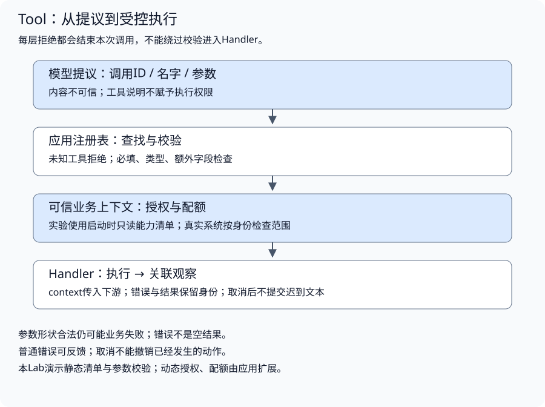
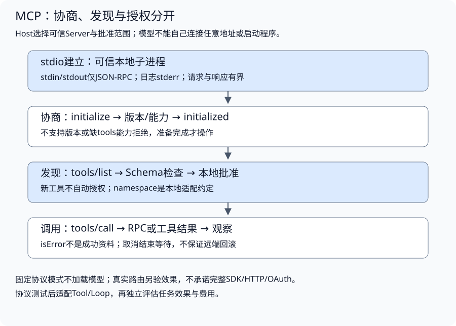
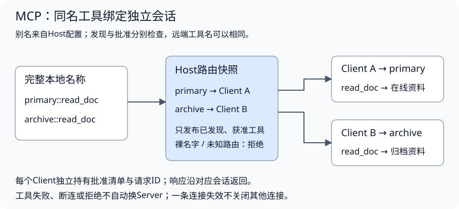
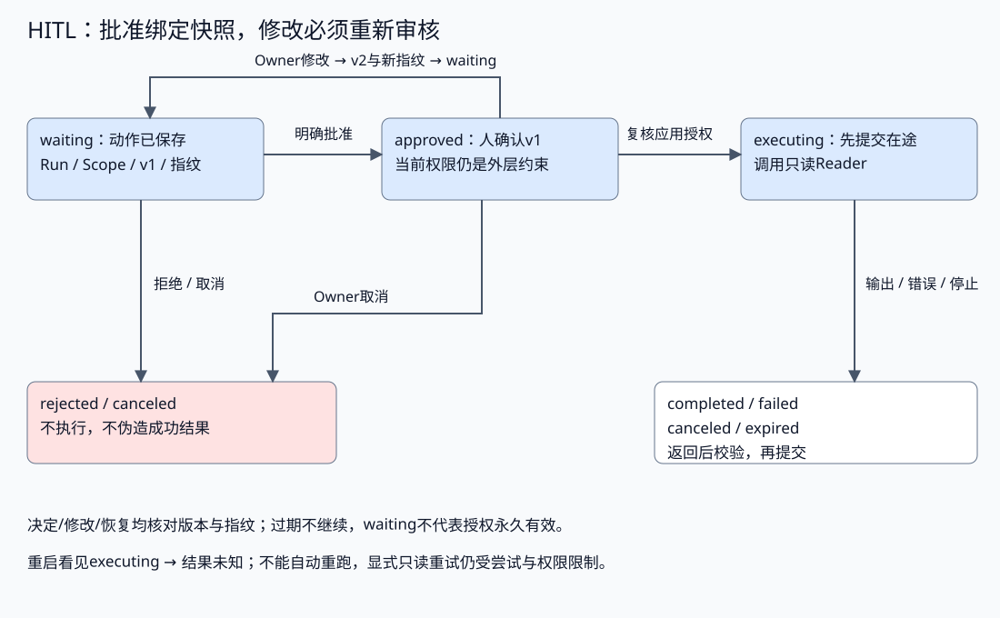

# 工具接入与受控行动

配套实验：[工具注册、参数校验与受控执行](../../../labs/part3-agent/chapter23/tool-calling/README.md)。

相关实验：[实验：stdio握手、发现与受控调用](../../../labs/part3-agent/chapter30/mcp-stdio/README.md)、[Human Approval：持久等待与动作绑定](../../../labs/part3-agent/chapter33/human-approval/README.md)。

模型提出一个工具名和一组参数，应用还要判断：工具是否存在、参数是否有效、当前任务是否获准，以及是否需要人确认。工具移到外部服务后，协议接入也要兑现同一条执行边界。

可以把模型提议类比为页面提交的action：它表达意图，真正的执行由服务端批准。本章沿工具注册、MCP适配、执行政策、人工确认与观察反馈展开；批准绑定具体动作，不能替代权限。

## 工具契约与本地执行入口

<a id="topic-agent-tool"></a>

<a id="工具定义如何描述一种能力"></a>

<a id="描述用于选择schema用于约束"></a>

**描述用于选择，Schema用于约束**

一个工具至少包含名字、描述、参数约定与执行函数。[配套实现](../../../labs/part3-agent/chapter23/tool-calling/main.go)使用这个定义：

```go
type Tool struct {
	Name        string
	Description string
	Parameters  Schema
	Handler     func(ctx context.Context, args map[string]any) (string, error)
}
```

名字用于稳定定位，描述帮助模型判断适用场景，Schema说明参数形状，Handler才执行实际工作。描述应写清输入含义、返回内容和限制。例如“查询文档”过于含糊；“按关键词查询当前租户已授权文档，返回最多5条带source ID的摘要”更容易形成正确提议。

**描述不授权，Schema也不授权。** 即使模型读到了某个工具说明，调用仍要经过应用的执行入口。租户、数据范围和配额不能依靠模型在参数中自报；真实工具需要从可信调用上下文取得这些信息。

<a id="参数形状与业务语义分层检查"></a>

**参数形状与业务语义分层检查**

实验支持字符串和数字两类标量，并拒绝未声明字段：

```go
type Schema struct {
	Properties map[string]ArgType
	Required   []string
}
```

这是用于讲解的Schema子集，不能处理任意JSON Schema。参数形状通过之后，业务约束仍可能失败：数字类型合法，不代表除数可以为零；字符串类型合法，不代表用户有权读取该文档。

校验顺序应该能缩小错误范围：

1. **字段存在**：必填字段是否出现；不存在与显式null分别处理。
2. **类型正确**：数字不能被字符串替代，对象不能被当作字符串。
3. **允许的值**：枚举、范围、长度与额外字段是否符合契约。
4. **业务与权限成立**：对象可访问、动作允许、资源预算足够。

本实验把枚举和除零校验留在calculator Handler，用来区分形状失败与业务失败；真实服务可将可表达的约束放入Schema，但业务授权必须继续由应用执行。

<a id="数字类型合法数值仍可能无效"></a>

**数字类型合法，数值仍可能无效**

Go的float64可以表示NaN与正负Infinity，[JSON数值规范](https://www.rfc-editor.org/rfc/rfc8259#section-6)则不包含这些值。Registry还接受直接构造的Go参数，因此不能只用类型断言证明参数有效。[参数类型检查](../../../labs/part3-agent/chapter23/tool-calling/main.go)对float64另查有限性：

```go
		switch number := value.(type) {
		case float64:
			return !math.IsNaN(number) && !math.IsInf(number, 0)
		case int:
			return true
		}
```

输入通过也不保证结果有效。两个有限数相乘可能溢出为Infinity；若转成字符串并返回nil错误，下一轮会把失败计算当成正常观察。计算器在结果格式化前统一检查：

```go
func formatFinite(value float64) (string, error) {
	if math.IsNaN(value) || math.IsInf(value, 0) {
		return "", ErrNonFiniteResult
	}
	return strconv.FormatFloat(value, 'g', -1, 64), nil
}
```

两处检查有不同含义：非有限参数是调用违约，Handler不执行；有限输入计算出非有限结果是业务结果失败，调用已经发生。失败要保留这个区别，不返回一个看似成功的NaN/Infinity文本。有限性也不保证精度，float64的舍入、int转换和精确表示仍需按业务契约判断。

### 注册表如何成为执行入口



<a id="注册在运行前完成"></a>

**注册在运行前完成**

注册表应来自应用批准的能力清单，不从模型输出动态创建函数。实验在启动时注册工具，运行阶段只查询；它不支持并发注册。注册时复制参数定义，避免外部调用方通过共享map修改已注册规则。

这里的清单只能决定“这个实验允许哪些工具”。加入用户、租户和角色之后，还需要基于可信身份筛选能力，或在Call中执行授权策略。不要把整个服务内部函数表都暴露给模型，再指望描述里的警告限制使用。

<a id="查找校验执行各有结果"></a>

**查找、校验、执行各有结果**

[Registry.Call](../../../labs/part3-agent/chapter23/tool-calling/main.go)固定执行顺序：

```go
func (r *Registry) Call(ctx context.Context, name string, args map[string]any) (string, error) {
	if err := ctx.Err(); err != nil {
		return "", err
	}
	if err := payloadFits(name, args); err != nil {
		return "", err
	}
	tool, ok := r.tools[name]
	if !ok {
		return "", fmt.Errorf("%w: %q", ErrUnknownTool, name)
	}
	if err := validateArgs(tool, args); err != nil {
		return "", err
	}
	if err := encodedArgsFit(args); err != nil {
		return "", err
	}
	result, err := tool.Handler(ctx, args)
	if stop := ctx.Err(); stop != nil {
		return "", stop
	}
	if err != nil {
		return "", err
	}
	if !resultFits(result) {
		return "", ErrToolResult
	}
	return result, nil
}
```

这段代码把未知名字和参数违约挡在Handler前面，并在执行前后检查取消。函数返回以后即使拿到文本，只要请求已经取消，就不提交这个迟到结果。它仍不能撤销已经发生的调用，也不能抢占忽略context的Handler。

<a id="参数有类型也要有体积和编码边界"></a>

**参数有类型，也要有体积和编码边界**

一个string可以是一段简短关键词，也可以是超长文本；类型相同，读取、编码与模型输入的代价不同。执行前先限制调用名、字段数量、键与字符串大小，再做Schema检查；通过以后还须检查完整参数JSON，因为控制字符转义会让编码结果比原字符串更长。

配套执行入口限制字符串4 KiB、最多32字段、序列化参数16 KiB，成功文本4 KiB且UTF-8合法。原字段累计检查先于JSON编码，避免为明显超限输入分配完整编码结果；这些是教学运行边界，不是通用最佳配额，也不是Token计数。

| 情况 | 执行事实 | 交付与后续判断 |
| --- | --- | --- |
| 参数超限或编码无效 | Handler未执行 | 返回ErrToolInputLimit，缩小或重新组织输入；不静默截断参数 |
| Handler失败并带残余文本 | 动作已调用 | 丢弃残余文本，保留原error供分类；不能只看文本非空 |
| 成功返回过大或坏编码文本 | 动作已调用 | 返回ErrToolResult；用分页、摘要或Workspace引用重新定义结果 |
| 成功返回有界文本 | 仅通过当前执行与交付契约 | 继续核对完整性、来源和业务目标，不继承答案正确性 |

返回后拒绝大结果不能撤销调用或此前的内存分配。HTTP读取、文件扫描和数据库查询也应在数据进入Handler时限制，不能靠最后一次len检查代替源头控制。截断若是业务允许的结果，须另提供完整性标记；这个字符串接口不把裁剪文本伪装成完整成功。

注册完成后，多个调用可以只读访问注册表；Handler自身是否可并发是另一个问题。它若访问共享缓存、计数器或连接状态，就必须定义所有权与同步，不能由map只读推导出整个工具线程安全。

## MCP协议与外部能力接入

<a id="topic-agent-mcp"></a>

### 本地Tool与外部协议怎样衔接

本地调用直接进入注册表，外部调用多了协议与进程或网络边界。原有Tool契约仍需保留：名字、参数、执行预算、错误结果和调用身份。



模型提出本地工具标识，Host查出对应Server与远端名字，Client发送调用，结果转换为观察回填。模型不能决定启动哪个可执行文件、连接任意地址或扩大权限。

配套实验启动当前课程程序自己的Server子进程，仅访问固定教学文档。基础模式使用固定决策，显式本地模型模式另行验证实际提议；没有通用进程启动器。两者复用相同Client与Loop，协议、模型行为和任务效果分层检查。

<a id="会话为何先协商再调用"></a>

### 初始化建立共同协议

实验锁定2025-11-25协议版本，stdio仅使用JSON-RPC逐行消息。连接开始时，Client发送版本、能力与实现信息，Server返回支持的版本和能力，然后Client通知初始化完成。

[Initialize](../../../labs/part3-agent/chapter30/mcp-stdio/main.go)核对版本和tools能力：

以下摘录函数内的关键分支，完整校验与资源清理见所链源码。

```go
	if json.Unmarshal(result, &init) != nil || init.ProtocolVersion != version {
		c.Close()
		return ErrProtocol
	}
	if _, ok := init.Capabilities["tools"]; !ok {
		c.Close()
		return ErrProtocol
	}
```

```go
	if err := c.notify(ctx, message{JSONRPC: "2.0", Method: "notifications/initialized"}); err != nil {
		c.Close()
		return err
	}
```

只有准备完成才进入发现和调用。版本不支持时终止，不能用“JSON结构差不多”继续。能力协商也不等于安全授权：Server声明支持Tools，仅说明协议功能可用。

当前实现锁定一个版本，Server声明Tools、Resources和Prompts三类基础能力，不声明订阅与列表变化通知。Client记录协商结果后，再检查具体操作需要的能力；完整SDK还有更多生命周期、通知和兼容策略。协议版本与Server程序版本不同，日志和配置分别记录。

<a id="消息方向与id一起校验"></a>

**消息方向与ID一起校验**

JSON能解析，仍可能不是当前等待的消息。初始化请求、初始化完成通知和请求结果有不同形状：

| 消息 | 主要字段 | 接收方怎样处理 |
| --- | --- | --- |
| Request | jsonrpc、ID、method与可选params | 执行对应方法并返回同ID的结果或错误 |
| Notification | jsonrpc、method与可选params，没有ID | 更新相应状态，不为通知发送响应 |
| Response | jsonrpc、原请求ID、result或error | 匹配等待请求，结果与错误互斥 |

[MCP基础协议](https://modelcontextprotocol.io/specification/2025-11-25/basic)允许字符串或整数请求ID，要求同一会话请求方不复用ID。本实验只生成递增整数，并只等待一个请求；这简化了关联，不代表完整SDK的全部消息与路由能力。

教学Client拒绝在Response里混入method或params，Server拒绝请求/通知混入result或error；否则一份载荷会同时表现为两个消息类别。Client还核对ID和result/error互斥，失败后关闭会话，不把错误载荷当作资料继续。扩展元信息应按所用协议与SDK明确处理，不能据此泛化为拒绝所有额外字段。

<a id="传输负责消息与关闭"></a>

**传输负责消息与关闭**

stdio由Host启动可信进程，stdin/stdout承担协议通信，日志写stderr。普通打印混入stdout，会破坏消息解析。连接关闭时结束输入，并等待或按明确策略停止子进程，不能让僵尸进程持续占用资源。

Streamable HTTP是另一种传输，具有请求头、会话与安全要求；不能把一个普通JSON HTTP接口直接宣称为完整MCP服务。本实验不实现HTTP、OAuth、SSE、服务端任务或远端Server。

### Schema怎样从发现结果进入应用

发现响应包含工具名称、描述与输入Schema。它们来自外部服务，仍需校验与本地适配。

实验使用一个明确的Schema子集：对象只包含必填字符串id，不接受额外参数。Server公布的定义是：

```go
func tool() Tool {
	no := false
	return Tool{Name: "read_doc", Description: "Read one fixed teaching document by id.", InputSchema: Schema{Type: "object", Properties: map[string]Property{"id": {Type: "string"}}, Required: []string{"id"}, Additional: &no}}
}
```

这个约定足以验证发现与参数边界，不是完整JSON Schema引擎。接入复杂工具时，应核对嵌套对象、枚举、组合规则和引用，不让未知Schema被悄悄当成“任何参数都可以”。

### Tools、Resources与Prompts怎样分工

同一份文档可以被工具查询，也可以作为资源读取，还可以被提示模板引用。区别在于应用怎样选择能力，以及结果进入哪段流程，不能仅凭“都返回文本”合并处理。

| 能力 | 典型选择方式 | 协议操作与交付 | Host需要保留的判断 |
| --- | --- | --- | --- |
| Tools | 模型根据任务提出动作 | tools/list公布Schema，tools/call返回执行结果 | 提议是否允许执行，结果怎样关联本次调用 |
| Resources | 应用决定本轮需要哪些资料 | resources/list提供URI，resources/read返回内容 | 用户能否读取，内容是否适合进入Context |
| Prompts | 用户选择命名模板，应用填写参数 | prompts/list提供模板参数，prompts/get返回消息 | 模板是否适用，消息怎样与应用指令和资料组合 |

这些是协议的交互设计视角，不强制某一种界面。应用也可以自动选择资源，但需要明确选择依据与预算；不能因Server公布了资源，就把它全部塞进模型输入。[Resources规范](https://modelcontextprotocol.io/specification/2025-11-25/server/resources)与[Prompts规范](https://modelcontextprotocol.io/specification/2025-11-25/server/prompts)分别定义两类内容的发现和获取方式。

### Resource URI标识内容，不授予读取权限

URI是Server范围内的资源标识。看到file://并不意味着Client应该直接打开本地文件；Host应按已批准的Server和读取政策获取内容。配套实现只接受固定course://docs/doc-A，Server查表返回教学资料，不根据URI访问磁盘或网络。

[资源读取边界](../../../labs/part3-agent/chapter30/mcp-stdio/context.go)先检查会话、能力、批准清单与发现记录，再发送请求。响应必须对应同一URI，且符合当前应用支持的内容类型和大小：

```go
	var result struct {
		Contents []ResourceText `json:"contents"`
	}
	if decodeContext(raw, &result) != nil || len(result.Contents) != 1 {
		return "", ErrProtocol
	}
	part := result.Contents[0]
	if part.URI != uri || part.MimeType != "text/plain" || part.Text == "" || len(part.Text) > 4096 {
		return "", ErrProtocol
	}
	return part.Text, nil
```

**读取成功与进入上下文是两个决定。** 协议支持文本和二进制资源，本实现只接收单条text/plain文本；不支持的blob或MIME应拒绝或交给专门适配器，不能强转字符串。Context仍需处理来源、时效、输入预算和任务相关性。

### Prompt返回消息，不替应用制定政策

命名模板将常用输入组织放在Server侧。用户选explain_doc，应用传入id，Server生成用于解释文档的消息。参数满足模板要求，只证明该请求可展开，不证明用户具有文档读取权限；真实服务还须在Server侧核对所用身份。

消息进入模型前，Host检查角色、内容类型与总量。[模板适配](../../../labs/part3-agent/chapter30/mcp-stdio/context.go)采用受控的文本子集：

```go
	bytes := 0
	for _, m := range result.Messages {
		bytes += len(m.Content.Text)
		if (m.Role != "user" && m.Role != "assistant") || m.Content.Type != "text" || m.Content.Text == "" || bytes > 4096 {
			return nil, ErrProtocol
		}
	}
	return result.Messages, nil
```

模板可能同时携带指令和资料，应用要保留它们的来源，不能把外部模板升级为可信system政策，也不能让模板中的“请调用某工具”扩大批准范围。多模态内容和嵌入资源需要额外适配；当前Catalog不接纳它们，只返回已检查消息，是否进入模型输入由Host决定。

<a id="host怎样把资料交给决策边界"></a>

**Host怎样把资料交给决策边界**

Host显式批准Resource与Prompt后，将只读资料和模板消息送入本轮输入。工具、资源和提示模板分别准入，并检查版本、角色、MIME、数量与体积；坏输入整批拒绝，不发布部分视图。外部模板仍按不可信内容处理。

实现与对照见[配套实验](../../../labs/part3-agent/chapter30/mcp-stdio/README.md#book-agent-mcp-host怎样把资料交给决策边界)。

<a id="三类能力分别准入再接入决策闭环"></a>

**三类能力分别准入，再接入决策闭环**

```text
Server能力声明 → 按类发现 → 本地批准与内容校验
                              ├─ Tool：模型提议 → 执行 → 关联观察
                              ├─ Resource：应用选择 → 读取 → Context选择
                              └─ Prompt：用户选择 → 参数展开 → 消息组装
```

三条路径共用会话，却有独立的批准清单。资源或模板获准使用，不改变tools清单；模板返回工具名也不等于该工具获准执行。生产Host还要将准入绑定用户、租户与策略版本，固定教学清单不能替代真实身份系统。

Resources或Prompts列表出现nextCursor时，必须继续分页才能声称发现完整。当前Catalog要求两类能力同时存在，遇到分页或不支持字段就拒绝，是受控子集的选择，不是所有MCP Client的兼容策略。支持更多内容时，应扩展类型与校验，保留按类授权和有界处理。

## 能力发现与执行政策

<a id="发现为什么不等于获准执行"></a>

<a id="host保留本地批准清单"></a>

**Host保留本地批准清单**

Server新增工具，不代表当前用户可以调用。Client构造时复制应用批准清单，发现之后只暴露已批准名称；未经批准的调用在发送前拒绝。

本实验用`docs::read_doc`作为本地别名：docs来自Host配置，read_doc来自Server。这个格式是课程的命名约定，不是MCP强制标准；mcp__server__tool也属于常见适配命名方式，不能作为协议定义。

命名空间减少重名，不能代替访问控制。多个Server、用户与角色还需独立的会话和范围策略，不能因名字不同就默认隔离。

<a id="同名工具按可信路由绑定会话"></a>

**同名工具按可信路由绑定会话**

在线资料库和归档资料库都公布read_doc。若将两份发现结果直接合并为name→Handler，后加入的一份可能覆盖前一份；即使参数相同，两个Server的资料范围和时效也可能不同。不能在调用时寻找“任意一个能读的Server”。

Host为已批准配置分配别名，形成primary::read_doc和archive::read_doc。**本地完整名称绑定具体Client，远端请求仍使用read_doc。** 别名由应用配置产生，不信任Server自报的实现名称作为授权身份；Schema相同也不意味着资料或权限相同。

构建路由时按以下顺序检查：

1. **核对连接**：各Client先完成初始化与发现，分别持有自己的请求ID、能力和批准清单。
2. **拒绝别名冲突**：同一Host中的两个连接不能使用相同别名，避免配置覆盖已存在路由。
3. **发布获准能力**：只把各Client已发现且获批的工具绑定到完整本地名称；批准primary不批准archive。
4. **按名称精确调用**：没有匹配就拒绝；命中以后仍由对应Client验证参数、权限与结果。

[Host路由快照](../../../labs/part3-agent/chapter30/mcp-stdio/router.go)保留这个精确关系：

```go
func (r *ToolRouter) Call(ctx context.Context, name string, args map[string]any) (string, error) {
	c, ok := r.routes[name]
	if !ok {
		return "", ErrDenied
	}
	return c.Call(ctx, name, args)
}
```



工具失败、断连或权限拒绝时，不自动转向另一条同名路由。失败可能表示资料不存在，也可能表示原目标不可达；换Server改变了资料来源与授权范围。确需降级时，应单独定义允许的目标、来源标签、预算和任务验收，再由可信应用执行，而不是靠名称碰撞触发。

路由快照与连接生命周期分别管理。路由器不拥有子进程；Host关闭对应连接并等待进程退出。一个连接失效，不应关闭无关连接，也不能把旧路由重新绑定到新会话而沿用旧协商状态。重连后重新初始化、发现、审核并构建快照；原快照不能自动感知新增能力。

当前实现最多接入四个Client，仅由单个调用方串行使用；实验真实启动两个本课程Server，验证结果来源、独立批准、请求关联与断连边界。它不提供多租户身份服务、远程认证或共享Client的并发复用。资源URI和提示模板名称也要绑定Server范围，不能仅因两个Server返回同一字符串就合并为一条全局能力。

这里先固定“同名能力怎样绑定到具体会话”。接下来再看同一条调用在会话内还要过哪两层检查：本地参数与批准状态，以及Server自己的最终业务校验。

<a id="本地参数检查与server校验同时存在"></a>

**本地参数检查与Server校验同时存在**

Client在发送前检查参数形状与批准状态，Server再次检查工具名和参数。Client检查减少无效请求，Server负责自己的最终业务边界；绕过一个Client不应使Server接受非法调用。

[Call](../../../labs/part3-agent/chapter30/mcp-stdio/main.go)把本地标识转换为远端请求，再检查内容类型与工具结果：

```go
func (c *Client) Call(ctx context.Context, name string, args map[string]any) (string, error) {
	local := strings.TrimPrefix(name, c.alias+"::")
	if !c.ready || name == local || !c.approved[local] {
		return "", ErrDenied
	}
	if _, ok := c.tools[local]; !ok {
		return "", ErrDenied
	}
	if !arguments(args) {
		return "", ErrProtocol
	}
	data, err := c.exchange(ctx, "tools/call", map[string]any{"name": local, "arguments": args})
	if err != nil {
		return "", err
	}
	var result ToolResult
	if json.Unmarshal(data, &result) != nil || len(result.Content) == 0 || len(result.Content) > 16 {
		return "", ErrProtocol
	}
	text := ""
	for _, part := range result.Content {
		if part.Type != "text" || len(text)+len(part.Text) > 4096 {
			return "", ErrProtocol
		}
		text += part.Text
	}
	if result.IsError {
		return "", ErrTool
	}
	return text, nil
}
```

工具描述、只读提示或其他annotations可以帮助判断，但不能作为权限事实。应用必须知道该Server实际提供什么、允许哪些动作、使用哪种身份与数据范围。

<a id="topic-agent-hitl"></a>

### 哪些判断交给人，哪些必须由应用执行

授权、参数校验和预算拒绝仍由应用强制。HITL适合需要人判断的目标、代价或风险：确认资料范围、修改计划、审核输出，或在已经允许的能力内决定是否继续。不能把安全执行器没有解决的问题全部转成弹窗。

本章选择只读资料查询演示暂停与恢复，避免引入删除、发送或交易。它不意味着每一次读取都该审批；触发策略应按任务和参数定义，过多确认会让用户机械点击，并不能提高安全性。

| 人的决定 | 控制含义 | 不能混淆什么 |
| --- | --- | --- |
| 批准 | 对当前具体快照同意继续 | 不新增工具或权限，不批准后来改过的参数 |
| 拒绝 | 本次动作不执行，记录拒绝 | 不伪造一个成功工具结果 |
| 修改 | 改变动作或参数，形成新快照 | 是否同时确认必须明确定义；本章重新审核 |
| 回答问题 | 人提供信息给后续决策 | 信息来源是人，不等于真实工具已经执行 |
| 取消 | 结束等待或停止可取消过程 | 不撤回已发生的动作，不能强行抢占阻塞函数 |

例如人的“使用季度数据”可以作为带来源的信息进入Context，但不能把“不要查询A”变成“查询A成功”的观察。框架可能提供approve/edit/reject/respond等名字，adapter需要按具体版本解释行为，不把不同决定统一成一条成功消息。

## 人工介入与动作确认

### 一份审批要说明什么

审批界面展示实际动作，不只展示模型生成的“我将安全处理资料”。至少要包含：操作和目标、关键参数、所属任务、请求人和审核人、权限范围、版本、期限，以及用户作判断需要的预期代价与影响。

<a id="确认目标批准动作与审核答案分别绑定"></a>

**确认目标、批准动作与审核答案分别绑定**

用户说“只看季度数据”，是在确定任务范围；同意读取某份季度材料，是批准一个具体动作；看完报告后确认可以采用，是审核产物。三次决定的对象不同，不能用一个approved字段串起整个流程。

| 决定对象 | 展示与绑定的内容 | 改变后怎样处理 |
| --- | --- | --- |
| 任务目标或计划 | 范围、交付要求、关键约束及目标版本 | 重新检查旧子任务、证据和计划是否仍适用 |
| 待执行动作 | 工具、目标、参数、权限与动作指纹 | 参数或权限变化时重新审核，不能沿用旧批准 |
| 待交付产物 | 具体内容、引用、缺项与产物版本 | 重新生成或修改后形成新产物，原确认不能覆盖新内容 |

本章Record绑定的是第二类决定。它不实现计划审批或报告发布流程；completed只说明这次已批准的只读动作完成了本地提交，不表示用户看过最终答案。父任务收取结果后仍需按目标与证据验收。

人的修改也不能自动修复所有交接。例如把资料A改成B后，先前依据A生成的摘要应重新检查；把用户范围从全年改为季度后，已经完成的全年子任务不能直接交付。哪些结果可以重用，由计划、Context与任务结果准入检查；审批组件只保存自己绑定的决定。

审批页面还要让人能够选择拒绝或修改，并看见尚未确定的信息。只有同意按钮、目标藏在折叠诊断里，或模型摘要与实际参数不同，都会削弱审核作用。当前CLI打印动作与指纹只是机制入口；真正的审核界面与真人理解仍需单独验证，不能用指纹正确证明用户理解了动作。

配套[Record](../../../labs/part3-agent/chapter33/human-approval/main.go)保存一个Run的一份动作审批：

```go
type Record struct {
	Schema             int
	Run                string
	Owner, Reviewer    Scope
	Revision           uint64
	PolicyVersion      string
	Action             Action
	ExpiresAt          time.Time
	Fingerprint, State string
	DecisionBy         Scope
	Attempts           int
	Output, Failure    string
	History            []Event
}
```

Action只接受应用注册的read_document与资料ID；Owner和Reviewer来自可信Policy，而不是模型填的role。一个私有目录对应一个Run，记录与调用方身份一起定位；生产多任务接口还需要稳定审批ID和资源所有权，不能只靠工具名找到“最近一次同意”。

模型提议可以成为待审Action，不能提供审核者的身份或调用Decide。本实验CLI按明确操作选择演示角色，测试用Scope检查角色边界；真实系统需要Serving中的可信身份和独立审批入口，不能把公开演示身份当作生产认证。

参数显示也有数据边界：界面需要足够信息审核，但不应暴露凭据、内部诊断或无关资料；模型文本用安全呈现方式，按钮状态依据应用记录。审核者权限与任务所有者权限可能不同，需要明确能看见哪些内容。

前面先把“人到底在看什么、批什么”说清楚。接下来才把这份判断真正绑到当前快照上：版本和指纹为什么缺一不可，旧确认又为什么不能自动复用到新动作。

### 指纹与版本把同意绑定到快照

如果页面只提交approve=true，后台无法知道用户看的是哪份内容。每次决定带上请求版本与动作指纹，服务端和当前记录比对；新参数不能悄悄复用旧确认。

[fingerprint](../../../labs/part3-agent/chapter33/human-approval/main.go)绑定Run、身份、参数、策略版本与期限：

```go
func fingerprint(r Record) string {
	// Only immutable approval scope belongs in the fingerprint, not mutable execution status/output.
	snapshot := struct {
		Run             string
		Owner, Reviewer Scope
		Revision        uint64
		PolicyVersion   string
		Action          Action
		ExpiresAt       time.Time
	}{r.Run, r.Owner, r.Reviewer, r.Revision, r.PolicyVersion, r.Action, r.ExpiresAt}
	data, _ := json.Marshal(snapshot)
	sum := sha256.Sum256(data)
	return hex.EncodeToString(sum[:])
}
```

执行状态和Output不在指纹里，因为它们会在同一个已审动作后变化。修改动作或策略版本则递增Revision，清除原决定，生成新指纹回到waiting；原期限和已消耗的执行尝试不重置。

SHA256在这里校验快照一致性，不是人的签名，也不是凭据。如果攻击者已有状态目录写权限，可以重算摘要并改文件；真实权限、可信存储和防篡改审计仍需另行保护。可变资料、工具Schema或计划上下文也可能影响判断，必要时将它们的版本纳入审批范围，不能认为一个ID覆盖所有变化。



多人或多动作审批更需要稳定身份：决定应绑定审批ID和版本，而不只按列表位置配对。批量中某一项拒绝时，要说明其他项是否继续；本章单动作实验不宣称实现批量审批事务。

### 等待存储状态，不占着一个goroutine

等待审批是持久状态：保存动作快照、状态版本、有效期和决定，释放当前执行资源。恢复由可信入口重新领取并验证；goroutine阻塞、聊天中的“同意”或HTTP连接存活都不能替代持久等待。运行恢复机制见运行时篇。

实现与对照见[配套实验](../../../labs/part3-agent/chapter33/human-approval/README.md#book-agent-hitl-等待存储状态不占着一个goroutine)。

### 明确决定，再确认是否仍能继续

[Decide](../../../labs/part3-agent/chapter33/human-approval/main.go)将人、版本和动作绑定：

```go
func (s *Store) Decide(actor Scope, revision uint64, hash string, approve bool) (Record, error) {
	return s.change(func() (Record, error) {
		r, err := s.load()
		if err != nil {
			return r, err
		}
		if actor != s.policy.Reviewer || actor != r.Reviewer {
			return r, ErrDenied
		}
		if err = s.check(r, revision, hash); err != nil {
			return r, err
		}
		target := "rejected"
		if approve {
			target = "approved"
			if !s.authorized(r) {
				return r, ErrDenied
			}
		}
		if r.State == target && r.DecisionBy == actor {
			return r, nil
		}
		if r.State != "waiting" {
			return r, ErrConflict
		}
		r.State = target
		r.DecisionBy = actor
		return s.commit(r)
	})
}
```

整个决定流程按以下顺序推进：

1. **取得可信审核身份**：请求来自明确的调用方，不能取模型自报身份。
2. **读当前审批**：核对Run、Owner、Reviewer与快照结构。
3. **比较版本、指纹和期限**：旧页面、错误指纹或迟到确认拒绝。
4. **检查允许的决定与当前权限**：同意不能越过注册范围；拒绝不执行工具。
5. **保存结果并返回确认**：相同决定可以幂等重报，修改产生新版本等待重审。

批准与修改同时发生时，本机writer claim只允许一个变更提交；另一方得到busy或冲突，应重新查询，不能自动批准新快照。自动重试人类决定也要保持原版本与指纹，否则重试会改变用户当时的意思。

本实验批准/拒绝由Reviewer提交，修改/取消由Owner提交。审核者提出修改要求后，由发起方形成新动作，再审核新版本；不能把“请求修改”直接当作批准。

生产产品可以把修改和确认合成一个操作，但需要明确展示并绑定编辑后的完整动作。这里选择“修改→重新等待→再次批准”，便于验证旧确认失效。

### 恢复前重新授权，返回后再决定释放结果

批准时允许的操作，到恢复时可能已经失去权限或过期。Resume再次核对Snapshot与Policy，而不是只查曾经有一条approve消息。

在配套[Resume](../../../labs/part3-agent/chapter33/human-approval/main.go)中，执行前的关键分支是：

```go
		if err = s.check(r, revision, hash); err != nil {
			return r, err
		}
		if !s.authorized(r) {
			return r, ErrDenied
		}
		if r.State == "completed" {
			return r, nil
		}
		if r.State == "executing" {
			return r, ErrUnknown
		}
		if r.State != "approved" || r.Attempts >= 2 || len(r.History) > 30 {
			return r, ErrConflict
		}
		if err = ctx.Err(); err != nil {
			return r, err
		}
		r.State = "executing"
		r.Attempts++
		if err = s.save(&r); err != nil {
			return r, err
		}
```

先保存executing并增加Attempts，才调用Reader。执行期间保持本机写者归属，避免同一动作被两个恢复者同时领取；等待人时则释放归属。任意忽略context的函数仍可能阻塞，文件锁不提供强行停止能力。

结果回来后继续检查取消、当前权限与期限；条件变化时不释放迟到文本，普通错误和非法输出记稳定失败，只有合法结果才提交completed。批准不替代Safety、RAG或Eval：授权的读取仍可能得到错误、无关或不支持答案的资料。

<a id="执行超时与审批到期分别记录"></a>

**执行超时与审批到期分别记录**

审批期限决定同意何时有效，执行期限约束实际动作。批准不能为任务重置总时限或预算；动作执行后超时应保留结果未知，不能把批准当成安全重做的依据。

实现与对照见[配套实验](../../../labs/part3-agent/chapter33/human-approval/README.md#book-agent-hitl-执行超时与审批到期分别记录)。

### 执行后崩溃，批准不能证明结果已提交

进程可能在Reader完成以后、completed保存以前退出，重启看到的仍是executing。已经批准只说明允许执行，不说明动作没发生，也不说明结果已保存。

默认恢复对这个状态返回结果未知；遗留writer.lock同样不能根据“很久了”就删除。先确认原执行者终止，再处理所有权和动作语义。

本实验只有可信只读read_document，因此允许Reviewer通过显式retry-readonly选择重读，仍检查权限、期限与剩余尝试；计数持久化，重启不清零。只读重读也可能产生额外费用，并非免费或exactly-once。业务写操作需要幂等和结果查询，不能复制这个策略。

审批与恢复有三份证据：人的决定、执行者领取、结果提交。审计保留Actor、版本、指纹、状态与时间，能够检查它们的关系。本机History有界，达到上限拒绝新变更，执行前为开始和结果事件留位置；它不是防篡改日志或完整生产审计平台。

## 执行结果与观察反馈

<a id="工具结果如何成为下一轮观察"></a>

<a id="结果需要身份与完整性信息"></a>

**结果需要身份与完整性信息**

Loop把工具提议保存为assistant消息，再执行调用，并用ToolCallID回填观察。名字相同的两次调用也必须有不同的关联ID，否则下一轮难以分辨哪条结果属于哪个参数。

一个可追踪的调用过程包含：

1. **接收提议**：保留调用ID、名字与参数。
2. **应用判定**：查找、校验、授权和检查配额。
3. **执行动作**：把context传给下游，并记录实际消耗。
4. **生成观察**：结果或稳定失败信息与原调用ID绑定。
5. **继续决策**：Loop提供观察，模型选择下一步。

实验中的Call返回字符串与error，足以观察执行边界。接入资料检索、分页或大块数据时，结果还应表达截断、部分成功、来源与游标，不能让“没有报错”掩盖不完整结果。限制输出大小时，也要说明返回的是完整结果、摘要还是产物引用。

<a id="失败不是空结果"></a>

**失败不是空结果**

| 失败层 | 发生了什么 | Handler是否执行 | 可能的下一步 |
| --- | --- | --- | --- |
| 未知工具 | 请求不在能力清单内 | 否 | 修正选择或报告不支持，不能自动注册 |
| 参数违约 | 请求形状不符合契约 | 否 | 有限修复参数 |
| 业务拒绝 | 形状合法，业务条件不成立 | 是或在业务授权处拒绝 | 改方案或报告拒绝，不扩大权限 |
| 下游暂时故障 | 请求可能已发出，结果失败或未知 | 可能 | 核对重试安全性与预算 |
| 取消或超时 | 调用方停止等待 | 可能 | 终止运行，处理已发生动作的状态 |

普通失败可以转成观察，让模型得到新信息；取消与超时一般直接传给Runtime终止。错误反馈应包含模型能修正的信息，例如字段路径和允许枚举，不能把数据库地址、堆栈或凭据原样放入上下文。

模型看到错误后仍可能输出“已经完成”。应用需要检查任务证据或评估结果；不能因为最终文本语气肯定，就把失败的工具调用改成成功。

前面处理的是“一次调用怎样被安全执行并回填成观察”。接下来再看多个调用同时出现时，哪些能并行，哪些仍必须等前一步结果出来才能继续。

### 并行调用前先明确依赖

模型一次提出多个工具，不代表可以全部并行。两次独立资料查询可以并行；后一项参数依赖前一项结果，就需要等待观察后再决策。

并行执行之前至少确定：并发上限、每个调用的ID、结果顺序、部分失败规则和取消传播。结果可以按提议顺序回填，也可以按完成顺序回填，但不能丢失ID。预算应在执行前预留，而非等所有goroutine启动后再统计是否超限。

配套注册表保持串行演示，帮助隔离校验问题；受限并发与队列调度将在Runtime和多Agent调度主题中继续展开。不能只把for循环改成goroutine就声称支持并行工具。

### 工具输出Schema与模型可见内容分开

发现返回的outputSchema描述结构，不授权结果进入模型。Host先检查structuredContent、文本表示、调用ID与可信资料版本，再投影允许字段。Schema子集、协议校验和模型输入效果分别验证；任一表示冲突时拒绝，不能用一份合法文本掩盖另一份坏结构。

实现与对照见[配套实验](../../../labs/part3-agent/chapter30/mcp-stdio/README.md#book-agent-mcp-工具输出schema与模型可见内容分开)。

### RPC失败与工具失败如何区别

| 情况 | 所在层 | 应用判断 |
| --- | --- | --- |
| 版本或消息格式不兼容 | 会话/协议 | 终止或按明确兼容规则处理 |
| 无效方法、名字或参数 | JSON-RPC请求 | 修复协议或提议，不当作正常业务结果 |
| 合法调用返回isError | 工具执行 | 转成失败观察，不能把错误文本当答案 |
| 响应ID不匹配、内容类型不支持 | Client适配 | 拒绝结果，不拼接未知内容 |
| EOF、超时或取消 | 传输/生命周期 | 停止等待，外部动作状态可能未知 |

本实验Server用RPC错误表达非法工具请求，固定文档不存在则返回工具isError。Client保留RPC代码，但公开错误不直接拼接Server原始消息，避免传播内部信息。

正确收到响应只证明协议交互成立。工具文本可能错误、过期、包含注入或与问题无关；RAG和Eval继续检查证据与任务效果。

前面区分的是会话错误、RPC错误和工具业务失败。再往下收一层，才是这些判断在 I/O 生命周期里怎样真正停住：写端会不会阻塞、取消后会不会还在等旧会话返回。

### 超时应覆盖写入和读取

只给读响应设置截止时间，写请求也可能阻塞。stdio管道或下游进程不读取时，发送端会等待；请求发出后，Server也可能不返回。

实验将写入和读取放入同一等待边界，取消时关闭会话并等待本次I/O退出。它只支持一个未完成请求，不支持共享Client并发调用。退出的是客户端等待，不保证Server动作被回滚或已经停止。

完整实现可采用对应取消通知和请求关联，仍要有最大等待预算。重连以后重新协商与发现；不能复用旧会话的ready状态，也不能因为断线就无限重试工具。

## 接入决策循环

### 如何分层接入Agent

1. **直接协议测试**：无模型完成初始化、发现、合法/非法调用和断连。
2. **注册表适配**：将批准工具绑定本地标识、Schema、执行器与结果契约。
3. **Loop集成**：模型提议本地工具名，结果按Call ID回填，错误与取消保留语义。
4. **任务评估**：确认能力选择、结果使用与费用，测试外部响应不能扩大权限。

<a id="将外部结果回填到同一决策循环"></a>

**将外部结果回填到同一决策循环**

配套[RunLoop](../../../labs/part3-agent/chapter30/mcp-stdio/agent.go)现在将已初始化、发现并批准的Client接入有界循环。模型回调只看到值快照，不能改Client的批准清单或进程配置；提议中的Call ID与tool观察始终配对。

```go
		text, callErr := execute(ctx, call)
		if stop := ctx.Err(); stop != nil {
			return r, stop
		}
		observation := LoopMessage{Role: "tool", CallID: call.ID, Tool: call.Tool}
		switch {
		case callErr == nil:
			observation.Content = text
		case errors.Is(callErr, ErrTool):
			observation.Failed = true
			observation.Content = "tool_failed"
		case errors.Is(callErr, ErrDenied):
			observation.Failed = true
			observation.Content = "not_authorized"
		default:
			return r, callErr // Protocol, transport and cancellation are not normal evidence.
		}
```

这里必须分清两类失败：工具isError或本地拒绝形成带Failed标记的观察，供下一轮判断；协议、传输与取消直接结束运行，不能把损坏的响应当作正常资料。下一轮看到的错误码是稳定类别，不包含Server原始错误文本。

工具失败后的下一步取决于观察和剩余预算。文档不存在时，模型可以提出另一个获准ID；下一轮历史须同时保留旧失败与新提议，并用不同Call ID关联各自结果。若响应同时包含最终文本和工具提议，应用必须按既定响应契约拒绝歧义，不能一边交付答案一边继续执行。

本地拒绝不发送RPC；即使模型随后给出非空Final，ToolFailures与Failed观察仍保留，不能由Final覆盖。这证明协议到Loop的执行关联，不证明真实模型会选择正确能力或开放任务已经完成，后者仍用Eval判断。

<a id="多个server如何共享一次运行"></a>

**多个Server如何共享一次运行**

同一Loop可以按本地完整工具名路由到多个已批准会话。工具名绑定具体Client，断连与工具失败保留原目标，不回退到同名的其他Server；全局轮次和工具预算不按Server重置。

实现与对照见[配套实验](../../../labs/part3-agent/chapter30/mcp-stdio/README.md#book-agent-mcp-多个server如何共享一次运行)。

<a id="json被接收后还要检查动作关联"></a>

**JSON被接收后，还要检查动作关联**

[本地模型对照](../../../labs/part3-agent/chapter30/mcp-stdio/README.md#真实本地模型提出路由动作)已让实际模型选择工具名，再由Host调用两个受控Server。首轮模型选择archive并取得真实观察；第二轮复制同一个调用ID，再次提议相同读取。JSON字段合法，Loop仍因重复ID拒绝，尚未比较两个来源。

这说明解析、动作关联与任务判断需要分层。不能只看“模型输出合法JSON”，也不能为了让演示继续就静默覆盖ID或将响应配给另一次提议。若调用标识由Provider或应用adapter生成，应明确标识所有权与映射，并保持原始生成记录；新ID本身也不能解决重复查询或遗漏来源。

模型输入只包含批准名字与已观察历史，期望值留在评估侧。真实生成的失败与用量在Lab中保留，协议测试、固定回调和实际模型各自能证明的范围分别记录。

<a id="关联标识由谁生成"></a>

**关联标识由谁生成**

模型工具ID与应用执行ID分开保存。应用可以为受控适配生成本地ID，但必须保留原始提议和映射；ID修复不证明模型选对了来源，重复读取仍受原预算限制。

实现与对照见[配套实验](../../../labs/part3-agent/chapter30/mcp-stdio/README.md#book-agent-mcp-关联标识由谁生成)。

<a id="最佳实践"></a>
<a id="工具保持职责明确"></a>
<a id="明确参数类型不悄悄容错"></a>
<a id="修复与重试分别管理"></a>

[实验排查与实践建议：最佳实践](../../../labs/part3-agent/chapter23/tool-calling/README.md#book-agent-tool-最佳实践)。

<a id="常见问题排查"></a>
<a id="handler因类型断言panic"></a>
<a id="注册成功调用时规则却变化"></a>
<a id="同名工具结果交错"></a>

[实验排查与实践建议：常见问题排查](../../../labs/part3-agent/chapter23/tool-calling/README.md#book-agent-tool-常见问题排查)。

<a id="server身份与连接由部署配置决定"></a>
<a id="能力变化重新检查政策"></a>
<a id="先看协议再调模型"></a>

[实验排查与实践建议：最佳实践](../../../labs/part3-agent/chapter30/mcp-stdio/README.md#book-agent-mcp-最佳实践)。

<a id="初始化成功却不能调用工具"></a>
<a id="同名工具读取了另一份资料"></a>
<a id="日志输出导致解析失败"></a>
<a id="工具错误被模型当作资料"></a>
<a id="资源已发现模型仍没有看到资料"></a>

[实验排查与实践建议：常见问题排查](../../../labs/part3-agent/chapter30/mcp-stdio/README.md#book-agent-mcp-常见问题排查)。

[实验排查与实践建议：最佳实践](../../../labs/part3-agent/chapter33/human-approval/README.md#book-agent-hitl-最佳实践)。

[实验排查与实践建议：常见问题排查](../../../labs/part3-agent/chapter33/human-approval/README.md#book-agent-hitl-常见问题排查)。

## 小结

1. 工具描述帮助选择，应用注册表、参数检查与身份授权决定是否执行。
2. MCP负责外部能力互操作，发现、批准和模型可见输入分别管理。
3. 人工确认绑定动作快照、版本与期限，恢复前重新授权，批准不扩大权限。
4. 执行结果保留关联、错误与完整性信息，成为下一轮观察；并发与重试受原预算约束。

## 参考文档

- [JSON Schema对象约束](https://json-schema.org/understanding-json-schema/reference/object)：Properties、Required与额外字段的含义。
- [RFC 8259数值](https://www.rfc-editor.org/rfc/rfc8259#section-6)：JSON数值、范围与精度的互操作边界。
- [Function Calling](https://developers.openai.com/api/docs/guides/function-calling)：工具提议、应用执行和结果回填的协议关系。
- [context](https://pkg.go.dev/context)：取消与截止时间的协作语义。
- [encoding/json](https://pkg.go.dev/encoding/json)：JSON数字与Go类型的转换规则。
- [MCP生命周期](https://modelcontextprotocol.io/specification/2025-11-25/basic/lifecycle)：锁定版本的初始化与能力协商。
- [MCP Tools](https://modelcontextprotocol.io/specification/2025-11-25/server/tools)：发现、Schema与调用结果。
- [MCP Resources](https://modelcontextprotocol.io/specification/2025-11-25/server/resources)：URI、读取结果、分页与可选通知。
- [MCP Prompts](https://modelcontextprotocol.io/specification/2025-11-25/server/prompts)：命名模板、参数与消息内容。
- [MCP传输](https://modelcontextprotocol.io/specification/2025-11-25/basic/transports)：stdio与Streamable HTTP的区别。
- [Go io](https://pkg.go.dev/io)：管道、关闭与I/O边界。
- [Deep Agents HITL](https://github.com/datawhalechina/deepagents-in-action/blob/main/content/ch09-human-in-the-loop.md)：工具审批、修改、拒绝与恢复；具体API版本以其说明为准。
- [LangGraph interrupts](https://docs.langchain.com/oss/python/langgraph/interrupts)：框架暂停、持久状态与重新进入执行节点的语义。
- [Go os.Root](https://pkg.go.dev/os#Root)：本机根目录约束的文件操作。
- [Go context](https://pkg.go.dev/context)：执行取消与期限，不能抢占任意阻塞函数。

[返回全书目录](../../README.md) · [上一篇：Agent 架构与模型接口](chapter22-architecture.md) · [下一篇：Agent 决策循环与 ReAct](chapter24-decision-loop.md)
