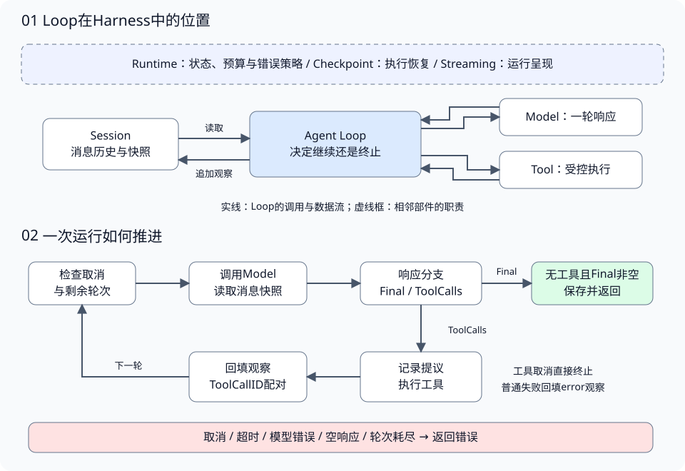
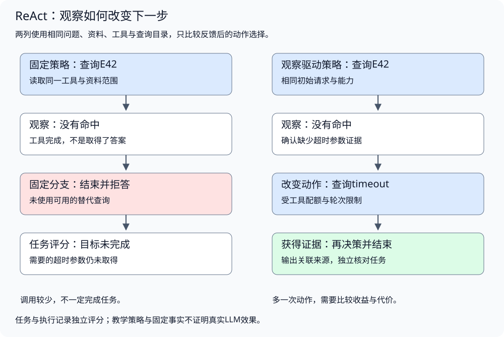
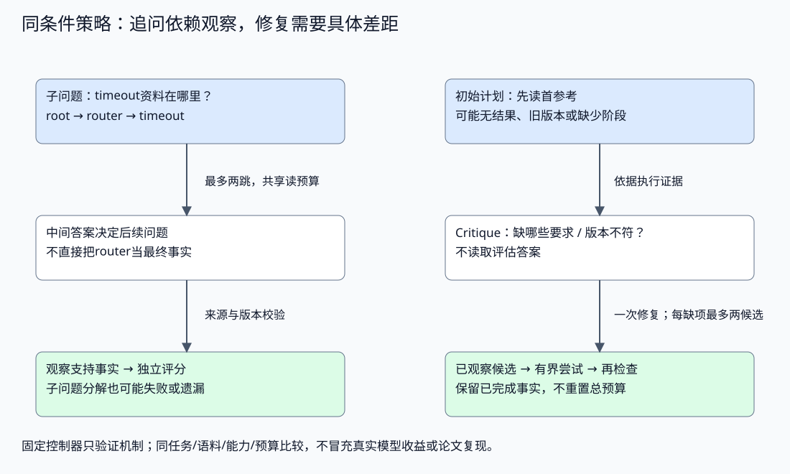

# Agent 决策循环与 ReAct

配套实验：[决策循环与观察反馈](../../../labs/part3-agent/chapter23/minimal-agent-loop/README.md)。

相关实验：[实验：固定路径与观察驱动决策](../../../labs/part3-agent/chapter24/react/README.md)、[策略对照：子问题、计划与有界证据修复](../../../labs/part3-agent/chapter24/strategy-comparison/README.md)。

第一次查询只返回目录，答案藏在目录指向的下一份资料里。固定的一次调用无法完成任务，应用需要把观察交回模型，再决定读取、换查询或结束。

Agent Loop管理循环与状态，ReAct利用动作和观察推进决策。二者沿同一条链路讲解：谁决定下一步、谁执行、哪些事实进入下一轮，以及何时必须停止。

## 从单次响应到持续决策

<a id="topic-ch23-tool-calling"></a>

<a id="agent-loop在harness中负责什么"></a>

<a id="固定工作流与动态决策"></a>

**固定工作流与动态决策**

固定工作流把执行路径写在程序里，例如“检索→重排→生成回答”。每个阶段可以调用模型，但阶段之间的转移由程序规定。它适合步骤已知、输出契约清楚的任务。

Agent Loop允许模型根据当前信息选择下一步：调用工具、继续收集信息，或者给出回答。应用仍然规定工具权限、预算和终止规则。**下一步由模型提议，执行与停止由应用控制。**

| 设计问题 | 固定工作流 | Agent Loop |
| --- | --- | --- |
| 下一步从哪里来 | 程序规定的阶段和条件分支 | 模型结合当前信息提出动作 |
| 执行路径 | 已定义的路径，包含必要分支 | 任务运行时逐轮形成 |
| 调试重点 | 哪个阶段或分支出了错 | 某轮依据什么信息选择了什么动作 |
| 适用条件 | 步骤稳定、验收标准明确 | 下一步依赖运行中获得的信息 |

二者可以组合：一个工具内部执行固定工作流，外层Loop决定什么时候调用它；工作流也可以在某个阶段运行有界Loop。不要为了使用Agent，把本来稳定的服务流程全部交给模型决定。

<a id="模型工具与运行时的分工"></a>

**模型、工具与运行时的分工**



Loop连接Model、Tool与Session：读取当前输入，获取一轮响应，执行提议，保存观察，再决定是否进入下一轮。图中的外围部件提供更完整的工程支撑：

- **Model适配层**：转换Provider协议，提供可替换的模型接口。
- **Tool执行层**：检查名称、参数和权限，执行允许的动作并返回结果。
- **Session与Context**：前者保存会话消息，后者选择这一轮真正交给模型的内容。
- **Runtime**：管理运行状态、预算、错误策略和资源生命周期。
- **Checkpoint与Streaming**：分别负责恢复执行进度、呈现运行事件。

Loop本身不决定检索算法、长期记忆存储或工具的业务实现。它需要的是稳定的输入输出契约。这样更换模型、扩展工具或接入框架时，仍能保留同一套推进规则。

ReAct强调推理与行动交替，外部结果帮助更新后续判断。Loop提供行动与观察的执行结构，但完整ReAct、Planning或Reflection还需要各自的策略。这里讨论的“决策”是可观察的工具提议与最终文本，无需读取或保存模型内部思维链。

<a id="每轮决策需要哪些状态"></a>

<a id="会话运行与轮次"></a>

**会话、运行与轮次**

用户的一次请求通常启动一次Run，一个Run可以调用模型多轮。Session则可以跨Run保留对话历史。把它们混在一起，预算计数和恢复逻辑都会变得含糊。

| 概念 | 保存什么 | 何时结束 |
| --- | --- | --- |
| Session | 用户、模型与工具消息 | 按会话生命周期保留或清理 |
| Run | 本次任务的状态、预算与结果 | 完成、失败、取消或超限 |
| 模型轮次 | 一次模型请求与响应 | 模型返回响应或调用出错 |
| Tool Call | 模型提出的一次具体动作 | 执行成功、失败或被拒绝 |

**一轮模型响应可以提出多个工具调用，消息数、工具次数和模型轮次不能共用一个计数器。** 模型先请求两次工具、下一轮再给出答案，就是两轮模型调用、两次工具执行。

最小实现可以把消息历史作为下一轮输入。任务变长后，保存的全部历史未必都适合送入模型：旧观察可能过大，重复结果可能挤占上下文，还可能丢失当前任务约束。这时Context负责选择和压缩输入，Session保留原始历史；两者要通过明确的快照或引用连接。

<a id="模型响应决定哪条分支"></a>

**模型响应决定哪条分支**

配套[main.go](../../../labs/part3-agent/chapter23/minimal-agent-loop/main.go)用一个接口隔离Provider，响应只保留Loop需要的字段：

```go
type Response struct {
	ToolCalls []ToolCall
	Final     string
}

type Model interface {
	Next(ctx context.Context, history []Message) (Response, error)
}
```

Loop收到响应后，首先做分支判断：

1. **有工具提议**：交给执行层，收集观察，继续下一轮。
2. **只有最终文本**：保存回答，结束本次Run。
3. **两者都为空**：返回协议错误，不能继续一个没有动作也没有回答的循环。

下面是源码中的终止分支：

```go
if len(resp.ToolCalls) == 0 {
	if resp.Final == "" {
		return Result{}, ErrEmptyModelReply
	}
	session.Add(Message{Role: "assistant", Content: resp.Final})
	return Result{Answer: resp.Final, Steps: step}, nil
}
```

这个数据结构没有从类型上保证互斥。当前实现同时收到Final与ToolCalls时，工具分支优先，Final被忽略。接入Provider时，需要明确如何处理这种组合，不能让不同adapter默默采用不同规则。纯文本、工具调用、结构化输出的合法形状由协议校验层确认，Loop消费校验后的结果。

Final表示模型结束本轮任务的提议。**模型给出回答，不等于回答有依据或任务已完成。** 引用有效性、工具任务完成度、业务验收条件应在结果交付前另行检查。

<a id="topic-agent-react"></a>

### 推理与行动如何形成反馈

原始ReAct论文研究推理轨迹与动作交替，让外部信息帮助后续判断。工程实现首先要抓住可验证的联系：动作基于哪些可用信息，工具实际返回什么，下一步是否因观察改变。

一个决策点可以按下面的顺序理解：

1. **确认缺口**：当前还缺资料、条件、参数还是验证结果？
2. **选择动作**：请求能够补充该缺口的受控工具。
3. **接收观察**：区分成功、为空、不完整与失败。
4. **更新判断**：继续查询、改变动作、澄清、拒答或结束。

这些判断可能由模型完成，但不能只记录一段“我会认真检查”的解释来证明它发生了。外部观察是否进入输入、动作是否执行、结果是否有效，才是可追查的证据。



### 策略怎样与Loop分开

[Policy与Decision](../../../labs/part3-agent/chapter24/react/main.go)表达本轮选择：

```go
type Decision struct {
	Action                *Action
	Final, Source, Reason string
	Refuse                bool
}
type Policy func(context.Context, Task, []Observation) (Decision, error)
```

Action与最终回答互斥；Refuse是明确结束方式，不能与工具请求混在一起。Reason用于保存短决策摘要，不视为模型内部思维链。模型提供的解释也可能错误，调试仍须回到实际动作与观察。

本实验用确定性策略函数替代模型，隔离“是否使用观察”的机制。接入真实模型时，adapter将Context中的任务与观察转换为消息，再解析结构化决策；权限、参数、配额和结果校验继续由应用执行。

不要求模型输出完整Thought字段，也不把所有带工具调用的循环自动命名为ReAct。原论文的显式推理形式与当前模型的推理接口可能不同，工程上应说明实际实现了什么反馈策略。

## 动作执行与观察回填

<a id="工具提议如何变成受控动作"></a>

<a id="模型提出动作应用保留执行权"></a>

**模型提出动作，应用保留执行权**

工具调用至少要包含调用ID、名称和参数：

```go
type ToolCall struct {
	ID   string
	Name string
	Args map[string]any
}
```

这些字段来自模型，属于不可信输入。执行层应按顺序检查：

1. **名称与权限**：工具是否注册，本次任务是否允许调用。
2. **参数形状**：必填字段、类型、额外字段是否符合约定。
3. **业务约束**：形状正确的参数是否满足实际操作条件。
4. **执行预算**：剩余时间、次数和资源是否足以启动动作。

工具的Schema描述能力，注册表和应用校验决定能力能否使用。提示词可以帮助模型选择工具，但最终强制执行点必须在应用代码中。当前课程默认只读，预订、支付、发送消息等不可逆工具不在范围。

Loop通过执行接口取得结果或错误，通常不需要知道工具内部怎样访问数据库或检索资料。Schema与注册表的具体实现见[Tool执行边界实验](../../../labs/part3-agent/chapter23/tool-calling/README.md)。

<a id="先保存提议再保存结果"></a>

**先保存提议，再保存结果**

消息协议需要保留调用的来龙去脉。`assistant`消息记录模型请求了什么，`tool`消息记录该请求的结果，两者用ToolCallID关联。

```go
session.Add(Message{Role: "assistant", ToolCalls: resp.ToolCalls})
```

工具返回后再追加对应消息：

```go
session.Add(Message{Role: "tool", ToolCallID: call.ID, Content: content})
```

可以用这段消息序列理解配对关系：

```text
user       查找错误码说明
assistant  call c1: search(error_code)
 tool      c1: 找到版本差异说明
assistant  call c2: read_document(document_id)
 tool      c2: 返回适用版本与修复方法
assistant  根据说明给出回答
```

这是协议示意，真实字段由Provider adapter转换。只保存结果文本会丢掉请求与结果的对应关系；漏掉assistant提议则会留下无来源的工具消息。调用ID还需要检查完整性和唯一性，不能靠工具名配对，因为同一轮可能多次调用同名工具。

<a id="串行还是并行"></a>

**串行还是并行**

**有依赖的动作必须等待前一步结果。** 查询返回document_id之后才能读取文档，两个动作应跨执行阶段推进。互不依赖的查询可以并行，但收益要与额外复杂度一起考虑。

串行执行更容易保证消息顺序和取消传播。并行执行则需要明确：某个工具失败时是否取消其他工具，如何收集部分结果，以及什么时候把本轮观察交给模型。结果可以按稳定顺序记录，但始终要靠调用ID关联，不能按完成先后猜测对应关系。

收到取消时，一轮可能只有部分工具完成。此时要标记Run未完成，保留实际完成的记录；不能把缺少结果的消息历史直接当成正常续跑输入。处理未完成调用及安全恢复属于Runtime和Checkpoint的职责。

前面讲的是提议如何变成受控动作。接下来才看这些动作返回的观察如何真正改变下一轮决策，而不是只把执行过程追加成一串历史文本。

<a id="观察如何影响下一轮决策"></a>

<a id="观察提供新信息"></a>

**观察提供新信息**

一次有效的循环应改变下一轮的输入。查询为空、参数错误或找到新资料，都应作为观察进入模型可见的上下文。否则模型可能在相同输入下反复作出相同提议。

观察至少应让模型分辨：**调用是否成功、获得了什么信息、哪些条件尚未满足。** 成功返回的空集合与调用失败不能混写成“没有结果”；截断输出也应明确标记，否则模型会把片段当成完整数据。

工具错误同样可以成为观察。配套源码用一个简单字符串回填普通错误：

```go
content := observation
if err != nil {
	// 非取消类工具失败序列化成 observation 回填，
	// 让模型自己看到失败并决定重试、换工具或放弃。
	content = "error: " + err.Error()
}
```

真实系统宜返回稳定错误码、简洁原因和允许的修复方向，内部地址、身份及秘密须先脱敏。工具输出中的网页文本或第三方指令仍然是数据，不能改变应用权限。

<a id="修复需要范围与次数"></a>

**修复需要范围与次数**

普通错误是否允许模型修复，取决于任务策略。例如缺少必填参数，可以回填字段要求，让模型重新提议；临时网络故障可以由应用在有限次数内重试。未知或越权工具首先要拒绝，是否继续运行由应用决定，不能靠新增权限“修好”这次调用。

一次模型修正也是新的决策轮次，消耗时间与预算。反复得到相同错误时，应检查观察是否提供了足够信息、动作是否取得新进展，再决定重规划、降级或终止。不要只提高MaxSteps让失败重复得更久。

Loop负责把失败传给下一层判断，具体的修复策略由Runtime或Planning扩展。最小循环可演示“失败回填后继续”，但生产系统需要按错误类型选择策略。

### 观察需要哪些信息

观察应保留动作、来源、结果与稳定失败分类：

```go
type Observation struct {
	Action                  Action
	Source, Text, ErrorCode string
}
```

- **空结果**说明这次查询没有提供资料，不等于工具故障，也不说明资料永远不存在。
- **调用失败**说明环境交互不成功或结果未知，不能当作一份可引用证据。
- **不完整结果**需要截断、分页或剩余范围标记，不能让模型误以为已经看完全部资料。
- **有效结果**仍需要来源和版本，才能判断后续回答是否有依据。

教学执行器只返回小型固定文本，没有分页或部分结果；真实检索工具应扩展相应契约。失败反馈使用稳定错误码，不把内部地址、堆栈与秘密原样回填。

观察驱动策略不能假定模型看见了保存的全部历史。Context省略了上次失败或关键条件，模型可能重复动作；先检查实际输入，再调策略提示词。

### 如何根据观察选择动作

配套[Choose](../../../labs/part3-agent/chapter24/react/main.go)先发出查询，收到有效证据就结束；证据不足时，观察驱动变体在有替代查询的情况下再尝试：

```go
func Choose(adaptive bool) Policy {
	return func(ctx context.Context, task Task, history []Observation) (Decision, error) {
		if err := ctx.Err(); err != nil {
			return Decision{}, err
		}
		if len(history) == 0 {
			return Decision{Action: &Action{Tool: "search", Query: task.Query}, Reason: "initial_query"}, nil
		}
		last := history[len(history)-1]
		if last.ErrorCode == "" && last.Source != "" && last.Text != "" {
			return Decision{Final: last.Text, Source: last.Source, Reason: "evidence_received"}, nil
		}
		if adaptive && len(history) == 1 && task.Fallback != "" {
			return Decision{Action: &Action{Tool: "search", Query: task.Fallback}, Reason: "need_other_query"}, nil
		}
		return Decision{Refuse: true, Reason: "insufficient_evidence"}, nil
	}
}
```

Fallback来自教学任务的已知查询目录，不是评分答案。两种策略取得相同任务信息，区别是是否在空观察后采用替代查询。它展示条件反馈，不证明某个LLM已经具备更好的推理能力。

真实任务可能需要先检查别名目录、拆分子问题或澄清歧义，而不是始终换一个搜索词。工具执行已失败时，也不能把“模型继续生成”当作恢复成功；下一步必须得到新的有效观察。

Self-Ask可用于先明确子问题，再查相应资料；它改变查询组织方式，不替代输入完整性与证据校验。确定步骤可以用普通工作流完成时，应保留简单基线。

这里还只是根据上一条观察换动作：搜不到就换查询，或直接停止。进入 Self-Ask 后，系统开始把“还缺哪一块信息”拆成可追踪的子问题，再让后续读取依赖这些中间答案。

## 观察驱动的子问题与查询

<a id="子问题怎样由观察继续展开"></a>

### Self-Ask关注问题依赖，不只是多写几条查询

复合问题可能需要先找到中间对象，再提出后续问题。例如root资料指出router，router才提供timeout文档的位置；第一次查到router，并不等于取得了超时事实。

Self-Ask将跟进问题与中间答案显式表达，再组合所需信息。它可以使用检索工具，但“拆成几个小问题”不能保证分解覆盖目标、子答案正确或组合成立。应用仍须检查来源、版本和任务约束。

配套[同条件策略实验](../../../labs/part3-agent/chapter24/strategy-comparison/README.md)先用结构化Required形成子问题，避免混入自然语言分解效果：

```go
func Questions(input Input) []Question {
	questions := []Question{}
	for n, goal := range input.Required {
		questions = append(questions, Question{ID: fmt.Sprintf("q%d", n+1), Goal: goal, Depends: "root"})
	}
	return questions
}
```

Required是输入中的任务要求，不是正确答案值。这个函数只是可检查的控制结构，不能把它的输出当成模型已经会自动分解复杂问句。之后的[selfAsk](../../../labs/part3-agent/chapter24/strategy-comparison/main.go)从已返回资料继续追问：

```go
func (r *runner) selfAsk(root Document) error {
	for _, q := range Questions(r.input) {
		current := root
		for depth := 0; depth < 2; depth++ {
			if !slices.Contains(Missing(r.input, r.report.Facts).Missing, q.Goal) {
				break
			}
			ids := current.Links[q.Goal]
			if len(ids) == 0 {
				break
			}
			if err := r.decision("followup_question", q.Goal, current.ID); err != nil {
				return err
			}
			doc, err := r.read(ids[0])
			if errors.Is(err, ErrMissing) {
				break
			}
			if err != nil {
				return err
			}
			r.collect(doc)
			current = doc
		}
	}
	return nil
}
```

当前文档的链接决定下一次读取，有限深度和共享工具预算约束继续。途中取得的有效事实保留；没有资料时停止而不是编造中间答案。这里的追问是动作记录，不能作为模型隐藏思维链的替代证明。

这里先固定子问题依赖的中间资料：下一问跟着当前文档的可见链接走。接下来再看，这些子问题是否真的改变了检索边界与后续返回结果。

<a id="子问题必须进入查询而不只进入历史"></a>

**子问题必须进入查询，而不只进入历史**

如果工具收到问题和资料ID，却无论问题是什么都返回同一份全文，应用只能证明“先读A再读B”。问题文本是否帮助定位信息，还没有被验证。要检验查询分解，先说明子问题在检索边界改变了什么：候选排序、筛选条件，或从资料中取得的中间答案。

旧自然语言入口按reference直接读取，question保留在追问记录中。新增[问题匹配入口](../../../labs/part3-agent/chapter24/strategy-comparison/self_ask_model.py)让lookup只接收问题，应用在当前已发现、尚未读取的资料中选择正词项匹配最多的一项：

```python
        overlap = len(tokens & set(re.findall(r'[a-z0-9]+', doc['text'].casefold())))
        if overlap:
            ranked.append((-overlap, reference))
```

它是有范围的英文词项匹配，不是语义检索。相同候选集合中，“request timeout seconds”与“retry count”可以选中不同资料；未发现资料即使更像问题，也不参与匹配。没有正匹配则返回query_no_match，并记录已发生的查询尝试，不能猜一个资料ID补上结果。

一次查询按下面的顺序交接：

1. **模型提出跟进问题**：不直接指定资料ID，问题应描述当前信息缺口。
2. **应用固定搜索范围**：只有当前发现且未读取的引用可参与，评分答案与隐藏资料不进入候选。
3. **检索器选择并读取**：词项匹配决定引用，平分按稳定ID排序；这个选择属于应用检索器，不算模型主动选中了资料。
4. **回填实际观察**：记录问题、检索绑定方式和返回资料，模型据此决定下一步，引用仍须回到真实观察。
5. **验收分解与结果**：检索可执行不等于问题聚焦，得到资料也不等于最终答案有依据；重复原问题和真正依赖中间答案的追问分别分析。

当前控制器将无匹配作为可分类失败结束，尚未实现空检索观察后的有界改写；若增加这项恢复，应保留原查询和消耗再比较。初始范围内只有一份资料时，也不能靠“最后读到了正确ID”证明问题分解有效。

同一1.7B配置的原生问题匹配对照取得了超时与重试资料，连续追问覆盖两条回答与一条缺资料拒答；比较题仍因多调用拒绝。模型的追问文本重复原问题，覆盖与原ID读取入口相同。这说明问题已参与检索交接，尚未证明模型形成了有效子问题或新检索方式带来独立收益。两种入口同时改变工具格式与绑定方式，不能把差异全部归因于推理能力。

这里验证的是：问题是否真正参与了检索选择。接下来再看，跟进问题拿到的中间答案如何进入后续输入，以及系统怎样避免读到目录就提前把问题答完。

<a id="跟进问题怎样接入外部答案"></a>

**跟进问题怎样接入外部答案**

Self-Ask将上一轮观察形成的子问题交给查询工具，答案再作为下一轮观察。查询必须限定已发现、未读取且已授权的资料范围；应用检索器做词项匹配时，要标明选择来自应用，不能将其当作模型独立分解的证据。

实现与对照见[配套实验](../../../labs/part3-agent/chapter24/strategy-comparison/README.md#book-agent-react-跟进问题怎样接入外部答案)。

<a id="工具提议与最终响应分别适配"></a>

**工具提议与最终响应分别适配**

Provider的原生工具消息与最终回答分别转换，保留原文、实际messages和转换结果。坏调用、重复ID或不支持的多调用按契约拒绝；最终回答仍须证据校验，协议适配成功不等于任务完成。

实现与对照见[配套实验](../../../labs/part3-agent/chapter24/strategy-comparison/README.md#book-agent-react-工具提议与最终响应分别适配)。

<a id="动态决策先与简单流程比较"></a>

**动态决策先与简单流程比较**

先固定相同任务、资料入口与读取上限，再比较动态决策和沿已返回链接推进的固定流程。分别报告真实模型调用与程序步骤，保留无收益、单位错误和冲突处理失败；更多动作并不自动带来独立的问题分解收益。

实现与对照见[配套实验](../../../labs/part3-agent/chapter24/strategy-comparison/README.md#book-agent-react-动态决策先与简单流程比较)。

<a id="分解反馈与计划解决不同问题"></a>

**分解、反馈与计划解决不同问题**



Self-Ask把问题与中间答案的依赖表达出来，ReAct根据执行观察调整下一步，Planning保存整体目标与待完成结构。三者可以组合；查询次数不能单独证明问题分解或推理质量。一次首引用失败时，只有单一路径的子问题控制仍可能失败；已取得所有子答案时，也可能在组合阶段遗漏条件。反过来，反馈策略可能知道换查询，却缺少整体目标跟踪。

因此对照不仅记录最后文本，还记录子问题依赖、实际读取、有效来源、失败和新增步骤。新实验给各控制器相同Root、Requested keys、版本、语料和预算；评分Labels留在运行外，usage未知就保持未知。确定性策略的差别用来理解控制取舍，真实模型收益需要独立任务评估。

到这里为止，我们比较了“该怎么拆问题、何时按观察改动作、是否需要整体计划”这三类控制差异。下一层还要固定停止条件：系统什么时候应该继续争取新信息，什么时候应当承认已经停滞、预算耗尽，或只能以未完成结束。

## 模型提议的解析与反馈

### 模型怎样形成可执行决策

到这里为止，收益主要来自可检查的固定控制器：我们知道为什么换查询、为什么停止、为什么拒答。接下来一旦把“下一步”交给真实模型，协议形状、提示内容、候选空间和修复策略都会一起影响结果。因此要把两件事分开记录：**模型是否真的基于观察做了更好的选择**，以及**应用是否把提议接口和执行边界设计正确**。

控制器能根据missing字段选择下一份资料，真实模型却可能复述格式示例里的占位ID、重复已读文档或提出无法执行的动作。**机制实验与策略效果是两份证据。** 验证工具—观察闭环以后，仍要检查实际模型在该输入中选了什么，是否获得新信息，以及应用有没有正确拒绝错误提议。

逐轮决策根据当前观察选择一个动作，初始计划则先提出清单、再由应用按清单执行。区别在于何时利用新观察，以及谁决定下一步。两者都应只使用当前已知信息；未读语料和评分答案不能为了“帮助模型选对”而提前放入输入。应用仍持有资料读取、权限与预算的强制执行点。

一次模型决策按以下步骤验证：

1. **构造本轮观察**：提供任务要求、资料版本、已读事实与已尝试动作，保留来源；未发现的ID不进入候选。
2. **生成受限提议**：限制输入与输出长度，记录模型、提示、Token及原始响应；输出截断不能当成完整动作。
3. **解析并校验动作**：确认JSON分支与字段，不自动删围栏或替换占位ID；read只能指向当前允许的资料。
4. **执行并更新观察**：保存成功、缺失与版本拒绝；重复动作仍消耗预算，不能重置轮次逃避终止。
5. **独立评分任务**：结束响应与正确拒答、事实完整性分别判断；格式失败不等于正确拒答，根资料已足够也不证明模型决策能力。

失败要回到它发生的层，不能全部归为“模型不会推理”：

| 现象 | 先核对哪一层 | 修正与验证方向 |
| --- | --- | --- |
| 返回围栏、额外字段或截断JSON | 输出协议与解析 | 明确响应契约；修复有上限且保留原始失败，不把解析后的对象直接计为任务成功 |
| 复述示例占位ID或使用未知名字 | 候选来源与参数 | 提供真实、当前可用标识；执行器拒绝未知能力，不替模型猜目标 |
| 重复已读动作 | 观察输入与运行状态 | 确认上次结果进入本轮Context，再查新信息目标与重复预算 |
| 证据已齐却仍拒答 | 决策条件与任务判断 | 核对实际可见事实、结束候选与选择分数，不能仅增加调用轮次 |

更明确的提示只是给模型说明要求。语法约束、应用解析和有限修复是不同机制，仍需分别验证。“输出能否被接收”与“接收后的动作是否有用”分别统计；原始错误、修复成本和剩余失败都留在记录中。

到这里为止，我们固定了第一次模型提议的检查顺序：先看能不能接收，再看接收后有没有用。下一层才处理一个更窄的问题：首轮提议在协议层失败时，反馈怎样进入下一轮，而不是顺手替模型把决策补完。

<a id="协议反馈怎样进入下一轮"></a>

**协议反馈怎样进入下一轮**

解析失败时，把稳定的协议问题连同原响应作为普通数据反馈，限定修复次数。参数合法后继续检查动作是否有用，不能通过改写模型输出或补造事实制造成功。

实现与对照见[配套实验](../../../labs/part3-agent/chapter24/strategy-comparison/README.md#book-agent-react-协议反馈怎样进入下一轮)。

<a id="按动作空间选择决策接口"></a>

**按动作空间选择决策接口**

动作集合大小、参数形状和环境变化程度，决定怎样把模型选择交给应用：

| 接口方式 | 更适合什么情况 | 额外责任 |
| --- | --- | --- |
| 模型生成结构化提议，应用校验 | 查询内容或参数组合较开放 | 检查分支、参数、身份与执行权限；解析失败不能当正常观察 |
| 支持约束的生成接口 | 输出形状可明确表达 | 核对实现实际约束范围；格式合法仍须业务校验与任务评估 |
| 应用枚举合法候选，模型选择 | 动作空间小且可有界枚举 | 候选是否遗漏有效动作、怎样排序、前向计算量与错误选择 |

选择接口后，Loop仍负责推进，Runtime仍管理预算。应用补充了候选或格式控制时，对照实验需要记录这一变化；不能把新接口排除非法动作的效果全部归因于推理策略。

到这里为止，接口表只比较了三种交接方式分别新增什么责任。下一层看受限候选这一种具体实现：即使所有输出都合法，模型仍可能选中成本更高或任务上更差的动作。

<a id="约束格式后动作仍可能选错"></a>

**约束格式后，动作仍可能选错**

格式约束只缩小可表达的动作集合，模型仍可能重复读取、选择无关资料或提前结束。受限候选似然需要记录每次前向与候选Token，不能把候选JSON当作真实生成用量；策略收益仍由相同预算下的任务对照判断。

实现与对照见[配套实验](../../../labs/part3-agent/chapter24/strategy-comparison/README.md#book-agent-react-约束格式后动作仍可能选错)。

## 继续、停止与预算

<a id="如何保证循环能够结束"></a>

<a id="正常结束与异常结束"></a>

**正常结束与异常结束**

将运行的终止原因分开，调用方才能决定交付答案、提示未完成，还是安排重试。

| 终止原因 | 含义 | 应用处理 |
| --- | --- | --- |
| 模型给出Final | 决策循环产出了回答 | 检查任务验收与证据，再交付 |
| 轮次或其他预算耗尽 | 仍有任务未完成，但不能继续消耗 | 返回未完成状态，保留原因与进度 |
| 用户取消 | 调用方要求停止 | 停止新增动作，向下游传递取消 |
| 执行超时 | 运行超过时间限制 | 终止或按明确策略降级 |
| 协议错误或不可恢复故障 | 响应不合法，或无法安全继续 | 返回错误并保留诊断信息 |

普通工具错误可以在预算内继续，但取消和超时要直接传播。模型调用失败也不应无限重试；需要重试时，先规定次数、退避和费用上限。

<a id="多种预算分别计量"></a>

**多种预算分别计量**

MaxSteps通常限制模型轮次。假设上限为1，第一轮提出两个工具，应用仍可能执行并保存两个结果，然后因无法再次调用模型而超限。**预算检查阻止新的动作，不能撤销已经完成的动作。**

| 预算 | 防止什么 | 检查位置 |
| --- | --- | --- |
| 模型轮次 | 不收敛的决策循环 | 下一次模型调用之前 |
| 工具次数 | 单轮大量调用或持续重试 | 每次工具执行之前 |
| 时间 | 慢模型、慢工具长期占用资源 | 整体deadline与各下游请求 |
| Token与费用 | 大输入、大输出及多轮消耗 | 请求前检查配额，返回后统计实际usage |
| 观察与上下文大小 | 工具大结果挤占模型输入 | 接收工具输出与组装下一轮输入时 |

配额不能只靠请求结束后统计。费用预算还需要为在途请求预留余量，并结合Provider可用的输出限制与真实usage结算；多个Run并发时，配额检查与分配要由Runtime协调。

<a id="取消是协作停止"></a>

**取消是协作停止**

Go的context传递取消信号，模型与工具必须把它交给下游，并在收到信号后退出。Loop应在模型调用前后、工具执行前后检查，而不是等下一轮才发现任务已取消。

```go
if err := ctx.Err(); err != nil {
	return Result{}, err
}
```

工具也可能返回来自子请求的context错误，即使外层context尚未取消，仍需按失败契约处理：

```go
if errors.Is(err, context.Canceled) || errors.Is(err, context.DeadlineExceeded) {
	return Result{}, err
}
```

检查和提交之间仍可能收到取消信号，因此context检查不是原子的状态提交协议，也不能抢占忽略context的阻塞函数。它能阻止在检查点之后继续正常推进；若需要严格定义哪个结果算已提交，由Runtime制定状态与提交规则。

已经完成的工具不会因取消而自动回滚。运行中断的部分结果要按实际状态保留，不能把“请求停止”报告为“所有动作都未发生”。

<a id="继续执行也要解释何时停止"></a>

<a id="重复动作不一定带来新信息"></a>

**重复动作不一定带来新信息**

同一个工具、同一参数、同样的观察反复出现，通常说明信息不足、状态丢失或策略不收敛。本实验对相同Action最多允许两次执行，之后返回ErrStalled。

这是保守的教学规则。真实系统需要结合错误类型、时间、数据更新与幂等条件判断：暂时网络故障可能允许受限重试；权限拒绝不应重复；资料更新后同查询可能有新信息。重试预算仍由Runtime管理，不能让模型解释成为无限重试的理由。

<a id="模型轮次与工具次数分别限制"></a>

**模型轮次与工具次数分别限制**

一轮模型调用可以提出多个动作，重试也会消耗调用预算。实验虽每轮最多一个动作，仍独立统计Rounds与Tools：工具上限可以先于模型轮次触发，轮次耗尽也可能已经执行过工具。

取消在决策前后与工具返回后检查。它能拒绝迟到结果，不能撤销已经发生的查询或计费；下游仍需协作响应context。

<a id="结束不等于任务完成"></a>

**结束不等于任务完成**

实验只允许最终文本与已观察的有效原文及来源匹配，这是一种封闭的摘录式交付契约；它不处理任意自由生成回答。释义支持使用RAG中的独立判断，任务完成使用Eval中的条件。

评分标签Want不会传给Policy，防止系统直接看到正确答案。配套[Complete](../../../labs/part3-agent/chapter24/react/main.go)在运行之外判断固定任务：

```go
func Complete(task Task, report Report, err error) bool {
	if err != nil {
		return false
	}
	if task.Want == "" {
		return report.Refused
	}
	return !report.Refused && report.Final == task.Want
}
```

这个评分器只适合教学中的固定输出与拒答期望。真实任务要检查约束、证据、操作结果和完整性，不能用文本相等代替所有语义评估。

这里先固定单次运行里的停止语义：什么时候算停滞、什么时候只是预算打完、什么时候虽然结束却还没完成任务。把停止和完成拆开以后，才能继续比较策略收益。

## 策略效果与新增代价

### 怎样比较策略而不夸大收益

同任务比较至少固定资料、工具能力、可用输入、失败条件与预算。记录完成度、模型轮次、工具次数、失败类型、延迟和实际消耗。

本实验覆盖直接命中、需要替代查询、确实无资料三类情况。观察驱动策略在第二类多走一步取得证据，额外调用也是代价；三条合成任务只验证机制，不能推出普遍成功率提升。

真实模型比较还需要锁定配置、重复试验与独立评估。不要一边增加工具和输入信息，一边把收益全部归功于推理策略，也不要把评分答案作为模型上下文。

到这里为止，我们讨论的是怎样公平比较策略，而不是让某个接口细节偷带优势。下一层才真正接回模型：一旦由模型生成动作，收益就同时受决策质量和提议接口设计影响，两者必须分开记账。

<a id="最佳实践"></a>
<a id="保持明确的部件边界"></a>
<a id="从确定性链路走向真实模型"></a>
<a id="记录足以还原决策的事件"></a>
<a id="分开续聊与恢复"></a>

[实验排查与实践建议：最佳实践](../../../labs/part3-agent/chapter23/minimal-agent-loop/README.md#book-ch23-tool-calling-最佳实践)。

<a id="常见问题排查"></a>
<a id="模型反复调用同一个工具"></a>
<a id="工具成功了模型却说没有结果"></a>
<a id="用户取消后仍收到答案"></a>
<a id="达到上限时工具已经执行"></a>
<a id="工具失败run却返回成功"></a>

[实验排查与实践建议：常见问题排查](../../../labs/part3-agent/chapter23/minimal-agent-loop/README.md#book-ch23-tool-calling-常见问题排查)。

<a id="让每次继续都有信息目标"></a>
<a id="记录可核对的决策与观察"></a>
<a id="先校验最简单的反馈契约"></a>

[实验排查与实践建议：最佳实践](../../../labs/part3-agent/chapter24/react/README.md#book-agent-react-最佳实践)。

<a id="一直搜索相同内容"></a>
<a id="工具失败后仍回答成功"></a>
<a id="比较结果看起来异常优秀"></a>

[实验排查与实践建议：常见问题排查](../../../labs/part3-agent/chapter24/react/README.md#book-agent-react-常见问题排查)。

## 小结

1. Loop管理状态与分支，ReAct根据实际观察选择后续动作。
2. 工具提议先保存，结果与调用关联后回填；缺观察应先修链路。
3. 子问题要实际改变查询，应用路由与模型分解分别记录。
4. 继续执行受轮次、工具、时间与消耗约束；模型结束仍需任务验收。
5. 策略比较固定任务与可比预算，保留额外调用、失败和无收益结果。

## 参考文档

- [ReAct论文](https://arxiv.org/abs/2210.03629)：推理与行动交替、通过外部观察更新后续判断的研究背景。
- [OpenAI Function Calling](https://developers.openai.com/api/docs/guides/function-calling)：模型提议、应用执行、结果回传的协议流程。
- [Go context文档](https://pkg.go.dev/context)：Done、Err与取消信号的标准契约。
- [Go Blog：Context](https://go.dev/blog/context)：取消如何跨接口传递给下游请求。
- [Go语言规范：值的表示](https://go.dev/ref/spec#Representation_of_values)：slice和map复制为何仍可能共享内部数据。
- [ReAct论文](https://arxiv.org/abs/2210.03629)：推理与动作交替、外部反馈的研究背景。
- [Self-Ask论文](https://arxiv.org/abs/2210.03350)：问题分解、跟进问题与外部检索的研究背景。
- [Go context](https://pkg.go.dev/context)：取消传播与协作边界。
- [Eval正文](../governance/chapter35-evaluation.md#topic-agent-eval)：用任务、执行事实和独立标签比较策略。

[返回全书目录](../../README.md) · [上一篇：工具接入与受控行动](chapter23-actions.md) · [下一篇：任务规划与反馈修订](chapter25-planning.md)
