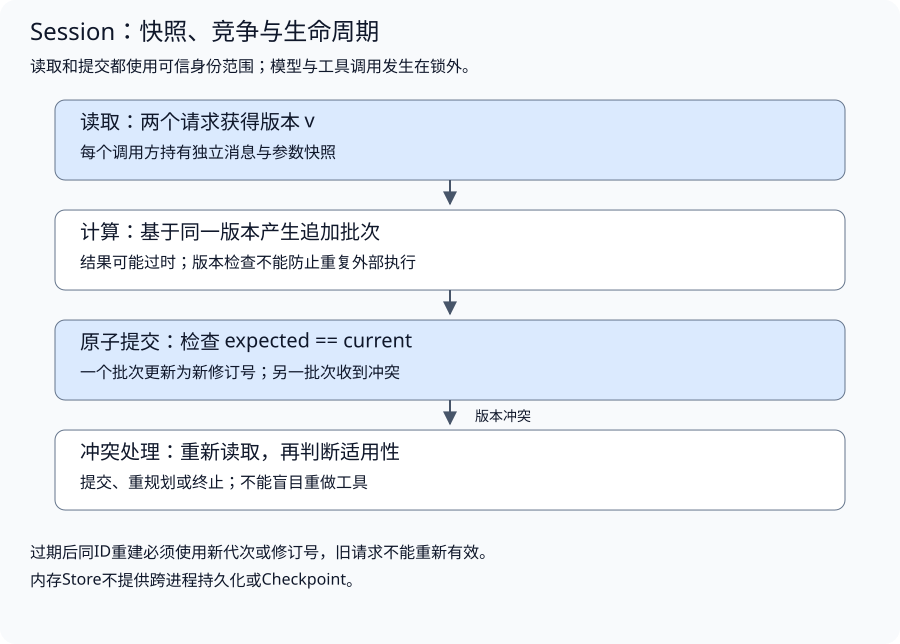
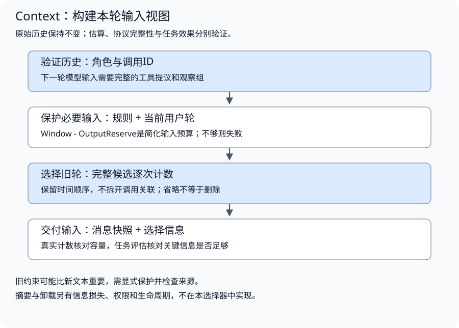

# 会话状态与上下文工程

配套实验：[会话状态与上下文工程实验](../../../labs/part3-agent/chapter29/context-builder/README.md)。

相关实验：[实验：会话快照、版本冲突与隔离](../../../labs/part3-agent/chapter27/session-history/README.md)。

历史已经保存在服务端，模型却忘记刚更新的限制；两个并发请求都成功，下一次续聊又少了一条消息。保存历史与组织本轮输入需要不同的状态契约。

这与前端的服务端数据和渲染视图类似：Session保存交互事实，Context选择当前模型可见内容。视图裁剪不删除历史，数据库里有记录也不表示它已经进入请求。

## 会话事实与输入视图

<a id="topic-agent-session"></a>

<a id="会话保存什么运行又保存什么"></a>

<a id="历史是执行事实的一种记录"></a>

**历史是执行事实的一种记录**

会话可以跨越多次Run。用户追加问题，应用启动一次运行，模型与工具产生消息，随后运行结束；用户再次提问时，应用读取已有历史。

消息历史至少保留用户输入、模型回复、工具提议和观察。它能解释“模型看过什么、提议了什么”，但不一定包含运行游标、结果提交窗口和外部动作状态。工具已执行而观察未保存时，历史仍可能停在提议位置。

| 信息 | 归属 | 不能据此推导什么 |
| --- | --- | --- |
| 用户、assistant与tool消息 | Session | 未提交的外部动作是否已经执行 |
| 本轮筛选后的模型输入 | Context | 完整历史已经被删除 |
| 当前状态、次数和预算 | Runtime | 下一次Run应继承相同预算 |
| 执行游标与已提交结果 | Checkpoint | 所有工具都能够安全重做 |
| 授权保存的长期信息 | Memory | 可以永久保留全部聊天内容 |

Session可以使用内存或持久存储。“短期”描述信息用途与范围，不代表对话结束必须删除。过期、保留、用户删除及访问策略需要明确约定。

<a id="身份范围来自可信调用方"></a>

**身份范围来自可信调用方**

仅以session ID作为查询条件，容易让不同用户读取同名或猜到的会话。配套[Store](../../../labs/part3-agent/chapter27/session-history/main.go)把身份范围和会话ID一起作为键：

```go
type Scope struct{ Tenant, User string }
```

Scope应由认证层提供，不接受模型在工具参数中自报Tenant或User。把字段加进struct只是表达隔离维度；只有读写查询始终使用可信Scope，隔离才真正成立。

本实验没有登录系统，调用方显式传入固定身份来验证存储契约。接入服务时，应先认证，再构造Scope；对其他Scope返回“不存在”，避免泄漏会话是否存在。

前面固定的是“谁的会话”。接下来再固定“会话里到底保存了哪些可追溯的执行事实”，避免把工具提议、结果和最终回答都压成一串普通文本。

<a id="topic-agent-context"></a>

<a id="模型本轮需要的不是全部历史"></a>

<a id="从信息需求反推输入"></a>

**从信息需求反推输入**

一个决策点的输入通常包括稳定规则、本次任务、必要历史、工具定义、相关证据和授权的长期信息。它们不能无差别堆在一起：稳定规则告诉模型如何处理任务，工具定义描述可请求的动作，资料提供待判断的事实，工具结果告诉它前一步发生了什么。

输入选择可以按以下顺序进行：

1. **确定当前动作**：本轮要回答、找证据、修复参数还是修订计划？
2. **列出必要信息**：没有哪些事实，模型就无法做出合理选择？
3. **保留信息来源**：应用规则、用户请求、检索资料与执行观察各有角色和标识。
4. **保护协议关联**：调用提议与结果不能因为长度裁剪而分离。
5. **检查剩余容量**：先为输出留空间，再选择可用的输入。

“最新”是一个容易实现的选择依据，不代表“最相关”。旧消息里的用户约束可能比最新工具的长文本更重要。先把关键约束表达为有来源、可验证的任务状态或固定输入，再考虑一般历史裁剪；不能要求模型从一份缺失关键信息的输入中猜对任务。

<a id="保存与删除是不同操作"></a>

**保存与删除是不同操作**

Context构建不应修改Session。一次请求省略了旧轮，不代表历史已经删除；摘要进入模型输入，也不代表它可以覆盖原始记录。数据保留、删除和授权由各自存储契约处理。

输入中出现某项信息也不等于模型一定正确使用它。位置、噪声、冲突、模型能力与任务表述都会影响结果；必须用任务数据检查关键事实是否仍被正确应用。

<a id="多个来源怎样组成一次输入"></a>

**多个来源怎样组成一次输入**

假设用户长期偏好简洁，本次却要求详细比较两个方案；会话中又把预算从5000元改为6000元，检索资料仍有旧版本价格。构建输入时要分别处理：本次明确要求覆盖表达偏好，后续有效更新替换旧预算，资料版本按任务适用范围选择。模型不应在没有来源与更新关系的混合文本中自行裁决这些规则。

一次输入可以包含多个来源快照，但它们的修订号不能直接比较。Session.Version表示历史提交，Memory.Revision表示一条长期记录的更新，资料Version表示内容版本；“数值更大”不意味着跨来源更权威。保留来源身份及其自身版本，再按任务、授权与有效性形成输入。

在构建期间用户删除偏好，或资料发生更新时，旧视图可能已经失效。需要严格新鲜度的场景，应在使用或交付边界复核相应来源，重新构建受影响内容；其他场景可以明确采用某个快照回答，并保留版本依据。单个存储的CAS不能保证历史、Memory和检索库形成全局原子快照。

当前Build只接收system和历史消息，不查询Memory或检索库，也不协调多来源事务。它验证消息选择与协议；将外部信息接入时，需要应用先完成各自范围检查，再扩展输入组装和版本失效契约。输入更完整与信息更新一致，是两项不同的验收。

## 消息关联与并发历史

<a id="消息顺序与工具关联如何保持"></a>

<a id="一个提议可能产生多条观察"></a>

**一个提议可能产生多条观察**

用户消息、模型提议、工具结果、最终回答不是任意文本列表。模型一次提出两次read，每个结果都要用独立调用ID关联；即使工具名字相同，也不能仅凭名字配对。

实验用封闭的消息类型保存关联，并将参数限制为JSON字节：

```go
type Call struct {
	ID, Name string
	Args     json.RawMessage
}
type Message struct {
	Role, Content, CallID string
	Calls                 []Call
}
```

`json.RawMessage`保留参数的JSON表示，便于复制和验证语法；它本身不验证工具Schema，也不证明参数获准执行。Tool执行器继续承担这些职责。

追加消息时检查整个候选历史：

1. **来源有效**：只允许user、assistant、tool，调用提议属于assistant，结果ID属于tool。
2. **提议可关联**：调用ID非空且未重复，参数是合法JSON。
3. **观察有出处**：每条tool消息必须对应尚未回填的提议，不允许重复结果。
4. **继续条件成立**：还有待回填观察时，不能追加新用户轮或最终assistant回答。

同一轮的多个工具可以按完成顺序回填，只要ID不丢。Session允许保存尚未收齐观察的历史，因为执行过程会分次提交；Context在发出下一轮模型请求前，还要确认需要的观察组已经完整。

历史校验失败不能只提交前面“看起来合法”的消息。工具a结果正确、工具b结果重复时，整个追加批次应被拒绝；否则调用方很难知道提交了哪一部分。

### 快照如何避免历史被外部修改

Go复制slice并不会自动复制底层数组，复制包含slice字段的struct也不会复制嵌套数据。直接返回Store里的Messages，会把内部状态交给调用方修改；只复制最外层仍可能共享Calls和Args。

[clone](../../../labs/part3-agent/chapter27/session-history/main.go)分别复制消息列表、调用列表和JSON参数字节：

```go
func clone(messages []Message) []Message {
	out := append([]Message(nil), messages...)
	for i, m := range out {
		out[i].Calls = append([]Call(nil), m.Calls...)
		for j, c := range out[i].Calls {
			out[i].Calls[j].Args = append(json.RawMessage(nil), c.Args...)
		}
	}
	return out
}
```

写入时复制，读出时也复制。前者防止请求完成后调用方继续修改原输入，后者防止适配器或测试代码污染已保存历史。字符串在这套类型中按值使用，不暴露可变对象。

封闭类型让复制范围可检查。若直接使用`map[string]any`，必须明确允许的嵌套类型，并处理所有可变值；不能靠一个递归函数声称能深拷贝任意Go指针对象。

快照同时带版本。模型调用期间持有自己的快照，不应占用存储锁；调用完成后再用预期版本提交结果。锁住会话等待网络响应，会让同一存储上的请求一起阻塞。

前面解决的是“读出来的历史会不会被外部偷偷改掉”。接下来才处理第二个并发问题：两个基于同一旧快照产生的新批次，谁能真正追加进去。

### 并发追加为何需要版本检查



<a id="不覆盖整份旧历史"></a>

**不覆盖整份旧历史**

两个调用都读到版本v，分别产生追加批次。Compare-and-Append将版本检查与追加放在同一临界区：

以下摘录函数内的关键分支，完整校验与资源清理见所链源码。

```go
	if current.Version != expected {
		return Snapshot{}, ErrConflict
	}
```

```go
	candidate := clone(current.Messages)
	candidate = append(candidate, clone(batch)...)
	if err := validate(candidate); err != nil {
		return Snapshot{}, err
	}
```

只有当前版本等于expected时才提交；不匹配返回ErrConflict。没有冲突时，历史校验和状态更新也必须一起完成。单独“先查询版本，再更新消息”无法阻止查询后另一个调用抢先写入。

本实验用Mutex保护内存状态；数据库实现通常需要事务或带版本条件的更新，并检查影响行数。把Mutex换成数据库，不意味着版本检查可以省略。

<a id="冲突需要重新判断不能盲目补交"></a>

**冲突需要重新判断，不能盲目补交**

遇到冲突时按以下步骤处理：

1. **保留已产生结果**：识别哪些工具已经执行，避免直接再次执行。
2. **读取当前快照**：核对追加期间发生了什么。
3. **判断结果仍适用吗**：参数、用户问题或任务目标是否已改变。
4. **决定提交、重规划或终止**：不能自动把基于旧上下文的答案拼到最新历史。

版本检查避免丢失更新，不能保证工具只执行一次，也不能阻止两个运行同时发出模型请求。若业务要求同一会话只运行一个任务，应在Runtime或服务层明确串行策略；若允许并行，就要设计结果归属与冲突处理。

提交请求结果未知时，也不能简单重复append：版本可能已经更新，重复提交可能造成重复消息。稳定批次ID与幂等记录可以解决这一类问题，本实验未实现；Checkpoint和服务任务契约会进一步处理提交窗口。

### 过期与版本重用的陷阱

到达ExpiresAt后，会话不可继续读写；实验在访问时清理过期条目，访问本身不自动续期。若需要滑动过期，应明确是读取、用户活动还是成功提交延长TTL，并说明长时间工具调用超过TTL时如何处理。未再次访问的过期条目仍留在内存中；TTL拒绝访问与回收存储是两项工作，当前Store也没有会话总量上限。服务需要按容量选择清理、接纳与回收策略，不能仅设置TTL就认为内存已有上限。

还要防止版本重用：旧会话版本为2，过期后同ID创建新会话，再次变成版本2，旧请求就可能误以为版本仍匹配。这是对象重建后的身份问题，不能只看局部递增数字。

实验采用**Store生命周期内单调增加的修订号**，创建和提交都分配新的值，因此重建会话不会复用旧版本。修订号可能跳跃，不应根据差值推导消息数量。持久化或多实例时，应使用可持久验证的会话代次与版本，或者不复用会话ID；内存计数器重启后不能继续承担这一保证。

单调计数还需要处理表示空间耗尽。uint64到达上限后继续递增会回绕；实验在Create与Append提交前返回ErrRevisionExhausted，保留原会话与版本，不分配零或重置计数。调用方应明确迁移到新代次的策略，不能仅把内存计数器清零，再让旧请求与新对象重新匹配。当前实现只拒绝耗尽，没有提供持久迁移协议。

TTL限制访问生命周期，不代表备份、日志与缓存中的个人信息已经删除。涉及数据删除时，要分别检查存储、索引和衍生内容，长期Memory也有自己的授权与删除策略。

## 输入预算与完整观察组

### 输入预算要给输出留空间



<a id="先核对模型的容量口径"></a>

**先核对模型的容量口径**

Provider对上下文窗口、输出限制、工具定义和隐藏推理等用量的计算可能不同。接入时要核对模型契约，不能将某个API的计数方式直接用于所有Provider。

配套实验使用[Policy](../../../labs/part3-agent/chapter29/context-builder/main.go)明确窗口与输出预留：

```go
type Policy struct{ Window, OutputReserve int }
```

在这个简化契约下，允许输入的容量为Window减去OutputReserve。输出预留只是本地选择策略，还需要把相应输出限制传给Provider；否则本地计算留了空间，实际生成仍可能截断。

计数范围应覆盖整个请求，而不只是用户文本。角色标记、工具定义、调用参数和协议封装都可能占用空间。多模态与其他特殊输入也要采用相应计数规则，不能直接套用文字估计。

<a id="估算值必须标明来源"></a>

**估算值必须标明来源**

实验将Counter注入构建函数，让选择算法不依赖具体分词器：

```go
type Counter func([]Message) int

func estimate(messages []Message) int {
	cost := 0
	for _, m := range messages {
		cost += 4 + utf8.RuneCountInString(m.Role+m.Content+m.CallID)
		for _, c := range m.Calls {
			cost += 4 + utf8.RuneCountInString(c.ID+c.Name+string(c.Args))
		}
	}
	return cost
}
```

这里按Unicode码点和固定额外开销计数，单位是**教学估算量**，不是某个模型的真实Token。相同输入得到相同估算，便于检查选择行为；真实计数要用对应模型的tokenizer或Provider支持的统计方法，并给误差留余量。

接口统计完整候选请求，允许Counter包含额外封装成本。不能简单把独立文本Token相加，就断言等于最终请求计数。usage返回后再与估算比较，帮助修正预算策略，但后验usage不能保护已经发出的超长请求。

<a id="工具消息为什么要成组保留"></a>

<a id="最近n条会破坏调用关系"></a>

**最近N条会破坏调用关系**

考虑这一轮：user提问，assistant提出两个工具调用，两个tool消息回填结果。若只留下最后三条，就会丢掉用户任务或调用提议；即使保留的文本有用，Provider也可能拒绝不完整的协议序列。

本章采用“用户轮”为选择单位：从一条user消息开始，到下一条user消息之前结束。组内保留所有模型回复、提议与结果。调用结果必须对应已知ID，所有待执行调用的观察收齐后，才能构造下一轮模型输入。

这与Session的检查时机不同：Session可以保存尚未完成的执行事实，Context负责确认送给模型的视图已经满足调用协议。没有收齐观察时，应先完成、取消或按明确策略记录失败，不能跳过关联校验继续推理。

<a id="粗粒度选择也有成本"></a>

**粗粒度选择也有成本**

完整用户轮容易理解，但可能很大。单条工具输出就占满窗口时，整个当前轮都无法放入。不能偷偷裁掉半段JSON或一条观察来“通过预算检查”；应在工具返回处限制大小，提供受控摘要、分页或产物引用。

以后可以把用户轮拆成更小的关联组，但必须重新定义依赖：哪些规则要固定，哪条提议与哪些结果一起保留，摘要如何替代原文。组越细，选择更灵活，验证也更复杂。

### 如何构建一个可解释的输入视图

配套[Build](../../../labs/part3-agent/chapter29/context-builder/main.go)先保护system和最新用户轮，再从近到远尝试完整旧轮：

```go
	limit := p.Window - p.OutputReserve
	selected := []Message{{Role: "system", Content: system}}
	selected = append(selected, clone(groups[len(groups)-1])...)
	used := count(selected)
	if used <= 0 || used > limit {
		return View{}, ErrBudget
	}
```

```go
	for i := len(groups) - 2; i >= 0; i-- {
		candidate := []Message{selected[0]}
		candidate = append(candidate, clone(groups[i])...)
		candidate = append(candidate, selected[1:]...)
		candidateCost := count(candidate)
		if candidateCost <= 0 {
			return View{}, ErrBudget
		}
		if candidateCost <= limit {
			selected = candidate
			used = candidateCost
		} else {
			dropped++
		}
	}
```

构建过程有五个明确步骤：

1. **验证历史**：角色合法、JSON参数合法、调用ID完整且没有遗留待回填观察。
2. **保护必要输入**：system与当前用户轮不能被静默丢弃。
3. **检查是否可容纳**：必要输入超过预算时返回可见失败，不返回半个当前轮。
4. **选择旧轮**：每次统计完整候选，能够放入才接受，并保持被选轮的时间顺序。
5. **交付独立视图**：返回输入、估算消耗和丢弃轮数，复制可变参数，不污染原历史。

算法允许跳过太大的旧轮，再尝试更早的小轮，因此保留结果不一定是连续的历史后缀。它只保证顺序与协议，不保证语义连续；问题依赖先前约束时，必须显式保护这些约束，或选择连续后缀策略，再通过任务集比较。

实验限制128条历史消息，文本、调用ID、工具名与参数累计最多64 KiB；system另有独立的64 KiB上限。这些字节检查控制构建与复制开销，Counter再统计完整候选请求，不能将二者当成同一个容量口径。重复统计完整候选是简单实现，较大历史或昂贵tokenizer需要测量后优化；优化不能改变计数范围或绕过完整性检查。

这里先固定输入视图的最小契约：什么必须保留、什么不能拆开、什么会因预算直接失败。接下来再看裁剪、摘要和卸载分别牺牲了什么，以及怎样验证这种牺牲还能接受。

## 裁剪、摘要与卸载

### 裁剪、摘要与卸载如何选择

| 策略 | 减少了什么 | 主要风险 | 适用判断 |
| --- | --- | --- | --- |
| 选择与裁剪 | 不相关或低优先级历史 | 关键约束被省略，指代断裂 | 信息可以按相关性与关联组清楚选择 |
| 摘要与压缩 | 重复细节和表达长度 | 事实遗漏、数值改变、来源丢失 | 用保留要求和回查机制验证压缩损失 |
| 卸载与按需读取 | 大工具结果和产物正文 | 模型看不到未读内容，引用可能失效 | 产物有稳定ID、权限与生命周期 |
| 检索历史或长期信息 | 无关的完整记录 | 召回遗漏或带入错误旧事实 | 有范围过滤、来源与效果评估 |

输入选择器实现完整组选择，新增的保留检查核对结构化摘要候选，不生成自由摘要或管理产物。要增加摘要，先定义需要保留的事实、单位、来源、未决问题和工具结果，再检查摘要是否满足这些要求。重要数字与约束可由确定性代码核对，开放文本则需要人工或经过校准的评估；不能以“文本变短”作为摘要正确的证据。

卸载时先保存产物，再返回摘要与读取方式；产物权限和删除不能被一条文件路径绕过。Memory的召回内容进入模型前也要选择，长期存储不会自动解决当前输入预算。

### 摘要要保留哪些信息

回到开场的方案比较任务。用户先说“总预算不超过5000元，必须支持离线”，后来改为“预算可以到6000元，离线要求不变”，最后要求“沿用之前的预算”。如果摘要只写“用户关注价格和离线能力”，它很短，却已经无法支持下一次比较。

需要保留的不是每句原话，而是当前判断所依赖的事实和依据：

| 信息 | 此时应保留什么 | 压缩错误会造成什么 |
| --- | --- | --- |
| 当前目标 | 比较两个方案，判断是否满足条件 | 摘要变成一般产品推荐，丢掉比较任务 |
| 有效约束 | 总预算≤6000元；必须支持离线 | 沿用旧金额，或把必须条件改成偏好 |
| 更新依据 | 用户在后续轮明确修改预算，离线要求未撤销 | 把两个金额并列，模型自行猜测哪一个有效 |
| 未决问题 | 尚未取得方案B的离线能力证据 | 摘要将“未知”改写成“不支持”或“支持” |
| 可回查来源 | 对应消息ID及方案资料ID、版本 | 无法区分用户要求、模型建议与工具事实 |

这个表是教学上的保留要求，Build本身不生成摘要。配套[保留契约检查](../../../labs/part3-agent/chapter29/context-builder/summary.go)用应用提供的有效事实快照核对结构化候选：

```go
type Fact struct {
	Key, Value, Source, State string
}
type Snapshot struct {
	Version string
	Facts   []Fact
}
```

Key明确事实与单位，Source定位依据；unknown的Value留空，避免把尚未取得的事实写成确定结论。Version对应应用登记的当前状态，不能由候选摘要选择。

校验器先限制字段与集合，再逐项核对；关键交付路径如下：

```go
	actual, err := factSet(candidate)
	if err != nil || candidate.Version != current.Version || len(actual) != len(wanted) {
		return Snapshot{}, ErrSummary
	}
	for key, f := range wanted {
		if actual[key] != f {
			return Snapshot{}, ErrSummary
		}
	}
	if err := ctx.Err(); err != nil {
		return Snapshot{}, err
	}
	return Snapshot{Version: candidate.Version, Facts: append([]Fact(nil), candidate.Facts...)}, nil
```

遗漏未知项、沿用5000元、修改离线条件或替换来源都会失败，整份候选不交付；只改变事实排列顺序可以接受。已通过结构校验也不证明事实真实：当前快照须由应用可信状态取得，两份相同错误的事实仍会匹配。这里验证的是显式保留契约，不自动提取约束，不判断自由摘要的语义。

金额、单位和来源可以做结构化核对，更新含义和条件是否保持则需要进一步判断。若无法确认，保留相关原文或回查来源，不用摘要覆盖原始事实。候选版本失效后重新生成或回查，不能修改版本号便视为完成更新。

摘要多次转述也会积累误差。新一轮压缩不能只信上一版摘要：重要约束重新核对权威状态或原始来源，明确压缩覆盖到哪条消息，之后的更新单独保留。未完成工具调用仍按协议保存，不能用“工具查过资料”一句话替代待回填结果。

<a id="看见更新不等于保留了更新"></a>

**看见更新不等于保留了更新**

压缩候选要保留当前约束、来源、修订和未决事实，并与可信事实快照核对。结构字段一致只证明保留契约，真实模型仍可能误用旧金额、遗漏条件或引用无效来源；截断和失败原文保留，不补写成合格摘要。

实现与对照见[配套实验](../../../labs/part3-agent/chapter29/context-builder/README.md#book-agent-context-看见更新不等于保留了更新)。

## 输入布局、缓存与信息质量

<a id="输入布局与缓存怎样取舍"></a>

<a id="先保留语义再调整位置"></a>

**先保留语义，再调整位置**

来源清楚、协议合法的输入仍可能不好用。大量无关资料夹在任务和关键观察之间，会增加查找难度；把稳定规则重复放入每个工具结果，又会占用容量。先明确每部分的角色，再比较布局，不能将所有文本提升为system指令。

一个可作为对照起点的组织方式是：稳定规则与工具定义、当前目标及有效约束、选定的历史与证据、当前问题和最新观察。具体字段和顺序还受Provider消息协议约束；工具结果必须留在对应提议之后。检索资料保留来源标记，资料中的命令不改变应用规则。

长上下文中的信息位置会影响部分任务表现，[Lost in the Middle](https://arxiv.org/abs/2307.03172)研究过这一现象。不能据此断言“重要内容永远放最后”。用相同资料移动关键事实的位置，检查约束遵守、证据使用与回答完整性；比较布局时保持内容集合一致，才容易区分位置影响与信息增删。

<a id="三种缓存不能混用"></a>

**三种缓存不能混用**

| 缓存对象 | 可以复用什么 | 复用前要检查什么 |
| --- | --- | --- |
| 应用的输入视图或摘要 | 已完成的信息选择或压缩结果 | 身份范围、历史修订、资料版本、策略版本及当前授权 |
| 模型推理的前缀计算 | 与当前模型及输入前缀匹配的计算状态 | 模型、分词与模板配置、实际Token前缀；机制见Model章 |
| 已生成的答案 | 某个请求的既有结果 | 任务、条件、资料、权限与时效；答案仍须满足交付契约 |

前缀缓存复用计算，模型本轮仍需要相应输入；它不会使缓存内容退出上下文窗口，也不会证明旧答案适合新问题。应用摘要缓存则保存一份派生信息，原始历史或用户约束更新后，需要判断它是否已经失效。

Provider的Prompt Cache有独立接口与用量口径。例如[Claude缓存文档](https://platform.claude.com/docs/en/build-with-claude/prompt-caching)按请求前缀复用；具体边界、期限与usage字段由adapter按对应服务核对。本章不实现Provider缓存，不把本地View复用当成服务端缓存命中。

稳定内容适合保持稳定，当前任务与新观察按实际需要更新。为提高缓存命中率而保留已撤销的工具、过期资料或旧用户条件，会改变正确性。以预算更新为例，6000元必须进入本轮有效约束，即使这使旧前缀无法复用；工具授权仍由执行器重新检查，缓存的Schema不能替代当前权限。

对照至少记录冷缓存与可复用请求的条件、实际缓存用量、总输入、延迟、费用和任务效果。不同配置改变了内容或评分标准时，不能把所有差异归因于缓存。命中率是性能观察，约束与事实保留才是输入质量判断。

前面比较的是输入如何组织与复用；最后再回到它为什么重要：模型忘记约束或重复动作时，先怀疑策略还是先怀疑输入质量。

### 信息质量如何影响下一步决策

模型反复查询同一个工具，可能是策略问题，也可能是前一次观察根本没进入输入。回答忘记约束，可能是模型能力问题，也可能是裁剪造成事实丢失。调优前先核对实际发出的请求。

至少记录输入构建策略版本、哪些关联组被选择、哪些被省略、计数来源与必要事实检查结果。日志不应默认保存原始消息或敏感内容；用来源ID、哈希、统计量和脱敏摘要辅助定位。

效果对照需要同任务、同资料、可比模型配置。比较完整历史、裁剪、摘要或按需读取时，同时看完成度、关键约束遵守率、引用支持、输入消耗与延迟。只比较Token变少，可能奖励了一个丢掉重要事实的策略。

<a id="最佳实践"></a>
<a id="一次提交明确一个批次"></a>
<a id="缩短临界区"></a>
<a id="保存事实与选择输入分开"></a>

[实验排查与实践建议：最佳实践](../../../labs/part3-agent/chapter27/session-history/README.md#book-agent-session-最佳实践)。

<a id="常见问题排查"></a>
<a id="两个请求都成功后来少了一条消息"></a>
<a id="历史参数在模型调用后发生变化"></a>
<a id="工具结果无法关联"></a>

[实验排查与实践建议：常见问题排查](../../../labs/part3-agent/chapter27/session-history/README.md#book-agent-session-常见问题排查)。

<a id="保护约束不保护所有旧文本"></a>
<a id="在信息产生处控制体积"></a>
<a id="把计数与语义评估分开"></a>

[实验排查与实践建议：最佳实践](../../../labs/part3-agent/chapter29/context-builder/README.md#book-agent-context-最佳实践)。

<a id="provider拒绝工具消息序列"></a>
<a id="输入变短后答案漏掉用户条件"></a>
<a id="本地计数未超限真实请求却失败"></a>
<a id="压缩或缓存后仍在使用旧条件"></a>

[实验排查与实践建议：常见问题排查](../../../labs/part3-agent/chapter29/context-builder/README.md#book-agent-context-常见问题排查)。

## 小结

1. Session保存历史，Context选择本轮输入，裁剪视图不删除事实。
2. 快照、调用关联与版本检查共同保护并发续聊，过期不能重用旧版本。
3. 输入预算给输出留空间，工具提议与观察成组选择。
4. 摘要、卸载与缓存各有身份和失效条件，输入变短仍需核对关键信息及任务效果。

## 参考文档

- [Go内存模型](https://go.dev/ref/mem)：理解锁与共享状态的同步关系。
- [sync.Mutex](https://pkg.go.dev/sync#Mutex)：内存存储临界区的标准库约定。
- [json.RawMessage](https://pkg.go.dev/encoding/json#RawMessage)：参数JSON表示的类型与解码用途。
- [PostgreSQL事务隔离](https://www.postgresql.org/docs/current/transaction-iso.html)：实现数据库版本冲突处理时的补充阅读。
- [json.RawMessage](https://pkg.go.dev/encoding/json#RawMessage)：JSON参数字节与解码用途。
- [Lost in the Middle](https://arxiv.org/abs/2307.03172)：长上下文信息位置与任务表现的研究，理解“放入窗口”与“有效使用”的区别。
- [Anthropic上下文工程](https://www.anthropic.com/engineering/effective-context-engineering-for-ai-agents)：信息选择、压缩与按需读取的补充讨论。
- [Claude Prompt Caching](https://platform.claude.com/docs/en/build-with-claude/prompt-caching)：Provider前缀缓存、用量与生命周期；具体服务接口不作为通用Context定义。
- [AI Agent Book上下文工程](https://github.com/bojieli/ai-agent-book/blob/main/book/chapter2.md)：请求结构与上下文组织的进一步阅读。

[返回全书目录](../../README.md) · [上一篇：任务规划与反馈修订](chapter25-planning.md) · [下一篇：检索增强生成与证据验证](chapter27-rag.md)
