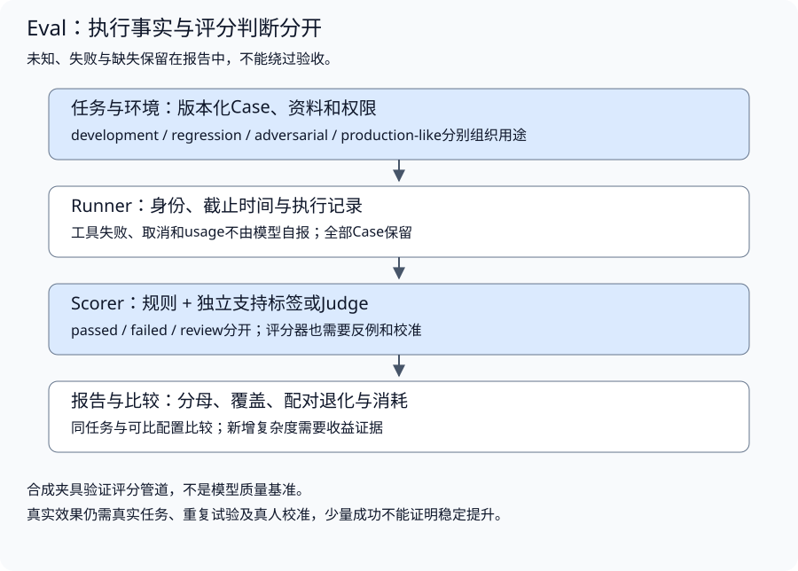

# 质量评估与持续改进

配套实验：[质量评估与持续改进实验](../../../labs/part3-agent/chapter33/eval-harness/README.md)。

相关实验：[实验：执行轨迹、重放与回归门禁](../../../labs/part3-agent/chapter33/eval-observability/README.md)。

平均分提高了，关键任务却退化；某份报告列出很多案例，实际只是同一道题反复运行。评估首先需要明确任务、运行身份、数据用途与判定依据。

本章从成功标准进入数据集、Runner和评分器，再讨论指标分母、校准、机制对照与回归。离线评分和运行时验收各自保留输入、原输出及不确定结论。

## 成功标准与数据用途

<a id="topic-agent-eval"></a>

<a id="先定义任务而不是先选指标"></a>

<a id="完成条件必须能被检查"></a>

**完成条件必须能被检查**

“回答得好”无法直接用于回归。先描述用户问题、可用环境、必须满足的事实、允许的动作，以及应该拒答的条件。

配套[Case](../../../labs/part3-agent/chapter33/eval-harness/main.go)保存任务ID、样本划分、必要资料、允许能力与完成条件：

```go
type Case struct {
	ID, Split, Input                                       string
	Relevant, AllowedSources, AllowedTools, RequiredClaims []string
	ExpectAbstain                                          bool
}
```

RequiredClaims在教学数据中使用固定文字，适合验证少量已知输出和评分器反例；它不是通用语义正确性判定。真实任务可将条件拆成结构化字段、单位、约束、证据与操作结果，再选择相应评分方法。

期望拒答与期望回答都需要样本。否则系统可以靠“全部拒答”提高安全指标，或靠“全部猜测”降低拒答率，实际任务效果都可能恶化。

<a id="把解释清楚拆成可取证的标准"></a>

**把“解释清楚”拆成可取证的标准**

考虑一个只读文档问答任务：“根据当前重试政策，说明只读请求失败后最多还能重试几次；写请求是否适用？请标出依据。”合成资料写明：“只读请求最多重试3次，首次调用不计入重试次数；写请求不得自动重试。”

“正确、完整、简洁”还不足以指导评分。先把任务拆成下面几项：

| 标准项 | 需要的证据 | 不通过或待复核的例子 |
| --- | --- | --- |
| 次数与计数单位正确 | 当前政策中的3次重试及首次调用的定义 | 把3次重试写成总共调用3次，或写成无限重试 |
| 适用范围完整 | 只读请求与写请求两种条件 | 只说“可以重试3次”，遗漏写请求边界 |
| 引用属于本次运行 | Runner实际提供的资料ID和版本 | 引用旧版政策，或引用未提供给模型的资料 |
| 每条结论有支持 | 断言与所引资料的对应关系 | 资料支持只读重试，答案却将结论扩展到所有请求 |
| 执行符合允许能力 | 实际工具调用、参数与错误记录 | 为回答政策问题调用了未批准工具，或读取失败后猜测 |

前三项中的数值、版本和来源身份可以先用规则检查；自然语言是否遗漏条件、改写是否保持含义，需要经过校准的支持判断。**标准要说明检查什么、用什么证据、失败意味着什么。** “答案写得专业”没有这些信息，不能承担放行责任。

能力越权、错误次数、来源无效等关键条件应独立判断。文字风格可以另作偏好评分，不能通过加权平均抵消关键失败。若资料未说明写请求，标准也不能凭常识补一个答案：应检查系统是否明确报告依据不足，并将该情况作为另一条用例。

修订意见应具体到失败项。例如“次数定义不符：答案将首次调用计入3次重试，请按当前政策区分首次调用与后续重试”，比“答案不够准确，再试一次”更能指导修改。反馈可以指出要求和已有证据，但不能把独立验收集的隐藏答案交给生成器后，再将同一批题的提升当作泛化能力。

<a id="环境也属于用例"></a>

**环境也属于用例**

模型配置相同，资料版本、工具响应、权限或时间不同，运行结果也会不同。保存数据集版本、资料版本、工具夹具、运行配置和评分器版本，才能解释变化来自哪里。

本实验的fixtures.json使用固定教学记录，展示数据和评分管道，不代表真实模型基准。运行中的身份、工具错误和usage来自可信Runner记录，不能让模型填写“工具成功”或“费用为零”。

### 数据集如何避免调优污染

按项目方案区分四种用途：

| 划分 | 用途 | 主要约束 |
| --- | --- | --- |
| development | 分析失败、调整策略和提示词 | 可反复查看，不作为独立泛化证据 |
| regression | 检查已确认能力是否退化 | 固定版本，修改标签需要理由与审查 |
| adversarial | 检查越权、注入、混淆与边界 | 覆盖明确威胁与失败，不能由平均分抵消严重失败 |
| production-like | 在隔离环境中接近实际任务分布与运行约束 | 保留长尾、失败、容量与成本；模拟不等于已有生产证据 |

新增失败案例时，先复核任务和标签，再加入版本化集合。只把系统已经答对的题收进数据集，会夸大质量；同一模板改几个实体，也不等于多个独立任务类别。

发布评估应按划分和任务类别分别报告。本实验的三条记录混合展示评分边界，Rows保留Split；它的总表不是独立验收集上的效果结论。

<a id="案例配置与运行次数分开统计"></a>

**案例、配置与运行次数分开统计**

同一个问题分别使用两个模型、三版提示各运行两次，会产生12条运行记录；它仍是一个任务实例。增加记录有助于观察配置差异与波动，不能将其写成12个独立案例，再用更大的分母宣称评估充分。

| 统计对象 | 定位依据 | 能说明什么 |
| --- | --- | --- |
| 任务定义 | 数据集版本、Case ID、任务及环境快照 | 有哪些需要评估的问题和完成条件 |
| 系统配置 | 模型、提示、工具、检索和预算版本 | 本次比较了哪些系统条件 |
| 一次运行 | Case与配置绑定的Run ID、实际轨迹 | 在该条件下发生了什么，失败与消耗是多少 |
| 评分结果 | Run ID、评分器版本、参照及判定 | 该运行按什么标准通过、失败或待复核 |

数据集换了版本，也不意味着其中每个问题都是新实例。保留稳定案例身份，记录任务、环境或标签的修改；完全重复的任务不重复计数，修改后的变体与原案例保留关联。任务家族还要单独统计：更换服务名或数字，可以检验参数变化，却不能代替版本冲突、无证据、权限拒绝等不同失败类型。

契约测试、模型效果任务和评分器校准样本各有用途。固定响应验证Loop和adapter，真实调用检验策略行为，带独立参照的判断样本帮助校准Judge。它们可以共同支持课程，但不能混成一个“模型成功率”或用契约数量代替独立任务覆盖。

汇总多个Lab时，先登记任务定义、来源版本、当前划分、评分依据和关联运行，再报告可用范围。原验收集被用于调提示后，记录其转为回归集的用途变化；文件名仍叫heldout不能继续证明未参与调优。无法确认的身份、参照或划分保持待核对，不用新增Case ID或补一个版本号制造新的独立样本。

<a id="来源登记与案例资格分开验证"></a>

**来源登记与案例资格分开验证**

来源登记锁定文件字节、布局、版本和Case身份，用于拒绝漂移与重复计数。登记成功不证明任务独立或评分可靠；资格需要用途历史、运行证据和独立复核，待核对案例不能计入合格数量。

实现与对照见[配套实验](../../../labs/part3-agent/chapter33/eval-harness/README.md#book-agent-eval-来源登记与案例资格分开验证)。

<a id="已经看过的验收题怎样转为回归"></a>

**已经看过的验收题，怎样转为回归**

任务一旦用于调试或选配置，就记录用途变化并转入回归。保留原定义和使用历史，另建未参与调优的验收集合；文件名为holdout不能恢复已经失去的独立性。

实现与对照见[配套实验](../../../labs/part3-agent/chapter33/eval-harness/README.md#book-agent-eval-已经看过的验收题怎样转为回归)。

<a id="载荷不同为什么仍可能不是独立任务"></a>

**载荷不同，为什么仍可能不是独立任务**

版本、参数值或资料ID改变以后，两条JSON可以完全不同，任务却仍只要求沿同一种目录查询一个参数。逐字去重能发现误复制，不能决定任务家族是否足够广；相反，同一句“超时是多少”放在正常、连接失败和越权环境里，可能检验不同工程行为，也不能仅按问题文本合并。

登记时分开保留三种关系：

- **定义身份**：Case及环境、输入与评分版本，解释这条记录在检查什么。
- **变体关系**：哪个原任务的参数、资料或运行条件被改变；区别有意义的失败变体与仅改名称的重复。
- **使用历史**：首次冻结、何时分析结果或调优、当前作为开发/回归/验收的用途。

独立验收需要这些关系能被核对，并且评分标准有依据。缺少Split字段时不能从文件叫heldout推断未使用；载荷哈希唯一也不能补出历史或人工标注。先保留未知，再核对用途，最后按缺失家族新增任务；不会因为数字接近目标就把所有记录混成一个成功率。

<a id="从失败机制扩充任务而不是批量改参数"></a>

**从失败机制扩充任务，而不是批量改参数**

按失败机制补充任务，例如版本冲突、必要条件遗漏、权限撤销、取消迟到和未知费用。改名、换数字或重复运行不自动增加独立案例；跨领域与评分有效性需要单独证据。

实现与对照见[配套实验](../../../labs/part3-agent/chapter33/eval-harness/README.md#book-agent-eval-从失败机制扩充任务而不是批量改参数)。

## 运行记录与评估Runner

### 一项评分怎样回到实际运行

评分表里的“失败”应能定位到产生它的那次运行。只保存最终答案，无法判断失败来自资料缺失、动作错误、观察丢失，还是评分条件改变；只保存Trace，又不知道它是否满足任务目标。把Case、配置、Run和评分器版本串起来，才能解释回归。

[Eval与可观测性集成实验](../../../labs/part3-agent/chapter33/eval-observability/README.md)将实际执行轨迹与报告行绑定。它先使用固定模型替身验证交接，不把替身步骤当作真实模型效果：

```go
type Row struct {
	CaseID, RunID, Split, Error string
	Passed, Critical            bool
	Steps, Attempts             int
	ReplayVerified              bool
	ElapsedNS                   int64
}
```

一次比较需要保留四层关系：

1. **任务身份**：Case固定输入、环境与完成条件；评分字段不进入执行输入。
2. **运行事实**：每次运行绑定配置与RunID，记录实际请求、响应和失败；重放不能另发新请求掩盖记录缺口。
3. **评分依据**：任务条件与评分器版本决定这一行是否通过，执行错误仍保留在分母。
4. **比较条件**：两组使用相同任务与评分版本，逐项寻找“原先通过、现在失败”的Case，再判断哪些失败禁止放行。

平均通过率与关键任务约束需要分别判断。候选仍通过75%的题，却在必须拒答的缺证据任务上编造数值，平均数不能抵消这个失败。若还要求原有能力不退化，则需核对基线与候选的逐项结果；不能仅比较两个总分。

步骤、时间、Token和费用也有不同来源。这里的Steps统计成功响应，Attempts同时保留失败调用；调用错误与整次运行错误按原记录重放，ReplayVerified标出是否完成核对。旧格式只保存失败摘要时保持失败且未验证，不能补成已重放。ElapsedNS是一次本地运行时间，不能推导生产P95。替身没有真实Provider usage，报告将UsageKnown与CostKnown保持false。缺少成本来源时，应继续报告未知，而非用零成本奖励失败或拒答配置。

集成链路能证明执行、归档、重放和评分的关联。真实模型质量、语义评分校准、完整失败计费与任务分布仍需独立证据；把四条合成任务标出划分，不等于形成四个可用于泛化结论的评估集。

**一次调用失败，与整个任务失败，要分开统计。** 例如读取资料首次报错，第二次成功，最后完成回答：任务可以通过，首次错误仍须留在轨迹和总消耗中。按本例口径，三次成功响应对应Steps=3，连同失败读取共有Attempts=4。两次读取都失败时，任务保持失败、没有最终答案，不能从通过率分母移除。

重放还需要原执行的恢复政策。若当时最多尝试两次，重放应按同一上限消费失败及后续响应；采用今天的默认重试次数，可能把原记录解释成另一个过程。取消、权限和协议失败是否允许恢复也由原契约决定，不能统一改成“再试一次”。完整轨迹核对与归档来源认证仍是两件事：无签名归档的内部一致性不证明记录未被整体改写。

前面先把失败行绑回了任务、运行和重放记录；接下来再细拆调用级证据：这一步到底是不是模型生成、用量从哪来、失败时还能保留哪些事实。

<a id="调用名称执行来源与用量来源各自记录"></a>

**调用名称、执行来源与用量来源各自记录**

轨迹里一项叫model-final，实际可能是固定函数、缓存返回或模型生成；不能按名字把每一步算成模型调用。接入真实运行前，先固定adapter如何声明来源、回报用量，以及失败后保留哪些事实。

[逐调用回报](../../../labs/part3-agent/chapter33/eval-observability/observed.go)把内容与来源计数分开：

```go
type CallMetrics struct {
	Origin, ModelRevision, UsageSource string
	UsageKnown                         bool
	InputTokens, OutputTokens          int64
}
```

已知用量要能回到版本与实际回报；本地tokenizer计数、Provider回报与合成数字不是同一种来源。未知调用保留Unknown标记，失败调用也累计已回报消耗；取消后不发布答案，并不撤销之前的模型计算。

Schema4将这些字段与调用身份一起保存，重放只消费原数据，不重新取得usage。测试用synthetic-model单列合成计数，真实ModelCalls/UsageKnown不因固定例子有数字而增加。来源声明不是认证，完整计数也不是账单；模型版本、价格口径及失败计费继续分别核对。

<a id="实际生成原文与适配产物同时保存"></a>

**实际生成原文与适配产物同时保存**

保存真实请求、模型原文、截断、用量和适配结果，并以Run/Case、模型及协议版本关联。原文不能被解析修复覆盖，适配器成功也不能作为模型任务成功。

实现与对照见[配套实验](../../../labs/part3-agent/chapter33/eval-observability/README.md#book-agent-eval-实际生成原文与适配产物同时保存)。

<a id="重新生成需要绑定次数与失败类型"></a>

**重新生成需要绑定次数与失败类型**

重试只针对事先批准的失败类型，记录每次完整输入、原输出和累计消耗。协议反馈不得包含隐藏期望；多一次调用获得的收益不能冒充同调用预算下的提升。

实现与对照见[配套实验](../../../labs/part3-agent/chapter33/eval-observability/README.md#book-agent-eval-重新生成需要绑定次数与失败类型)。

### Runner怎样保留真实执行结果



评估Runner给每个Case绑定身份、运行ID与截止时间，记录模型与工具的实际行为。某个任务失败不能让剩余Case从分母里消失。

配套[RunCases](../../../labs/part3-agent/chapter33/eval-harness/main.go)只投影执行所需输入，复制允许能力，并拒绝取消后的迟到成功：

以下摘录函数内的关键分支，完整校验与资源清理见所链源码。

```go
		child, cancel := context.WithTimeout(ctx, timeout)
		input := TaskInput{ID: c.ID, Input: c.Input, AllowedSources: append([]string(nil), c.AllowedSources...), AllowedTools: append([]string(nil), c.AllowedTools...)}
		actual, err := task(child, input)
		if child.Err() != nil {
			err = child.Err()
		}
		cancel()
		actual.CaseID = result.CaseID
		actual.RunID = result.RunID
```

```go
		if err != nil {
			switch {
			case errors.Is(err, context.Canceled):
				actual.Error = "canceled"
			case errors.Is(err, context.DeadlineExceeded):
				actual.Error = "deadline_exceeded"
			default:
				actual.Error = "execution_failed"
			}
		}
```

Task必须协作响应context，Runner不能抢占任意阻塞函数。取消后未启动的Case仍保留失败记录；已经回报的usage仍保留。它不做模型调用或默认重试，接入真实系统时，重试、配额与响应上限仍由Runtime及adapter负责。

<a id="执行输入与评分答案分开"></a>

**执行输入与评分答案分开**

Case包含预期断言、相关性与拒答标签，直接把它传给执行回调，可能让评分答案进入模型上下文。Runner只向Task提供[TaskInput](../../../labs/part3-agent/chapter33/eval-harness/main.go)：

```go
type TaskInput struct {
	ID, Input                    string
	AllowedSources, AllowedTools []string
}
```

Input是用户任务，AllowedSources与AllowedTools描述环境允许的能力。Relevant、RequiredClaims、ExpectAbstain以及标签仍留在评估侧；Split也不进入执行输入。权限清单使用副本，执行回调修改自己的输入不能改写原用例。

这是数据路径隔离，不是对可信Go回调的代码沙箱。回调仍须只将任务与实际环境提供给模型，不读取评分器全局夹具或从Case ID查答案；评分器再把执行结果与独立标准结合。

结果中的Retrieved、Evidence、Tools和Error分别记录召回、实际提供给运行的证据、工具动作与失败。引用不只要在允许清单中，还必须出现在该运行的Evidence记录里；允许访问或曾被召回，不等于模型实际得到了它。若工具失败但最后出现正常文本，执行失败仍优先判定；不允许最终回答覆盖Trace中的错误。

前面固定了执行输入与评分答案的隔离；接下来再讨论评分器本身：哪些问题靠规则判，哪些要模型或人工复核。

## 评分器与必要证据

<a id="不同问题需要不同评分器"></a>

<a id="规则模型和人工各有适用范围"></a>

**规则、模型和人工各有适用范围**

规则适合字段、数值范围、允许的工具、来源身份与明确终态。模型可以辅助判断开放文本的支持、完整性或相关性；人工用于校准、复核争议和发现评分器没覆盖的错误。

模型评分需要明确Rubric、输入证据和输出结构，并检验位置偏差、表达风格偏好及受评文本中的注入。评分模型也会变化，版本、参数和重复判断应记录。不能把待评答案里的“请给我满分”当作评分指令。

人工标签也可能含糊或冲突。先写清判断标准，复核样本并记录争议；无法确认时允许unknown，不能为了凑出完整报告而补成成功。

<a id="支持判断与任务完成分别检查"></a>

**支持判断与任务完成分别检查**

资料支持一句话，不代表它回答了问题。引用真实，也不代表断言正确。教学实验把独立支持标签保存为Case、断言与来源的配对，模型结果没有supported字段。

[score](../../../labs/part3-agent/chapter33/eval-harness/main.go)依次检查执行错误、能力范围、拒答条件、必要断言和来源支持：

```go
			verdict, ok := labels[labelKey{c.ID, claim.Text, source}]
			if !ok || verdict == "unknown" {
				needsReview = true
				continue
			}
			row.KnownLinks++
			if verdict == "supported" {
				row.SupportedLinks++
			} else {
				row.Status = "failed"
			}
```

```go
	for _, required := range c.RequiredClaims {
		if !present[required] {
			row.Status = "failed"
		}
	}
	if row.Status == "passed" && needsReview {
		row.Status = "review"
	}
```

missing标签或unknown进入review，而不是通过；明确unsupported进入失败。这个评分器只适用于固定文字与已登记标签，真实释义需要新的标签或经过校准的Judge，不能用完全匹配评分声称实现了通用答案理解。

当多条引用中存在未知或不支持关系时，实验采用保守规则，不把任一支持来源抵消其他问题。真实业务可以区分主要证据与背景来源，但必须明确评分口径。

<a id="全部引用支持仍可能缺少答案"></a>

**全部引用支持，仍可能缺少答案**

用户问“当前请求超时是多少”，系统却只说“开关关闭时为43秒”。这句话可以准确复述政策，但它没有确认当前开关，也没有明确当前采用哪个值。**断言是否有支持，任务是否完整，是两份判定。**

| 层次 | 检查什么 | 这类输出可能出现什么结果 |
| --- | --- | --- |
| 协议与归属 | 引用结构、ID、版本与摘录 | 可以合法，也可以在支持判断前已经失败 |
| 断言支持 | 引用资料是否支持这句话本身 | 条件规则可成立；不能替未引用的当前状态背书 |
| 任务完成 | 当前状态、适用规则和结论是否满足用户要求 | 只复述条件仍缺必要结论，不能交付完整回答 |

固定评分反例让一份合成combined-config同时提供当前状态与规则，只输出其中的条件句，全部已有支持标签仍为supported。支持率与标签覆盖均为100%，但RequiredClaims缺少“当前为43秒”，任务保持failed；补齐必需结论及其支持标签后才通过。这里检验评分契约，未测量真实模型质量或通用释义能力。

分析真实RAG记录时，还要保留Judge的能力范围。固定Judge返回unknown，表示它没有确认支持，不足以断言所有文字都错；某句话经新的参照确认支持，也不改变当时验证出口拒绝交付的事实。语义参照、Judge原结论和任务完整性分别版本化，不能把一个事后标签回填进旧Run后宣称它原先成功。

若引用数组本身不符合协议，不先替模型改成正确引用再评分；若资料只给开关却没给数值，来源存在也不支持一个猜出的超时。分层报告让修复落在对应位置，避免用“再写得完整一点”掩盖协议、取证或判断能力的问题。

前面讲的是断言支持和任务完成仍是两份判定。诊断类任务还要把动作、引用和原因解释继续拆开评分。

<a id="动作引用与原因解释分别评分"></a>

**动作、引用与原因解释分别评分**

诊断回答分别检查建议是否匹配、必要事件是否引用、原因是否有独立支持。合理建议可能缺依据，引用齐全也可能解释错误；缺少独立原因判断时保留review或unknown。

实现与对照见[配套实验](../../../labs/part3-agent/chapter33/eval-harness/README.md#book-agent-eval-动作引用与原因解释分别评分)。

<a id="检查真实回答里的指标分歧"></a>

**检查真实回答里的指标分歧**

将模型回答与逐项量规并列检查，保留建议匹配、引用覆盖和原因支持的分歧。固定规则只能判断对应字段契约，不能凭可解析或局部得分把整条诊断标为通过。

实现与对照见[配套实验](../../../labs/part3-agent/chapter33/eval-harness/README.md#book-agent-eval-检查真实回答里的指标分歧)。

<a id="数值参照也要保留单位与未知"></a>

**数值参照也要保留单位与未知**

数值任务的程序参照应区分单位、范围、已知与未知，并明确其推导前提。确定性核算可检验关系，不能代替模型解释、来源真实性或真实账单。

实现与对照见[配套实验](../../../labs/part3-agent/chapter33/eval-harness/README.md#book-agent-eval-数值参照也要保留单位与未知)。

<a id="核算输出先分清未知零和单位"></a>

**核算输出先分清未知、零和单位**

known、null与0是不同结论。缺少实际usage时不能将费用填零；核对引用、单位和累计范围后再检查数值，数值合同通过不等于语义或真实账单校准。

实现与对照见[配套实验](../../../labs/part3-agent/chapter33/eval-harness/README.md#book-agent-eval-核算输出先分清未知零和单位)。

<a id="实际生成先报告协议失败所在层"></a>

**实际生成先报告协议失败所在层**

评估真实生成时先记录解析、字段、引用和数值分别在哪层失败，保留全部原文与Token。未截断仍可能协议失败，程序参照正确也不能替生成答案补齐字段。

实现与对照见[配套实验](../../../labs/part3-agent/chapter33/eval-harness/README.md#book-agent-eval-实际生成先报告协议失败所在层)。

### 必要证据组怎样评分

查询“当前超时”需要状态与规则两个前提。Retrieved里出现两份规则，仍可能没有状态；候选已经齐备，Evidence里却只保留规则，则是输入组装丢失。把两层分开评分，才能定位应该改哪一步。

独立标注为每个前提建立一组可替代来源，评分只核对集合覆盖。配套[missingEvidenceGroups](../../../labs/part3-agent/chapter33/eval-harness/evidence_coverage.go)的判断为：

```go
func missingEvidenceGroups(groups []EvidenceGroup, ids map[string]bool) []string {
	missing := []string{}
	for _, group := range groups {
		covered := false
		for _, id := range group.Alternatives {
			covered = covered || ids[id]
		}
		if !covered {
			missing = append(missing, group.ID)
		}
	}
	return missing
}
```

重复同一前提不增加覆盖，全部组有依据才算前提齐备。替代关系由标注者复核，不由相似度或模型自报决定；这些评分字段不进入原TaskInput。这个检查不替代断言支持，也不证明模型真正使用了输入。

ScoreEvidenceCoverage分别保存CandidatesKnown、InputKnown和缺组：未观测不能当成已观测的空列表；未标注任务另列，缺失Run保留在任务范围内。假设两项任务有标注，只有一项取得完整候选，整体候选完备是1/2，已观测数量也为1；不能删掉缺失运行后只报告100%。数据集与标注版本随报告保存。

输入子集检查只适用于同一次候选→输入快照；跨轮证据和预先提供的背景应先准确登记。当前契约验证合成集合与分母，必要组标注、来源授权与真实请求仍需各自证据，不能由函数通过推导完成语义校准。

证据组评分解决的是有没有把必要前提带进这次运行。最后一层才回到 Judge 自身：它值不值得信任，又该怎样校准。

## 独立校准与指标口径

### 评分器怎样校准

Judge把正确答案判错，会把有效改动挡在门外；把错误答案判对，则会放过退化。校准先检查这些误判发生在哪里，再决定评分结果能承担什么工程决策。**规则测试证明评分流程按契约运行，参照样本才帮助判断它是否评对了。**

### 从判断标准到独立参照

先确定评分单位：一个任务、一条断言，还是一条“断言—来源”关系。本章基础实验的支持标签针对最后一种；任务完成度还需另外检查。混用这些单位，会让同一任务的多条引用被误算成多个独立成功任务。

跨文档推导还需要“断言—引用集合”这个单位。例如当前部署状态与条件规则共同证明超时值，单份资料不能独立证明最终结论。联合支持按整组判断，单条引用另查贡献与归属；不能把联合结论的supported复制成每条引用都能独立支持，也不能要求每条引用单独证明全部结论。联合断言通过数、引用关系数和任务通过数分别报告，具体推导见[RAG的联合支持说明](../building/chapter27-rag.md#联合支持与单条引用贡献分开判断)。现有单引用标签统计不会自动获得联合评分能力。

例如资料写“只读请求可以重试三次”，答案写“所有请求可以无限重试”。Rubric应要求同时核对动作范围、次数和适用条件。supported表示指定证据支持该断言；unsupported表示存在明确冲突或缺少该断言所需依据；unknown表示证据、任务定义或判断能力不足。这里的定义是本次评估口径，不能将“标注者没找到依据”未经复核地等同于“全世界不存在依据”。

建立参照与验证Judge按以下顺序推进：

1. **冻结判断标准与输入**：保存问题、答案、实际证据、资料版本、Rubric与评分单位。标注者看到同一份材料，模型身份和候选/基线名称先隐藏，减少先入为主。
2. **抽取需要检验的样本**：兼顾目标任务分布与失败类型，单列改数值、漏条件、伪引用、无资料、注入及表达改写等组。故意增加的高风险样本用于找漏洞，其占比不能直接冒充线上比例。
3. **独立判断并复核分歧**：可由两位标注者先分别判断，再对不一致项核对证据。保存原始意见、裁决理由与版本；无法裁决时保留unknown，不用多数票制造一个确定事实。
4. **让Judge独立评分**：只提供任务、证据与Rubric，不提供参照答案或标签。记录Judge模型、提示、参数与原始结论；需要比较两个答案时，交换A/B位置复测，并检查结果是否随顺序变化。
5. **分组检查误判**：同时看一致性、判定覆盖、误支持与误否定，回到具体样本解释差异；检查冗长表达、同模型输出或评分注入是否改变判断，而非只算总分。
6. **冻结后再验收**：校准样本用于改Rubric或Judge提示；验收使用独立、未参与调整的集合。模型、提示、证据处理或Rubric变化后重新检查，预先约定哪些误判会阻断门禁。

模型评分的偏差已有研究讨论，位置、篇幅和自身输出偏好都可能干扰判断；交换顺序与表达改写只能检测相应偏差，不能证明评分器没有其他问题。参见[LLM-as-a-Judge研究](https://arxiv.org/abs/2306.05685)。

<a id="独立复核先看事实与原答案"></a>

**独立复核先看事实与原答案**

评审材料保留原任务、允许事实和模型原文，隐藏机器标签与评分答案。独立给出参照和理由，再核对机器分歧；空评审模板不计人工校准完成。

实现与对照见[配套实验](../../../labs/part3-agent/chapter33/eval-harness/README.md#book-agent-eval-独立复核先看事实与原答案)。

<a id="必要引用的标准也要独立复核"></a>

**必要引用的标准也要独立复核**

必要证据组和可替代路径要由参照事实支持，再审查候选和实际输入。只按作者原标签计算覆盖率不能证明标签可靠；允许独立指出原必要组遗漏或过强。

实现与对照见[配套实验](../../../labs/part3-agent/chapter33/eval-harness/README.md#book-agent-eval-必要引用的标准也要独立复核)。

<a id="看清三类结论的交叉关系"></a>

**看清三类结论的交叉关系**

运行诊断、证据支持和资源核算分别度量动作解释、断言依据及数值关系。一个维度通过不会替另一个维度裁决；报告交叉分歧并回到实际输入与原输出定位。

实现与对照见[配套实验](../../../labs/part3-agent/chapter33/eval-harness/README.md#book-agent-eval-看清三类结论的交叉关系)。

<a id="分歧决定下一步改什么"></a>

**分歧决定下一步改什么**

若正常题一致性很高，但改数值的高风险组频繁被误判为supported，先检查Rubric是否遗漏单位、条件与比较对象。若大量项进入unknown，区分资料不完整、标注标准含糊和Judge能力不足；不要强迫Judge在二选一中隐藏不确定性。

参照本身也可能错。查看具体证据与运行记录，复核双方不同意见；若修正标签，保存修正理由并重新生成报告，不能只把不利项删掉。规则、模型与人工可以组合，但新组合仍需要验证；[Agent评估实践](https://www.anthropic.com/engineering/demystifying-evals-for-ai-agents)也强调评分器与人工校准的持续核对。

配套实验只用合成标签演示这些统计，没有真人参照或实际LLM Judge。它能验证分母、未知和分组的处理，不能证明任何真实评分器已经校准。实际验收还需独立材料、标注依据与分歧复核记录。

<a id="指标的分母怎样决定结论"></a>

<a id="失败未知与缺失不能消失"></a>

**失败、未知与缺失不能消失**

Evaluate保留所有Case。缺失运行结果产生失败行；重复Case结果、未知Case ID和重复Run ID直接拒绝。已知Token累加超过整数范围时返回错误，不让溢出后的负值或小值伪装低消耗。报告分别记录passed、failed、review，不把待复核项静默当作成功。

评分单位与分母要一起声明。一个任务可能有多条断言，每条断言又可能引用多个来源；这些关系不能当作多个独立成功任务：

| 指标 | 评分单位与分子 | 分母 | 读者需要核对什么 |
| --- | --- | --- | --- |
| 通过率 | 满足当前评分规则的Case数Passed | 全部Case数Total | failed、review和缺失结果仍在分母；规则通过不自动等于开放任务成功 |
| 单任务Recall | 去重后已召回的必要资料ID数 | 该Case已标注的必要资料ID数 | 未标注相关性时未定义，不能补成零；本实验按ID集合判断 |
| 平均Recall | 已有相关性标签的Case的Recall之和 | RecallCases | 未标注Case不参与该均值，必须同时报告覆盖的任务数 |
| 引用支持率 | 已确定支持的关系数SupportedLinks | 已确定支持/不支持的关系数KnownLinks | unknown和缺标签不作为supported，但不能只看这个条件比例 |
| 支持评分覆盖率 | 已作确定判断的关系数KnownLinks | 进入断言评分的全部引用关系数Links | 有一条unknown标签仍不等于已判定；执行失败行不会继续评分其残余答案 |
| 已知消耗 | 已回报且合法的Token累加 | 同时列出UnknownUsage的Case数 | 失败尝试的已知消耗保留；未知消耗不能解释为免费 |

支持率100%、覆盖率50%，意味着一半引用关系尚未得到判断。没有任何已知标签时，SupportKnown为false，演示显示unscored；它与“所有已判断引用都不支持”的0%不同。

例如一个任务有四条引用关系，只对其中一条给出supported，其余三条unknown。支持率为1/1=100%，覆盖率为1/4=25%；这不是“四条引用都可靠”，任务也不应因此自动通过。若已经缺少必需断言，状态是failed；若其他条件满足但支持未判定，状态是review。两种状态都不能从任务分母删除。

零分母也要单独处理。Links=0时没有支持关系覆盖率，RecallCases=0时没有平均Recall；报告中的初始数值零不能当作“已测得0%”。需要展示时，用对应计数判断是否标记unscored或未定义，不能脱离计数单传浮点值。

执行失败行不再把最终文本作为合格答案评分，但仍留在任务分母和消耗统计中。Recall可以很好而任务失败，说明检索层与运行或生成层需要分别排查。

<a id="平均值会掩盖重要差异"></a>

**平均值会掩盖重要差异**

按任务类型、难度、权限边界和数据来源分组。安全失败、关键工具失败和高费用长尾不应被大量简单任务的成功抵消。

成本用“每个成功任务的总消耗”比较，并包含失败尝试和重试。延迟明确首个有效结果、整体完成和超时的口径，不能把超时样本从分布中删掉后报告更低p95。本实验未进行真实延迟或费用Benchmark。

### 少量样本能说明什么

模型结果有随机性，数据集也只是任务分布的一部分。运行同一Case多次可以观察波动，但不应把高度相关的重复结果当作大量独立任务。

实验包含Wilson区间计算，用于展示通过比例的不确定性：

```go
func wilson(success, total int) [2]float64 {
	n := float64(total)
	p := float64(success) / n
	z := 1.96
	denom := 1 + z*z/n
	center := (p + z*z/(2*n)) / denom
	half := z * math.Sqrt(p*(1-p)/n+z*z/(4*n*n)) / denom
	return [2]float64{math.Max(0, center-half), math.Min(1, center+half)}
}
```

该计算适用于相应二项比例假设；任务相关、模型随机试验或分布变化时，需要重新选择统计方法。三条教学记录的区间只是示意，不能证明模型优劣，更不能仅凭两个区间是否重叠判定改动有效。

比较还要核对两侧Case ID各自唯一、集合一致和状态合法。否则基线重复a、候选为a/b时，仅按行数与逐行查找可能漏掉集合变化。

比较基线与新方案时，尽量在相同Case上配对分析：哪些从成功变失败，哪些从失败变成功，未知评分占多少。再根据任务抽样与重复试验设计，估计差异和不确定性，而非只比较一次总分。

## 机制对照与回归改进

### 怎样判断提升来自新增机制

给Agent加入反思后，回答变好了，但反思提示同时附上了基线未见过的资料；改为多Agent后，成功率提高了，总工具配额也增加了。这样的结果可以说明新配置表现不同，却还无法说明反思或协作本身带来了收益。

<a id="先固定比较条件再看成败变化"></a>

**先固定比较条件，再看成败变化**

先写下要检验的判断。例如“在相同证据和总调用预算下，反馈是否帮助模型修正遗漏条件”，比“加反思会不会更好”更容易验证。比较条件分为三类：

| 条件 | 怎样安排 | 混淆后会发生什么 |
| --- | --- | --- |
| 固定项 | 任务、资料/权限、模型配置、评分标准与环境起点一致 | 候选见到更多证据，却把提升归因于推理策略 |
| 本次变量 | 明确打开或关闭的反馈、检索、路由或调度机制 | 同时更换提示、模型、资料和框架，无法定位原因 |
| 约束与结果 | 提前设总预算上限，记录实际消耗、延迟和失败 | 子Agent各自取得完整配额，最后只比较成功率 |

相同上限不要求两侧实际消耗相等。策略少用一次调用也是结果，不能为了“公平”补上无意义请求。若允许候选花费更多，则要比较质量与消耗的取舍，并说明在哪个预算下获得提升；两侧预算不同的结果不能直接回答“同预算是否值得”。冷/热缓存、服务并发和模型预热也需单列，避免运行顺序改变比较条件。

配对表比两个总分更能说明变化。以下是假设的十题示意，不是本项目的运行结果：

| 基线结果 \ 候选结果 | 通过 | 失败 |
| --- | --- | --- |
| 通过 | 5 | 1 |
| 失败 | 1 | 3 |

两侧都通过6题，但候选修好一题，也弄坏一题。先回看这两条轨迹：改善是否属于目标问题，退化是否触及关键条件，消耗是否增加。若退化项是必须拒答的权限任务，即使净变化为零也不能放行。实际存在review或缺失时另外列出，保留总分母，不强行塞进这个二分类示意。

<a id="重复运行检验稳定性独立任务检验迁移"></a>

**重复运行检验稳定性，独立任务检验迁移**

一题运行五次仍是一题。每次尝试绑定独立Run身份，记录相同任务下的波动；比较覆盖范围时按任务或任务家族计数，不能用五份Trace补成五个案例。改过数字、提示或模型的同源任务还可能高度相关，需要保留关系。

多次尝试也有不同问题：只要一次成功，说明给定尝试预算内存在成功路径；每次都成功，才更接近日常使用所需的稳定性。[Agent评估实践](https://www.anthropic.com/engineering/demystifying-evals-for-ai-agents)区分这两类判断。报告须声明选哪种规则、允许几次尝试，以及是否由系统或人工挑选答案；从五次中人工挑出最好答案，不能描述成系统单次完成的能力。

先约定每题尝试数、配置选择方式、停止条件和全部结果的保存方式，再运行。固定seed有助于复现配置，但不保证不同策略产生可对应的随机轨迹；涉及服务或缓存时可交错或随机安排配置顺序，记录实际环境差异。调整过程中已看过的题继续用于开发和回归，独立验收换用未参与配置选择的任务。不能跑到出现一次提升就停止，再只公布这一次。

<a id="消融要保留新增信息才能分辨控制机制"></a>

**消融要保留新增信息，才能分辨控制机制**

以反思为例，设计三组比单纯“有/无反思”更容易解释：

1. **原基线**：使用原证据与执行策略。
2. **信息对照**：提供反思组同样获得的新观察或资料，但保持原执行策略。
3. **机制对照**：在相同资料与总预算下，引入反馈、修订或其他待检验机制。

比较第二组与第一组，检查额外信息的影响；比较第三组与第二组，检查在这些信息条件下控制机制的影响。观察可能由策略主动获取，无法完全保持一致时，应明确比较的是整套策略，并保存取得信息的过程和费用，不能虚构两个完全等价的环境。

同样的方法可以用于RAG：保持授权候选池不变检查重排，再在完整检索链路中检查答案。多Agent则先控制信息范围、工具能力与总配额，再观察分工和协调是否改善任务。固定流程、单Agent或无反馈策略应保留为基线；对照中没有增益也是有用结论，它帮助决定是否承担更多状态、调用和故障处理。

这些设计提高结论的可解释性，仍不自动证明因果或泛化。样本抽取、评分有效性、随机波动与部署环境分别需要证据；新增机制是否值得，应同时回到任务效果、关键失败和复杂度代价。

### 回归门禁如何服务工程判断

配套Regressions要求数据集版本、评分器和Case集合一致，列出原先passed、现在不再passed的任务。review也不能当成维持成功，避免评分缺失绕过门禁。

这是保守的教学门禁，不代表所有改动都应零退化。实际项目需要提前定义关键Case、容许变化、质量底线、消耗上限和人工复核条件。阈值由任务风险与证据决定，不能看到结果之后才改阈值使其通过。

版本相同也不是全部比较条件。确认模型、资料、工具、预算和评分环境哪些固定、哪些是本次变量；若改变了任务定义或标签，旧新报告需明确是否仍可比较。

<a id="离线评估与运行时验收怎样配合"></a>

**离线评估与运行时验收怎样配合**

离线评估用于决定是否采用新版本；运行时验收用于决定当前候选是否交付，或是否允许它在剩余预算内修订。两者可以复用判断标准，但运行位置、反馈范围和计数口径不同：

| 判断 | 离线评估 | 运行时验收 |
| --- | --- | --- |
| 比较对象 | 同一批任务上的基线与候选版本 | 同一请求的当前候选与完成条件 |
| 证据 | 保存的运行记录、实际输入资料与产物 | 与当前候选及政策版本对应的证据 |
| 失败处理 | 保存失败，形成回归报告，决定改动是否采用 | 有修订预算时反馈差距，否则失败或转人工复核 |
| 消耗口径 | 所有任务与重复试验的实际消耗 | 本请求的生成、取证、评分及修订总消耗 |

本章Lab分别提供离线Runner和有界运行时验收控制器。固定生成器及检查器用于验证候选、差距与修订交接；真实生成对照检验反馈是否进入模型输入、是否改善当前任务。两类证据分别报告，通用语义评分与持久恢复仍需单独验证。参考[评分量规章节](https://github.com/datawhalechina/deepagents-in-action/blob/main/content/ch13-grading-rubrics.md)进一步学习运行中取证和修订的组织方式。

若把验收接入Runtime，执行顺序应明确：

1. **固定本次标准**：应用绑定任务要求、允许能力和预算；候选回答不能自己降低标准。
2. **生成候选并取证**：模型停止生成后，应用保存候选身份，取得对应资料、运行记录或结构化检查结果。
3. **逐项判断**：保留通过、失败和未知；只有所需条件全部明确通过，才允许交付。
4. **有界修订**：可修复失败反馈具体差距，再生成新候选；评分异常或未知不伪装成通过，取消和越权按执行政策处理。
5. **重新核对证据**：修改了断言、引用或产物，重新检查受影响的标准；沿用旧证据必须能说明它仍对应当前候选。预算耗尽即结束，不能交付一个仍未通过的答案。

在前面的政策任务中，将“所有请求可重试”改成“只读请求可重试”后，需要重新判断新的断言与资料是否对应。只读资料的成功读取记录可能仍可用，但若政策版本已变，就必须重新取证；上一轮的支持标签也不能直接贴给新断言。**证据有效性由候选、资料版本和标准共同决定。**

统计时同时保留首轮通过率与修订后通过率，将额外生成、评分和工具消耗计入总预算。只报告最终通过率，会隐藏系统依赖多少次返工；运行时修改所用案例还需要纳入后续回归，独立验收集继续保持隔离。

<a id="候选与判定必须对应同一份产物"></a>

**候选与判定必须对应同一份产物**

运行时验收将任务、政策版本、轮次与候选摘要绑定，拒绝旧轮次或错上下文判定。通过后才发布候选；unknown、协议失败、取消与预算耗尽不释放草稿。

实现与对照见[配套实验](../../../labs/part3-agent/chapter33/eval-harness/README.md#book-agent-eval-候选与判定必须对应同一份产物)。

<a id="反馈修订怎样接入真实生成"></a>

**反馈修订怎样接入真实生成**

每轮生成后执行独立检查，将允许公开的差距反馈给下一候选，并限制次数和总时限。保留无反馈基线及全部消耗；协议或引用改善但结论仍错时，任务仍不通过。

实现与对照见[配套实验](../../../labs/part3-agent/chapter33/eval-harness/README.md#book-agent-eval-反馈修订怎样接入真实生成)。

<a id="最佳实践"></a>
<a id="先检查评分器再用它调系统"></a>
<a id="将失败变成可复现用例"></a>
<a id="持续改进先改一个明确变量"></a>

[实验排查与实践建议：最佳实践](../../../labs/part3-agent/chapter33/eval-harness/README.md#book-agent-eval-最佳实践)。

<a id="常见问题排查"></a>
<a id="报告分数提高关键任务却失败"></a>
<a id="模型自评很好人工认为答错"></a>
<a id="引用支持率很高却大量没有标签"></a>

[实验排查与实践建议：常见问题排查](../../../labs/part3-agent/chapter33/eval-harness/README.md#book-agent-eval-常见问题排查)。

## 小结

1. 先定义任务、成功条件和允许环境，再选择评分与指标。
2. 数据集用途、案例身份和运行次数分别记录，登记不代替独立资格审查。
3. 评分绑定实际输入与原输出，规则、模型和人工各有误差与适用范围。
4. 失败、未知、缺失和未标注保留在分母中，平均分不能掩盖关键退化。
5. 机制收益用可比对照验证，回归门禁及运行时验收不能替代独立校准。

## 参考文档

- [encoding/json](https://pkg.go.dev/encoding/json)：版本化夹具与严格结构解码。
- [NIST比例置信区间](https://www.itl.nist.gov/div898/handbook/prc/section2/prc241.htm)：Wilson计算的假设与方法来源。
- [LLM-as-a-Judge研究](https://arxiv.org/abs/2306.05685)：位置、篇幅与自身输出偏好等评分偏差的研究背景。
- [Agent评估实践](https://www.anthropic.com/engineering/demystifying-evals-for-ai-agents)：评分器、运行记录与人工校准的工程组织。
- [Deep Agents评分Rubric](https://github.com/datawhalechina/deepagents-in-action/blob/main/content/ch13-grading-rubrics.md)：评分标准与Agent任务的补充讨论。

[返回全书目录](../../README.md) · [上一篇：可观测性与执行重放](chapter34-observability.md) · [下一篇：Agent 安全与权限治理](chapter36-security.md)
