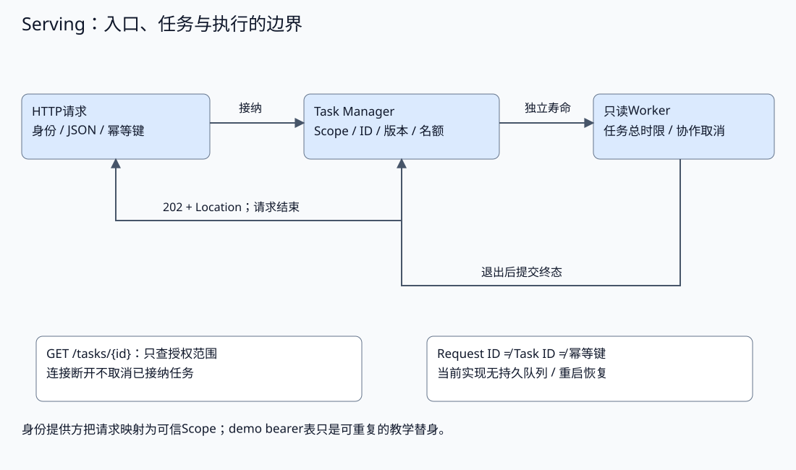
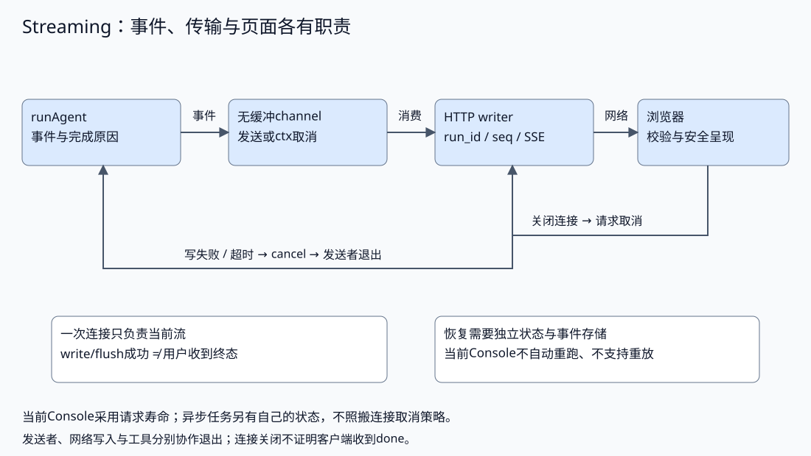
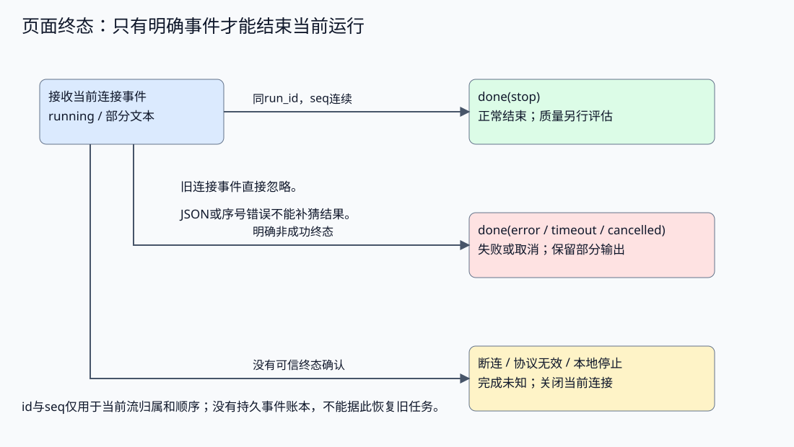
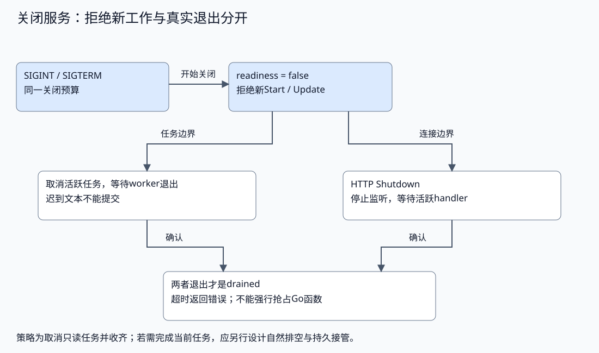

# 服务接入与流式交互

配套实验：[服务接入与流式交互实验](../../../labs/part3-agent/chapter32/task-service/README.md)。

相关实验：[Mini Agent Console](../../../labs/part3-agent/chapter32/mini-agent-console/README.md)。

客户端重试一次提交，后台启动了两份任务；页面显示完成时，worker却仍在执行。服务入口和流式交互需要依赖同一份真实任务状态。

从熟悉的BFF/API和SSE出发，本章先建立身份、接纳、幂等与容量契约，再把运行事件传给页面。断开连接、取消任务和服务退出各有明确语义。

## 服务身份与任务接纳

<a id="topic-agent-serving"></a>

### 请求可以结束，任务仍有自己的寿命

同步接口在当前请求里取得结果；异步接口先返回Task ID，再通过查询或订阅读取状态。流式同步接口仍可能受连接寿命约束，不能仅因为使用SSE就认为任务已经脱离请求。

| 接口模型 | 返回与交互 | 生命周期约定 |
| --- | --- | --- |
| 同步查询 | 一次请求返回最终结果 | 请求超时是否取消执行需要明确 |
| 流式查询 | 当前连接持续接收事件 | 断流后的任务状态与重连策略另行定义 |
| 异步任务 | 创建返回ID，随后查、改、停 | 任务总时限与请求时限分开，资源由应用持有 |

配套服务采用异步任务，HTTP只承担接纳与控制。任务管理器拥有总时限和worker，GET查询使用当前请求context，已接纳任务不因某个查询离开而取消。



这个划分首先改变错误判断：提交响应丢失，不等于任务没开始；查询超时，不等于任务失败；HTTP200返回任务记录，也不等于该任务completed。调用方应分别处理HTTP结果与Task State。

前面先把“请求结束”和“任务继续存在”拆开。接下来再把另一个最基础的边界钉住：谁有权提交、查询和控制这些任务，不能由请求体里的参数自己声明。

### 身份绑定资源，不能由参数自行声明

用户可以提供问题、幂等键和任务ID，不能自己声明拥有某个租户或用户的任务。入口从已经验证的调用身份得到Scope，将它贯穿所有操作，而不是从JSON里的user字段取值。

配套[入口包装](../../../labs/part3-agent/chapter32/task-service/main.go)在调用handler之前完成范围绑定：

```go
func (s *service) authenticated(handler func(http.ResponseWriter, *http.Request, tasks.Scope)) http.HandlerFunc {
	return func(w http.ResponseWriter, r *http.Request) {
		w.Header().Set("X-Request-ID", rand.Text())
		token, ok := strings.CutPrefix(r.Header.Get("Authorization"), "Bearer ")
		scope, known := s.identities[token]
		if !ok || !known {
			w.Header().Set("WWW-Authenticate", "Bearer")
			reject(w, 401, "unauthorized")
			return
		}
		if r.Context().Err() != nil {
			reject(w, 408, "request_canceled")
			return
		}
		handler(w, r, scope)
	}
}
```

这里的identities是固定演示表，公开的demo字符串用于可重复地验证不同用户的资源访问路径。它**不是生产身份提供方**，不证明Token签名、失效、轮换或真实用户认证已经实现；服务因此只允许监听回环IP。

换成真实认证后，仍须在资源操作处检查所有权：同一身份登录成功，不代表能读任意任务。查询、更新、取消和列表都带Scope；跨用户ID按not_found处理，避免透露记录存在。任务存储也检查范围，不能只依赖一个容易被绕过的前端过滤器。

服务端向外返回taskView，保留ID、状态、版本、尝试、结果或稳定错误码，不直接序列化包含内部Scope和输入的Task记录。DTO是公开契约，内部结构可以演进；授权后的结果也需要数据分类、脱敏与大小限制，不能因为“同一个用户”就公开全部日志。

Request ID用于关联一次HTTP调用，Task ID用于定位持续工作，幂等键用于识别一次逻辑提交。三个标识各有生命周期，不要把新生成的Request ID当作客户端重试键。

### 先验证输入，再决定接纳

边界验证分成协议层和任务层：Content-Type、body大小、JSON结构由HTTP检查，输入长度、可接受动作、Scope与预算由执行契约检查。二者不能相互代替。

[decode](../../../labs/part3-agent/chapter32/task-service/main.go)限制读取并拒绝未知字段与额外JSON：

以下摘录函数内的关键分支，完整校验与资源清理见所链源码。

```go
	r.Body = http.MaxBytesReader(w, r.Body, 8192)
	data, err := io.ReadAll(r.Body)
	if err == nil && (!utf8.Valid(data) || uniqueObjectFields(json.NewDecoder(bytes.NewReader(data)), 0) != nil) {
		err = errAmbiguousJSON
	}
```

```go
	decoder := json.NewDecoder(bytes.NewReader(data))
	decoder.DisallowUnknownFields()
	err = decoder.Decode(v)
	if err == nil {
		var extra any
		err = decoder.Decode(&extra)
		if errors.Is(err, io.EOF) {
			return true
		}
	}
```

8192字节是此应用的body上限，任务输入另限4096字节。编码错误或数字误作字符串在解析时拒绝，空输入在任务校验时拒绝；非法请求不能先启动worker再补错误响应。

解析分三步：先有界读完整body并确认原始UTF-8有效，再检查每个对象字段唯一与嵌套深度，最后按窄结构解码并拒绝未知字段和尾部负载。重复键包括input/Input这样的Go字段别名，以及转义后相同的键；不能让后值覆盖前值后才申请任务名额。

当前最大深度为16，不同对象可以各自拥有同名字段。这个预检查不是完整JSON Schema或所有Unicode转义的语义验证；字段类型、长度与revision等业务规则仍由后续层检查。本章不接受模型生成的任意执行配置或Scope。

接纳前还要检查请求是否已经取消；接纳以后即使响应写入失败，也不能把已经登记的任务“回滚”成未发生。HTTP响应只报告接纳事实，任务如何查回由幂等与Location承担。

前面解决的是“一个请求长什么样才值得接纳”。接下来才处理“接纳过一次的逻辑提交如何不被重复派单”，也就是为什么响应丢失后还需要幂等而不是重新来一遍。

## 幂等、容量与错误契约

### 幂等提交防止重复派单

[创建入口](../../../labs/part3-agent/chapter32/task-service/main.go)使用经过身份绑定的Scope、请求幂等键与归一化输入：

```go
func (s *service) start(w http.ResponseWriter, r *http.Request, scope tasks.Scope) {
	if !s.ready.Load() {
		reject(w, 503, "draining")
		return
	}
	var input struct {
		Input string `json:"input"`
	}
	if !decode(w, r, &input) {
		return
	}
	if r.Context().Err() != nil {
		reject(w, 408, "request_canceled")
		return
	}
	task, err := s.manager.Start(scope, r.Header.Get("Idempotency-Key"), strings.TrimSpace(input.Input))
	if err != nil {
		taskError(w, err)
		return
	}
	w.Header().Set("Location", "/tasks/"+task.ID)
	respond(w, 202, project(task))
}
```

处理顺序是：

1. **检查接纳状态**：服务关闭中不接受新工作。
2. **验证请求**：解析有界JSON，并在启动前确认请求仍有效。
3. **在任务管理器中去重与接纳**：同Scope、同键、同初始输入返回已有ID；同键换输入返回冲突。
4. **返回任务位置**：202与Location告诉调用方已接纳，状态快照可能是running，也可能已经结束。
5. **丢失响应时按同键重试**：不得因为没看到202就随机换键再发起一次。

去重与新任务登记必须在同一原子边界内。若先查“没有”，释放锁后再创建，两个并发请求都会启动worker。当前共享Task Manager在同一锁边界完成；多实例服务需要数据库唯一约束、事务或等价的一致性机制，不能用本机map实现跨实例去重。

当前任务记录有保留期，清理同时结束幂等窗口；窗口过期后，同键是新任务。需要更长保证时，单独保留请求账本，并绑定规范化输入摘要与授权范围。幂等也不能撤销外部动作：有副作用的工具仍需自己的执行键和提交结果判断。

### 错误状态指导调用方下一步

HTTP错误应有稳定分类，任务失败则出现在任务记录中。让所有情况都返回200和一句自然语言，会迫使客户端猜测重试行为。

| 情况 | 本章API | 调用方判断 |
| --- | --- | --- |
| 无有效演示身份 | 401 unauthorized | 修正身份，不重试同一个无效凭据 |
| 非JSON、非法字段/输入、body过大 | 415、400或413 | 修正请求，不重复发送相同坏数据 |
| 任务不存在或不属于当前Scope | 404 not_found | 不泄漏其他用户记录；核对ID与范围 |
| 幂等内容不符、旧版本、终态不能更新 | 409 conflict | 重新查询，处理版本或业务冲突 |
| 全局名额或保留容量耗尽 | 503 capacity，带Retry-After | 按相同幂等键有限退避，避免重试风暴 |
| 服务关闭中 | 503 draining | 选择可接纳实例或报告暂不可用 |
| 任务已失败 | 查询200，state为failed | HTTP读取成功，执行失败仍需单独呈现 |

Retry-After是重试提示，不预留名额，也不保证一秒后一定成功。客户端要有总重试期限；权限拒绝、输入错误与确定性冲突不能无限重试。若引入用户配额，可以使用适合契约的限流响应，但不能把本章全局容量控制声称为多租户公平调度。

更新与取消使用revision：用户查到v1以后，另一请求已更新为v2，旧操作返回409；完成先提交后也拒绝再更新。取消响应可能仍为canceling，后续查询才能确认执行器已经结束；它可能没有调用worker，也可能等待已进入的worker退出。具体竞争机制见[Async Tasks](chapter32-async-tasks.md#topic-agent-async-tasks)，HTTP只映射其语义。

更新请求的input在本实现中是完整替换，不是追加消息。用户只补一句“只看今年”时，调用层先形成保留原目标的完整新要求，再提交；HTTP入口不会自动合并旧输入或重新授予权限。输入契约与反例见[Async Tasks的更新输入说明](chapter32-async-tasks.md#更新传的是完整目标还是一条追加指令)。

### 队列和并发是两份容量

增加一个异步API并不意味着可以无限创建goroutine。当前服务最多两个在途任务、十六条保留记录，没有等待队列；拒绝是明确的背压方式。

引入队列时需要分别定义：

- **接纳容量**：排队记录能占多少内存或存储，满时拒绝还是有限等待。
- **执行容量**：worker数量、Provider并发与数据库连接额度分别限制。
- **等待期限**：排队过期、执行超时与客户端等待期限不同。
- **隔离与公平**：一个用户不能无限占用名额；优先级和租户配额需要实际策略与测试。
- **重投与所有权**：持久队列的重复投递、lease与结果提交需要幂等和Checkpoint。

这些是引入队列的责任，不是把内存slice换成Redis以后自然得到的能力。本实验验证HTTP接纳和本机任务契约；另有实际回环HTTP的容量边界对照，持久队列、跨进程恢复与持续负载仍需作品级证据。

<a id="执行空闲为什么仍然拒绝任务"></a>

**执行空闲，为什么仍然拒绝任务**

在途任务结束以后会释放执行名额，但终态记录还要保留，用户才能查回结果或重试原提交。保留容量满时，即使没有worker在执行，新任务也可能被拒绝。此时增加worker数量并不能释放记录，反而可能更快消耗保留容量。

从一次提交到记录回收，分别核对三个边界：

1. **接纳前去重**：已有幂等键返回原任务，不申请新的在途或记录名额。
2. **执行结束**：确认worker退出，提交终态并释放在途名额；结果与幂等索引继续保留。
3. **保留期清理**：应用只清理符合条件的终态记录，同时结束对应去重窗口。清理以后，同键提交可以成为新任务。

本机HTTP对照将worker暂时阻塞，验证并发新提交只能占用既定执行名额；放行并收齐以后，再用终态记录占满保留容量。满额时新键被拒绝，同键仍查回原ID；清理以后新工作又能接纳。这解释容量来自哪里，不证明真实模型吞吐或生产SLO。

保留期限由结果查询、重试和数据策略共同决定。不能为了缓解容量就立即删除用户仍需要查询的结果，也不能把幂等索引永久留下而不计算其空间。持续服务需要接纳量、清理频率与存储容量的联合设计，瞬时执行并发只是其中一项。

<a id="测量什么才能判断服务容量"></a>

**测量什么，才能判断服务容量**

先区分请求次数、逻辑任务数量与实际执行次数。一次任务提交被重试五次，可以产生五次HTTP响应，却只启动一个worker；将这五次响应全计为任务吞吐，会夸大处理能力。

| 观察 | 计量起止与分母 | 容易误判的地方 |
| --- | --- | --- |
| 提交响应延迟 | 发送POST到收到完整接纳/拒绝响应，分组报告 | 202只说明接纳快，不说明任务完成快 |
| 任务终态延迟 | 首次逻辑提交到观察到对应任务终态 | 轮询间隔进入客户端观测，不能当成worker纯执行耗时 |
| 容量拒绝比例 | 合法新逻辑提交中的capacity拒绝 | 幂等重试、坏请求与未授权请求另列，不通过混入健康查询稀释比例 |
| 执行与保留占用 | 在途数量、终态保留数量及清理变化 | 有空闲worker不意味着还能接纳新记录 |
| 完成与失败消耗 | 各任务终态、实际模型/工具调用与usage | 查询HTTP200不等于任务成功，失败与重复尝试也消耗资源 |

容量实验先固定任务分布、请求到达方式、并发与保留配置，明确是否包含模型加载、检索、重试和评分；随后测量稳态、突发及故障期间的变化。只保持固定并发、等待上一个请求结束才发送下一个，会在系统变慢时自动降低提交速率；这种闭环负载不能代表持续按既定速率到来的请求。

负载生成方式可对照[开放与闭合负载模型](https://grafana.com/docs/k6/latest/using-k6/scenarios/concepts/open-vs-closed/)：先选择要模拟的到达行为，再解释观测结果。

SLO需要先约定目标用户操作、测量窗口、延迟和失败口径，再用相应负载验证。少量本机请求可以验证拒绝、去重和回收契约，不能从它们的耗时推导长期P95或99%成功承诺。真实Provider限流、队列等待、超时与关闭故障还要分别纳入证据。

## 运行事件与SSE传输

<a id="topic-ch32-streaming-service"></a>

<a id="先决定展示什么再选择传输方式"></a>

<a id="文本动作与终态不能混成一条字符串"></a>

**文本、动作与终态不能混成一条字符串**

用户需要看见有意义的阶段：正在查询、取得资料、生成回答、结束或失败。将所有日志原样推到浏览器，可能暴露秘密、内部地址和大块工具数据，也会把实现细节当成产品状态。

应用从执行事件中选择面向用户的视图。工具提议不等于执行成功，工具返回不等于回答成立，一段文本也不等于最终结果。最小协议可以分清以下几类：

| 事件 | 页面理解 | 不能据此推断什么 |
| --- | --- | --- |
| tool_call | 模型提出工具动作，显示允许公开的名称与参数摘要 | 动作已获授权或执行成功 |
| tool_result | 应用取得工具数据，可显示摘要或来源 | 数据真实、相关或支持全部结论 |
| token / text_delta | 回答的一段文本，追加到当前消息 | 运行成功、内容完整或已通过质量评估 |
| agent_error | 应用报告失败，保留可公开的错误分类 | 连接已经结束或后台已退出 |
| done | 当前运行给出明确终态 | 业务目标一定达成 |

这些名称是本章应用协议，不是所有Agent框架的统一枚举。接入新框架时，adapter先分清它输出的是文本增量、状态快照、工具参数增量还是终态，再映射到页面；不能见到字符串就当答案追加。

<a id="模型流与应用流是不同的边界"></a>

**模型流与应用流是不同的边界**

Provider可能分片输出工具参数：前一块只有半个JSON，后一块才补完整。**参数增量可以展示，完整参数通过校验后才执行**；不能每收到一块就调用一次工具。不同消息、工具调用或子任务的增量还需要各自的标识，不能用角色显示名作为唯一键。

应用也可以先取得完整结果，再分块呈现。配套Console采用这种方式：本地fake先形成完整文本，再按空白切成块。它验证事件与传输，不模拟真实模型的逐Token生成；中文可能整句是一块，换行也会被重新组装。这里的块数预算不能用于Provider计费。

如果答案需要证据校验，应在发送前选择策略：缓冲全部答案后验证，或明确呈现尚未验证的草稿。已经显示并被用户使用的内容，无法靠最后追加警告真正撤回。Console的只读research先核对来源与摘录，再发送答案；断言支持与自由生成质量继续见[RAG](../building/chapter27-rag.md#topic-ch28-rag-app)，不在Streaming里重新实现检索。

### 一次运行的事件如何保持归属与顺序

同一页面可以连续提交问题，同一个角色也可能参与多个任务。仅靠tool名称和到达时间，无法区分旧回答、当前回答和不同子任务。

应用为每条连接建立Run ID，并按实际发送顺序分配序号。配套[wireEvent](../../../labs/part3-agent/chapter32/mini-agent-console/main.go)保留事件载荷与传输身份：

```go
type wireEvent struct {
	RunID   string          `json:"run_id"`
	Seq     uint64          `json:"seq"`
	Payload json.RawMessage `json:"payload"`
}
```

Run ID标识本次流，Seq在该流内从1递增；事件名称仍由SSE的event字段承载。页面同时核对连接实例、Run ID和连续序号，才能把事件追加到正确回答。

多Agent呈现还需任务或分支路径、消息ID、工具调用ID：相同显示名不能区分两次委派，父级事件也不能覆盖子级卡片。一个可选设计是以`(run_id, task_path, message_id)`定位文本，以ToolCallID配对工具；具体字段须跟Runtime实际契约对应。本Console只有一次单工具流程，不声称实现嵌套事件路由。

序号说明发送顺序，不说明并发工作存在唯一的因果先后。多个worker产生事件时，应由应用的单一发送点排序，必要时记录依赖或父事件ID；不要用时间戳强行排列因果。状态快照通常覆盖旧状态，文本增量通常追加，二者也不能用同一套合并动作。

### SSE把应用事件编码成HTTP文本流

SSE适合服务端持续向浏览器发送文本事件。浏览器的EventSource解析事件，按名称派发回调；若需要上传敏感问题或自定义请求头，也可用经过认证的POST和fetch读取响应流，但需要实现分片解析及取消。

| 传输选择 | 适合什么 | 应用要处理什么 |
| --- | --- | --- |
| EventSource / SSE | 单向事件、浏览器内置解析 | GET入口、重连策略、事件身份与鉴权 |
| fetch流式响应 | POST请求、定制请求头与协议 | UTF-8与事件跨块解析、AbortController、结束判断 |
| WebSocket | 持续双向通信 | 连接会话、消息协议、心跳和流量控制 |

不因“需要流式”就引入双向协议。发送用户要求与接收事件可以使用不同请求；选择取决于交互方式与部署约束。

<a id="一条事件以空行结束"></a>

**一条事件以空行结束**

[writeSSE](../../../labs/part3-agent/chapter32/mini-agent-console/main.go)将载荷封装成单行JSON，再写事件边界并flush：

```go
func writeSSE(w http.ResponseWriter, runID string, seq uint64, ev streamEvent) error {
	data, err := json.Marshal(wireEvent{RunID: runID, Seq: seq, Payload: json.RawMessage(ev.data)})
	if err != nil {
		return err
	}
	if _, err = fmt.Fprintf(w, "id: %s:%d\nevent: %s\ndata: %s\n\n", runID, seq, ev.name, data); err != nil {
		return err
	}
	return http.NewResponseController(w).Flush()
}
```

`id`携带本次Run ID和序号，`event`指定名称，`data`是一行JSON，最后的空行结束事件。JSON编码会转义字符串里的换行，避免资料文本破坏事件边界。SSE自身允许多行data，但本协议选择单行编码，便于保持一个完整JSON载荷。

HTTP网络块不是事件边界：一次Write可能被网络拆开，多次Write也可能被合并。EventSource负责跨块解析；使用fetch时，不能对每个读取块直接JSON.parse，必须先组装完整SSE事件，并处理跨块UTF-8字符。

<a id="flush不等于用户收到"></a>

**flush不等于用户收到**

响应应声明`text/event-stream`，避免缓存。flush将缓冲内容向下游推进，但代理或浏览器仍可能缓冲，写入成功也不能证明用户已经看到事件。生产链路需要实际测量首事件延迟与后续间隔，核对代理配置，而不是靠增加sleep验证“逐字”。

写入和flush错误必须结束当前handler，并取消还在等待发送的生产者。否则连接已经坏了，后台仍可能继续生成无人接收的答案。

请求context约束协作执行，无法抢占阻塞的网络写入。本Console的HTTP Server另设有限WriteTimeout；长任务应拆开执行与观看生命周期，或设置适合产品的逐次写入deadline。无限WriteTimeout、无限channel缓冲和不断重试，都会把慢客户端变成持续资源占用。

前面两节固定了“页面能收到什么”和“这些事件如何编码”；接下来转到最容易失控的地方：生产者和消费者速度不一致时，取消、背压和终态究竟沿哪条路径传播，页面又该相信哪一个结束信号。

## 背压、断连与用户取消

### 背压和取消沿哪个方向传播

运行过程与传输分工如下：



Console使用无缓冲channel，让消费者决定发送速度。[runAgent](../../../labs/part3-agent/chapter32/mini-agent-console/main.go)的发送边界是：

```go
		send := func(ev streamEvent) bool {
			if ctx.Err() != nil {
				return false
			}
			select {
			case out <- ev:
				return true
			case <-ctx.Done():
				return false
			}
		}
```

这段机制按四步工作：

1. **执行器产生事件**：模型或工具完成相应阶段，形成可公开的载荷。
2. **消费者接收事件**：handler读取channel并编码SSE；消费者慢时，生产者等待。
3. **取消打断等待**：请求取消或总期限耗尽时，阻塞发送可退出；handler写流失败也通过defer取消生产者。
4. **收束执行**：生产者关闭自己拥有的channel，handler结束连接，页面根据是否收到明确done决定状态。

无缓冲减少排队内存，不限制全服务的活跃请求数。若改成有界缓冲，应定义满额策略：等待、丢弃可合并进度、断开慢订阅者等。**不能丢终态或随意丢文本delta**，否则页面会出现内容缺失却显示成功。快照或计数可以合并，工具结果与完成确认需要保留其语义。

工具也必须遵守取消契约。Console的工具是短时本地计算，当前签名没有context；执行前后检查请求取消，拒绝迟到结果。接入网络或存储工具时，需要传入context和各自的超时。handler返回不等于忽略context的工具已被强行终止，取消也不撤销已经完成的动作。

前面处理的是服务端怎样把事件送到连接上；接下来再看浏览器怎样拒绝旧连接、跳号和坏载荷，避免把别的运行误当成当前结果。

### 页面只接收当前连接的有效事件

用户提交新问题时，关闭旧连接还不够：浏览器里已经排队的旧回调仍可能执行。每个回调先核对它捕获的局部connection，再验证载荷。

配套[页面接收器](../../../labs/part3-agent/chapter32/mini-agent-console/web/index.html)保存当前Run ID与连续序号：

```javascript
  function receive(e, apply) {
    if (source !== connection) return;
    try {
      const d = JSON.parse(e.data);
      if (typeof d.run_id !== 'string' || !d.run_id ||
          !Number.isSafeInteger(d.seq) || d.seq !== lastSeq + 1 ||
          (runID !== null && d.run_id !== runID) ||
          !d.payload || typeof d.payload !== 'object' || Array.isArray(d.payload)) {
        throw new Error('invalid stream envelope');
      }
      // Commit the cursor only after the event-specific payload is accepted.
      apply(d.payload);
      runID = d.run_id;
      lastSeq = d.seq;
    } catch {
      append('[invalid stream; completion unknown]\n', 'err');
      stopStream();
    }
  }
```

`apply`负责检查具体事件字段，成功后才推进游标；无效JSON、Run ID变化、跳号或非法payload都会关闭当前流并显示完成未知。本协议没有事件重放，因此重复或跳号直接作为协议错误处理；支持断点重放的应用需要另外定义重复去重与缺口补读。

文本通过textContent呈现，不执行来源中的HTML。工具参数、结果和错误也必须按可公开范围投影；这里展示的是固定教学输入，真实服务应先脱敏并限制长度。

<a id="明确终态与连接结束分别处理"></a>

**明确终态与连接结束分别处理**



- **done(stop)**：当前应用流程正常结束；事实正确与任务完成度由RAG/Eval判断。
- **done(error / timeout / cancelled)**：执行失败、超时或取消，保留已出现的部分文本，并明确它不是完整成功回答。
- **网络error或协议失败**：没有可信终态，显示完成未知并关闭连接。
- **用户本地停止**：停止观看并触发本示例请求取消，但没有收到服务端退出确认；不能显示“任务已成功取消”。

本示例handler在取消边界尝试发送终态，但已断开的连接通常收不到。服务端完成与客户端收到确认是两个事实。需要可靠查询时，应使用Async Tasks的独立任务状态和Serving入口，而非让断开的连接承担确认。

前面固定了单个连接里的终态语义；接下来再看自动重连为什么会把“继续观看”误变成“重新执行一次”。

### 重连为什么可能重复执行

EventSource默认具有自动重连行为。Console的GET入口同时表示“开始一次新运行”；如果直接重连，会重新调用模型和工具。页面在网络错误时主动close，要求用户明确发起新请求，避免未经确认的重跑。

本章加入id与seq用于归属和诊断，**没有实现Last-Event-ID断点恢复**。要恢复观看，服务端至少需要稳定Run ID、持久或保留期内的事件账本、单调序号、范围授权、重复去重与过期响应，并让连接接口订阅已有任务，而不是创建新任务。

恢复观看、重放记录、恢复执行仍是不同机制：事件账本可以重发已经发生的内容，Checkpoint管理未完成执行的位置，Replay用于复现诊断。网络断流本身不能决定是否重做一个已完成工具，更不能保证exactly-once。

## 服务关闭与部署边界

<a id="健康检查和服务关闭"></a>

<a id="存活就绪与任务成功分开"></a>

**存活、就绪与任务成功分开**

livez说明进程仍能处理健康请求，readyz说明入口当前可接纳工作。模型暂时调用失败不一定意味着整个进程应重启；全局名额暂满也不应一律让所有实例同时掉出服务。

本章ready是本地接纳标记，关闭时变为false，不声称探测真实数据库或Provider健康。生产readiness根据必需依赖和接纳策略设计，检查要有自己的超时，不能让健康请求成为昂贵模型调用。

<a id="不再接纳随后确认退出"></a>

**不再接纳，随后确认退出**

服务关闭可以选择完成现有任务，也可以选择取消并等待退出。本实验对只读fake采用后者，关闭顺序为：

1. **停止接纳新工作**：readiness置false，Start与Update拒绝；正在接纳的竞争仍由任务管理器最终边界决定。
2. **取消活跃任务**：通知所有worker，保留真实在途资源直到退出。
3. **关闭HTTP入口**：停止监听，等待活跃handler；这不自动管理后台worker。
4. **收齐执行者**：在同一关闭期限内等待任务结束；超时必须报告未完成，不能打印“已优雅退出”。



[Shutdown](../../../labs/part3-agent/chapter32/task-service/main.go)组合HTTP与任务等待：

```go
func (s *service) Shutdown(ctx context.Context, httpServer *http.Server) error {
	s.BeginDrain()
	httpErr := httpServer.Shutdown(ctx)
	return errors.Join(httpErr, s.WaitDrain(ctx))
}
```

Go的HTTP Shutdown等待活跃连接，不会替应用等待独立goroutine，也不会强行抢占忽略context的工具。即使ListenAndServe或Serve已经返回，也要让主进程等到关闭流程结束。

同一deadline避免HTTP等待三秒之后再给worker额外三秒，实际总关闭时间却翻倍。超时返回错误只证明没有按时退出；若任务必须跨实例接管，需要持久状态和租约。直接终止进程可以回收本机资源，不能证明外部请求没有执行。

### 部署时分开课程站点与Agent后端

GitHub Pages发布静态课程和图示，不运行Go任务服务。后端需要自己的进程、服务端配置、运行身份、资源限制与日志；页面通过受控API访问，不把模型凭据注入静态文件。

最小部署应明确四件事：监听地址与网络访问范围；请求、任务和关闭时限；身份验证与任务存储；依赖与错误观测。先从本机独立启动，验证创建、查询、拒绝和信号关闭，再选择进程托管或容器。不能只看到首页200就宣称后端可用。

本实验锁定在仓库Go module，默认仅回环与演示身份；生产部署必须换掉身份替身，并按实际产品选择TLS、持久化、配额与恢复方式。尚未执行的部署、压测和SLO不写成已具备的能力。

<a id="最佳实践"></a>

[实验排查与实践建议：最佳实践](../../../labs/part3-agent/chapter32/task-service/README.md#book-agent-serving-最佳实践)。

<a id="常见问题排查"></a>

[实验排查与实践建议：常见问题排查](../../../labs/part3-agent/chapter32/task-service/README.md#book-agent-serving-常见问题排查)。

[实验排查与实践建议：最佳实践](../../../labs/part3-agent/chapter32/mini-agent-console/README.md#book-ch32-streaming-service-最佳实践)。

[实验排查与实践建议：常见问题排查](../../../labs/part3-agent/chapter32/mini-agent-console/README.md#book-ch32-streaming-service-常见问题排查)。

## 小结

1. 服务入口绑定身份与任务资源，验证输入和容量后接纳。
2. 幂等键绑定请求指纹，响应丢失后的重试不能重复派单。
3. 流式事件保留运行身份、顺序和终态，flush不证明用户收到。
4. 页面隔离旧连接回调，断连观看和显式取消分别处理，重连不自动重新执行。
5. 关闭先停止接纳，再取消并确认worker退出；静态课程与Agent后端独立部署。

## 参考文档

- [Go net/http](https://pkg.go.dev/net/http)：路由、请求context、读取限制与Server超时。
- [Go Server.Shutdown](https://pkg.go.dev/net/http#Server.Shutdown)：HTTP关闭范围与等待语义。
- [Go os/signal](https://pkg.go.dev/os/signal)：信号与应用关闭入口。
- [RFC9110](https://www.rfc-editor.org/rfc/rfc9110.html)：202、401、409、503与Retry-After语义；应用协议仍需定义任务状态。
- [Grafana k6负载模型](https://grafana.com/docs/k6/latest/using-k6/scenarios/concepts/open-vs-closed/)：区分固定并发与独立到达的测试负载，理解系统变慢时测试提交速率的变化。
- [HTML标准：Server-sent events](https://html.spec.whatwg.org/multipage/server-sent-events.html)：事件边界、EventSource与重连语义。
- [Go net/http](https://pkg.go.dev/net/http)：请求context、Flusher、ResponseController与服务超时。
- [Go context](https://pkg.go.dev/context)：取消传播与协作退出。
- [Deep Agents Streaming](https://github.com/datawhalechina/deepagents-in-action/blob/main/content/ch14-streaming.md)：对照事件视图、子任务路由与不同流协议；本章采用独立Go应用协议。

[返回全书目录](../../README.md) · [上一篇：异步任务与生命周期管理](chapter32-async-tasks.md) · [下一篇：可观测性与执行重放](../governance/chapter34-observability.md)
