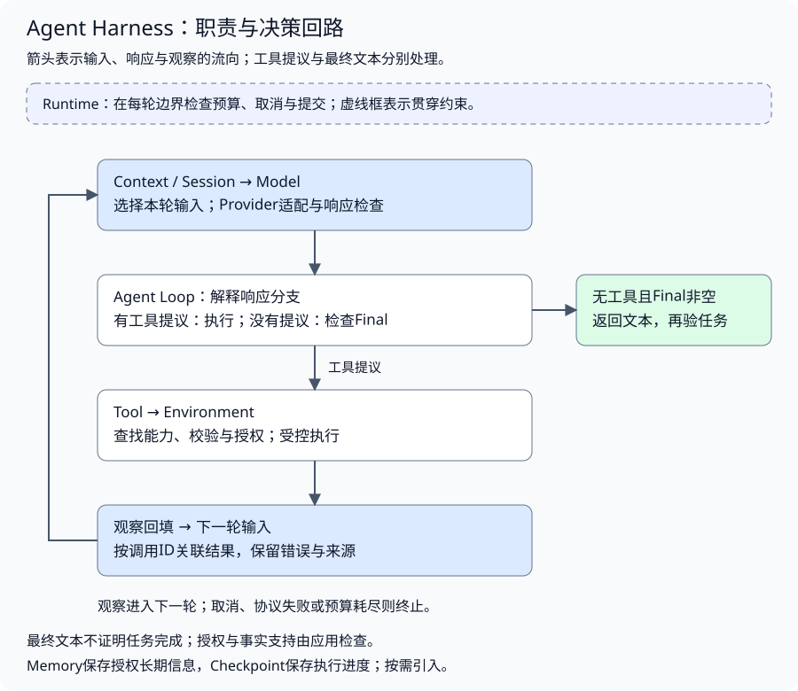
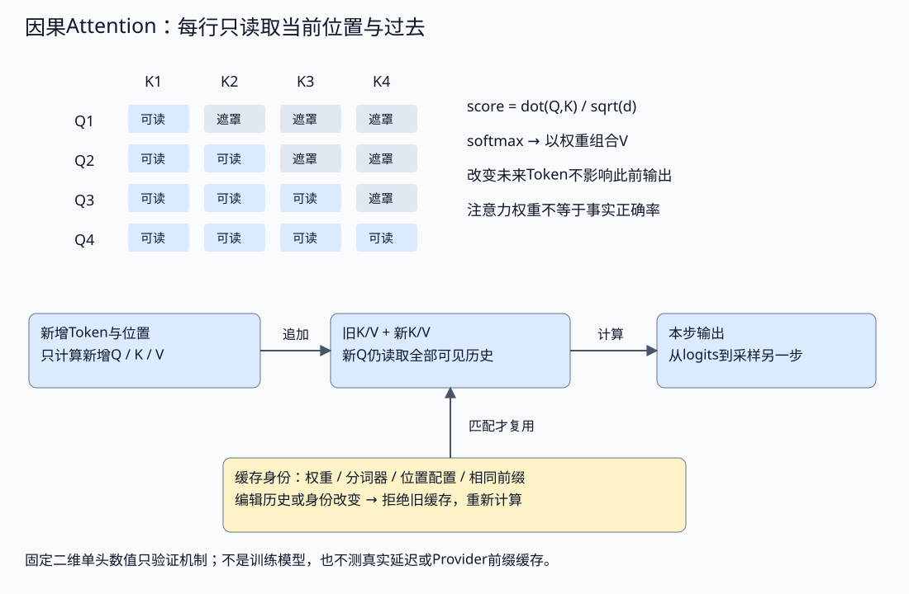
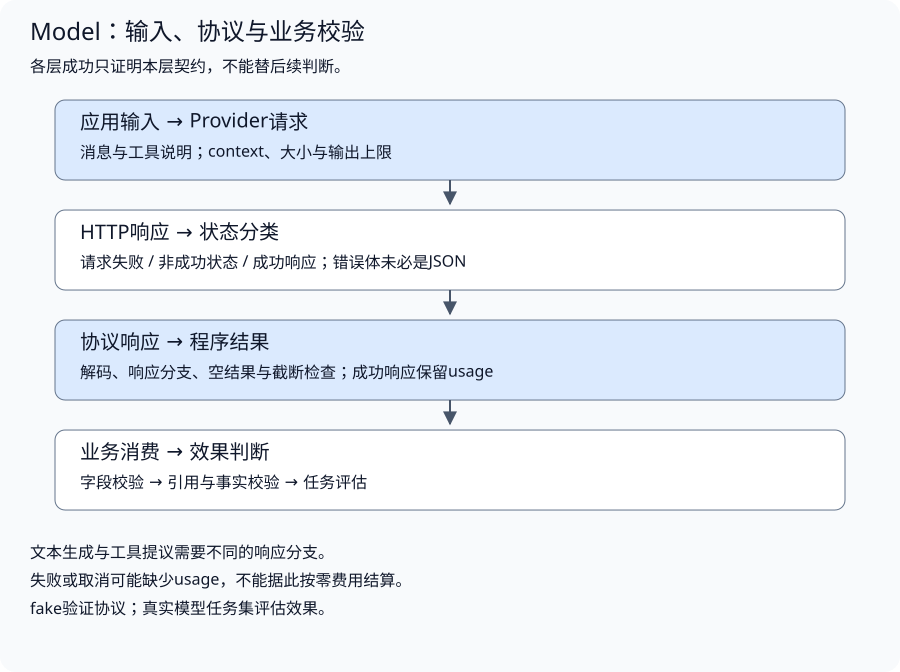

# Agent 架构与模型接口

配套实验：[模型接口与最小执行系统](../../../../labs/part3-agent/chapter23/minimal-agent-loop/README.md)。

相关实验：[示例：hello-llm](../../../../labs/part3-agent/chapter22/hello-llm/README.md)、[示例：structured-output](../../../../labs/part3-agent/chapter22/structured-output/README.md)、[推理机制：字节分词、因果Attention、KV与采样](../../../../labs/part3-agent/chapter22/inference-mechanisms/README.md)。

一个资料助手能回答问题，接入真实使用后却反复检索、忽略取消，甚至在工具失败后宣布完成。需要先看清模型接口与执行系统的分工，再决定增加哪些能力。

页面展示的是文本，服务端还要接住响应完整性、工具提议、状态与消耗。Harness承载模型与环境之间的工程边界；本章先建立职责图，再沿一次推理解释输入、响应和失败。

## 架构职责与执行边界

<a id="topic-harness-intro"></a>

### 先分清模型、Agent与Harness

模型接收输入，产生响应。响应可能是文本，也可能是工具提议。它不会因为生成了函数名，就自动执行应用中的函数。

Agent在运行中根据目标与观察选择后续动作：查询资料、读取结果、再次查询，或结束并回答。动态选择并不意味着应用放弃控制；动作仍要经过参数、权限、资源和状态检查。

Harness提供这些工程边界：模型适配、工具执行、状态管理、上下文组织、终止策略及观测。不同系统按需要组合部件，不要求每个Agent都具备长期Memory、RAG、多Agent或文件系统。



理解这张图时，沿一次请求看职责：

1. **组织输入**：Context选择规则、问题、必要历史和资料，Model适配为Provider请求。
2. **接收决策**：Loop区分工具提议与最终响应。
3. **受控执行**：Tool查找能力、校验参数并调用环境，Runtime约束预算与取消。
4. **反馈观察**：执行结果与原调用关联，进入下一轮可用输入。
5. **结束与判断**：运行因完成、失败或取消结束，业务再验证任务与证据。

课程样章中的[响应类型](../../../../labs/part3-agent/chapter23/minimal-agent-loop/main.go)直接表达两种决策输出：

```go
type Response struct {
	ToolCalls []ToolCall
	Final     string
}
```

工具提议与最终文本必须分支处理。文本不为空也不能覆盖工具失败；模型返回Final，只能说明它选择结束，是否完成任务还需要应用证据。

<a id="一次结束包含哪些判断"></a>

**一次“结束”包含哪些判断**

用户要求“比较当前部署的超时与重试，并给出依据”。模型读完超时资料就返回最终文本，这一轮生成可以正常结束，用户任务却只完成了一半。反过来，预算耗尽会让运行停止，已经取得的资料仍然存在，但应用不能因此声明比较已经完成。

| 判断 | 谁持有依据 | 要回答的问题 |
| --- | --- | --- |
| 任务目标 | 应用与用户约定 | 是否需要超时、重试、当前版本及对应来源，缺资料时怎样说明 |
| 模型响应原因 | Model适配层 | 本次生成给出了最终文本、动作提议，还是因长度或协议问题未完成 |
| 运行停止原因 | Loop与Runtime | 继续、失败、取消或预算耗尽；是否还有在途动作需要收齐 |
| 业务验收结果 | 应用验证与Eval | 必要内容是否齐全，断言有无依据，允许能力是否被遵守 |

这四份判断应保留关联，不能互相覆盖。Provider的停止字段要由adapter转换；某个接口的`tool_use`只表示动作提议，执行还须通过应用边界。一次完整生成也可能给出错误答案；一次取消则可能发生在工具已经执行之后，停止不能撤销既有事实。

判断顺序是：**先确认响应可处理，再决定动作是否允许，随后记录执行事实，最后检查任务完成条件。** 运行失败或待复核时，保留原因与已知消耗；不要将页面上的“完成”按钮或模型自述作为成功依据。Model、Loop、Runtime和Eval分别展开这些契约。

### 固定工作流与动态决策如何选择

如果资料处理步骤可以预先确定，例如解析文档、切分、索引，固定工作流更容易验证。若用户的问题有歧义、查询结果不足，需要根据观察调整行动，动态Loop才有价值。

| 选择依据 | 固定工作流 | 动态Agent |
| --- | --- | --- |
| 后续动作 | 由应用预先组织 | 根据本轮观察选择 |
| 错误定位 | 可先核对每个固定阶段 | 还需核对动作选择与输入信息 |
| 资源管理 | 仍需超时、重试与预算 | 还需限制循环与不收敛 |
| 适用例子 | 固定资料的批量索引 | 证据不足时追加查询 |

两者可以组合：固定检索流水线作为一个Tool，被Agent按需调用。不要为了展示Agent，把确定的业务校验也交给模型；也不要因为固定流程更简单，就忽略确实需要动态选择的任务。

框架可以提供消息、图编排、工具接口和事件机制，但不会自动定义业务权限与完成条件。先理解契约，再用框架或外部协议组合部件，才容易判断哪些行为来自外部组件，哪些仍由应用负责。

## 推理机制怎样约束应用接口

<a id="topic-ch22-llm-api"></a>

<a id="模型推理如何成为应用接口"></a>

<a id="先看模型能看到什么"></a>

**先看模型能看到什么**

一次推理基于本次请求提供的上下文。模型不会因为应用保存了聊天记录，就自动看到这些记录；应用必须选择消息、工具说明和相关资料，再送入调用。

输入中的文本先被分成Token，模型在上下文基础上逐步生成后续Token。Token与字符没有固定比例；不同语言、代码和分词器的结果都不同。**上下文窗口限制本次输入与可生成内容的空间，不能把全部历史无限追加。** 具体容量与输入/输出计算方式取决于Provider和模型。

从系统角度看，几个机制直接影响接口设计：

| 机制 | 对应用的影响 | 应保留的判断 |
| --- | --- | --- |
| Token与上下文窗口 | 长历史与大工具结果挤占生成空间 | 输入预算与输出预算分别管理 |
| Attention | 模型利用上下文中的信息生成响应 | 信息放入窗口不保证被正确使用 |
| KV Cache | 复用已有前缀的中间计算可减少重复推理 | 缓存命中依赖服务实现和输入布局，不能当作会话存储 |
| 采样 | 相同输入可能产生不同输出 | 确定性协议测试与模型效果评估分开 |
| 训练形成的能力 | 决定模型可能完成哪些任务 | 工具权限和事实来源由应用控制 |

Embedding用于把文本映射到向量空间，主要在检索中比较相似性；它不等于生成模型的答案。选模型时先确认任务需要文本生成、结构化结果还是工具提议，再比较能力、延迟与成本，不要只比较上下文窗口大小。

### Token由词表决定，不按字符计数

分词器将文本变成模型词表中的ID。一个字符可以对应多个ID，多个字符也可以合成一个ID；空格、代码标点、聊天模板和特殊标记都会影响输入。预算应绑定所用模型及分词器，不能把字符数乘一个固定系数就当作精确计量。

配套[数值机制实验](../../../../labs/part3-agent/chapter22/inference-mechanisms/README.md)实现一个字节级pair合并教具：先把UTF8字节作为回退ID，再按照给定rank合并已有相邻ID。[Encode](../../../../labs/part3-agent/chapter22/inference-mechanisms/main.go)每次选最优先的可用pair：

```go
		if bestRank < 0 {
			return ids, nil
		}
		ids[bestPosition] = 256 + bestRank
		ids = append(ids[:bestPosition+1], ids[bestPosition+2:]...)
```

新ID对应原有字节串，Decode按词表拼回原文；合并改变分段，不应悄悄丢空格或替换中文。rank冲突按规则决定，同一文本在另一词表中可以产生不同Token。实验规则由应用给定，不包含词表训练、真实聊天模板或Provider tokenizer，计数不能拿去结算费用。

接口层由此需要两份判断：发送前计数/估算用于输入与输出预留，返回后usage来自服务实际口径。Tokenizer一致不保证窗口全部可用，系统规则、工具描述和结构化约束也占输入；Context负责在窗口内选择信息，Model保留相关能力与计量差异。

### Attention组合信息，Embedding不等于证据

生成模型通常先把Token ID映射为向量，加上位置信息，再经过多层变换形成下一步预测。Attention的一步是从表示得到Query、Key、Value：Q用于本位置的信息选择，K参与匹配，V提供被组合的数值。它们是学习到的变换，不是文档ID或应用权限。

单头计算可以写成：`scores = QK^T / sqrt(d)`，加上可见性遮罩后做softmax，再以权重组合V。配套[Attention](../../../../labs/part3-agent/chapter22/inference-mechanisms/main.go)采用固定二维向量：

```go
func Attention(q Vec, keys, values []Vec) (Vec, []float64, error) {
	if len(keys) == 0 || len(keys) > 64 || len(keys) != len(values) {
		return Vec{}, nil, ErrInput
	}
	for _, vectors := range [][]Vec{{q}, keys, values} {
		for _, v := range vectors {
			for _, x := range v {
				if !finite(x) || math.Abs(x) > 1_000_000 {
					return Vec{}, nil, ErrInput
				}
			}
		}
	}
	scores := make([]float64, len(keys))
	for n, k := range keys {
		scores[n] = (q[0]*k[0] + q[1]*k[1]) / math.Sqrt(2)
	}
	weights, err := Softmax(scores)
	if err != nil {
		return Vec{}, nil, err
	}
	out := Vec{}
	for n, v := range values {
		out[0] += weights[n] * v[0]
		out[1] += weights[n] * v[1]
	}
	return out, weights, nil
}
```

自回归的因果遮罩让第i个位置只读当前位置与过去。本实验用K/V前缀形成每一行，改变未来ID时，已经计算的早期行保持不变。训练与prefill可以并行计算多行，但“并行”不表示早期位置可以偷看未来答案。

Attention输出是信息组合，不是数据库查询结果；较大的权重也不等于正确、可信或因果解释。资料放进窗口后仍可能被忽略或误用，所以输入布局与Context效果要评估。检索用Embedding把资料放进可比较的向量空间，生成模型内部表示则参与预测，两者不保证相同，也不能替代来源和断言校验。

这里没有多头、残差、归一化、FFN或训练权重，不能把一次二维加权当成完整Transformer。它足以展示数据依赖，完整模型对语言与任务的能力还来自训练和架构，而非应用层注册工具。

### Prefill与Decode为什么需要KV Cache

prefill处理当前输入前缀，decode随后逐步产生新Token。每个新位置都有新Q，但过去位置的K/V可以在相同模型与前缀条件下复用，避免每步重新做这些投影。



[KVCache.Step](../../../../labs/part3-agent/chapter22/inference-mechanisms/main.go)只接受精确前缀后追加一个ID：

```go
func (c *KVCache) Step(identity CacheIdentity, prefix []int) (Vec, error) {
	if identity != c.identity || len(prefix) != len(c.tokens)+1 || len(prefix) > 64 || !slices.Equal(prefix[:len(c.tokens)], c.tokens) {
		return Vec{}, ErrCache
	}
	p, err := project(prefix[len(prefix)-1], len(c.tokens))
	if err != nil {
		return Vec{}, err
	}
	// Previous K/V remain unchanged; the new query still attends over all accepted history.
	keys := append(append([]Vec(nil), c.keys...), p.K)
	values := append(append([]Vec(nil), c.values...), p.V)
	out, _, err := Attention(p.Q, keys, values)
	if err != nil {
		return Vec{}, err
	}
	c.tokens = append([]int(nil), prefix...)
	c.keys = keys
	c.values = values
	c.Projections++
	c.ScorePairs += len(keys)
	return out, nil
}
```

复用的条件包括权重、分词器、位置配置和前缀ID一致。修改历史文本、在前面插一条规则、更换模型或位置布局以后，旧缓存不能仅凭“都是同一会话”继续用。示例对身份或前缀变化明确拒绝，调用方需重新计算；真实服务按自己的缓存策略决定可重用范围。

缓存保留旧K/V，不表示不再访问历史：新Q仍与可见K做匹配，再读取V。上下文更长时，这部分计算与显存占用仍增长。普通未压缩KV的容量与层数、序列长度、KV头数、头维度和数值精度相关；GQA、量化、滑窗或缓存卸载会改变具体消耗，不能仅凭窗口长度推导总容量。

本地KV、Provider前缀缓存和Session历史是不同的状态。Session用于组织输入，KV是特定模型的中间计算，Provider缓存还受服务布局、有效期和计费策略约束。CPU教具中的投影计数能验证省掉了什么，不证明GPU加速倍数、实际缓存命中或真实首Token延迟。

### 采样选择候选，不输出正确概率

模型最后产生的是词表上的logits，选择下一个ID还需要解码策略。Greedy取最大项；temperature改变logits差距，top-p则根据归一化概率保留累计质量达到阈值的候选，再重新归一化。

配套[Distribution](../../../../labs/part3-agent/chapter22/inference-mechanisms/main.go)固定相同logits，按温度与保留集合计算：

```go
	scaled := make([]float64, len(logits))
	for n, v := range logits {
		scaled[n] = v / temperature
	}
	probs, err := Softmax(scaled)
	if err != nil {
		return nil, err
	}
	order := make([]int, len(probs))
	for n := range order {
		order[n] = n
	}
	sort.SliceStable(order, func(i, j int) bool { return probs[order[i]] > probs[order[j]] })
	kept := make([]float64, len(probs))
	mass := 0.0
	for _, n := range order {
		kept[n] = probs[n]
		mass += probs[n]
		if mass >= topP {
			break
		}
	}
	for n := range kept {
		kept[n] /= mass
	}
```

降低温度会使这个分布更集中，提高温度使候选更分散；top-p不是“保留前p比例的词”，而是累计概率阈值。显式给定随机draw能够稳定检验落在哪个区间，方便区分分布计算与模型能力。

预测概率表示模型在给定上下文下对下一Token的相对偏好，不是答案正确率。相同参数也不能保证所有Provider逐字重复，真实服务还可能有并行计算、实现和策略差异。协议回归用固定输出，模型比较锁定配置、保留重复试验，不能把temperature=0当作任务正确或完全可重现的保证。

<a id="后训练怎样影响接口行为"></a>

**后训练怎样影响接口行为**

预训练提供语言模式，SFT学习示范格式，RLHF与DPO优化偏好目标。它们影响格式、风格与拒绝倾向，部署后仍须独立检查响应完整性和任务质量。DPO使用偏好对相对参考模型的对数概率差；训练目标参数beta与推理温度作用不同。数值损失下降只能验证计算，不能证明模型能力提升。

实现与对照见[配套实验](../../../../labs/part3-agent/chapter22/inference-mechanisms/README.md#book-ch22-llm-api-后训练怎样影响接口行为)。

### Provider负责转换，调用方依赖契约



Provider适配器包住厂商的请求形状、响应形状和HTTP错误。调用方使用课程实验中的[Provider接口](../../../../labs/part3-agent/chapter22/hello-llm/main.go)：

```go
type Provider interface {
	Generate(ctx context.Context, messages []Message) (Response, error)
}
```

接口传递context，让取消与截止时间进入网络调用。响应保留文本和usage；调用方才能把“拿到文本”和“实际消耗”一起处理：

```go
type Usage struct {
	PromptTokens     int
	CompletionTokens int
}

// Response 是一次生成的结果：文本加上 token 用量。
type Response struct {
	Text  string
	Usage Usage
}
```

这套接口是**文本生成的最小契约**，没有覆盖所有Provider功能。接入Loop后，响应还要表达工具提议、调用ID、终止原因等信息，不能把工具提议伪装成最终文本。不同Provider对消息和工具调用的表示可能不同，应在adapter中转换，并验证这种转换不会丢失关联。

当前adapter只在成功响应中返回usage。请求失败、取消或截断时，返回的零值不表示没有消耗；服务端可能已经处理请求。需要费用账本时，应将“已知用量”和“用量未知”分开记录，再按Provider的实际报告对账，不能把错误路径按零费用结算。

本实验沿用Chat Completions风格的文本接口，适合观察HTTP边界；它不是对所有OpenAI兼容服务的兼容承诺。新接入先核对服务的请求字段、usage和错误定义，再写adapter测试。

## 消息与输入的来源

<a id="消息角色如何承载上下文"></a>

<a id="规则问题历史与观察各有来源"></a>

**规则、问题、历史与观察各有来源**

消息角色帮助模型识别内容来源。课程的文本实验使用以下最小消息形状：

```go
type Message struct {
	Role    Role   `json:"role"`
	Content string `json:"content"`
}
```

- **system**承载应用提供的稳定规则，例如输出格式与角色要求。
- **user**承载用户请求与参数。
- **assistant**承载模型先前的回复；保留它才能继续对话或反馈输出错误。
- **tool**承载应用执行后的观察，在Loop章中通过调用ID与工具提议配对。

这些分类解释数据来源，不等于服务端权限。即使模型接受了一条恶意指令，它仍只能请求应用允许的能力。检索资料、网页和工具结果也应保留来源身份，不能因为包含“忽略规则”就升级为应用指令。

<a id="api无状态与业务会话是两件事"></a>

**API无状态与业务会话是两件事**

本实验每次Generate都显式传入消息。续聊时，应用选择需要的历史，并重新构造请求；真实服务也可能提供服务端会话或响应关联能力，适配器应说明如何使用，不能据此省略应用的数据隔离。

一个常见错误是把本轮问题插入system，随后又把历史全部拼接进去。这样会混淆稳定规则与请求参数，也让上下文选择越来越难。先按来源保存消息，再由Context部件选择本轮输入；Session负责历史的保存与隔离，不由Provider承担。

## 响应完整性与结构化校验

<a id="http成功还需要哪些检查"></a>

<a id="按调用链逐层判断"></a>

**按调用链逐层判断**

一次调用至少经过以下步骤：

1. **检查请求**：消息不能为空，编码后的请求不能超过应用上限。
2. **发出受限请求**：绑定context，配置客户端超时与输出Token上限。
3. **读取有界响应**：限制字节数并关闭响应体。
4. **判断状态**：非成功状态先归为HTTP失败，错误体未必是JSON。
5. **检查协议**：成功响应必须能够解码，并包含所需结果。
6. **检查是否仍有效**：取消、空文本或已知截断不能作为正常答案提交。

[HTTP适配器](../../../../labs/part3-agent/chapter22/hello-llm/main.go)在读取时多取一个字节，用于区分“刚好到上限”和“确实超限”：

```go
	maxBytes := p.MaxBytes
	if maxBytes <= 0 {
		maxBytes = 1 << 20
	}
	data, err := io.ReadAll(io.LimitReader(resp.Body, maxBytes+1))
	if err != nil {
		return Response{}, fmt.Errorf("hello-llm: read response: %w", err)
	}
	if int64(len(data)) > maxBytes {
		return Response{}, fmt.Errorf("hello-llm: response exceeds %d bytes", maxBytes)
	}
```

`LimitReader`约束本地读取，不等于约束服务端生成。实验另外发送`max_tokens: 256`，编码请求最多64 KiB。输出参数属于这个adapter的API方言；换Provider时必须确认字段是否支持，不能把字节上限当作Token上限。

<a id="状态码不能被错误体格式掩盖"></a>

**状态码不能被错误体格式掩盖**

网关返回429时可能只有一行文本，返回502时可能是一页HTML。先要求错误体解码成功，会丢掉真正的HTTP分类：

```go
	if resp.StatusCode != http.StatusOK {
		// 网关的错误页未必是JSON；状态分类不依赖错误体能否解析。
		_ = json.Unmarshal(data, &parsed)
		msg := http.StatusText(resp.StatusCode)
		if parsed.Error != nil && parsed.Error.Message != "" {
			msg = parsed.Error.Message
		}
		return Response{}, &HTTPError{StatusCode: resp.StatusCode, Message: msg}
	}
```

这段适配逻辑保留状态码；JSON错误体能解析时补充服务端消息，不能解析时仍返回HTTPError。上层再决定限流退避、故障重试或直接失败。来自服务端的消息仍可能包含内部信息，公开日志与模型反馈需要脱敏。

| 结果 | 意味着什么 | 应用下一步 |
| --- | --- | --- |
| 请求失败或超时 | 尚未取得可用响应，服务端是否已消耗资源可能未知 | 保留错误链，按预算和重试策略处理 |
| 非200 | Provider或网关拒绝了本次调用 | 按状态分类，不靠错误文本猜测 |
| 200但非法JSON或无结果 | HTTP成功，响应协议失败 | 检查adapter与服务契约 |
| 空文本或长度截断 | 没有完整的文本答案 | 返回可见失败；不要提交成空答案或完整答案 |
| 合法文本与usage | 文本调用契约成立 | 继续业务校验与效果评估 |

这里只接受文本响应，因此空文本被拒绝；支持工具调用的adapter应先检查工具分支，不能沿用“没有文本就是失败”的规则。

<a id="结构化输出如何进入业务代码"></a>

<a id="json语法字段契约与业务有效性"></a>

**JSON语法、字段契约与业务有效性**

假设下游需要回答、置信度、情感与引用列表。输出“像JSON”不够，必须分别检查语法与字段。配套的[Answer定义](../../../../labs/part3-agent/chapter22/structured-output/main.go)为：

```go
type Answer struct {
	Answer     string   `json:"answer"`
	Confidence float64  `json:"confidence"`
	Sentiment  string   `json:"sentiment"`
	Citations  []string `json:"citations"`
}
```

应用把输出先解析为`map[string]any`，才能区分缺字段、类型错误、枚举错误与范围错误。对本章的少量固定字段，手写校验足以展示机制；需要嵌套对象和组合规则时，应使用经过验证的Schema实现，不能把这个实验当成完整JSON Schema引擎。

校验按三层推进：

1. **语法层**：是否为可解析的JSON，是否有多余尾部内容。
2. **契约层**：必填字段、类型、枚举、范围、额外字段是否符合约定。
3. **业务层**：引用是否真实存在，资料是否支持断言，任务是否完成。

`confidence: 0.9`只代表模型输出了一个合法数字，不代表答案有90%的正确概率；引用列表通过类型校验，也不代表资料支持答案。这些判断留给证据校验与Eval。

Provider提供的结构化输出约束可减少格式错误，但应用仍需处理拒绝、截断、契约差异与业务有效性。JSON模式与Schema约束能力也不能混为一谈，具体以对应Provider文档为准。

<a id="修复必须带反馈也必须能停止"></a>

**修复必须带反馈，也必须能停止**

遇到字段违约时，只重发原请求并没有补充新信息。应用可以将错误结果与具体问题一起反馈，配套实现保留这段修复消息：

```go
		messages = append(messages,
			Message{Role: "assistant", Content: raw},
			Message{Role: "user", Content: "Your output failed validation: " +
				strings.Join(serr.Issues, "; ") + ". Return only valid JSON matching the schema."},
		)
```

每次修复又发生一次模型调用，仍占用时间与费用。实验只允许首次调用加一次修复；超大输出直接拒绝，context取消直接终止，网络错误不归入格式修复。应避免把原始输出中的秘密或长文本直接反馈，真实系统可改用字段路径和稳定错误码。

## 状态分工与后续扩展

### 状态不是一份聊天历史

从同一个资料问答任务看，至少有四种不同信息：

- **Session**保存消息历史与会话关联，帮助续聊，并负责隔离。
- **Context**是本轮实际提供给模型的输入，可能只是历史的一部分。
- **Memory**保存经过授权、需要跨会话使用的信息，具有范围、过期与删除规则。
- **Checkpoint**保存恢复所需的执行位置与已提交结果，处理进程中断和重复执行。

把历史保存到数据库，不等于实现Checkpoint；把摘要放入prompt，也不等于可靠长期Memory。恢复需要知道动作是否完成、结果是否提交，而模型输入可能只需要一小段已确认的观察。

同样，Streaming、Trace和Eval也各有用途：Streaming让用户看见过程；Trace定位调用链；Eval衡量任务效果。页面显示了完整文本，不能证明答案正确，也不能证明中断后能够恢复。

### 从一个最小契约开始扩展

先用确定性模型与只读工具，确认提议、执行、观察与终止的顺序。再按真实失败补充部件，不一次建齐所有能力。

| 遇到的问题 | 应先查看的部件 | 需要形成的证据 |
| --- | --- | --- |
| 响应格式变化，空结果被接受 | Model | adapter与输出契约测试 |
| 工具名或参数不合法仍执行 | Tool | 拒绝发生在Handler之前 |
| 反复调用同一工具无法结束 | Loop、Context、Runtime | 观察可见、继续条件与预算 |
| 资料命中但引用不支持回答 | Retrieval、RAG、Eval | 候选召回与断言支持分别验证 |
| 子任务阻塞、竞争或状态丢失 | Delegation、DAG、Async | 隔离、依赖、配额与生命周期 |

这些检查从确定性底层开始：先直接调用函数或协议，再验证adapter，再接入运行策略和模型。坏JSON应先修协议，跨用户数据应先修隔离，不先调提示词。

课程的最小实验使用fake与固定数据，不需要密钥。它证明程序按契约推进；真实模型是否做出正确选择，需要受控调用与任务集评估。学习时先预测失败会在哪一层出现，再运行和修改条件，最后脱离AI答案解释一次故障及修复。

<a id="新能力改变了闭环的哪一部分"></a>

<a id="如何继续阅读-part-3"></a>
<a id="按问题选择路线"></a>
<a id="从部件理解到完整实践"></a>
<a id="一次学习怎样安排阅读与动手"></a>
<a id="用一次故障检验理解"></a>

<a id="最佳实践"></a>
<a id="先验证协议再比较模型"></a>
<a id="记录消耗时标明数据来源"></a>
<a id="不在provider里悄悄重试"></a>

[实验排查与实践建议：最佳实践](../../../../labs/part3-agent/chapter22/hello-llm/README.md#book-ch22-llm-api-最佳实践)。

<a id="常见问题排查"></a>
<a id="429被显示成json解析失败"></a>
<a id="json能解析业务却拿到空字段"></a>
<a id="取消后页面仍显示答案"></a>

[实验排查与实践建议：常见问题排查](../../../../labs/part3-agent/chapter22/hello-llm/README.md#book-ch22-llm-api-常见问题排查)。

## 小结

1. 模型提供响应与动作提议，Harness承载输入组织、受控执行、状态和验收边界。
2. 模型机制决定窗口与计算约束，Provider将具体协议转换为应用契约。
3. 响应完整、结构合法、来源可信和任务完成分别判断；失败时保留原因与已知消耗。
4. Session、Context、Memory和Checkpoint按用途管理，不将聊天历史当作所有状态。

## 参考文档

- [Go context](https://pkg.go.dev/context)：应用取消与下游协作的基础。
- [Deep Agents的Agent Harness导论](https://github.com/datawhalechina/deepagents-in-action/blob/main/content/ch01-agent-harness.md)：补充Harness整体视角。
- [ReAct论文](https://arxiv.org/abs/2210.03629)：动作与环境观察如何形成反馈循环。
- [工作流与Agent架构](https://www.anthropic.com/engineering/building-effective-agents)：固定路径、动态选择及组合模式的设计取舍。
- [InstructGPT论文](https://arxiv.org/abs/2203.02155)：示范、偏好与奖励模型路线。
- [DPO论文](https://arxiv.org/abs/2305.18290v3)：直接偏好目标、参考模型与计分约定。
- [encoding/json](https://pkg.go.dev/encoding/json)：JSON与Go类型的转换、解码失败行为。
- [net/http](https://pkg.go.dev/net/http)：请求context、客户端超时与响应体处理。
- [Structured Outputs](https://developers.openai.com/api/docs/guides/structured-outputs)：区分输出Schema约束与业务校验，接入时核对支持范围。
- [Attention Is All You Need](https://arxiv.org/abs/1706.03762)：Attention与Transformer机制的基础阅读。
- [Hugging Face BPE](https://huggingface.co/learn/llm-course/en/chapter6/5)：pair rank与词表如何形成分词结果。
- [KV Cache说明](https://huggingface.co/docs/transformers/en/cache_explanation)：前缀中间状态与逐步解码。
- [生成策略](https://huggingface.co/docs/transformers/en/generation_strategies)：Greedy与采样的区别。

[返回全书目录](../../README.md) · [下一篇：工具接入与受控行动](chapter23-actions.md)
