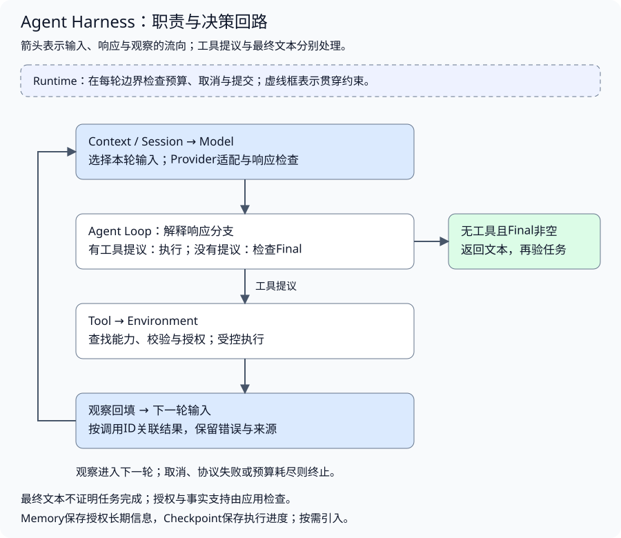
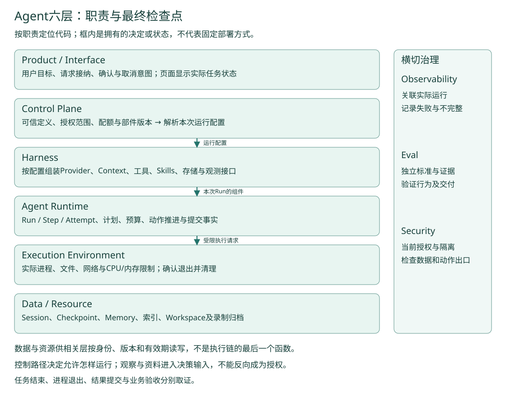
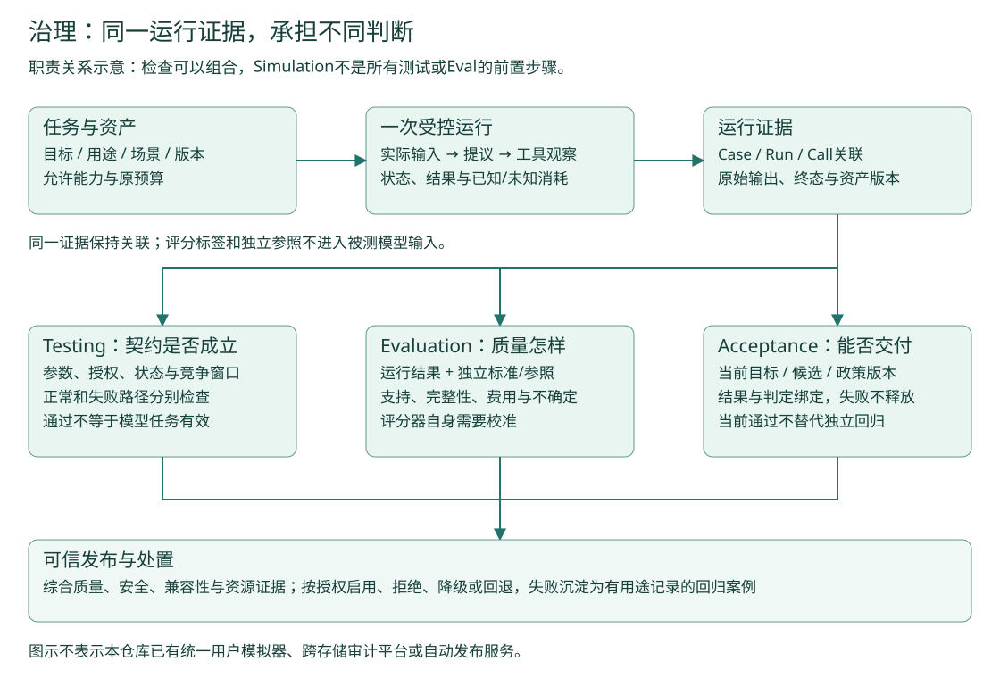

# Agent 架构基本要素与最佳实践

配套实验：[最小Agent决策闭环](../../../../labs/part3-agent/chapter23/minimal-agent-loop/README.md)。

用户要求“比较当前部署的超时与重试策略，并给出依据”。模型能理解这句话，却不会自动知道去哪里查、能读哪些资料、何时该停止，也不会替应用保存执行状态。一个完整Agent应用需要把这些职责连接起来。

从前端经验出发，可以把它看成一个有任务状态的应用：页面负责交互，服务端接纳任务，执行系统调用模型和工具，存储保存事实，验证决定结果能否交付。新增的挑战是，部分执行路径由模型根据观察提出，应用仍须掌握权限、资源和最终交付。

本章先解释基本构件，再用六层职责定位它们，沿同一任务串起运行过程，最后讨论架构取舍。参考[AI Agent Handbook架构篇](https://aliyun.github.io/ai-agent-handbook/architecture/chapter-02.html)的组件、平台与生命周期视角，重点建立读者可以继续定位后续专题的整体地图。

## 一、任务形态：从模型响应到Agent应用

### 1.1 模型、Agent与应用系统

Model负责在给定输入下生成文本、结构化结果或动作提议。Agent根据任务目标与已有观察选择下一步行动。Agent应用还包括入口、身份、执行器、状态、资源和验证：这些部件共同决定提议能否执行、结果是否可用。

例如模型提出“读取重试政策”，应用仍要解析这个提议，检查资料范围，调用允许的读取工具，再把真实结果交回下一轮。模型生成了函数名，不会自行触发服务端函数。

> **Agent架构要同时回答三件事：下一步从哪里来，实际动作由谁控制，结果凭什么算完成。**

这也解释了为什么换一个更强模型不一定解决重复执行、跨用户读取或状态丢失。这些问题发生在应用的调用与数据边界，需要相应的工程机制。

### 1.2 Workflow、单Agent与协作不是同一分类

任务路径稳定时，可以用固定Workflow连接模型与工具；需要依据新观察决定后续步骤时，再使用动态决策循环。二者可以组合：Agent调用的一个工具，内部可能就是固定检索流水线。

| 架构选择 | 改变了什么 | 增加的设计责任 |
| --- | --- | --- |
| 固定Workflow | 由应用规定阶段和转移条件 | 每阶段的契约、分支与错误传播 |
| 动态Agent Loop | 模型结合观察提议下一步 | 动作准入、反馈、终止与总预算 |
| 多Agent协作 | 将子任务交给不同执行角色 | 子契约、权限交集、结果汇总与协调成本 |
| 长时间运行 | 任务跨请求甚至跨执行实例持续 | 持久状态、恢复资格、资源回收与迟到结果 |

后两项可以叠加到前两项。单Agent可以运行很久，多Agent也可以按固定Workflow组织；它们不构成从低级到高级的单一路线。[Anthropic的架构实践](https://www.anthropic.com/research/building-effective-agents)也将固定路径与模型驱动路径分别讨论，选择依据是任务需要。

## 二、基本构件：Model、Harness与能力连接

### 2.1 Model提供判断，适配层保留可替换边界

架构上关心模型能否完成当前任务、能接收哪些输入、能提出什么动作，以及延迟、用量和数据边界。模型接入适配层处理具体服务协议，向上提供应用可理解的请求、响应与错误。

更换模型时，应用应能继续使用相同的任务和工具契约，但仍要重新验证实际行为。接口兼容只说明请求可以交互，不能证明新模型会保留同样的约束、选择同样的动作或达到相同质量。

Token窗口、缓存和采样会影响输入容量、性能和稳定性，在架构中表现为约束。实现细节可按需阅读[模型接入实验](../../../../labs/part3-agent/chapter22/hello-llm/README.md)、[结构化结果实验](../../../../labs/part3-agent/chapter22/structured-output/README.md)及[推理机制实验](../../../../labs/part3-agent/chapter22/inference-mechanisms/README.md)；这里先明确它们与其他部件的交接关系。

### 2.2 Harness把部件接成受约束的任务循环

Harness常被用来概括模型外围的工程支撑。为便于定位代码，本书在六层视角中进一步区分：Harness负责部件组装、输入与能力适配、策略接缝；Runtime持有一次运行的状态，推进动作、停止和恢复。任务策略通过这些部件协作落地。

沿图看最小闭环：Context组织当前信息，Model返回提议，执行器检查并调用工具，真实观察进入状态和下一轮输入，运行控制判断继续还是停止。Planning、RAG、Skills或子Agent是在这条闭环上增加能力，不是建立另一套不受约束的执行入口。

> **先保证输入、提议、执行、观察和终止能正确交接，再决定需要增加哪些能力。**

### 2.3 Context、State、Memory、Knowledge与Skill

这些对象都可能以文本进入模型，但来源、用途和更新方式不同。判断归属时先问“谁维护它、它代表什么”，再选择数据库或文件后端。

| 对象 | 在任务中的作用 | 需要保留的边界 |
| --- | --- | --- |
| Context | 本轮模型实际可见的信息视图 | 随任务重建，遵守容量与来源规则 |
| State | 任务、计划、调用及提交事实 | 按身份和版本维护，支撑并发与恢复 |
| Memory | 经准入保存、供后续交互使用的事实或经验 | 所有者、写入依据、期限、更新和删除 |
| Knowledge | 可查询的业务文档与外部资料 | 源资料权限、版本、时效与原文定位 |
| Skill | 一类任务的方法、步骤与参考资源 | 适用范围、内容版本、加载预算与宿主许可 |

Session、Task、Plan、Checkpoint是不同用途的状态；Workspace与Artifact保存任务资料和产物。把它们放到同一后端，并不会使其访问和生命周期规则自动一致。

> **Context是输入视图，持久状态是应用依据的事实。压缩或重建输入不应改写已经发生的任务事实。**

例如用户把目标从全年改为季度，State记录新目标版本，Context采用新约束，已有Memory与Knowledge按各自资格读取，旧报告产物是否可复用则重新验收。不能只改一条提示词，就假定所有旧结果已经失效或更新。

### 2.4 Tool、Protocol与Environment

Tool提供可请求的动作，Protocol定义如何描述、发现和交换调用，Environment承载实际影响。一次MCP调用可以最终读取文件或调用服务，但发现了工具不等于有权限，协议交互成功也不等于任务完成。

| 边界 | 应用要决定什么 | 典型失效 |
| --- | --- | --- |
| Tool | 允许的动作、参数与结果契约 | 参数合法但业务范围不允许 |
| Protocol / Adapter | 能力绑定、请求关联、错误与生命周期 | 结果配给错误调用，断连被当成空结果 |
| Environment | 实际文件、进程、网络和资源范围 | 应用停止等待，后台执行仍继续 |

权限由可信应用落实；Shell、浏览器或代码执行环境所具有的通用能力，也要纳入同样的准入与隔离。具体接入见[受控行动](chapter23-actions.md)，环境边界见[安全与执行环境](../governance/chapter36-security.md)。

## 三、六层职责：把构件放回系统边界

### 3.1 六层分别拥有什么

组件视角解释有哪些能力，分层视角进一步确定谁持有决定和状态。本书采用以下六层，Observability、Eval、Security横切其间。

| 职责层 | 持有的决定或状态 | 交接给其他层什么 |
| --- | --- | --- |
| Product / Interface | 用户目标、交互、任务操作与结果呈现 | 经身份绑定的请求、确认或取消意图 |
| Control Plane | 定义、版本、Policy、配额与发布选择 | 本次运行允许使用的配置及约束 |
| Harness | 模型、Context、工具、Skills、存储和观测接口的组合 | 绑定本次任务的部件与适配规则 |
| Agent Runtime | Run、Step、Attempt、预算、执行和提交状态 | 动作、观察、状态变化与明确终态 |
| Execution Environment | 实际进程、文件、网络与资源限制 | 受限执行的结果、退出及清理事实 |
| Data / Resource | 会话、恢复状态、记忆、索引、工作区及产物 | 有身份、版本、所有权和有效期的数据或引用 |

> **六层是职责划分，不是六个微服务，也不是每个请求必须顺序经过的六个函数。**

一个Go进程可以同时承担这些角色。拆分模块或服务时，依据独立状态、故障边界、资源需求和团队维护责任，而不是为了让部署图看起来与分层图一致。

### 3.2 控制路径、执行路径与数据路径

控制路径决定允许使用的版本、能力和预算；执行路径产生真实动作与观察；数据路径提供资料、保存状态和结果。同一组件可以参与多个路径，但各自的权限和一致性语义需要分清。

例如控制面发布新的工具版本，Harness在新运行中绑定它；旧Run继续记录原配置，执行器按当前授权检查动作。工具返回的资料属于决策输入，不能倒流成控制面政策。

集中管理策略也不要求所有动作都同步访问同一管理服务。可以由执行入口按已下发版本判定，但要处理策略传播延迟；需要及时撤销的权限，另定义刷新、短期资格或强制核对机制。快照解决追溯，不能代替当前许可。

## 四、任务链路：从用户目标到可交付结果

### 4.1 用一次资料比较串起各层

仍以“比较当前超时与重试，并给出依据”为例。下面是架构过程示意，解释各处的输入与产物，不表示所有平台采用同一套接口或存储事务。

| 环节 | 主要责任方 | 形成什么事实 |
| --- | --- | --- |
| 接纳任务 | Product / Interface | 谁请求、比较哪个服务、交付要求是什么 |
| 解析配置 | Control Plane | 允许资料、模型/工具版本、原预算及环境范围 |
| 组装运行 | Harness | 本次绑定的部件、输入来源与校验位置 |
| 选择行动 | Model与任务策略 | 下一步查询或结束的候选提议 |
| 受控执行 | Runtime、执行器与Environment | 准入决定、实际工具调用及结果或错误 |
| 提交观察 | Runtime与Data / Resource | 调用关联、已取得证据、执行状态和消耗 |
| 继续或终止 | Runtime与任务策略 | 继续查询、请求澄清、失败、取消或正常结束 |
| 验收与交付 | 应用验证与产品出口 | 结果是否覆盖要求、仍有有效依据并允许释放 |

只读超时资料返回以后，任务还可能缺少重试政策。观察应该让下一步发现这个缺口；预算不足时报告不足，不靠模型补出一个未读取的值。若资料读取被拒绝，拒绝事实继续保留，不能被最终回答覆盖。

### 4.2 响应结束、运行停止与任务完成

这三个判断发生在不同位置。模型可以正常结束生成，但只回答了一半问题；Runtime也可能因为取消而停止，此前已执行的读取却真实发生过。

| 判断 | 判断依据 | 对后续的影响 |
| --- | --- | --- |
| 本次模型响应是否完整 | 响应协议与生成结束原因 | 能否解析为提议或候选回答 |
| 运行是否继续 | 状态、取消、预算及在途动作 | 能否再派发动作，是否需要收齐 |
| 任务是否完成 | 目标、证据、产物与独立检查 | 能否将当前结果作为合格交付 |

> **模型选择结束，只形成候选结果；业务完成由任务条件与实际证据决定。**

### 4.3 失败在所属边界处理

没有必要把所有失败都交给模型“再试一次”。格式违约可以有限修复；暂时故障只有在重复安全且预算允许时才能重试；权限拒绝需要维持边界；执行与提交之间结果未知时，则先查状态或按明确恢复政策处理。

取消同样贯穿多层：页面提出意图，服务验证任务归属，Runtime关闭新动作入口，Environment协作停止执行，数据层保留已提交事实。停止观看不等于任务停止，任务停止也不撤销已经发生的动作。

## 五、运行基础：配置、状态与环境各守边界

### 5.1 定义、运行快照与当前授权

Agent定义表达可用模型、工具、Skill、政策及预算上界；启动快照记录本次实际选择。二者帮助解释“运行了哪一版”，当前授权则回答“此刻还能做什么”。

例如v3允许资料A/B，v4新增C，原Run不会因新版本发布自动得到C。A随后撤销时，记录了v3也不能永久读取A。恢复旧任务要核对原身份、版本和剩余预算，再判断当前资源资格。

> **版本快照用于复现，当前授权约束使用；回滚配置不能倒转外部动作或已经发生的消耗。**

### 5.2 持久状态与可替换执行实例

当任务需要跨请求、审批等待或故障恢复时，关键事实应能脱离单个worker存活。保存已提交观察、游标、目标版本和消耗，再以明确所有权恢复；重新启动函数不等于恢复同一任务。

Session支持交互连续性，Checkpoint支持执行继续，Memory支持跨交互信息，Workspace支持任务资料与产物。它们可以互相引用，但访问范围、版本和保留规则分别维护。[LangGraph的持久化文档](https://docs.langchain.com/oss/python/langgraph/persistence)也区分线程状态与跨线程存储；具体实现保证仍取决于所用后端。

短任务可以从单进程内存开始。需要恢复时，再补足持久提交、领取与迟到结果检查；不能将内存演示的成功直接推广为进程重启或多实例保证。

### 5.3 Runtime与执行环境

Runtime管理任务怎样排队、推进、重试、暂停和退出；Environment约束实际程序可以触及的文件、网络和计算资源。取消信号需要传播到执行方，执行方退出需要确认，资源清理另有结果与失败记录。

资料目录有边界，不表示Shell已经隔离；进程被限制，也不表示某个读取已经获得用户授权。运行预算、环境限额和数据权限同时生效，分别防止循环失控、资源占用失控与越权。

### 5.4 入口与Gateway的治理粒度

认证、幂等接纳、并发限制及公开错误在服务入口落实。共享Gateway可以进一步集中模型路由、工具凭据或任务配额，但模型调用、工具调用和整项任务的控制对象不同，不应共享一套含糊的计数与权限。

是否引入独立Gateway取决于多应用复用和治理需求；它不是最小Agent的必选部署组件。即使使用共享入口，数据后端和工具服务仍要守住自己的授权边界。

## 六、治理闭环：可观测、验证与受控改进

### 6.1 运行证据连接质量、安全和成本

Observability关联任务、调用、错误和版本；安全检查约束数据与动作；Eval检查任务表现及改动效果；成本管理记录已知、估算和未知消耗。它们贯穿接纳、执行与交付，承担不同判断。

Trace显示工具成功，答案仍可能缺少依据；没有越权，任务仍可能没完成；质量通过，也可能超出可接受的延迟或费用。治理需要把这些证据放回同一次任务，而不是用一个平均分抵消关键失败。

### 6.2 从失败到候选版本，再回到验证

发现回答遗漏时，先沿Run检查实际配置、输入与工具观察，确认问题来自缺少资料、未保留约束、动作选择还是结果验收。随后调整对应部件，形成候选版本，与原方案在可比任务和预算下验证。

> **运行事实支撑诊断，独立对照支撑改进，可信发布入口决定新版本何时生效。**

发布记录需要关联模型、Prompt/Context策略、能力与资料、运行政策以及验证基线等实际依赖。无需为每次运行复制全部资产，但必须能够解析其身份和版本。只保存一个模型名或最终答案，不足以解释一次行为变化。

模型生成的Prompt、Skill或配置建议也只是候选。它们可以帮助改进，但不因此获得修改线上政策或扩大工具权限的资格。深入阅读从[治理篇导读](../governance/chapter34-observability.md#governance-overview)进入。

## 七、最佳实践：选择足够简单、能够取证的架构

### 7.1 用实际问题决定扩展顺序

架构设计先固定任务、可用资料、允许动作和完成条件，再选择部件组合。对稳定路径采用容易验证的Workflow，需要观察驱动时引入有界Loop；模型、编排、状态与环境保持清楚接口，便于独立改变并联合验证。

| 设计重点 | 可采用的实践 | 需要保留的判断 |
| --- | --- | --- |
| 组件解耦 | 用明确请求、结果和状态契约连接模型、Harness、Runtime与环境 | 替换实现后任务行为仍要验证 |
| 状态归属 | 恢复事实按任务持久化，Context按决策重建 | 保存历史不等于保存了可恢复执行事实 |
| 自主性与影响范围 | 从只读、少量工具和有限预算开始 | 每增加一种动作，补相应授权、隔离与结果检查 |
| 可观测与验收 | 从最小闭环起保留调用关联和成功标准 | 日志存在不等于证据完整，生成结束不等于交付通过 |
| 持续演进 | 按失败定位部件，比较新旧配置及新增代价 | 能力更多或框架更复杂都不是收益证据 |

例如反复查询先检查观察是否进入输入，再检查继续条件；证据不支持回答先检查候选、实际输入与断言；中断后重复调用先检查提交事实与恢复资格。问题落在哪个边界，就先改那个边界。

部署可以从应用内组合开始，再按隔离、容量、复用和运维需求拆分服务。托管与自托管都会留下应用自己的目标、权限和验收责任；选框架或平台时，检查它承担了哪些保证、哪些仍需自己实现。

### 7.2 从架构地图进入后续专题

下面的八阶段是阅读映射，不是一项任务的固定执行顺序，也不要求一阶段一周。先理解本章组件与边界，再进入对应实现；需要模型接入代码时选读第2节链接的实验。

| 阶段 | 先解决的问题与阅读入口 | 需要解释的失败与迁移证据 |
| --- | --- | --- |
| 1. 建立最小闭环 | 本章架构总览 → [23本地Tool](chapter23-actions.md#topic-agent-tool) → [24 Loop/ReAct基础](chapter24-decision-loop.md#topic-ch23-tool-calling) → [26 Session/Context](chapter26-context.md) | 未知工具不执行、观察关联不丢、历史与输入分离；换一条查询解释继续和停止 |
| 2. 让运行可检查 | [29运行控制](../runtime/chapter29-execution.md#topic-agent-runtime) → [35 Case/Runner](../governance/chapter35-evaluation.md#topic-agent-eval) → [34事件关联](../governance/chapter34-observability.md) | 坏输出、工具失败、取消和预算有不同记录；固定Case绑定实际Run，Trace不等于评分 |
| 3. 约束配置与环境 | 本章配置与状态边界 → [30 Workspace](../runtime/chapter30-state.md#topic-agent-workspace) → [36环境与安全](../governance/chapter36-security.md#execution-environment-lifecycle) | 版本快照不授予永久权限；受限目录不等于进程隔离；等待结束不等于资源销毁 |
| 4. 接入领域能力 | [23 MCP](chapter23-actions.md#topic-agent-mcp) → [28 Skills](chapter28-skills.md) → [23人工决定概念](chapter23-actions.md#topic-agent-hitl) | 发现、加载、批准与执行分开；坏Schema/断连不被转成正常资料 |
| 5. 形成知识任务 | [30 Memory](../runtime/chapter30-state.md#topic-agent-memory) → [27检索与RAG](chapter27-rag.md) → [35证据评分与校准](../governance/chapter35-evaluation.md#独立校准与指标口径) | 更新/过期/删除改变有效输入；召回、出处、支持和完成度分别验证；回读HyDE与重排 |
| 6. 决策与恢复 | [24 Self-Ask](chapter24-decision-loop.md#子问题怎样由观察继续展开) → [25 Planning/Reflection/Reflexion/搜索](chapter25-planning.md) → [29 Checkpoint](../runtime/chapter29-execution.md#topic-agent-checkpoint) → [23持久审批](chapter23-actions.md#人工介入与动作确认) | 同任务对照策略；中断后按提交事实继续；重做不清零预算，旧批准不覆盖新动作 |
| 7. 扩展协作与产品入口 | [31委派/Handoff/DAG](../runtime/chapter31-collaboration.md) → [32 Async](../runtime/chapter32-async-tasks.md) → [33 Serving/Streaming](../runtime/chapter33-serving.md) | 子结果归属、目标版本、资源竞争、取消收齐与幂等接纳；区分局部SQLLease和完整跨实例恢复 |
| 8. 治理与架构取舍 | 先读[治理篇导读](../governance/chapter34-observability.md#governance-overview)，回读[34 Trace/Replay](../governance/chapter34-observability.md)、[35 Eval](../governance/chapter35-evaluation.md)、[36 Safety](../governance/chapter36-security.md)、[37 Cost](../governance/chapter37-cost.md) | 用四类独立作品说明质量、恢复、安全、延迟和成本；保留无收益与未验证的生产边界 |

同一篇长章可以分次阅读。MCP不要求先完成多Agent，最小流式体验也不要求先完成持久任务；Runtime、知识系统或能力集成方向可以沿不同缺口加深。

## 小结

1. Agent应用由目标、模型、输入、行动、状态、执行环境与验证协作组成；能力清单要落到交接关系。
2. 六层用于分配职责，部署按故障、资源和维护边界选择，不机械拆成六个服务。
3. 模型提议经过应用准入才形成动作，真实观察与持久事实支撑继续、停止和恢复。
4. 配置快照、当前授权和任务验收各有作用，不能由模型结束或工具成功互相替代。
5. 从可验证的最小闭环开始，以运行证据定位改动，再按任务效果与全部代价决定是否采用。

## 参考文档

- [AI Agent Handbook：Agent架构设计基本要素](https://aliyun.github.io/ai-agent-handbook/architecture/chapter-02.html)：组件、运行与生命周期的多视角架构讨论；本章六层是本书的职责划分。
- [Anthropic：Building effective agents](https://www.anthropic.com/research/building-effective-agents)：固定Workflow、动态Agent与简单可组合模式。
- [LangGraph Persistence](https://docs.langchain.com/oss/python/langgraph/persistence)：线程执行状态与跨线程信息的不同持久化职责。
- [Go context](https://pkg.go.dev/context)：配套实验中协作取消和截止时间的基础，取消意图仍需执行方响应。
- [Deep Agents的Agent Harness导论](https://github.com/datawhalechina/deepagents-in-action/blob/main/content/ch01-agent-harness.md)：从模型外围工程系统理解Harness。

[返回全书目录](../../README.md) · [下一篇：工具接入与受控行动](chapter23-actions.md)
