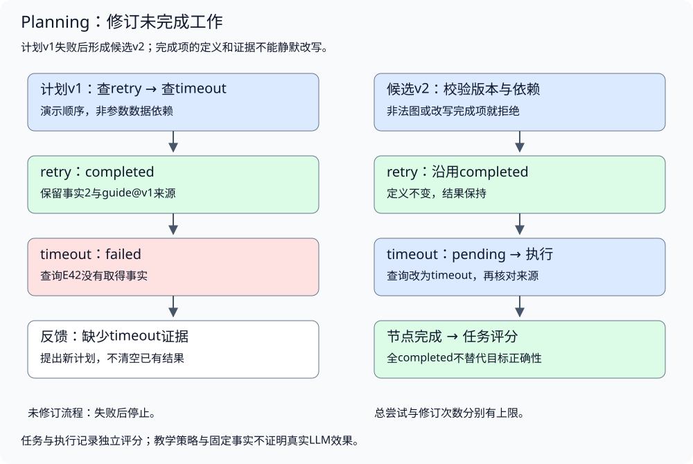
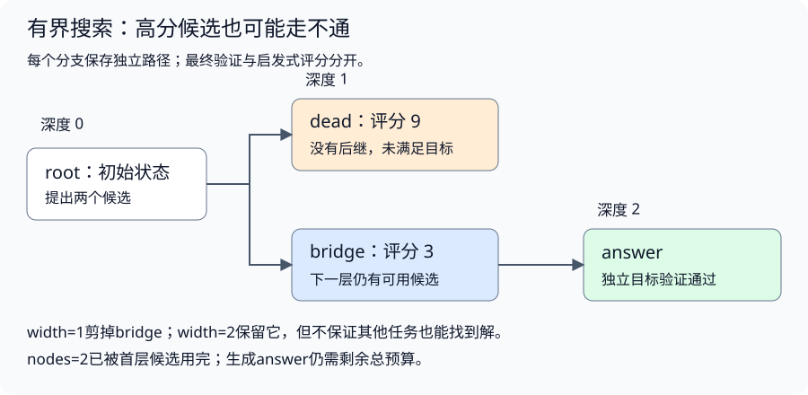
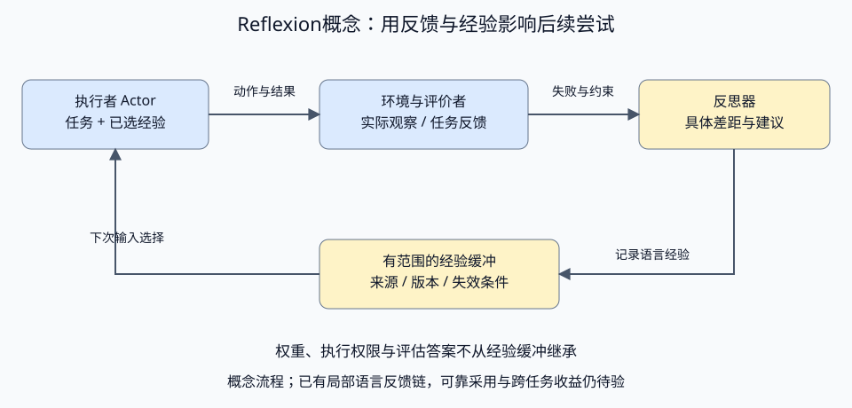

# 任务规划与反馈修订

配套实验：[任务规划与反馈修订实验](../../../../labs/part3-agent/chapter24/plan-execute/README.md)。

相关实验：[策略对照：子问题、计划与有界证据修复](../../../../labs/part3-agent/chapter24/strategy-comparison/README.md)。

长任务既可能遗漏步骤，也可能沿着错误计划持续执行。显式计划需要表达产物与依赖，执行反馈则决定它是否仍然有效。

本章从可验证的任务拆解进入计划验证与修订，再讨论反思、候选搜索和跨尝试经验。每一种策略都需要独立的采用条件和预算，最终完成由任务证据判断。

先读计划表达、验证与反馈修订，确认“步骤完成”和“目标完成”不同，再进入Reflection、候选搜索和跨尝试Reflexion。策略比较前先读[Eval的成功标准与Runner](../governance/chapter35-evaluation.md#topic-agent-eval)。本章决定依赖为何存在、观察怎样修订计划；[协作编排](../runtime/chapter31-collaboration.md#topic-agent-dag)负责依赖满足后的派发、并发和收齐，不能用模型生成的DAG直接获得执行权。

## 任务拆解与计划表达

<a id="topic-agent-planning"></a>

### 什么任务值得先规划

单次查询、确定的格式转换或固定流水线，往往不需要额外计划生成。多目标、长程、容易遗漏、需要中途修订的任务，更适合显式规划。

规划的收益要与代价一起比较：额外模型调用、计划长度、状态管理和修订成本。计划详细并不保证正确，复杂任务也不意味着所有步骤都应提前锁死。

| 方式 | 控制特点 | 适合比较的问题 |
| --- | --- | --- |
| 固定工作流 | 应用预先确定阶段与顺序 | 路径可预测，是否仍需要动态决策 |
| ReAct | 根据当前观察选择下一步 | 短期反馈能否完成任务，是否丢失整体目标 |
| Plan-and-Execute | 显式计划，再按状态推进 | 是否减少遗漏与重复，计划错误如何修订 |
| 有界反思与重规划 | 基于执行证据改未完成部分 | 修订是否得到新信息，代价是否值得 |

这些方式可以组合。计划中的一个步骤可以由小Loop执行，固定检索流水线也可以作为计划节点；不能因此让两层循环各自无限重试。

### 怎样拆出可验证的步骤

“调研参数，然后给出比较”可以表达方向，却无法判断调研做到哪一步。先把用户要求转为结果条件：要比较哪些参数、适用哪个版本、数值的单位是什么、每项依据来自哪里。这些条件来自任务，不包含评估器保存的正确答案。

以开头的超时与重试比较为例，三个阶段各有不同的输入和产物：

| 阶段 | 需要的输入 | 应取得的产物 | 完成时核对什么 |
| --- | --- | --- | --- |
| 查重试政策 | 服务及适用版本 | 重试次数、触发条件与来源 | 数字是否属于指定服务，条件是否完整 |
| 查超时配置 | 服务及适用版本 | 超时值、单位与来源 | 是单次请求还是整个任务的超时 |
| 形成比较 | 两份有效证据 | 明确条件的参数比较 | 两边采用同一范围，差异没有被省略 |

这张表说明业务分解；基础Lab只获取固定事实，不实现完整比较报告。一个合适的步骤应有可辨认的产物，执行失败后能定位缺口。把“理解任务、认真分析、给出高质量答案”拆成三个节点，依旧没有可验证的完成条件；把每次格式调整都拆成节点，又会增加计划维护和上下文开销。步骤粒度随产物与失败边界选择，单个节点内部可以用小Loop完成局部查询。

<a id="依赖来自所需信息"></a>

**依赖来自所需信息**

查重试次数和查超时值，如果共享服务身份却不使用彼此结果，就不需要互相依赖；比较阶段才同时依赖两份证据。若服务身份必须从目录中先查出，两次查询都应依赖目录结果。判断依赖时问：“没有上一步的产物，这一步还能正确开始吗？”

基础Lab为了固定演示次序，让timeout依赖retry；这是教学中的顺序约束，并非这两个参数天然存在数据依赖。实际计划应区分业务前置、资源串行限制与展示顺序。把所有节点连成链会限制调度机会；删掉必要依赖则可能让执行器在缺少输入时行动。具体并发由DAG调度章处理，本章只定义为什么需要这条依赖。

<a id="信息不足时只细化近期步骤"></a>

**信息不足时只细化近期步骤**

根目录只提供服务名，读取服务资料后才知道配置位置时，初始计划可以确定“识别服务→查配置→比较”，却不应提前编造配置文档ID。近期可执行动作写具体，远期目标保留为待细化工作；新观察出现后，再形成下一份候选并经过同样的校验。

这种逐步细化减少对未知环境的假设，也带来额外规划调用。执行器不能把“待细化目标”当作已授权工具请求；修订仍受版本、来源与总预算限制。当前Plan结构只接纳具体Query，没有专门的抽象目标节点；对应的模型实验通过执行后生成下一份具体计划展示局部修订，完整分层规划需另外设计契约。

<a id="计划需要哪些字段"></a>

<a id="目标动作与依赖分开"></a>

**目标、动作与依赖分开**

配套[Plan与Node](../../../../labs/part3-agent/chapter24/plan-execute/main.go)使用稳定ID、目标键、查询与依赖：

```go
type Node struct {
	ID, Goal, Query string
	Depends         []string
}
type Plan struct {
	Version uint64
	Nodes   []Node
}
```

Goal描述该步要取得哪类结构化事实，Query是当前动作参数，Depends表达执行前置条件。目标不应直接等同于工具名；一个步骤可以因为查询失败更换参数，同时仍然服务于原目标。

初始计划来自固定教学夹具，不是模型自动拆解。真实Planner需要把用户要求转换为可执行提议，随后由应用校验；即使模型返回合法JSON，也可能漏掉目标、生成未知依赖或提出无意义步骤。

本实验使用DAG表达依赖，但计划也可以是顺序清单或动态步骤集合。blockedBy、write_todos等是具体接口，不是所有Planning实现必须采用的字段。

<a id="进度与产物分别保存"></a>

**进度与产物分别保存**

pending表示等待，running表示已经开始，completed表示取得该节点所需的有效观察，failed表示该次动作没有取得所需证据。

```go
type Progress struct {
	State, ErrorCode string
	Fact             Fact
}
```

教学字典中timeout按秒解释，retry按次数解释；真实事实应另保留单位、条件与资料版本，不能只比较裸数字。

状态转换由执行结果产生，不接受模型直接把节点写为completed。Fact来自应用控制的只读环境，并保留Source；它是否覆盖用户全部要求，还要在任务层检查。

取消时，不将尚未确认的running步骤伪装为completed。当前实验没有持久化，进程重启后这些状态会丢失；恢复要另行定义Checkpoint，不是把计划存成JSON就完成了。

## 计划验证与依赖推进

### 执行前怎样检查计划

一个计划至少通过以下检查：

1. **形状有效**：版本、步骤数量、ID、参数长度符合上限。
2. **身份明确**：步骤ID唯一，目标在应用接受的范围内。
3. **依赖存在**：被依赖节点确实在计划中，没有重复依赖。
4. **没有循环**：不允许节点直接或间接依赖自己。
5. **动作仍受控**：实际执行经过工具校验、权限和运行预算。

图有效不保证目标覆盖。本实验可以接受一个少写了必需目标的合法计划，但独立Complete会将任务判为未完成；真实业务还可以在执行前增加覆盖校验。不能用拓扑正确代替任务正确。

限制步骤数量也帮助控制校验和上下文成本。开放式搜索生成越来越多节点时，应定义总节点、深度、候选与计算预算；不让模型输出成为不受限的资源申请。

### 按依赖推进，而不是按清单勾选



配套[Ready](../../../../labs/part3-agent/chapter24/plan-execute/main.go)只选择pending且所有依赖completed的节点：

```go
func Ready(plan Plan, progress map[string]Progress) (Node, bool) {
	for _, node := range plan.Nodes {
		if progress[node.ID].State != "pending" {
			continue
		}
		ready := true
		for _, dep := range node.Depends {
			if progress[dep].State != "completed" {
				ready = false
			}
		}
		if ready {
			return node, true
		}
	}
	return Node{}, false
}
```

它按计划顺序选一个就绪节点，保持串行执行，用于隔离计划语义。多个节点同时就绪不代表本实验已经支持并发；并发配额、背压、失败传播与公平调度属于DAG调度主题。

执行时保存running，扣一次尝试配额，再读取事实。返回的事实必须属于本节点目标且有来源，才能写为completed。工具失败或空结果写为failed；失败信息交给重规划，但不会作为正确产物。

在工具调用之外复制节点依赖，避免执行回调修改计划；重规划也取得独立快照，不直接持有运行中的可变map。明确所有权比事后发现数据竞争再补锁更容易建立契约。

## 反馈、修订与任务完成

<a id="计划怎样根据反馈修订"></a>

<a id="先识别差距再生成候选"></a>

**先识别差距，再生成候选**

“再认真想一遍”没有提供新证据。失败反馈应指向具体差距：缺哪项事实、查询为什么不命中、哪个约束不成立、哪个产物没有通过检查。

修订按以下顺序进行：

1. **记录当前事实**：保留已完成工作与失败类别。
2. **提出候选计划**：调整未完成节点、替代查询或补充必要步骤。
3. **验证版本与依赖**：候选必须基于当前版本，没有非法图结构。
4. **保护已完成节点**：其ID、目标、动作定义、依赖和结果不能被悄悄改写。
5. **整体切换**：候选通过后再更新计划和进度，不能部分应用。

配套[Revise](../../../../labs/part3-agent/chapter24/plan-execute/main.go)强制版本递增并保留完成证据：

```go
func Revise(old, next Plan, progress map[string]Progress, goals map[string]string) (map[string]Progress, error) {
	if old.Version == ^uint64(0) || next.Version != old.Version+1 {
		return nil, ErrRevision
	}
	if err := Validate(next, goals); err != nil {
		return nil, err
	}
	previous := map[string]Node{}
	candidate := map[string]Node{}
	for _, node := range old.Nodes {
		previous[node.ID] = node
	}
	for _, node := range next.Nodes {
		candidate[node.ID] = node
	}
	out := map[string]Progress{}
	for id, state := range progress {
		if state.State == "completed" {
			node, exists := candidate[id]
			if !exists || !reflect.DeepEqual(previous[id], node) {
				return nil, ErrRevision
			}
			out[id] = state
		}
	}
	for _, node := range next.Nodes {
		if _, ok := out[node.ID]; !ok {
			out[node.ID] = Progress{State: "pending"}
		}
	}
	return out, nil
}
```

它对完成节点采用保守的定义相等规则，依赖顺序变化也会被视为定义变化。真实系统可先规范化依赖集合，再判断语义变化；不能把宽松比较变成随意复用过期结果。

<a id="完成的工作也可能过期"></a>

**完成的工作也可能过期**

如果资料版本、用户目标或上游事实改变，旧结果可能不再适用。本实验禁止静默修改completed节点；需要重新做时，应明确失效策略、建立新的节点身份，并说明旧证据为何不再使用。

计划版本与资料版本不同。Plan.Version解释执行结构的变更，Source版本解释事实来自哪份资料，Checkpoint版本解释恢复状态的格式；混用一个数字会让旧结果是否可用难以判断。

<a id="修订次数与执行次数分别约束"></a>

**修订次数与执行次数分别约束**

修订一次计划可能产生多个新动作；不限制总Attempts，模型可以通过不断改计划绕过执行上限。只限制Attempts，又可能让重复重规划浪费模型费用。

实验同时限制Replans和Attempts，取消在执行与重规划返回后检查。真实Planner调用还需自己的输入/输出、Token与费用预算；不要让反思回路游离于Runtime总配额之外。

### 为什么全completed仍可能没完成任务

计划可能漏步骤、覆盖错误目标，或者取得了有来源但不满足要求的事实。实验把固定结构化目标评分放在运行之外：

```go
func Complete(goals map[string]string, r Report, err error) bool {
	if err != nil {
		return false
	}
	facts := map[string]string{}
	for _, state := range r.Progress {
		if state.State != "completed" || state.Fact.Source == "" {
			return false
		}
		if old, ok := facts[state.Fact.Key]; ok && old != state.Fact.Value {
			return false
		}
		facts[state.Fact.Key] = state.Fact.Value
	}
	for key, want := range goals {
		if got, ok := facts[key]; !ok || got != want {
			return false
		}
	}
	return true
}
```

它核对全部目标值与来源，并拒绝同键冲突。计划完成说明规定节点执行完，任务完成说明这些结果满足用户要求；真实开放任务需用更完整的Eval，不采用这份简单事实字典作为通用评分器。

比较ReAct、未修订计划与可修订计划时，固定任务、资料、能力与预算。额外修订取得了缺失事实，也增加了一次执行；目标简单时，规划可能只有额外成本，没有收益。

<a id="模型计划怎样通过执行与任务检查"></a>

**模型计划怎样通过执行与任务检查**

固定函数按已知链接生成节点，可以验证计划状态与执行约束；它没有检验模型能否理解要求并提出可执行清单。真实计划需要先核对结构、候选来源与权限，再整体接纳；不能执行了一半以后才发现后续节点引用了未知能力。

模型提议可能带有协议错误，也可能结构合法却重复已经完成的动作。先校验整份计划的格式、来源与权限，再决定是否执行；不能删除围栏、补ID或替模型选好节点后，将修复结果当作原计划正确。若允许修复，保留原始提议、修复过程和额外成本。

**计划写出来不等于计划能执行，计划执行完也不等于任务完成。** 需要区别结构失败、权限/来源拒绝、证据不足与任务评分，再讨论反馈是否改善下一次计划。若加入解析修复或重规划，额外调用与失败仍计入预算；真实Self-Ask、Reflection/Reflexion及跨尝试语言经验不能从这一次初始清单试验继承效果结论。

<a id="新观察怎样触发一次受限修订"></a>

**新观察怎样触发一次受限修订**

初始计划只能利用当时已知的链接。读到路由文档以后才发现下一份资料，并不表示模型最初“漏看了完整答案”：新信息尚未存在于输入。执行反馈要说明缺什么，再决定是否值得修订。

配套[结构Critique](../../../../labs/part3-agent/chapter24/strategy-comparison/local_strategies.py)只使用任务要求与真实执行记录：

```python
def observed_critique(task, report):
    return {
        'missing': [goal for goal in task['Required'] if goal not in report['Facts']],
        'conflicts': list(report['Conflicts']),
    }
```

应用保留已完成事实和来源，模型依据新观察选择修订计划；未知ID不能因为“反思需要”而获准访问。每次修订追加事件、消耗模型前向与工具预算，不重新开始计数。对本实验的一次修订上限，流程为：

1. **执行初始计划**：保存已读资料、缺失结果、版本拒绝与获得的事实。
2. **形成可核对反馈**：指出仍缺的要求及冲突，不加入评分答案或未读资料。
3. **检查是否允许修订**：冲突走拒答/复核；缺项且有预算才进入下一次模型选择。
4. **执行修订并保留旧事实**：新ID必须来自现有观察，完成项不能被新候选无理由覆盖。
5. **再次验收任务**：计划完成标记、事实完整性与正确拒答分别判断，仍不足时结束为未完成。

例如，根资料只提供路由位置，读取路由以后才发现最终资料。初始计划无法利用尚未出现的链接；有界修订可以根据新观察补上下一步。若后续又出现一个中间节点，修订预算也可能先耗尽。上限限制的是继续探索的机会，不能把预算耗尽直接解释为任务无解。

配套[模型重规划对照](../../../../labs/part3-agent/chapter24/strategy-comparison/README.md#v4实际模型的有界重规划)保留了第二跳修订与三跳超限的实际记录。应用生成的结构反馈不等于语言反思；跨尝试经验、选择与过期、不同预算下的策略效果分别验收，不能由一次修订成功继承结论。

## 反思与候选搜索

### Reflection怎样补齐本次计划

到这里的修订仍发生在**同一次任务执行内**：已有计划先运行，批评器指出缺项或冲突，再决定是否追加一次受限修订。下一节讲的 Reflexion 则是把经验带到后续尝试，它改变的是下一次输入，而不是本轮计划的即时状态。先把这两层分开，才不会把“这次修好了”误写成“系统已经学会了”。

反思可以使用工具错误、缺失证据、测试结果、任务Rubric或外部评判指出差距。若只让同一模型重新赞同自己的答案，不能由此证明质量改善。

区分三件事：检测差距、提出修复、执行验证。评分器报告缺少超时参数，只能支持“需要补证据”；修订计划以后仍需实际查询，成功观察才能支持下一次状态更新。

本实验修复函数只认识一种固定查询失败，验证反馈与计划切换机制，不是通用Reflection或Reflexion实现。持久保存反思经验、跨任务使用或有界搜索，还需要相应Memory、来源与效果对照，不能因一轮修复成功就宣称持续进化。

Reflection 不是所有失败的默认兜底。只有失败已经被定位成还能通过补证据、换近期步骤或修正候选继续推进，它才值得出场；其余情况应先回到 Runtime、权限控制或恢复协议。

<a id="先区分失败再决定是否反思"></a>

**先区分失败，再决定是否反思**

读取资料失败以后，下一步未必需要改计划。暂时连接故障与“选错资料”有不同原因；结果尚未确认与“结果确定不满足要求”也不能共用一个重试分支。先把运行事实分类，再决定由哪个部件处理。

| 已观察到的情况 | 首先处理什么 | 反思可以提出什么，不能替代什么 |
| --- | --- | --- |
| 暂时连接错误，动作与参数仍有效 | Runtime按预算重试 | 可分析持续失败，但不能无限重新请求来绕过重试上限 |
| 已读资料缺少目标字段，或不适用当前版本 | 保留缺项与版本反馈 | 提议其他已发现来源或修订近期步骤，仍要实际执行并验收 |
| 两份同等有效证据冲突 | 保留各自来源，补证据或澄清 | 提议如何核对差异，不能自行删掉不合意的值再宣称完成 |
| 参数/协议校验失败 | 依据具体校验错误进行有界修复 | 修复提议必须再次校验，文本解释不能授予执行资格 |
| 权限拒绝或取消 | 应用拒绝或终止 | 不能更换角色、工具名或计划重置这项约束 |
| 工具可能已完成，但提交结果未知 | Checkpoint及外部状态查询/幂等协议 | 不能猜测“没执行”后重做，也不能把未知节点直接勾成完成 |

规划修订应解决已经定位的缺口。相同观察和相同动作被反复提出时，先检查反馈是否进入输入、修订有没有改变可验证行为；如果只换了一段解释，就不该获得新的执行预算。另一方面，同一反馈可以产生不同候选，仍须按原上限检验，而非规定模型只能思考一次。

这里先区分哪些失败值得进入反思流程。接下来再固定职责边界：谁只负责提出建议，谁有权执行，谁又能根据独立证据宣布缺口已经补齐。

<a id="建议执行与验收由谁负责"></a>

**建议、执行与验收由谁负责**

反思器提出“应该补查当前部署状态”，只说明存在一项建议。应用需要知道建议依据哪条观察、计划修改哪个节点、原结果是否保留，以及执行以后怎样确认缺口已经补上。

| 职责 | 使用的依据 | 交付与边界 |
| --- | --- | --- |
| Actor或Planner | 当前目标、已准入观察、允许能力 | 提议动作或候选计划，不写成已完成事实 |
| Critic | 任务要求、实际轨迹、错误与测试反馈 | 指出差距及修复建议；诊断仍可能错误 |
| Controller | 状态、权限、候选校验与剩余预算 | 决定是否执行、保留什么结果、何时停止 |
| Verifier/Eval | 独立完成条件及实际产物 | 判断目标是否满足；不能只接受Actor或Critic自报成功 |

这些是职责，可以由同一模型、不同模型、规则或工具组合实现；增加一个模型实例不自动带来独立证据。同一个模型同时生成答案和批评，仍可能沿用相同误解。

一次本地修订按以下顺序推进：

1. **固定诊断输入**：提供目标和已发生的观察，保留错误原类；评分答案与未读资料不进入反思输入。
2. **把反馈定位到问题**：说明缺项、冲突或失败节点，提出下一项可验证行动。无法确定根因时保留未知。
3. **校验候选修订**：检查来源、参数、依赖、权限与新旧节点关系；旧事实不能被文字建议覆盖。
4. **在原预算内执行**：记录反思、修订与工具的额外开销；通过新观察更新状态，不通过“已改正”的声明更新。
5. **重新验收并决定出口**：成功、仍缺证据、不可恢复错误及预算耗尽分别结束。要复用到下一次尝试，另按后文经验准入处理。

[Self-Refine](https://arxiv.org/abs/2303.17651v2)研究同一模型生成反馈并迭代修订输出，说明自反馈可以成为一种策略；[内在自纠研究](https://arxiv.org/abs/2310.01798v2)在其受测推理任务中也发现，没有外部反馈时修订可能失败或退化。两者的任务、模型和设置各有范围，不能由论文标题推导所有Agent都能或不能自我修复。工程上仍需保存原产出和反馈，比较任务效果、已正确部分是否被破坏，以及增加的调用成本。

这里回答的还是谁来指出缺口、谁来决定要不要修补。接下来再看批评内容本身：哪些差距来自任务要求，哪些又只是模型对自己答案的主观把握。

<a id="批评依据任务要求不依据模型自信"></a>

**批评依据任务要求，不依据模型自信**

有效反思先指出可验证差距：缺少哪项要求、来源版本是否适用、测试或约束是否通过，再提出能补这个差距的行动。它不是让模型“再认真想一次”，也不应偷偷读取评估答案。

同条件[策略实验](../../../../labs/part3-agent/chapter24/strategy-comparison/README.md)把Critique限制为结构化覆盖与版本检查：

```go
func Missing(input Input, facts map[string]Fact) Critique {
	c := Critique{}
	for _, goal := range input.Required {
		f, ok := facts[goal]
		if !ok || f.Source == "" || f.Version != input.Version {
			c.Missing = append(c.Missing, goal)
		}
	}
	return c
}
```

Missing只比较Requested keys与已经取得的事实，不知道评分器期待的值。它能发现漏项与不适用版本，却不能证明资料中的值真实正确。因此批评通过以后仍需独立Complete/Eval；不能让同一自评器同时定义并宣布成功。

批评器只回答“还缺什么”，并没有回答“下一步该去哪里补”。接下来才把这些缺口绑定回当前已观察到的来源与预算，看看系统还能尝试哪些替代候选。

<a id="候选搜索受总预算与可用证据约束"></a>

**候选搜索受总预算与可用证据约束**

第一次读取首参考失败，或者取得旧版本时，应用可以从已观察的链接形成候选。这里的[repair](../../../../labs/part3-agent/chapter24/strategy-comparison/main.go)保留已有有效事实，只搜索缺项：

```go
func (r *runner) repair(failedPlan []Node) error {
	critique := Missing(r.input, r.report.Facts)
	if len(critique.Missing) == 0 {
		return nil
	}
	if r.report.Repairs >= r.limits.Repairs {
		return ErrBudget
	}
	r.report.Repairs++
	if err := r.decision("critique", "", ""); err != nil {
		return err
	}
	tried := map[string]bool{}
	for _, node := range failedPlan {
		tried[node.Goal+"\x00"+node.Document] = true
	}
	for _, goal := range critique.Missing {
		explored := 0
		for _, id := range r.candidates(goal) {
			if tried[goal+"\x00"+id] {
				continue
			}
			if explored >= r.limits.Candidates {
				break
			}
			explored++
			if err := r.decision("candidate", goal, id); err != nil {
				return err
			}
			if err := r.attempt(goal, id); err != nil {
				return err
			}
			if !slices.Contains(Missing(r.input, r.report.Facts).Missing, goal) {
				break
			}
		}
	}
	return nil
}
```

修复最多一次，每个缺项最多两个未尝试候选；所有读取仍共享原预算。候选顺序来自已观察文档和稳定遍历，不按隐藏正确答案排序。找到所需事实以后停止，预算耗尽则报告失败，不通过新计划清零计数。

这是有界行动候选探索，不是通用Tree of Thoughts或任意树搜索实现。实际搜索还需要候选生成、分支状态、评估器误差、剪枝与回溯策略，以及节点/深度/时间/费用限制。搜索更多分支不自动更好：评估器错时，可能只是更快筛出错误方案。

这里的修订仍围绕已知缺项补一个替代候选：它回答的是这次失败后还能再试什么，而不是同时维护多条后续路径。真正的候选搜索则要求应用保留并比较多个部分状态，而不只是把同一缺口换个文档重试。

### 怎样搜索多个候选分支

逐个尝试替代文档适合修补局部缺项。若当前选择会改变后续可见信息，就需要比较不同路径：先查配置还是先查运行记录，各路径取得什么观察，哪一条还有可能完成目标。搜索保存这些备选状态，再决定下一步扩展谁。

候选的粒度需要先确定：它可以是一条行动、一段候选计划或一个部分解。太小会增加节点与评价次数，太大会推迟反馈、使局部错误难以定位。随后把职责分开：

| 部分 | 需要回答什么 | 不能代替什么 |
| --- | --- | --- |
| 候选生成 | 从当前状态能提出哪些下一步 | 权限、参数校验与实际执行 |
| 状态评价 | 哪些分支值得继续投入预算 | 任务成功或正确性的最终证明 |
| 搜索调度 | 保留谁、扩展谁、何时剪枝或停止 | 模型质量、资料真实性与执行恢复 |
| 目标验证 | 当前产出是否满足任务条件 | 对尚未探索分支的完整性判断 |

[搜索调度示例](../../../../labs/part3-agent/chapter24/strategy-comparison/bounded_search.py)使用逐层扩展与有限保留宽度。候选是固定状态ID，分支以不可变路径表示；以下代码创建新路径，原分支不被修改，generated策略还会在评价前核对目标：

```python
                child = path + (candidate,)
                if goal_policy == 'generated':
                    solved = goal(child)
                    if solved is None:
                        return result('cancelled')
                    if solved:
                        return result('solved', child)
                score = evaluate(child)
                evaluated += 1
                if cancelled():
                    return result('cancelled')
                if type(score) not in (int, float) or (type(score) is float and not math.isfinite(score)):
                    raise ValueError('invalid score')
                children.append((score, child))
```

未完成候选经过评价后，按分数排序，只保留限定数量；默认retained策略也在这里决定后续验证哪些候选：

```python
        frontier = [path for _, path in sorted(children, key=lambda item: (-item[0], item[1]))[:limits.width]]
```

被剪掉的候选已经占用了生成与评价开销。width只限制下一层保留的分支数，不能拿保留数倒推本轮只产生了这些费用。评分也只是排序依据：高分路径可能没有后继，低分路径反而通向有效结果。

<a id="已经完成的候选还需要评价吗"></a>

**已经完成的候选，还需要评价吗**

若候选产物已经能通过独立目标验证，模型给它低分不应成为否认完成事实的依据。原策略先评价、剪枝，再验证保留前沿；一个已满足目标但分数低的候选可能被丢弃。它体现了验证时点的取舍，不是增加宽度才能解决的问题。

| 验证时点 | 能得到什么 | 增加或保留的代价 |
| --- | --- | --- |
| 保留前沿后验证 | 只验证将继续探索的有限候选 | 可能剪掉低分已完成产物，尤其评价不可靠时 |
| 每个新候选评价前验证 | 已满足目标即结束，不要求启发式确认完成 | 未完成候选也要验证，验证成本与结果可靠性必须管理 |

示例增加可选generated策略，默认retained仍保留原行为。候选先计入节点预算、排除路径循环，再验证；成功直接返回，取消与非布尔验证结果仍拒绝。未完成候选继续评分和剪枝，所以它不保护低分但尚需后续步骤的分支，也不证明搜索完整或结果全局最优。

例如根节点产生dead和answer，分别评分9与0，独立验证能确认answer已满足目标。宽度一的旧策略保留dead，随后耗尽；生成后验证则在同一两节点预算内返回answer。若只有一个节点预算，而answer排在第二项，仍必须返回node_budget，不能为“看见可能成功”绕过额度。

验证函数可能是规则、测试或外部服务。算术实验的精确分数及叶集合检查很便宜；开放任务的支持判断可能昂贵或不确定，必须记消耗，unknown不能提升为成功。评价分数用来决定未完成分支的投入，独立验证决定当前产物是否完成，两者职责不同。

旧真实模型记录在新策略下重放，结果仍未改变：这些记录没有因低分剪枝而丢掉可验证的完成产物。新的控制反例说明验证时点的机制，不能用它补记实际模型已经解决任务。



示例故意让dead评分9、bridge评分3，只有bridge能继续到answer。宽度一走完保留分支后返回exhausted；宽度二找到目标；同样宽度二但总节点上限为二，首层就用完额度，返回node_budget。**保留分支耗尽不证明任务无解，扩大宽度也不能创造新预算。** 这些结果验证调度行为，不是模型搜索效果。

这里先分清“评价谁该继续”和“验证谁已完成”两种职责。接下来再把搜索资源拆开记账：每层保留多少分支、总共还能生成多少节点、以及这些限制分别挡住了哪一类扩展。

<a id="宽度深度与总预算分别控制"></a>

**宽度、深度与总预算分别控制**

| 限制 | 控制什么 | 仍需单独处理什么 |
| --- | --- | --- |
| per_parent | 一次扩展可返回的候选数量 | 生成器的响应大小、输入与输出Token |
| width | 每层继续保留的分支数量 | 已生成但被剪掉的候选消耗 |
| depth | 从初始状态最多向下扩展几层 | 浅层中产生的大量候选与评价费用 |
| nodes | 整次搜索可处理的生成候选总数 | 扩展、评价、工具及模型调用的实际消耗 |
| 取消与截止时间 | 是否继续接受回调结果 | 阻塞调用必须协作停止，不能靠调度器抢占 |

示例不计初始根节点，计入已剪枝候选和路径内循环候选；expanded记录提议回调次数，evaluated记录评价回调次数。它们不是Token或账单。真实生成器、评价者可能批处理，也可能为一个候选多次调用模型，运行时需另外记录实际usage。

每个分支还要说明哪些是候选假设、哪些是真实观察。候选计划不能写成已完成状态，搜索多个方案也不能默认让每个分支执行有副作用的工具。当前示例只访问固定状态图；接入外部动作时，仍按应用权限、共享配额和提交边界执行。

固定图示例采用带剪枝的逐层搜索，不保留被剪分支供回溯，也没有实现DFS、模型候选生成或语言评价。[Tree of Thoughts](https://arxiv.org/html/2305.10601v2)提供生成、评价与搜索组合的研究背景；这个示例只验证搜索调度机制。选择回溯、调整评价器或增加预算以后，应作为新的系统配置，与简单策略在相同任务和资源条件下比较。

<a id="任务是否有解与搜索是否找到分开判断"></a>

**任务是否有解，与搜索是否找到分开判断**

搜索失败可能来自任务无解，也可能来自错误状态转换、深度或候选预算耗尽。可解性参照使用精确运算和完整探索；额度耗尽保留unknown，只有完整探索才判断无解。参照不进入模型输入，也不代替策略收益对照。

实现与对照见[配套实验](../../../../labs/part3-agent/chapter24/strategy-comparison/README.md#book-agent-planning-任务是否有解与搜索是否找到分开判断)。

<a id="接入模型以后仍要验证每一个状态转换"></a>

**接入模型以后，仍要验证每一个状态转换**

模型只提出候选动作，控制器核对操作数、运算符、父状态和预算后才发布子状态。保留原提议、解析错误、截断与消耗，不能替模型补齐动作再记作成功。

实现与对照见[配套实验](../../../../labs/part3-agent/chapter24/strategy-comparison/README.md#book-agent-planning-接入模型以后仍要验证每一个状态转换)。

<a id="操作数身份不要跟随数组位置"></a>

**操作数身份不要跟随数组位置**

候选合并会改变数组位置，应为操作数使用稳定身份，并在当前父状态中解析。验证整批输入后再更新子状态；身份稳定仅解决引用歧义，不证明动作有解或最终目标成立。

实现与对照见[配套实验](../../../../labs/part3-agent/chapter24/strategy-comparison/README.md#book-agent-planning-操作数身份不要跟随数组位置)。

## 跨尝试经验与效果对照

### Reflexion怎样影响后续尝试

前一节的 Reflection 还停留在同一次运行里：它只解释“这次为什么没完成、是否还值得补一步”。Reflexion把反馈推进到下一次尝试，等于在应用侧维护一份带范围的语言经验。它解决的是“下次是否别再犯同样的错”，而不是“本轮计划状态怎样变化”。

前面关于 repair、候选搜索和验证时点的讨论，都还共享同一轮执行预算和当前观察；它们即使增加分支，也没有把语言建议带出本次运行。Reflexion是第一次把反馈变成后续输入的一部分，因此要额外讨论经验的范围、失效和准入，而不是继续把它当成本轮重规划的别名。

本次执行中发现缺项，再修订未完成计划，属于Reflection控制。[Reflexion论文](https://arxiv.org/abs/2303.11366v4)进一步使用任务反馈形成反思文本，将其放入情节记忆缓冲，影响后续尝试。这里改变的是后续模型输入，没有通过这条路径更新模型权重。



可以按职责拆成三部分，具体实现不要求三个独立模型：

| 部分 | 需要取得什么 | 产出供谁使用 |
| --- | --- | --- |
| 执行者 Actor | 任务、实际观察与适用经验 | 提议动作或回答，交给环境与任务检查 |
| 评价者 Evaluator | 执行结果、任务标准或测试反馈 | 标量或文字反馈，指出成功、失败或未确认 |
| 反思器 | 当前轨迹与反馈 | 对失败原因和下一步的语言建议，进入经验缓冲 |

反馈可能来自外部测试，也可能来自内部判断，可靠性必须分别检验。测试失败可以证明某项约束没有满足，却不保证模型对根因的解释正确。保存时应把已观察事实、反馈来源和模型建议分开；“这是因为工具坏了”不能因写入Memory就成为确定事实。

<a id="经验怎样进入下一次尝试"></a>

**经验怎样进入下一次尝试**

1. **记录具体事件**：绑定任务类型、环境与资料版本、失败位置和反馈来源。只有“下次认真一点”难以改变动作选择。
2. **形成可检查建议**：说明下一次应核对哪项条件、读取哪份依据，保留未知；不复制评分答案作为建议。
3. **选择仍适用经验**：按当前任务和版本筛选，在Context预算内提供。一次失败产生的“总选第二个链接”不能无条件覆盖下一任务。
4. **重新执行与评估**：建议只是新的输入；工具仍经权限校验，结果仍由独立Eval判断。
5. **限制反复尝试**：经验数量、输入长度、尝试、工具和费用共用既定约束，经验不能创建新预算。

论文关注后续尝试，复用到不同任务还需检查任务相似性、数据授权和失效。运行内的经验缓冲也不自动等于长期用户Memory。资料、工具版本或目标改变时，旧经验可能失效；删除与保留遵守对应信息策略。

<a id="建议的适用范围先由应用绑定"></a>

**建议的适用范围先由应用绑定**

“目录只给出配置入口，下一次应继续读取政策”可以是一条可用建议；“总选第二个链接”则可能只适合一次失败。复用时要保留产生建议的尝试、反馈依据和环境，不凭文字听起来合理就将它变成事实。

[经验准入实验](../../../../labs/part3-agent/chapter24/strategy-comparison/experience.go)用可信应用Scope和带期限的记录表达这些关系：

```go
type ExperienceScope struct {
	Run, TaskKind, DataVersion, ToolVersion, EvaluatorVersion string
}
type FeedbackMemo struct {
	Scope                ExperienceScope
	SourceAttempt        int
	FeedbackCode, Advice string
	ExpiresAt            time.Time
}
```

Scope按本次Run、任务类型和资料/工具/评价版本绑定，来源尝试早于下一次尝试才可选。这里采用精确匹配，不自动推断两个任务语义相似；反馈码来自应用登记口径，文本仍是待验证建议。版本标识与反馈码也不能证明评价本身正确。

先检查全部记录，再选择当前仍适用的经验：

```go
	for _, m := range memos {
		if m.Scope != scope || m.SourceAttempt >= attempt || !now.Before(m.ExpiresAt) {
			continue
		}
		selected = append(selected, m)
	}
```

筛选后的完整记录会序列化并检查字节预算，包括范围、来源和期限，超限不返回半份建议；选中内容为值副本，后续修改不影响原记录。这个预算只覆盖经验视图，任务、观察、工具定义和Provider封装还需进入Context总预算。

固定文本准入检查覆盖下一次尝试、过期、版本变化、输入预算与复制边界；它本身不调用反思模型或Actor。[真实语言链路](../../../../labs/part3-agent/chapter24/strategy-comparison/README.md#真实语言反思与后续actor)另从保存的失败轨迹生成建议，再注入后续Actor输入，保留原始建议和每次行为。

早期0.6B对照中，Reflector在目录观察上建议继续读取quartz-config，后续Actor有、无建议两路都提出不存在的占位引用，执行器没有查询它。建议进入输入，行为并未改善；失败原因也未由建议自证。

<a id="反思器输出什么actor实际用了什么"></a>

**反思器输出什么，Actor实际用了什么**

反思器只接收实际任务、观察和失败，不读取隐藏评分答案。记录原建议、Actor实际输入和后续动作，分别判断建议产生、进入输入、被有效采用及独立收益；一次带提示的成功无法单独证明反思有效。

实现与对照见[配套实验](../../../../labs/part3-agent/chapter24/strategy-comparison/README.md#book-agent-planning-反思器输出什么actor实际用了什么)。

<a id="候选搜索与经验记忆采用不同预算"></a>

**候选搜索与经验记忆采用不同预算**

[Tree of Thoughts](https://arxiv.org/abs/2305.10601v2)探讨生成和评价多个推理候选，并按搜索策略选择、回溯。候选分支、评价器误差、宽度、深度和探索预算属于搜索问题；Reflexion的经验缓冲属于跨尝试输入问题，两者可以结合，但不由同一个“重试次数”参数覆盖。

当前reflection-control只检查结构化缺项/版本，并在本次运行探索有界行动候选；没有语言反思器、跨尝试经验存储或通用树搜索。它验证修复契约。真正效果比较还需同任务集、同信息与可比总资源：区分经验带来的变化、额外尝试得到的新观察，以及测试反馈本身提供的信息，不用一轮修复成功证明持续学习。

<a id="比较同条件保留新增代价"></a>

**比较同条件，保留新增代价**

新的共同实验覆盖直接事实、多目标、两跳、首引用缺失、版本陈旧和无资料。固定计划、子问题控制和有界修复使用同一数据与上限，但增加修复也增加决策和读取；没有真实usage就不填Token或费用。

同条件并不意味着每个策略都必然适合每种任务，也不意味着手写控制器的通过比例就是LLM成功率。真实模型比较锁定输入、工具、配置和评分，检查重要案例与不确定性，再判断规划/反思是否值得。

<a id="最佳实践"></a>
<a id="计划状态由证据推进"></a>
<a id="保持目标与评分答案分离"></a>
<a id="明确重用与失效"></a>
<a id="按信息变化触发修订"></a>

[实验排查与实践建议：最佳实践](../../../../labs/part3-agent/chapter24/plan-execute/README.md#book-agent-planning-最佳实践)。

<a id="常见问题排查"></a>
<a id="所有节点pending却没有可执行项"></a>
<a id="修改计划后重复查询已完成步骤"></a>
<a id="清单全完成答案仍漏项"></a>
<a id="两项无关查询被强制串行"></a>

[实验排查与实践建议：常见问题排查](../../../../labs/part3-agent/chapter24/plan-execute/README.md#book-agent-planning-常见问题排查)。

## 小结

1. 计划将目标拆成可验证步骤，依赖由所需信息决定。
2. 执行前验证计划，修订保留仍有效的结果与原预算，任务验收独立于completed标记。
3. 反思建议由实际失败产生，控制器验证后才可影响动作，不能补造事实。
4. 候选搜索与跨尝试经验分别管理预算、来源和失效；效果需要独立对照。

## 参考文档

- [Deep Agents任务规划](https://github.com/datawhalechina/deepagents-in-action/blob/main/content/ch04-task-planning.md)：任务清单、状态与产物检查的补充讨论。
- [Go context](https://pkg.go.dev/context)：执行和修订的取消边界。
- [Self-Refine论文](https://arxiv.org/abs/2303.17651v2)：生成、反馈与修订的职责及任务范围。
- [内在自纠研究](https://arxiv.org/abs/2310.01798v2)：对照缺少外部反馈时的推理修订局限，不泛化为所有模型的结论。
- [Reflexion论文](https://arxiv.org/abs/2303.11366)：反馈、语言经验与后续尝试。
- [Tree of Thoughts论文](https://arxiv.org/abs/2305.10601)：候选、评估与搜索；本实验仅做有界行动候选控制。
- [reflect.DeepEqual](https://pkg.go.dev/reflect#DeepEqual)：理解教学实现采用的保守定义比较。
- [Eval正文](../governance/chapter35-evaluation.md#topic-agent-eval)：任务要求与计划状态分开评分。

[返回全书目录](../../README.md) · [上一篇：Agent 决策循环与 ReAct](chapter24-decision-loop.md) · [下一篇：会话状态与上下文工程](chapter26-context.md)
