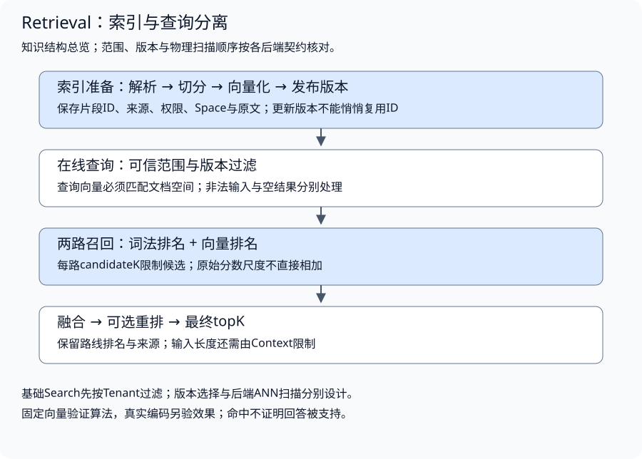
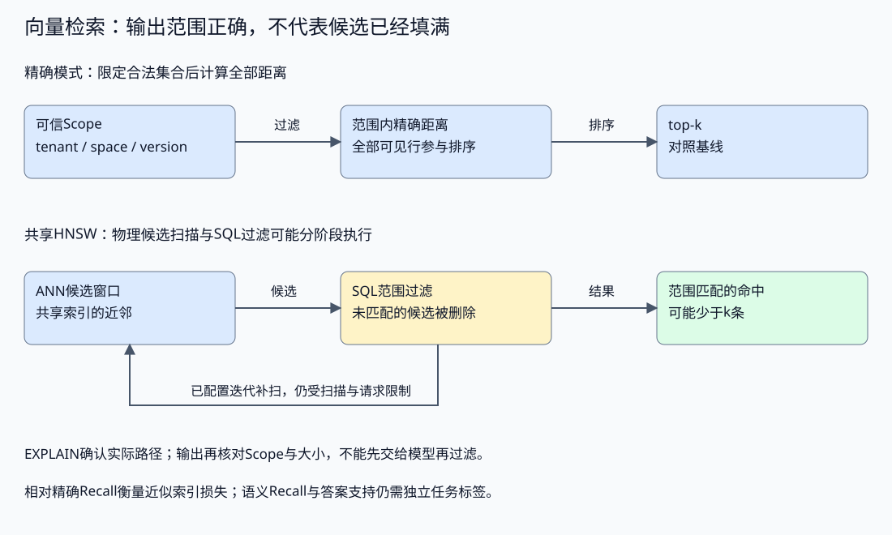
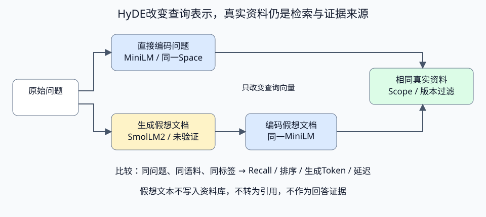
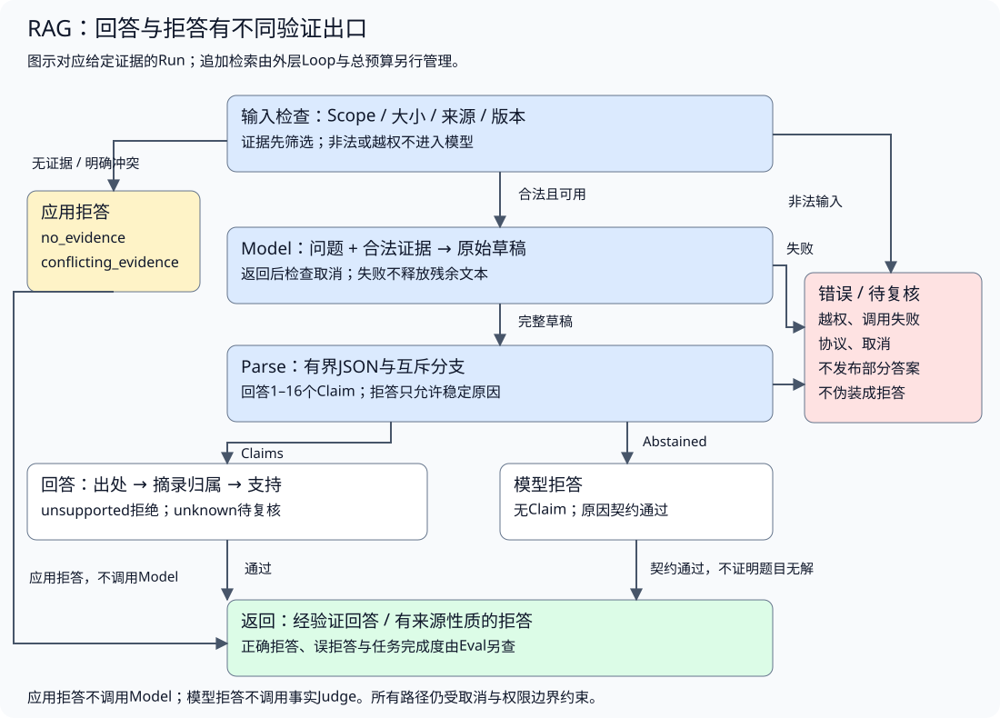

# 检索增强生成与证据验证

配套实验：[检索增强生成与证据验证实验](../../../../labs/part3-agent/chapter28/evidence-answer/README.md)。

相关实验：[实验：关键词、向量与排名融合](../../../../labs/part3-agent/chapter28/hybrid-retrieval/README.md)、[示例： eino vector store](../../../../labs/part3-agent/chapter28/eino-vector-store/README.md)、[pgvector：实际向量存储与HNSW对照](../../../../labs/part3-agent/chapter28/pgvector-retrieval/README.md)、[本地真实Embedding：同任务检索对照](../../../../labs/part3-agent/chapter28/neural-retrieval/README.md)、[示例： eino rag project](../../../../labs/part3-agent/chapter28/eino-rag-project/README.md)。

检索返回了相似资料，回答仍可能漏条件、引错版本或给出没有依据的结论。需要沿着索引、候选、输入、断言和交付逐层判断失败。

页面展示来源卡片，只说明链接可以呈现。后端还要验证资料范围、版本、引用归属和断言支持。本章将检索与生成串成完整证据链，分别评价候选质量与答案质量。

先建立一条基础证据链：片段与来源 → [候选进入输入](#从候选到生成输入) → [断言与引用](#断言引用与支持判断) → [冲突/拒答/交付](#冲突拒答与交付准入)。第二遍回读编码空间、索引切换、融合、HyDE、重排及联合支持，再用[Eval校准与对照](../governance/chapter35-evaluation.md#独立校准与指标口径)判断收益。RAG跨越资料资源与Harness输入，不要求每次检索都由动态Agent决定。

## 索引、编码空间与资料版本

<a id="topic-ch28-vector-retrieval"></a>

<a id="资料如何变成可查询的片段"></a>

<a id="切分决定能否保留完整证据"></a>

**切分决定能否保留完整证据**

索引需要把原文变成检索单元。片段太小，定义、条件和结论可能分离；片段太大，不相关内容会占用上下文，也可能稀释向量表示。

切分时先识别标题、段落、表格和代码等结构，再在模型输入限制内控制长度。需要重叠时说明重叠范围，后续合并去重也要处理重复内容；按任意字节截断可能破坏中文字符、代码或结构化字段。

[配套实验的Split](../../../../labs/part3-agent/chapter28/hybrid-retrieval/main.go)按段落与码点切分，并将来源、版本和片段序号组成ID：

```go
func Split(source, version, tenant, text string, maxRunes int) ([]Chunk, error) {
	if source == "" || version == "" || tenant == "" || maxRunes <= 0 || len(text) > 64<<10 || !utf8.ValidString(text) {
		return nil, ErrInvalid
	}
	out := []Chunk{}
	for _, paragraph := range strings.Split(text, "\n\n") {
		runes := []rune(strings.TrimSpace(paragraph))
		for len(runes) > 0 {
			n := min(maxRunes, len(runes))
			id := fmt.Sprintf("%s@%s:%d", url.QueryEscape(source), url.QueryEscape(version), len(out))
			out = append(out, Chunk{ID: id, Source: source, Version: version, Tenant: tenant, Text: string(runes[:n])})
			runes = runes[n:]
			if len(out) > 128 {
				return nil, ErrInvalid
			}
		}
	}
	if len(out) == 0 {
		return nil, ErrInvalid
	}
	return out, nil
}
```

这是一种可复现的教学切分，不具备语义边界识别。更新资料时必须改变Version，才能区分新旧片段；版本不变却修改切分规则，会让同ID指向不同内容。生产索引还应记录切分配置和内容校验值，避免更新期间引用漂移。

<a id="候选必须能回到原文"></a>

**候选必须能回到原文**

片段保存的不只是向量。至少保留片段ID、来源、资料版本、可访问范围和原文，回答才能引用，评估才能标注，故障才能定位：

```go
type Chunk struct {
	ID, Source, Version, Tenant, Text, Space string
	Vector                                   []float64
}
```

Source是应用登记的资料身份，不是让模型生成一个URL。引用前应根据可信目录解析来源，而非相信模型返回的路径。删除或权限变更时，也要处理旧索引和缓存，不能仅删除原文件。

<a id="embedding与相似度怎样影响召回"></a>

<a id="同维度不代表同空间"></a>

**同维度不代表同空间**

Embedding把文本转换为向量，让查询与片段可以比较相似性。查询向量与文档向量必须来自匹配的表示空间：模型版本、维度、预处理和归一化方式都需要明确。两个模型都输出1024维，不能因此混用。

新索引在接收整批资料时检查Space、维度、非有限值与可用范数，再复制向量。它是创建后只读的教学结构，调用方不能一边搜索一边修改公开字段；支持更新时需要索引版本或同步策略。

基础[Eino向量实验](../../../../labs/part3-agent/chapter28/eino-vector-store/README.md)用哈希桶表示词频，适合验证接口、维度、复制和排序。哈希碰撞可能让无关词共享位置，它不是训练得到的语义Embedding。本章融合实验则使用手工给定向量，两者都不能证明真实语义召回质量。

<a id="真实编码器的空间还包含处理配置"></a>

**真实编码器的空间还包含处理配置**

编码空间由模型revision、分词器、pooling、归一化、维度和截断策略共同决定。查询与资料必须使用同一配置；批次ID与空间绑定，超长输入显式拒绝或记录截断。真实编码需要独立锁定资产，默认实验不自动下载。

实现与对照见[配套实验](../../../../labs/part3-agent/chapter28/neural-retrieval/README.md#book-ch28-vector-retrieval-真实编码器的空间还包含处理配置)。

<a id="同任务对照也要保留无资料情况"></a>

**同任务对照也要保留无资料情况**

固定同一任务、资料与候选预算，同时包含可回答和无资料问题。分别观察词面、固定向量与真实编码器的召回，不把合成小样本的排名变化推广为通用语义能力。

实现与对照见[配套实验](../../../../labs/part3-agent/chapter28/neural-retrieval/README.md#book-ch28-vector-retrieval-同任务对照也要保留无资料情况)。

<a id="top-k为什么仍会返回无法回答的近邻"></a>

**top-k为什么仍会返回无法回答的近邻**

用户询问能否买机票并扣款，语料只有超时、重试、取消和引用说明，dense排序仍可能返回一条取消资料。top-k回答的是“现有合法候选中，哪些排在前面”，没有检查“其中是否存在支持这个问题的资料”。因此，空列表、非空候选与可回答是不同状态。

[本地排序实现](../../../../labs/part3-agent/chapter28/neural-retrieval/main.go)只按分数和稳定ID排序，再截取数量：

```go
func rank(hits []Hit, k int) []Hit {
	sort.Slice(hits, func(i, j int) bool {
		if hits[i].Score == hits[j].Score {
			return hits[i].ID < hits[j].ID
		}
		return hits[i].Score > hits[j].Score
	})
	return hits[:min(k, len(hits))]
}
```

只要范围内还有候选，这段排序就可能返回结果；它没有最低分数或答案支持检查。稳定ID解决平分时的复现，不能给第一名增加事实依据。实验中的词重合排序也保留零分候选，所以“检索返回了一项”甚至不一定表示存在词项重合。

是否设置分数阈值，要在指定模型、语料和查询类型下验证。有依据的资料可能分数较低，无依据的近邻也可能超过阈值；余弦分数、RRF分数和重排logit含义不同，不能共享一个阈值。开发集调整阈值时，同时看有资料任务被误拒多少、无资料任务被误接纳多少，再用未参与调整的任务核对；提高阈值不能代替引用支持判断。

| 观测到的情况 | 已经知道什么 | 下一步判断 |
| --- | --- | --- |
| 查询执行失败 | 本轮没有可靠检索结果 | 保留错误，按故障策略处理，不说资料库不存在答案 |
| 查询成功、候选为空 | 当前查询与范围下没有返回候选 | 核对范围、索引、查询与阈值，必要时澄清或追加检索 |
| 候选非空、没有完整支持 | 有近邻，但回答前提仍不足 | 由RAG核对缺项，追加取证或明确报告不足 |
| 所需证据齐备 | 可以进入回答与支持校验 | 仍须检查生成断言、有效引用和任务完成条件 |

无资料任务应单独评估误接纳与受控拒答。没有正相关标签时，Recall未定义；这不妨碍记录返回了哪些候选，以及下游是否错误地把它们当作答案依据。若标签只是尚未完成，则保持未标注，不能将它与已确认无支持资料的任务混为一组。

<a id="精确扫描与近似检索是不同取舍"></a>

**精确扫描与近似检索是不同取舍**

本实验逐个计算余弦相似度：

```go
func cosine(a, b []float64) (float64, error) {
	if len(a) == 0 || len(a) != len(b) {
		return 0, ErrInvalid
	}
	dot, aa, bb := 0.0, 0.0, 0.0
	for i, v := range a {
		w := b[i]
		if math.IsNaN(v) || math.IsNaN(w) || math.IsInf(v, 0) || math.IsInf(w, 0) || math.Abs(v) > 1e6 || math.Abs(w) > 1e6 {
			return 0, ErrInvalid
		}
		dot += v * w
		aa += v * v
		bb += w * w
	}
	if aa == 0 || bb == 0 {
		return 0, ErrInvalid
	}
	return dot / (math.Sqrt(aa) * math.Sqrt(bb)), nil
}
```

它比较方向而不是单纯向量长度，零范数与不合法数值被拒绝。大规模向量库通常采用近似索引来降低查询开销；候选可能与精确搜索不同，因此需要同时测量召回损失、延迟、内存与更新成本。

“相似度高”不代表片段适用于当前版本、用户或任务。相似度也不是答案正确概率。阈值应按语料和模型评估，不能把教学中的正分过滤当作通用相关性判断。

### 查询前过滤，比结果后删除更可靠



权限范围来自可信调用上下文。先过滤再排序，可以避免越权片段进入模型，也避免它们占满top-k后被删除，导致合法资料反而没进入候选池。

本实验Search固定接收可信tenant，先过滤后分别计算词重合和向量得分。不同身份使用同一查询，不应看见对方的片段；结果返回时再次复制向量，避免调用方污染索引。

过滤还可以包含资料版本、时间、类别和数据状态。它们解决不同问题：权限过滤决定能看什么，版本过滤决定当前采用哪份资料，相关性排序决定优先看什么。不能用相关性阈值代替授权，也不能先把越权正文送给模型再要求忽略。

没有符合范围的资料时，可以正常返回空集合；维度错误、非法top-k或调用取消则是失败。这些结果需要上层分别处理，不能全部改成“没找到”。

<a id="向量库中的过滤与近似候选怎样区分"></a>

<a id="sql约束输出索引决定查找路径"></a>

**SQL约束输出，索引决定查找路径**

真实向量库把向量、来源和访问范围放进存储，再由执行器选择扫描或索引。配套[pgvector对照实验](../../../../labs/part3-agent/chapter28/pgvector-retrieval/README.md)对相同合成向量运行Go扫描、PostgreSQL精确查询和HNSW；固定三维数据不代表学得语义，却能够验证实际存储与查询路径。

[Search查询](../../../../labs/part3-agent/chapter28/pgvector-retrieval/postgres.go)始终带可信Scope、参数向量与条数上限：

```go
const searchSQL = `SELECT id,body,tenant,space,version,embedding <=> $4::vector AS distance
 FROM vector_items WHERE tenant=$1 AND space=$2 AND version=$3
 ORDER BY embedding <=> $4::vector LIMIT $5`
```

`<=>`对应本实验的cosine distance，越小越近；索引opclass需要与排序距离一致。Scope与向量使用参数绑定，不拼接模型生成的SQL。返回结果还核对范围、内容长度和数值，权限不只由页面过滤。

SQL按Space隔离已存资料，vector维度只能检查形状，不能证明查询Embedding模型一致。本实验的query是已知固定向量；生产adapter还需携带并核对查询Space，不能让未标记向量仅靠形状通过。

<a id="where不保证ann索引先缩小候选集合"></a>

**WHERE不保证ANN索引先缩小候选集合**

前面“过滤先于排序”是输出授权与教学精确检索的原则，不能据此推断任意向量库都先枚举合法行再做近邻搜索。共享ANN索引可能先扫描候选，再应用条件；候选窗口里合法资料比例很低时，结果可能不足k条。



这不意味着可以取消权限条件。SQL输出范围仍须成立；问题在于候选是否充分，以及不同租户是否影响召回和消耗。实验锁定pgvector0.8.7，使用迭代扫描补候选，但扫描上限、数据分布与查询策略仍会影响结果。

可以比较更大的候选预算、过滤列索引、分区或独立租户索引。每项都有内存、构建、更新与维护代价，应在同范围基线下验证，不用一个全局ANN命中证明多租户公平或RLS安全。

<a id="创建了索引还要确认查询真的使用它"></a>

**创建了索引，还要确认查询真的使用它**

建索引后检查实际查询计划与参数，区分精确扫描和HNSW路径。索引是否被使用、相对精确结果的Recall、权限过滤与语义相关性是不同证据。

实现与对照见[配套实验](../../../../labs/part3-agent/chapter28/hybrid-retrieval/README.md#book-ch28-vector-retrieval-创建了索引还要确认查询真的使用它)。

<a id="相对精确recall不是语义recall"></a>

**相对精确Recall不是语义Recall**

近似索引评估问的是“相同向量和范围下，ANN找回了精确top-k的多少项”；语义检索评估问的是“真实问题需要的资料是否找回”。前者有算法基线，后者需要相关性标签与真实Embedding。

真实隔离数据库对照证明精确/ANN路径、输出范围和查询取消，不能证明固定向量理解语言，也不能推出所有查询无损或一定更快。输入资料标注、生成答案支持与真实延迟仍按各自层次验证。

前面处理的是同一份已发布索引里怎样检索、过滤和比较路径。接下来才看更棘手的问题：资料、切分或向量空间一旦更新，在线查询到底应该看到哪一代索引。

### 资料更新之后，查询看哪份索引

线上查询期间原地替换片段、向量或模型配置，会让一次查询看到混合状态：前半候选来自旧资料，后半来自新切分；查询向量由旧模型生成，索引却已切到同维度的新空间。更新需要自己的发布边界，不能仅给文档加一个Version字段。

<a id="文档版本编码空间与索引代次分别保存"></a>

**文档版本、编码空间与索引代次分别保存**

| 身份 | 表达什么 | 不能代替什么 |
| --- | --- | --- |
| Source / Version | 一份资料及其内容版本 | 切分配置与整批索引构建身份 |
| Space / Dimensions | 表示空间及维度 | 当前语料是否更新、哪些文档已删除 |
| Generation | 一次已经发布的索引快照 | 文档权限、内容真实性或业务完成 |

改变资料内容需要新文档版本；改变切分或编码配置需要新的构建依据。相同资料可以重新构建索引，索引代次因此增加，而文档Version未必改变；不能反过来认为Generation增加就证明每份内容都有新版本。

<a id="先建新快照再切换当前入口"></a>

**先建新快照，再切换当前入口**

[发布实验](../../../../labs/part3-agent/chapter28/hybrid-retrieval/snapshot.go)把已校验Index放进私有Snapshot。Publisher在锁外完成整批校验和复制，锁内核对预期代次与取消，再切换唯一当前指针：

```go
	if generation != expected || generation == math.MaxUint64 {
		return ErrGeneration
	}
	p.current = &Snapshot{generation: generation + 1, index: index}
	return nil
```

两位构建者都基于代次1时，只能有一位发布代次2；另一位重新取得当前状态并判断，不把自己的旧构建覆盖上去。非法新批不切换，查询继续使用旧快照；旧代次也不会因计数溢出回到零。

一次查询按下面的顺序固定视图：

1. **捕获一份已发布快照**：记录Generation、Space与Dimensions，后续不再重新读取当前指针。
2. **按该空间准备查询向量**：当前入口已经更新，也不把新空间向量塞进旧句柄。
3. **在同一快照检索与融合**：候选都来自该构建；返回向量复制，调用方不能改写索引。
4. **保留结果构建身份**：用于Trace、评估及问题复现，不仅保存某个top-k列表。
5. **交付前核对当前事实条件**：将资料版本、访问与删除状态回查到可信目录，再交给Context/RAG。

| 时刻 | 旧查询已捕获的句柄 | 新查询取得的句柄 |
| --- | --- | --- |
| 代次1已发布 | v1资料与space-a | 同一代次1 |
| 新构建仍在校验 | 保持原快照 | 仍为代次1 |
| 代次2原子发布 | 继续使用代次1 | v2资料与space-b |
| 代次1不再是当前入口 | 句柄释放前仍可读旧内容 | 取得代次2，不混用空间 |

这里的互斥保护一个进程的发布，句柄引用让旧对象暂时存活；没有跨实例发布、持久构建目录或自动生成Embedding。生产需要规定旧快照寿命、回滚条件与所选向量库的切换机制，不能由内存指针推广为分布式一致性。

<a id="固定快照为什么不能保证删除立即生效"></a>

**固定快照为什么不能保证删除立即生效**

切换新入口只改变后续查询，已经捕获旧快照的查询仍可能返回旧文档。快照让一次检索内部一致，但不会自动获得“当前仍可使用”的授权。删除资料或撤销访问时，要定义新的查询是否拒绝、在途结果是否丢弃，以及Context使用前在哪个位置复核。

若需要立即撤销，当前授权目录或删除代次必须参与最后准入；不能等所有旧句柄自然释放。回查失败也不能把旧快照当作默认允许。版本更新还需决定旧版本可否用于历史问题：允许引用历史版本与引用当前已失效资料是不同政策，引用必须保留相应版本和范围。

文档、关键词索引、向量索引及缓存不一定在同一事务中更新。异步更新可以带来短暂遗漏或陈旧，应用应保留构建身份与同步状态，分别观察更新可见时间、删除传播、召回和最终答案支持。当前实验验证同进程整批切换和句柄一致性，没有实现跨存储提交或权威目录准入；完整证据交付仍按RAG与Safety边界设计。

## 召回、融合与查询扩展

<a id="两路检索如何合并"></a>

<a id="关键词与向量互补但分数不能直接相加"></a>

**关键词与向量互补，但分数不能直接相加**

关键词对错误码、专名、精确参数有用；向量对表达变化和语义近似有用。本实验的词重合计数只是简化词法评分，不是BM25，也没有中文分词能力。接入真实全文搜索时，需要检验分词、同义词、停用词与字段权重。

两路原始分数的范围不同，直接相加可能使数值大的路线压过另一条。排名融合可以先使用各自排序，再合并同一片段。

配套[Fuse](../../../../labs/part3-agent/chapter28/hybrid-retrieval/main.go)采用Reciprocal Rank Fusion：每路贡献`1 / (k + rank)`，对同ID求和：

```go
func Fuse(lex, vec []Hit, k float64) []Hit {
	combined := map[string]Hit{}
	for route, list := range [][]Hit{lex, vec} {
		seen := map[string]bool{}
		for n, item := range list {
			id := item.Chunk.ID
			if seen[id] {
				continue
			}
			seen[id] = true
			hit := combined[id]
			hit.Chunk = item.Chunk
			hit.Score += 1 / (k + float64(n+1))
			if route == 0 {
				hit.LexicalRank = n + 1
			} else {
				hit.VectorRank = n + 1
			}
			combined[id] = hit
		}
	}
	out := make([]Hit, 0, len(combined))
	for _, hit := range combined {
		out = append(out, hit)
	}
	return rank(out)
}
```

rank从1开始。这里的k是融合平滑常量，与每路取多少候选、最终返回多少条是三个不同参数。实验取60以便观察机制，不把它当作所有语料的最佳值。

保留LexicalRank与VectorRank，让读者能判断命中来自哪一路。融合分数不再是余弦相似度，不能沿用原来的分数阈值或概率解释。相同分数用稳定ID排序，仅保证可复现，不保证同分片段的业务优先级。

<a id="候选池与最终top-k分别限制"></a>

**候选池与最终top-k分别限制**

每路candidateK控制参与融合的数量；最终topK控制交给下游的条数。候选池太小，重排器没有机会找回被漏掉的资料；候选过大，查询、重排与输入成本上升。

条数上限也不能代替总字节或Token上限。即使只返回三条，长片段仍可能撑满模型输入。Retrieval保留候选，Context再按输入预算选择，工具层限制每次读取与返回体积。

### 重排与查询扩展什么时候值得增加

重排针对“已经找到的候选”再次判断与问题的关系。它可以用规则、交叉编码器或模型，但不能找回从未进入候选池的资料。实验的Rerank只给现有片段打分，不接收新ID，避免重排服务凭空增加来源；服务错误与非有限分数仍返回可见失败。

加入重排前先确认：召回不足还是排序不足？若目标片段根本没进池，应检查索引、过滤与查询；若进池却靠后，再比较重排的收益和延迟。

<a id="独立编码与联合评分怎样分工"></a>

**独立编码与联合评分怎样分工**

双编码器分别得到查询与资料的向量，再比较相似性。资料向量可以离线建立索引，在线只编码查询并搜索；编码空间与预处理必须匹配。交叉编码器则将查询和候选片段一起输入模型，计算这一对的分数，查询改变后需要重新评分，不能把一次评分当成资料的永久属性。[Sentence Transformers说明](https://www.sbert.net/examples/cross_encoder/applications/README.html)给出了两种结构的接口差别。

常见组合是先召回有限候选，再对每个(query, chunk)联合评分。重排成本随候选数、片段长度与模型配置变化；候选池扩大可能找回必要资料，也会增加计算和下游噪声。分数含义依模型与任务而异，不能将任意重排logit当作余弦相似度或已经校准的正确概率。

<a id="评分改变次序保留候选身份"></a>

**评分改变次序，保留候选身份**

配套[Rerank](../../../../labs/part3-agent/chapter28/hybrid-retrieval/main.go)用注入回调说明这条边界：回调只取得已有Chunk，返回一个有限数值，不能插入新来源。查询可由可信调用方在回调闭包中绑定，远端adapter还需要输入/输出、超时和批量上限。

```go
func Rerank(ctx context.Context, hits []Hit, score func(context.Context, Chunk) (float64, error)) ([]Hit, error) {
	if err := ctx.Err(); err != nil {
		return nil, err
	}
	if score == nil || len(hits) > 128 {
		return nil, ErrInvalid
	}
	out := append([]Hit(nil), hits...)
	for n, hit := range out {
		out[n].Chunk.Vector = append([]float64(nil), hit.Chunk.Vector...)
		if err := ctx.Err(); err != nil {
			return nil, err
		}
		copy := hit.Chunk
		copy.Vector = append([]float64(nil), copy.Vector...)
		value, err := score(ctx, copy)
		if err != nil {
			return nil, err
		}
		if math.IsNaN(value) || math.IsInf(value, 0) {
			return nil, ErrInvalid
		}
		out[n].Score = value
	}
	if err := ctx.Err(); err != nil {
		return nil, err
	}
	return rank(out), nil
}
```

评分输入与返回候选的向量分别复制，调用方修改新排序不能改写原候选；回调失败或取消时不返回部分新排名。固定回调用于确定性机制检查；另有显式本地交叉编码器对照，在已冻结的同一候选池上得到真实评分并接入该边界。实际排序收益需要标注与任务比较，不能从函数跑通推出。

对照时先检查目标是否在候选池，再固定同一池比较重排前后的排序。若目标没进入池，调重排器无法补回；若合法来源变了，先查身份和过滤，不根据更高分数接纳未经授权的资料。

<a id="真实分数怎样进入候选排序"></a>

**真实分数怎样进入候选排序**

交叉编码器接收原问题与固定候选文本，输出每对的分数。应用核对候选ID完整、唯一且分数有限后再排序；未知、缺失或额外ID均拒绝。原始logit不能当作校准后的正确概率。

实现与对照见[配套实验](../../../../labs/part3-agent/chapter28/hybrid-retrieval/README.md#book-ch28-vector-retrieval-真实分数怎样进入候选排序)。

<a id="重排要与实际召回排序比较"></a>

**重排要与实际召回排序比较**

固定原查询与候选池，用召回器真实排序作基线，比较重排后的RR或nDCG，并核对下游是否多保留必要条件。相对任意演示次序的改善不能记为真实召回后的收益；原小池对照的无增益结果保留。

实现与对照见[配套实验](../../../../labs/part3-agent/chapter28/hybrid-retrieval/README.md#book-ch28-vector-retrieval-重排要与实际召回排序比较)。

### HyDE：用假想文档改变查询表示

问题往往是一句短问句，资料却是解释原理的长段落。直接编码问题可能不能充分表达相关文档的语言与概念。[HyDE论文](https://arxiv.org/abs/2212.10496)提出先让生成模型写一段假想文档，再编码这段文本，去真实语料中寻找近邻。**改变的是查询表示，检索对象仍是真实资料。** 假想文档可能包含错误细节；编码器并不提供事实校验，不能保证这些细节不会影响排名。



两路共用资料向量与访问范围，只有查询表示不同。一次查询按以下顺序推进：

1. **生成候选描述**：只给模型问题和生成要求，不提供相关性标签，让它写一段可能回答问题的文本。
2. **编码查询**：把假想文本送入与资料相同的编码器，核对空间、维度和截断状态；资料向量不用重新生成。
3. **检索原始资料**：仍按可信范围与资料版本过滤，返回原始片段ID与原文；不把假想文本写入资料库。
4. **比较效果与代价**：与直接编码问题的基线比较相同问题的命中、排序、生成Token和延迟。回答只能使用检索得到的真实证据。

本地对照使用SmolLM2-135M-Instruct生成英文假想文档，再使用前面的MiniLM编码。它是HyDE式查询表示实验，模型和编码器与论文不同，不用于复现论文指标。[生成器](../../../../labs/part3-agent/chapter28/neural-retrieval/generator.py)限制输入与输出，使用贪心生成，保留是否触及输出上限：

```python
        with torch.inference_mode():
            output = model.generate(**inputs, max_new_tokens=config["max_new_tokens"],
                                    do_sample=False, use_cache=True,
                                    pad_token_id=tokenizer.eos_token_id)
        suffix = output[0, count:]
        text = tokenizer.decode(suffix, skip_special_tokens=True).strip()
```

只解码新增部分，避免把系统提示和问题重新算作假想文档。固定贪心策略减少采样变化，但不能消除模型错误；64个新增Token是实验预算，触及上限意味着文本可能没有写完，不是完成证明。输入上限、资产哈希与本地加载在生成前核对，超限不悄悄裁掉问题。

应用接收的[假想文档记录](../../../../labs/part3-agent/chapter28/neural-retrieval/hypothetical.go)保留文本、Token计数与来源性质：

```go
type Hypothesis struct {
    Text          string `json:"text"`
    InputTokens   int    `json:"input_tokens"`
    OutputTokens  int    `json:"output_tokens"`
    AtOutputLimit bool   `json:"at_output_limit"`
    Trust         string `json:"trust"`
}
```

Trust必须为hypothetical；这个标记是应用契约的一部分，还需要调用链强制执行。对照实验只把Text送入查询编码，排名函数接收的文档始终来自原始语料；它没有将假想文本转换成证据记录的步骤。不能只靠提示词写一句“不要当作事实”，然后又把生成内容拼进回答证据。

<a id="排名没有变不代表生成内容正确"></a>

**排名没有变，不代表生成内容正确**

假想文档改变的是查询表示，原文即使含错误数字，也可能召回相同资料。检索排名不变既不证明生成内容正确，也不证明查询扩展改善了答案；生成开销与任务结果分别记录。

实现与对照见[配套实验](../../../../labs/part3-agent/chapter28/hybrid-retrieval/README.md#book-ch28-vector-retrieval-排名没有变不代表生成内容正确)。

<a id="扩展失败时回到哪个查询"></a>

**扩展失败时回到哪个查询**

假想文本没有被采用，不代表生成调用没有发生。回退需要分别记录选中的查询与已发生的扩展消耗；超时但没有取得usage时保持未知，不能按“最后用了原查询”报告零成本。

[SelectExpandedQuery](../../../../labs/part3-agent/chapter28/neural-retrieval/query_fallback.go)提供独立的单问题选择策略：原查询先经过大小、空值与UTF-8检查，完整且合法的假想文本可以用于编码；没有生成、步骤失败、协议非法或触及输出上限时保留原查询字节，不修复候选。

```go
	if generated.Rows[0].AtOutputLimit {
		selection.Reason = "output_limit"
		return selection, nil
	}
	selection.Text, selection.Origin, selection.Reason = generated.Rows[0].Text, "hypothetical", "selected"
	return selection, nil
```

取消不是回退信号。总context已取消或到期时，选择器清空可用Text并返回对应错误；下游返回包装的Canceled也停止。只有扩展步骤自己的DeadlineExceeded、而总context仍有效时，才可以用原查询继续。调用方必须检查错误，后续编码和检索继续协作响应同一总context。

| 结果 | 继续使用什么 | 消耗怎样记录 |
| --- | --- | --- |
| 完整合法的假想文本 | 用该文本重新编码查询 | 已回报生成Token保留 |
| 输出上限或坏候选 | 原查询，不用被弃用候选的向量 | 有合法回报时保留计数，候选原文另存 |
| 生成失败或步骤超时 | 总请求仍有效时使用原查询 | 未取得回报保持未知，不填成免费 |
| 总请求停止或下游取消 | 不继续编码/查询 | 保留已知消耗及停止原因 |

选择器只决定表示，不发起模型或检索调用，也不改变Tenant、资料Version或编码Space。选定文本之后再编码，在同一获准语料上查询；把Text切回原问题，却仍沿用假想文本的向量，不是真正的回退。假想文本及稳定失败码不能成为证据或新的访问权限。

这个受控策略验证降级边界，未改变原批量HyDE对照或补记真实任务收益；实际接入仍需锁定配置、保存全部尝试，并比较召回、答案与总消耗。

## 从候选到生成输入

<a id="topic-ch28-rag-app"></a>

### RAG在决策闭环中的两种位置

“回答必须查资料”与“模型决定何时查资料”是两个控制问题。前者可以由应用固定执行检索和生成，后者则把检索作为受控动作放进Agent Loop。两者都需要证据检查，不能通过增加动态决策绕过答案的交付条件。

| 组织方式 | 谁决定下一步 | 一次任务的典型过程 | 新增的工程问题 |
| --- | --- | --- | --- |
| 固定检索与回答管线 | 应用确定阶段 | 问题→检索→筛选证据→生成→验证 | 检索是否充分，证据如何进入输入，失败在哪里停止 |
| Loop按需检索 | 模型根据任务与观察提出下一步，应用控制执行 | 识别缺口→检索→观察→继续查或提出回答→验证 | 查询是否有新信息，跨轮证据是否适用，总预算如何约束 |

开头的超时问题，如果服务与版本已经明确，一次检索取得适用说明后即可进入回答阶段。若问题是“比较两个服务的重试与超时”，而目录只给出配置位置，就可能先查目录，再读取各配置，最后检查比较条件是否齐全。这里的后续读取依赖前一步真实观察，ReAct或Planning可以管理选择，RAG继续管理证据到断言的关系。

按需检索的交接顺序为：

1. **提出信息缺口**：说明缺哪项参数、版本或条件，检索动作只使用当前允许的能力。
2. **返回可追溯观察**：结果包含证据ID、版本和原文；空结果、截断与调用错误分别表达。
3. **更新本轮输入**：Context在预算内选择新旧证据，保留当前任务条件；保存过的资料不代表本轮已经可见。
4. **继续或交付**：需要更多资料时继续受限读取，准备回答时进入同一出处、摘录和支持检查。未知支持先定位缺口，不能默认交付。

每次检索、生成、修复及支持判断都消耗资源。外层Loop和内部回答管线共用Runtime总预算，不能各自重置轮次或调用配额。检索器也不能直接把原始资料当作已验证答案返回；即使将完整RAG管线包装为Tool，工具调用成功、证据支持和用户任务完成仍须分别判断。

本章配套Run处理已给定证据，RunRetrieved连接一次检索导出与回答验证；它们展示固定阶段的交接，没有实现模型自主追加检索的完整Loop。动态选择应结合ReAct、Tool与Runtime的契约另行实现和评估。先用固定路径作为基线，再判断多轮查询是否补齐了真实缺口，以及额外延迟和成本是否值得。

<a id="用户问题怎样变成检索请求"></a>

**用户问题怎样变成检索请求**

用户问“Harbor当前部署的请求超时是多少”，检索请求不能只剩“超时”。它至少要保留对象Harbor、参数request timeout、当前部署及可能影响结果的策略条件。权限、租户与资料版本由应用绑定，不能让查询改写顺便更换数据范围。

如果超时取决于fallback开关，可以先取当前部署状态，再取对应策略；也可以并列检索这两类资料，随后检查条件是否齐全。拆分依据是回答需要哪些事实，不是机械地把一句话拆成若干短句。

| 需要回答的部分 | 检索目标 | 容易丢掉的约束 |
| --- | --- | --- |
| 当前部署采用哪个分支 | Harbor部署的fallback状态 | 当前时点、部署环境、资料版本 |
| 各分支的超时规则 | Harbor的request timeout策略 | 请求/连接超时、单位、适用条件 |
| 最终使用哪个值 | 将状态与规则对应起来 | 缺少任一条件时不能直接选数值 |

查询改写可以补同义词或领域名称，但不能把不确定事实改成已知答案。保留原问题与改写请求，核对实体、时间、单位和条件；改写后仍找不到资料时，分别检查查询表达与资料覆盖。关键词/向量召回、重排和HyDE的实现留在Retrieval章，模型是否追加查询留在ReAct/Planning，本章继续检查证据是否足以支撑回答。

<a id="从候选资料到可用证据"></a>

<a id="先检查范围与版本"></a>

**先检查范围与版本**

候选可能相关，但仍可能越权、过期、重复或不完整。进入模型之前先检查身份范围、来源目录和资料版本；候选池太大时先选择证据，不把全部资料正文塞入输入。

配套[Evidence类型](../../../../labs/part3-agent/chapter28/evidence-answer/main.go)保留独立证据ID、来源、版本与原文：

```go
type Evidence struct{ ID, Source, Version, Tenant, Text, FactKey, FactValue string }
```

ID用于定位片段，Source用于回到应用登记的原资料，Version用于区别更新。模型可以引用这些ID，但不能创建一个看起来真实的来源并让应用自动接受。可信目录仍由应用维护，资料内容本身也可能有错误或注入指令。

FactKey与FactValue是教学资料的结构化元信息，用于展示同一参数的冲突检测。它们不是从任意文档自动提取的通用事实；自由文本中的矛盾需要另外的判断与评估，不能用这个字段比较冒充自然语言理解。

<a id="无证据与证据冲突分别处理"></a>

**无证据与证据冲突分别处理**

没有资料时，可以追加检索、要求澄清或说明证据不足。资料冲突时，应检查版本、时间与适用范围，必要时展示冲突或停止回答。空检索和服务故障不应共用一个“没有资料”的状态。

实验在没有证据时直接返回`no_evidence`，在结构化事实同键不同值时返回`conflicting_evidence`；两条路径都不调用生成模型。来源范围非法则返回错误，不把越权内容送给模型后再提示它忽略。

### 检索返回值怎样交给回答阶段

检索器返回排名，回答阶段需要可校验的原文。二者衔接时，必须保留候选ID、来源与版本，不能只把相似度得分或一段拼接文本传给模型。**排名决定先读什么，证据校验决定可以说什么。**

一次交接按下面的顺序推进：

1. **限定候选范围**：由应用确定租户与资料版本，在检索前过滤；排名不能扩大允许读取的范围。
2. **绑定原文快照**：从命中ID取得对应资料，保留来源、版本和文本；编码截断必须可见，不能把尾部未参与匹配的长文当成完整检索证据。
3. **校验交接数据**：接收方核对协议身份、大小、重复字段和候选范围；真正的服务还须根据可信目录及调用身份核对来源，不能把请求自报的Tenant当作授权。
4. **生成与验证回答**：通过前置检查后再调用模型，随后分别验证草稿结构、引用归属和断言支持；任何失败都不能释放部分答案。
5. **独立判断任务效果**：记录命中、拒答、格式失败与未知支持。相关性和预期回答标签留在评分侧，不能进入生成器。

[检索导出](../../../../labs/part3-agent/chapter28/neural-retrieval/export.go)使用原始候选字段，不包含相关性标签或假想文档。回答端的[接收契约](../../../../labs/part3-agent/chapter28/evidence-answer/retrieved.go)把问题与对应证据绑定：

```go
type RetrievedRow struct {
	ID       string
	Question string
	Evidence []Evidence
}
```

回答阶段在[RunRetrieved](../../../../labs/part3-agent/chapter28/evidence-answer/retrieved.go)中把这些候选交给已有验证出口：

```go
answer, runErr := Run(ctx, "demo", item.Question, item.Evidence, model, ExactSourceJudge)
```

model在Run检查输入之后才执行本地生成。检索与回答通过有界JSON连接，两个实验仍可独立运行，不导入彼此的私有实现。这里的demo身份和fixture来源是合成教学配置；传输协议与模型revision能定位一次实验，不能证明任意外部资料真实或调用方已获授权。

串起链路后，仍须区分三个结论：真实Embedding已执行，草稿经过验证，任务完成。这些需要不同证据。最近邻可以与问题无关，全文摘录可以没有回答问题，合法拒答也可能误拒一个可答任务。完整链路的运行与分层结果见配套实验，通用释义Judge和人工校准另行验收。

### 证据怎样进入模型输入



输入应清楚表达任务、证据及其来源，保留条件、单位和版本。资料作为数据提供，不因包含“忽略前面规则”而成为应用指令；工具权限仍由执行器决定。

[Model接口](../../../../labs/part3-agent/chapter28/evidence-answer/main.go)把问题与证据分开传入，输出一个待校验草稿：

```go
type Model func(context.Context, string, []Evidence) (string, error)
type Judge func(context.Context, Claim, Evidence) (Verdict, error)
```

接入Provider时，由adapter将这些字段编码为消息或结构化输入，并传递context、输入/输出上限和usage。接口分离只能帮助组织数据，不能自动保证模型正确遵守来源边界；应用的权限与输出校验仍要保留。

<a id="证据按回答需要组织不只截取top-k"></a>

**证据按回答需要组织，不只截取top-k**

排名高的片段可能都在重复同一条说明，却没有当前部署状态。将这些片段全部送入模型，输入更长，缺口仍然存在。证据组装先看回答需要覆盖哪些事实，再看每个片段增加了什么；重复文本可以少放，但独立来源、不同版本和相互矛盾的记录不能因“看起来相似”一起丢弃。

进入Context前依次处理：

1. **明确事实缺口**：列出对象、状态、规则、单位及时间条件，判断哪些已经取得依据。
2. **绑定必要片段**：保留ID、版本与原文；选出能覆盖缺口的内容，而非只按分数累计。
3. **检查上下文完整性**：保留否定、条件和例外，不能裁掉“fallback关闭时”后还把剩余数值当通用规则。
4. **按输入预算装配**：计算模板、问题、资料与输出预留的总空间。需要的证据装不下时分页、分阶段或报告不足，不偷偷压缩后假定含义没变。

Context负责计数和选择输入，RAG负责检查删减是否损害回答依据。把资料摘要得更短，需要另外验证事实、来源与条件；检索相关性评分不能代替这项检查。配套实验已有输入投影和验证出口，没有实现自动覆盖优化或通用摘要支持判断。

<a id="存储记录不直接作为模型请求"></a>

**存储记录不直接作为模型请求**

Evidence包含应用管理字段，不能直接序列化整条记录作为prompt。Tenant用于授权，FactKey/FactValue用于教学冲突检查，它们不属于生成答案所需的证据正文。输入中的冗余字段还可能被模型当成输出格式，导致草稿混入不允许的属性。

[本地adapter](../../../../labs/part3-agent/chapter28/evidence-answer/local.go)投影出专门的输入结构，只有引用定位与理解资料需要的三个字段：

```go
type PromptEvidence struct {
    ID      string `json:"id"`
    Version string `json:"version"`
    Text    string `json:"text"`
}
```

modelPayload逐条生成这个视图，再与问题一起编码。生成输入的字段选择应由应用控制，不让模型自行挑选存储对象。这个投影减少数据暴露与格式噪声，但不替代前面的授权检查，也不把原文变成可信指令。输出协议仍要求每条断言提供evidence_id与quote，不能因为输入里叫id就自动接受返回的id字段。

基础[Eino组装实验](../../../../labs/part3-agent/chapter28/eino-rag-project/README.md)展示查询、检索、消息与Generate的组合。它返回固定说明文字，适合验证接口与错误传播，不证明自由生成答案已经得到证据支持。生产请求也不应每次重新向量化整份知识库。

## 断言、引用与支持判断

<a id="回答为什么要保留断言与引用"></a>

<a id="引用附在断言上"></a>

**引用附在断言上**

只在答案末尾列几份资料，难以判断某句话依据哪段内容。结构化草稿将每个断言与证据ID、资料版本和摘录绑定：

```go
type Claim struct {
	Text       string `json:"text"`
	EvidenceID string `json:"evidence_id"`
	Version    string `json:"version"`
	Quote      string `json:"quote"`
}
```

用户最终可以阅读自然语言回答，但应用先处理这份关联结构。复杂答案需要将多个可验证断言拆开；“系统快、可靠、支持所有请求”不适合作为一个不可分的事实单元。

草稿仍是模型输出，不可信。它可能有坏JSON、空断言、未知字段、过多内容、伪引用或过期版本。解析之后必须继续校验；字段合法只证明形状，不证明事实。

<a id="输出解析要有界"></a>

**输出解析要有界**

先限制输出字节与结构，拒绝重复字段、未知字段、尾部内容和不完整响应，再进入引用校验。解析器不能自动填补缺引用或把截断草稿当作完整回答；结构失败保留原始输出与消耗。

实现与对照见[配套实验](../../../../labs/part3-agent/chapter28/evidence-answer/README.md#book-ch28-rag-app-输出解析要有界)。

### 出处、摘录与支持为何是三次判断

1. **出处存在**：ID属于本次允许使用的证据，版本与可信目录匹配。
2. **摘录归属**：Quote确实出现在该证据原文中，没有被模型改写。
3. **断言支持**：这段资料能否支持Claim的含义、条件、单位和适用范围。

前两项成立，第三项仍可能失败。真实资料中存在“30秒”，不支持“60秒”；“部分请求”也不支持“全部请求”。资料支持某句话，还不代表它回答了用户问题或资料本身真实。

配套[Validate](../../../../labs/part3-agent/chapter28/evidence-answer/main.go)先核对归属，再将释义交给独立Judge：

```go
func Validate(ctx context.Context, draft Draft, evidence map[string]Evidence, judge Judge) error {
	if draft.Abstained || len(draft.Claims) == 0 {
		return ErrDraft
	}
	for _, claim := range draft.Claims {
		if err := ctx.Err(); err != nil {
			return err
		}
		item, ok := evidence[claim.EvidenceID]
		if !ok || claim.Version != item.Version || !strings.Contains(item.Text, claim.Quote) {
			return ErrEvidence
		}
		// 完整原文身份可确定性核对；部分摘录可能删除否定或条件，仍需支持判断。
		if claim.Text == claim.Quote && claim.Quote == item.Text {
			continue
		}
		if judge == nil {
			return ErrReview
		}
		verdict, err := judge(ctx, claim, item)
		if err != nil {
			return fmt.Errorf("rag: judge: %w", err)
		}
		if err := ctx.Err(); err != nil {
			return err
		}
		switch verdict {
		case Supported:
		case Unsupported:
			return ErrUnsupported
		default:
			return ErrReview
		}
	}
	return ctx.Err()
}
```

完整证据原文同时作为断言与Quote时，可以确定性确认这份文本身份；它仍不检查任务相关性、资料真实性或跨文档条件。部分摘录即使与Quote逐字相同，也可能删掉否定或适用条件，必须和释义一样进入独立支持判断。

例如，资料写着“本应用不允许跨用户读取”，Quote与Claim却都只写“允许跨用户读取”。字串归属成立，含义已经反转。没有Judge时返回ErrReview；Judge看到完整Evidence后给出unsupported则拒绝，unknown仍待复核。不能把摘录存在直接升级成支持结论。

业务允许的部分摘录也有成立的情况，例如从一段参数说明中摘出完整的超时句子。但是否省略了必要条件，需要支持判断明确接受，而不是应用看到两段字符串相等就跳过。Quote、完整证据与Claim都应交给该判断，失败时不发布前面已经检查通过的部分答案。

Judge返回supported、unsupported或unknown。未知判断进入待复核，服务失败返回错误，不把“没有判断出来”补成成功。教学Judge只认识固定释义与证据配对，用于验证支持判断的接入；它不具备真实自然语言蕴含能力。

### 多份资料共同支持的结论怎样检查

部署资料写“Harbor的fallback_enabled=false”；另一份策略写“开启时为6秒，关闭时为43秒”。两份资料结合，才能回答当前超时为43秒。策略单独说明分支规则，没有证明当前开关；部署资料单独说明开关，没有给出超时值。

| 断言 | 需要的依据 | 只引用一份会缺什么 |
| --- | --- | --- |
| 当前开关关闭 | 部署资料 | 无法确定对应超时 |
| 关闭时使用43秒 | 策略资料及适用版本 | 无法确定当前是否走此分支 |
| 当前请求超时为43秒 | 部署状态与策略共同支持 | 缺状态或缺规则，推导链不完整 |

回答可以先分别说明有来源的状态和规则，再明确推导所用依据。需要直接交付组合结论时，数据结构应能关联多个证据，支持判断也应接收对应证据集合，并检查实体、版本与条件能否同时成立。把两份资料拼成一段文字、随便沿用一个ID，会丢掉来源和版本关系。

原有Claim只有一个EvidenceID，Judge每次只收到一份Evidence；它不能完整表达上述跨来源推导。用它分别核对两个基础断言，也不能替代组合结论的支持判断。配套新增[联合引用契约](../../../../labs/part3-agent/chapter28/evidence-answer/joint.go)，保留一个断言对应多个引用的关系：

```go
type CitationRef struct {
	EvidenceID string `json:"evidence_id"`
	Version    string `json:"version"`
	Quote      string `json:"quote"`
}
type JointClaim struct {
	Text      string        `json:"text"`
	Citations []CitationRef `json:"citations"`
}
type JointJudge func(context.Context, JointClaim, []Evidence) (Verdict, error)
```

ValidateJoint接收应用已经授权、绑定版本的证据快照。它先为整批断言核对ID、版本、摘录归属和重复引用，再把每条断言对应的完整证据集合交给JointJudge。传入模型自报的“证据目录”不能替代授权；快照也不保证后续公开时的权限仍有效。

判断按两个阶段推进：

1. **先绑定引用集合**：全部引用通过归属与边界检查，才开始支持判断。重复ID、伪来源或改写摘录使整批失败，不先发布已检查的一部分。
2. **再判断联合支持**：Judge收到对应证据集合的副本；只有明确supported才继续，unsupported拒绝，unknown待复核，错误和取消保持可分类。组合结论没有逐字匹配的快捷通道。

固定规则案例分别验证两份资料齐全时的43秒结论、只有策略时的unknown，以及两份齐全却声称6秒时的unsupported。它证明引用集合被正确交接，没有实现通用自然语言蕴含。

生成草稿还必须把这种关系编码成可解析结构。[ParseJoint与RunJoint](../../../../labs/part3-agent/chapter28/evidence-answer/joint_run.go)使用独立的多引用草稿格式：每个Claim保留text与citations数组，拒答仍与回答互斥。调用路径先复用证据范围/冲突检查，再调用Model，严格解析后进行整批联合验证，最后复制返回全部断言。后一个断言失败也不会返回前一个已支持断言。

旧单引用格式继续由Parse/Run处理，不将一个EvidenceID偷偷解释成多个来源。库返回可接受结果之后，实际客户端交付还须保持当前授权与传输契约。

前面解决的是“多份资料怎样一起进入联合支持判断”。接下来再把判断对象拆开：整个引用集合是否支持断言，与每一条引用各自贡献了什么，是两层不同的问题。

<a id="联合支持与单条引用贡献分开判断"></a>

**联合支持与单条引用贡献分开判断**

对于“当前超时为43秒”，部署状态和条件规则共同构成依据。单独拿任一份资料询问“是否支持43秒”，都会缺少前提；把这两次判断都记作引用失败，会错杀正确的组合结论。**先判断整个引用集合是否支持断言，再检查各条引用承担什么作用。**

判断可以沿一条明确的推导链展开：

1. **对齐对象与时点**：两份资料说的是同一个Harbor部署，策略适用于该部署版本；不能把测试环境的开关与生产环境的规则拼在一起。
2. **取得当前状态**：部署资料给出fallback关闭，确定条件规则使用哪个分支。
3. **应用对应规则**：策略说明关闭时请求超时为43秒，核对参数名称和单位。
4. **核对结论范围**：可以推出当前请求超时为43秒，不能进一步推出连接超时、所有服务或未来部署都使用43秒。

| 检查对象 | 要问的问题 | 本例中的判断 |
| --- | --- | --- |
| 断言与整个引用集合 | 所有必要前提是否齐全，是否存在未解决冲突 | 当前状态与适用规则齐全时，可判断组合结论 |
| 某条引用的贡献 | 该资料提供了哪个前提，还是无关或重复内容 | 部署提供状态，策略提供条件到数值的映射 |
| 整个任务 | 所有用户要求是否回答，答案是否遗漏其他必要条件 | 当前超时有依据，仍须检查用户是否还要求重试次数或版本比较 |

移除一份资料后重新判断，可以帮助发现它是否补充了必要前提，但不能将“删除后结论仍成立”直接解释为引用无用：另一份独立资料可能提供了相同依据。重复引用、替代来源和缺失前提应分别记录。引用更多也不会自动增强结论，新增资料可能引入版本冲突。

联合Judge应读取实际引用集合，而不是整份知识库；缺少前提时按预先定义的Rubric返回unsupported或unknown。配套固定案例将缺少状态记为unknown，表示无法确认当前分支；两份依据齐全、开关关闭却声称6秒时，则记为unsupported。具体评分口径与[Eval的校准方法](../governance/chapter35-evaluation.md#评分器怎样校准)一起冻结，避免运行时待复核与离线任务失败互相混淆。

<a id="数值正确也可能缺少推导前提"></a>

**数值正确，也可能缺少推导前提**

一个结论可能依赖多份资料共同成立。数值相等不代表推导条件完整，必须核对必要前提、单位和适用版本；联合Judge也要说明哪些输入支持整条断言。

实现与对照见[配套实验](../../../../labs/part3-agent/chapter28/evidence-answer/README.md#book-ch28-rag-app-数值正确也可能缺少推导前提)。

<a id="输入标识对齐仍不替模型补引用"></a>

**输入标识对齐，仍不替模型补引用**

输入可以将内部证据键投影为统一evidence_id，应用保存映射和实际messages。模型漏引或引用错误仍按失败处理，不能在返回后凭已知资料补齐答案。

实现与对照见[配套实验](../../../../labs/part3-agent/chapter28/evidence-answer/README.md#book-ch28-rag-app-输入标识对齐仍不替模型补引用)。

## 冲突、拒答与交付准入

### 冲突与不足时怎样继续

证据不足可以驱动下一轮查询，但要明确缺什么：缺定义、缺某个版本、缺计算输入，还是来源不可信。把同一查询无限重复，通常不能产生新证据。

出现矛盾时按顺序处理：

1. **核对来源身份**：是否引用了错误文档或片段。
2. **核对版本与适用条件**：资料更新、产品版本或地域条件是否不同。
3. **判断是否需要补证据**：可否通过另一份受控资料解决差异。
4. **决定公开结果**：有依据地说明差异，或者拒答、澄清、转人工复核。

多篇相互复制的资料不能当作多个独立证据。重排得分高也不能裁决事实冲突；模型在两份资料中选择一个数值，仍需说明选择依据。

前面处理的是证据不足或冲突时要不要继续取证。最后再回到交付出口：生成器给了你一份草稿，它还要过哪些完整性、结构和支持检查，才配叫“可交付答案”。

### 草稿何时能够交付

生成器返回文本后，应用还要确认生成是否结束、草稿是否符合协议，以及每条断言能否交给用户。配套[本地生成对照](../../../../labs/part3-agent/chapter28/evidence-answer/README.md)使用合成问题与资料检验这些出口；模型不接收期望答案或评分标签。生成配置与对照结果见配套实验。

<a id="先检查生成完整性"></a>

**先检查生成完整性**

触及输出上限的文本可能缺少后半段答案，即使某个前缀恰好能解析，也不能确认它已经完成。离线评估将原请求与生成记录配对，[草稿入口](../../../../labs/part3-agent/chapter28/evidence-answer/local.go)先检查取消与输出上限：

```go
func LocalDraftModel(row GeneratedDraft) Model {
	return func(ctx context.Context, _ string, _ []Evidence) (string, error) {
		if err := ctx.Err(); err != nil {
			return "", err
		}
		if row.AtOutputLimit {
			return "", ErrDraft
		}
		return row.Raw, nil
	}
}
```

这个入口消费已配对的离线记录，不可给另一问题复用。在线adapter应在Run完成证据范围检查后生成，再把草稿交给Parse与Validate。记录输入和输出Token、资料版本、模型配置与提示版本；Token计数跟分词器有关，不能直接用本地计数代替其他Provider账单。

<a id="结构出处与支持分别定位失败"></a>

**结构、出处与支持分别定位失败**

真实生成中出现的几类失败，需要不同的修复方式：

| 现象 | 失败位置 | 处理依据 |
| --- | --- | --- |
| 返回输入问题与资料的JSON副本 | 草稿结构 | JSON语法有效，但缺少应用要求的Claim |
| 模仿格式示例，复制“8秒租约”或example来源 | 结构或出处 | 示例不是本次证据，来源目录不登记它 |
| JSON外包Markdown围栏，或漏掉引用字段 | 草稿结构 | 严格Parse拒绝；修复须单独记录，不计作原始生成成功 |
| 引用“13 seconds.”，Text复制完整原文 | 支持判断 | 先确认摘录归属，再检查完整证据是否支持整句话 |
| 两次生成同一句逐字摘录 | 任务质量 | 引用可以有效，重复与遗漏仍由任务Rubric检查 |

新增格式示例可能帮助模型理解字段，也可能把示例事实带进答案。输入投影减少存储字段和格式噪声，仍需检验模型产物；未知字段、伪来源与截断各自保持失败状态。

<a id="逐字原文与一般释义采用不同检查"></a>

**逐字原文与一般释义采用不同检查**

原文与完整断言完全一致时可以验证身份关系；部分摘录或改写必须独立检查条件、否定和单位。固定规则只覆盖所声明任务，unknown和评分失败均不交付。

实现与对照见[配套实验](../../../../labs/part3-agent/chapter28/evidence-answer/README.md#book-ch28-rag-app-逐字原文与一般释义采用不同检查)。

### 证据不足时如何拒答

资料存在，仍可能答不了问题。将“证据不足”塞进事实断言，会要求它引用资料中没有写出的缺失结论；返回空claims，又无法区别有意拒答与漏填。草稿需要明确表达选择。

<a id="回答与拒答互斥"></a>

**回答与拒答互斥**

[Draft](../../../../labs/part3-agent/chapter28/evidence-answer/main.go)保留回答分支和受限的拒答分支：

```go
type Draft struct {
	Claims    []Claim `json:"claims"`
	Abstained bool    `json:"abstained,omitempty"`
	Reason    string  `json:"reason,omitempty"`
}
```

| 分支 | 结构要求 | 后续处理 |
| --- | --- | --- |
| 回答 | 1–16个完整Claim，Reason为空 | 核对出处、版本、Quote，再判断支持 |
| 拒答 | Abstained为true，没有Claim，Reason只能为insufficient_evidence | 返回带来源性质的拒答，不调用事实Judge |
| 不合法 | 混合回答与拒答、空回答、未知原因或额外字段 | 返回ErrDraft，不转成证据不足 |

原因采用白名单代码，避免模型把任意文本、内部地址或指令放进拒答。Scope与冲突检查仍在模型调用前；取消、超时、输出截断和解析失败也不会自动转成拒答。

<a id="标明拒答由谁判断"></a>

**标明拒答由谁判断**

应用没有取得任何资料时返回no_evidence。模型读取合法资料后提出拒答，Run返回model_insufficient_evidence；这表示模型的判断，没有证明所有资料都无法回答。结构化事实冲突由应用返回conflicting_evidence，三类原因分别记录。

模型拒答没有事实断言，因此不调用支持Judge。它仍可能拒绝本来可答的问题。Eval分别统计正确拒答、误拒答、错误回答和协议失败；调用方再根据缺口与剩余预算决定追加检索、澄清或结束。拒答不能绕过输入授权，也不会重置预算。

### 生成期间资料变化，旧答案还能交付吗

检索时读到Harbor超时为30秒，生成期间管理员把规则改为60秒。草稿仍引用旧版本，摘录也确实来自旧原文；针对“当前配置”的问题，它已经失去适用性。另一种情况是用户权限被撤销：旧快照仍在内存里，引用检查也不会自动感知撤销。

**引用检查核对生成依据，当前资料检查核对交付资格。** 两者需要保留不同信息：生成用的原文快照用于重现回答，可信事实源用于判断此刻是否还允许使用。不能把快照里的Tenant当成当前授权，也不能用新原文替换旧原文后重新解释已有断言。

<a id="在输入和交付处分别检查"></a>

**在输入和交付处分别检查**

对要求当前资料的任务，应用按以下过程处理：

1. **绑定可信读取入口**：由应用提供当前身份、租户与资料读取函数；模型只引用已给证据ID，不能选择数据库或授权策略。
2. **生成前复核**：回查每份证据，核对范围、来源、版本与正文。过期索引或缓存命中只能作为候选，变化后停止本次生成。
3. **使用固定快照生成并验证**：已有出处、摘录和支持检查仍围绕实际提交的旧快照执行。
4. **交付前再次复核**：输入资料发生更新、删除、撤销或读取故障时，整份结果不交付。重新取得证据和生成属于另一次受预算约束的尝试，不能把旧答案换个版本标签继续使用。

[RunCurrentJoint](../../../../labs/part3-agent/chapter28/evidence-answer/current.go)在已有快照管线外增加两次检查：

```go
func RunCurrentJoint(ctx context.Context, tenant, question string, items []Evidence, read CurrentEvidenceReader, model Model, judge JointJudge) (JointAnswer, error) {
	if err := ctx.Err(); err != nil {
		return JointAnswer{}, err
	}
	if len(items) > 8 {
		return JointAnswer{}, ErrEvidence
	}
	snapshot := append([]Evidence(nil), items...)
	if err := checkCurrentEvidence(ctx, tenant, snapshot, read); err != nil {
		return JointAnswer{}, err
	}
	answer, err := RunJoint(ctx, tenant, question, snapshot, model, judge)
	if err != nil {
		return JointAnswer{}, err
	}
	if err := checkCurrentEvidence(ctx, tenant, snapshot, read); err != nil {
		return JointAnswer{}, err
	}
	return answer, nil
}
```

checkCurrentEvidence使用应用提供的读取函数，要求当前Evidence与原记录的全部字段相同；仅比较Version会漏掉“版本未变但正文被修改”的错误。它检查全部输入，因此模型拒答也不会绕过这条交付要求。支持Judge报错或草稿校验失败时直接返回，只有原回答管线成功后才进入第二次复核。

这个实验采用严格策略：任何输入变化都使本次结果失效，包含最后没有被引用的资料。其优点是容易解释和复现，代价是无关资料更新也会导致重新尝试。若业务允许只复核必要证据，必须先确认哪些资料影响了生成、条件推导和拒答，不能简单取最终引用列表作为全部依赖。

<a id="两次回查的保证到哪里结束"></a>

**两次回查的保证到哪里结束**

第二次检查结束后，资料仍可能立即变化。多份记录逐一读取，也不自动形成数据库一致性快照。需要原子交付或明确时间语义时，存储和服务层要另行定义事务快照、版本令牌或提交前校验；RAG包装函数无法替它们提供跨系统原子性。

“当前”与“截至某版本”是不同任务。历史问答可以使用明确标注时点的旧资料，但仍需当前读取许可；当前配置问答则不能在资料已更新后静默退回历史答案。原文、索引代次与权限策略版本分别管理，索引更新见Retrieval，长期事实有效性见Memory，结果公开边界见Serving与Safety。

当前回查实验使用固定应用Reader，验证更新或故障时关闭交付，没有接入真实SQL/Redis授权服务。真实存储、生成期间变更和最终客户端交付仍须在同一任务中联合验收。

## 分层评估与故障定位

### 如何验证检索确实改善了任务

检索评估先标注问题需要哪些资料或事实，并明确标注粒度。片段级Recall依赖切分：同一事实换了片段ID，不能沿用旧标签而不复核。资料版本与标注版本也要一起保存。

- **Recall@k**：必要资料有多少进入前k个候选，重点判断遗漏。
- **Precision或排序指标**：前排有多少有用资料，以及重要资料出现的位置。
- **延迟与消耗**：查询、索引、重排分别测量，注明语料规模和配置。
- **端到端效果**：RAG是否使用证据完成任务，引用是否支持回答。

<a id="找到相同资料排序仍可能不同"></a>

**找到相同资料，排序仍可能不同**

问题需要两个片段：critical直接回答主要条件，useful提供补充信息；noise与问题无关。两个系统都返回这三个片段，Recall@3均为2/2，但输入窗口只够保留前一项时，它们提供的资料不同。

| 排序 | Recall@3 | 首相关RR@3 | nDCG@3 |
| --- | --- | --- | --- |
| noise、useful、critical | 1.00 | 0.50 | 0.541 |
| critical、useful、noise | 1.00 | 1.00 | 1.000 |

**Recall检查遗漏，排名指标检查有用资料出现的位置。** RR取第一份相关资料所在名次的倒数：第二名是1/2；前k项没有相关资料时为0。批量MRR是各查询RR的平均值，不能把单查询的0.5称为整体MRR。它也不区分“第一项有用”和“第一项最重要”，多份资料的优先级需要另一种口径。

nDCG先给相关性分级，本例以0、1、3分别表示无关、补充和关键资料。每项贡献为`(2^grade-1)/log2(rank+1)`，越重要、越靠前贡献越高；DCG是前k项贡献之和，除以同份标签按等级降序排列的理想DCG，得到nDCG。分级含义与增益公式必须随数据版本保存，不能看到结果后改等级来提高分数。方法参见[排名检索评估](https://nlp.stanford.edu/IR-book/html/htmledition/evaluation-of-ranked-retrieval-results-1.html)。

[配套评分实现](../../../../labs/part3-agent/chapter28/hybrid-retrieval/ranking.go)只在top-k资料都已判断时计算归一化排序分：

```go
	if r.Judged == r.Ranked {
		sort.Sort(sort.Reverse(sort.IntSlice(ideal)))
		idcg := 0.0
		for n, grade := range ideal[:min(k, len(ideal))] {
			idcg += (math.Exp2(float64(grade)) - 1) / math.Log2(float64(n+2))
		}
		r.NDCGKnown = true
		r.NDCG = dcg / idcg
	}
```

排序调整也要分层判断。目标未进入候选池时，重排无法补回；目标已经进入池但靠后，固定同一批候选比较RR或nDCG，才能观察顺序变化。增加k改变的是可见范围，也可能增加输入成本，应与排序方法的变化分开比较。

<a id="缺标签不等于不相关"></a>

**缺标签不等于不相关**

排名为unknown、critical时，只能确认第二项相关。unknown可能也是相关资料，首相关名次还不能确定，因此RR保留未评分状态；若critical在第一项，后面的未知不会改变RR=1，但nDCG仍不能确定。

实验分别记录Judged与Ranked、RecallKnown、RRKnown和NDCGKnown。Recall以已标注正相关ID集合为分母，理想DCG也来自同一标签池；这些分数不证明未标注资料或全库都已覆盖。没有正相关标签时，本实验标记三个指标未定义，另行检查无资料与拒答任务；已有正标签但返回空结果时，属于可评分的零召回。查询执行失败则先保留错误，不能伪装为空返回后正常打分。

比较报告应同时列出任务数、标签覆盖、未评分与失败，再计算相同查询上的指标均值。重复ID和错误版本会破坏名次及分母，评分前先校验；相关性高仍不保证资料支持生成答案，引用与断言支持留给RAG检查。

固定向量验证算法，真实Embedding与向量库对照验证召回选择，最终答案评估验证使用效果。三层证据不能互相替代。融合也可能带入噪声，必须与单路检索在同任务上比较，不默认更复杂的方案更好。

<a id="rag效果如何分层评估"></a>

<a id="排名更好为什么仍可能缺前提"></a>

**排名更好，为什么仍可能缺前提**

评估分别观察候选集、实际模型输入、引用与最终答案。高排名资料可能只覆盖部分条件；生成结果有真实引用仍可能误拒答或漏前提。保留实际输入和失败，不能用Recall上升替代答案完成度。

实现与对照见[配套实验](../../../../labs/part3-agent/chapter28/evidence-answer/README.md#book-ch28-rag-app-排名更好为什么仍可能缺前提)。

<a id="把改动定位到实际失效的阶段"></a>

**把改动定位到实际失效的阶段**

固定任务与资料后，一次只改变查询、候选排序、输入表示或生成配置中的明确变量。分别检查检索、输入、协议、支持与完成度；格式改善但答案仍错时，继续保留未交付结论。

实现与对照见[配套实验](../../../../labs/part3-agent/chapter28/evidence-answer/README.md#book-ch28-rag-app-把改动定位到实际失效的阶段)。

<a id="最佳实践"></a>
<a id="分离建索引与在线查询"></a>
<a id="保留可解释的来源链"></a>
<a id="先找遗漏层再调参数"></a>

[实验排查与实践建议：最佳实践](../../../../labs/part3-agent/chapter28/hybrid-retrieval/README.md#book-ch28-vector-retrieval-最佳实践)。

<a id="常见问题排查"></a>
<a id="向量维度正确排序却完全异常"></a>
<a id="某用户检索不到资料管理员却能命中"></a>
<a id="重排没有改善结果"></a>

[实验排查与实践建议：常见问题排查](../../../../labs/part3-agent/chapter28/hybrid-retrieval/README.md#book-ch28-vector-retrieval-常见问题排查)。

<a id="输出前建立验证出口"></a>
<a id="保留原文与版本"></a>
<a id="把拒答作为受控结果"></a>

[实验排查与实践建议：最佳实践](../../../../labs/part3-agent/chapter28/evidence-answer/README.md#book-ch28-rag-app-最佳实践)。

<a id="有真实引用答案仍然错误"></a>
<a id="judge不可用时仍显示正常答案"></a>
<a id="资料中的指令改变了执行权限"></a>

[实验排查与实践建议：常见问题排查](../../../../labs/part3-agent/chapter28/evidence-answer/README.md#book-ch28-rag-app-常见问题排查)。

## 小结

1. 索引版本、编码空间和访问范围共同决定候选，近邻不等于可回答证据。
2. 融合、重排和查询扩展分别验证召回、排序与新增消耗。
3. 证据进入输入后，继续检查出处、摘录归属、断言支持和必要条件。
4. 冲突、不足、截断或支持未知都进入明确的拒答或失败出口，交付前复核当前资料。
5. 候选命中、实际输入、引用与最终完成分别评分，不能用局部指标代替端到端质量。

## 参考文档

- [Eino Embedding接口](https://pkg.go.dev/github.com/cloudwego/eino@v0.9.13/components/embedding)：对照基础实验的批量输入与组件边界。
- [Azure排名融合说明](https://learn.microsoft.com/en-us/azure/search/hybrid-search-ranking)：理解RRF的排名贡献及其与原始分数的区别。
- [HyDE论文](https://arxiv.org/abs/2212.10496)：理解假想文档编码与真实资料检索的分工。
- [SmolLM2模型卡](https://huggingface.co/HuggingFaceTB/SmolLM2-135M-Instruct)：本地生成对照所用模型的用途与限制。
- [RAG论文](https://arxiv.org/abs/2005.11401)：检索与生成结合的研究背景。
- [MiniLM模型卡](https://huggingface.co/sentence-transformers/all-MiniLM-L6-v2)：核对模型语言、向量维度、pooling与截断范围。
- [ONNX Runtime](https://onnxruntime.ai/docs/get-started/with-python.html)：本地CPU推理运行时。
- [pgvector固定版本](https://github.com/pgvector/pgvector/tree/v0.8.7)：核对distance operator、HNSW与过滤，实验锁定相同版本。
- [排名检索评估](https://nlp.stanford.edu/IR-book/html/htmledition/evaluation-of-ranked-retrieval-results-1.html)：分级相关性、DCG与理想排名归一化。
- [TREC reciprocal rank定义](https://github.com/usnistgov/trec_eval/blob/main/m_recip_rank.c)：首个相关文档的位置及查询间平均口径；本实验另外保留未知标签。
- [ALCE论文](https://aclanthology.org/2023.emnlp-main.398/)：答案正确性、引用质量与多来源生成的评估研究；不作为本实验质量结果。
- [Qwen3模型卡](https://huggingface.co/Qwen/Qwen3-0.6B)：核对本地对照模型与thinking开关。
- [SmolLM2模型卡](https://huggingface.co/HuggingFaceTB/SmolLM2-135M-Instruct)：核对本地生成模型用途与限制。
- [encoding/json](https://pkg.go.dev/encoding/json)：严格字段解码与结构化输出处理。
- [Eino Retriever接口](https://pkg.go.dev/github.com/cloudwego/eino@v0.9.13/components/retriever)：对照框架检索部件与应用层证据管理的职责。

[返回全书目录](../../README.md) · [上一篇：会话状态与上下文工程](chapter26-context.md) · [下一篇：Skills 与领域能力复用](chapter28-skills.md)
