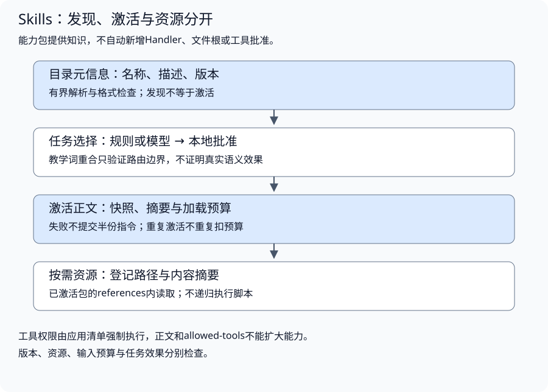

# Skills 与领域能力复用

配套实验：[Skills 与领域能力复用实验](../../../../labs/part3-agent/chapter30/skills-loader/README.md)。

把全部领域规则放进system，输入会膨胀，不同业务流程也容易互相干扰。Skills将知识、步骤和资源组织成可发现、可选择、按需加载的能力包。

加载可以类比前端按场景装载模块，但它改变的是模型可见信息。工具权限、资源授权和最终任务验收仍由应用承担，加载成功需要继续验证规则是否被有效使用。

## 能力包与任务边界

<a id="topic-agent-skills"></a>

### 一个能力包应该解决什么问题

技能包应围绕一类可重复任务，例如从错误描述确认资料范围、比较参数、报告证据缺口。它需要说明何时适用、步骤依据和失败边界，而不是把一段泛泛的角色提示换成目录。

工具提供动作，Skill提供如何组织任务和使用知识的指导；两者可以关联，但不是同一个权限对象。技能描述“运行命令”，不意味着应用已经注册Shell或批准执行。

配套教学包使用真实SKILL.md结构。以下格式示例与实验的incident-diagnosis包对应：

```yaml
---
name: incident-diagnosis
description: Diagnose timeout failures using readonly evidence.
metadata:
  version: v1
  sha256.references/guide.md: 035cbd950659ca8a4754082004482ef3f4ef143b328b7b74949eb9fe5249518c
allowed-tools: run-command
---
```

正文继续写领域步骤，必要资料放references。metadata.version是本实验的应用约定，不是标准要求的必填字段；allowed-tools的实际支持取决于宿主，本实验不让它扩大工具政策。课程只实现规范子集，不声称是完整验证器。

<a id="格式环境与执行许可分别判断"></a>

**格式、环境与执行许可分别判断**

[Agent Skills规范](https://agentskills.io/specification)定义包的描述方式，宿主还要决定怎样使用它。`compatibility`可以声明需要的产品、系统包或网络环境；字段合法不表示这些条件已经满足，更不表示宿主应自动安装依赖或开放网络。

| 判断层 | 要回答什么 | 本教学加载器的范围 |
| --- | --- | --- |
| 包格式 | 名称、描述及可选字段是否符合读取契约 | 校验已支持字段，拒绝未知字段；应用额外要求metadata.version |
| 环境适配 | 当前运行环境是否具备声明的条件 | 读取声明，不自动检测软件、安装包或执行脚本 |
| 执行许可 | 需要的工具是否由本次运行批准 | 执行器核对应用工具清单，allowed-tools不创建Handler或权限 |
| 任务适用 | 本任务是否确需这个流程和知识 | 选择器与任务评估分别检查，不能从前三层继承收益 |

`compatibility`在规范中是可选字符串，提供时长度为1–500字符。加载器按Unicode字符检查上限，并额外拒绝纯空白；不能仅看文件的总字节上限。YAML还能将数字解码进Go字符串，因此入口保留字段是否出现及原值类型，拒绝数字、null和空值。500个汉字可能超过500字节，但仍可满足字符限制；整体4KiB前部读取约束也要同时满足。

类型检查覆盖所有已支持的字符串字段。`description: 123`与`description: "123"`在YAML中类型不同；前者不能因为Go解码后看起来是文本就被接受。metadata要求字符串键和值，因此版本号若要写成`1`，应明确使用字符串，而不是让加载器把数字或布尔值转换成包声明。

[header入口](../../../../labs/part3-agent/chapter30/skills-loader/main.go)在发现与激活时共用这些检查。先按结构解码并拒绝未知字段，再检查原始字段类型，最后核对长度、名称与本实验的必需版本：

```go
	for _, name := range []string{"name", "description", "license", "compatibility", "allowed-tools"} {
		if value, present := fields[name]; present {
			if _, ok := value.(string); !ok {
				return Metadata{}, 0, ErrSkill
			}
		}
	}
```

带引号的数字、布尔词和多行描述仍按字符串处理；类型合法以后，还要通过字段自身的约束。字段存在与字段省略分别判断，不能把null直接当作一个合法的可选字符串。compatibility另有独立的长度边界：

```go
	if field, present := fields["compatibility"]; present {
		value, ok := field.(string)
		if !ok || strings.TrimSpace(value) == "" || utf8.RuneCountInString(value) > 500 {
			return Metadata{}, 0, ErrSkill
		}
	}
```

通过格式校验以后，声明仍是一段数据。一个包写着“需要Shell”，而运行只批准read-doc，应用应明确能力不足或选择获准替代流程；不能因为已经Load成功，就把执行权交给该文件。是否检查实际环境、如何降级和怎样记录差异，由宿主定义，不提升为所有Skill框架的默认行为。

<a id="怎样按任务边界拆包"></a>

**怎样按任务边界拆包**

故障诊断和报告整理可以拆成两个包：前者决定要查哪些证据、怎样判断条件不足，后者规定如何组织已经确认的事实。用户只问超时原因时，可以只选择诊断；用户还要求生成报告时，再选择报告包。报告包消费诊断结论与来源，不应另写一套不同的事实判断规则。

拆包时检查三个问题：适用条件能否单独描述，输入与产出能否明确交接，缺少另一个包时能否完成自身任务。若两个包必须反复引用对方才能解释同一步骤，适合合并主流程，把详细规则放入参考文件。若任务只需调用一个稳定接口，Tool已经提供了能力，未必需要另加Skill。

Skill中的步骤是提供给模型的指导。需要强制执行的次序，例如“授权后才能读取”“校验通过才能交付”，必须落在应用代码或Workflow的控制流中。把这些要求写进SKILL.md可以帮助模型理解流程，执行器仍需保证越过步骤时不能执行。

Skill正文应让模型能够决定下一步：说明输入需要哪些事实、每一步依据什么观察、资料不足时如何处理、产出保留哪些来源。长篇协议细节、参数表和示例放references，并在步骤遇到它们时给出具体读取条件，避免开始任务前先读完所有附件。

## 发现、选择与渐进加载

### 为什么分三个加载阶段



1. **发现元信息**：名称、描述和版本帮助判断任务可能需要什么。
2. **激活正文**：只有选定并获准的包进入本轮运行的知识视图。
3. **按需读取资源**：需要具体规则时读取参考文件，不自动递归展开或执行脚本。

配套[Entry与Loaded](../../../../labs/part3-agent/chapter30/skills-loader/main.go)把目录与正文状态分开：

```go
type Entry struct{ Name, Description, Version, HeaderHash string }
type Loaded struct{ Name, Version, Text, Digest string }
```

发现阶段读取有界文件前部并解析元信息，正文不会因扫描目录自动注入模型。小文件的I/O可能已经读到部分正文，但加载状态与模型输入仍要由激活流程控制；不能把“磁盘读取”和“向模型提供信息”混为一谈。

按需加载节省的是不必要输入，不保证模型效果改善。元信息不准、选择错误或必要资源没有读到，都可能让任务失败。

### 选择器应该看到哪些信息

描述应该写清任务、输入和产出，例如“按只读证据诊断超时并指出缺失条件”，而不是“处理各种问题”。选择器可以使用规则、模型或检索，但应只看可用元信息与任务，不先读取全部包的正文或评估答案。

[Select](../../../../labs/part3-agent/chapter30/skills-loader/main.go)采用固定词重合策略，便于观察选择边界：

```go
func (l *Loader) Select(query string) []string {
	out := []string{}
	words := strings.Fields(strings.ToLower(query))
	for name, entry := range l.catalog {
		if !l.approved[name] {
			continue
		}
		match := false
		for _, word := range words {
			for _, token := range strings.Fields(strings.ToLower(entry.Description)) {
				if word == strings.Trim(token, ".,;:") {
					match = true
				}
			}
		}
		if match {
			out = append(out, name)
		}
	}
	sort.Strings(out)
	return out
}
```

它不具备语义路由或中文分词能力，不证明真实模型能选对Skill。复杂任务可能需要多个包，但多包规则可能冲突；必须明确优先级、兼容关系与输入预算，不能无条件叠加。

本地批准范围与任务选择分别检查。目录发现某能力，不代表当前运行可激活它；模型选择也不能绕过审批或环境限制。

<a id="多个包同时命中先解决职责与冲突"></a>

**多个包同时命中，先解决职责与冲突**

“诊断原因并生成报告”可能同时需要两个包。名称排序可以稳定目录输出，却不能决定哪份指令优先；只按加载先后拼接，也可能让模型在不同轮次采用不同规则。

| 冲突类型 | 例子 | 应用需要作出的选择 |
| --- | --- | --- |
| 任务分工重叠 | 两个包都要求自己决定故障原因 | 选定负责判断的包，其他包消费带来源的结论 |
| 输出格式不同 | 一个要求简短回答，另一个要求完整报告 | 按当前任务确定交付格式，避免同时提出互斥要求 |
| 资料版本不同 | 主流程引用v1规则，参考文件已更新到v2 | 使用匹配版本或拒绝本次加载，不混合规则 |
| 执行要求不满足 | 包要求Shell，当前运行只有只读查询 | 报告能力不足或选择获准替代流程，不因加载扩权 |

这些冲突由宿主的任务与政策处理，Agent Skills格式本身不替应用定义通用优先级。组合前按以下步骤检查：

1. **限定任务与产出**：确认本次需要诊断、报告还是两者，保留用户要求和应用政策的来源。
2. **确定交接关系**：指定哪份流程负责取得事实、哪份流程负责呈现，避免重复检索或互相改写结论。
3. **核对兼容条件**：检查资料版本、工具能力和输入预算；无法满足时拒绝组合或明确缩减任务。
4. **固定本轮选择**：记录使用的包名、版本和内容摘要，再组装正文与必要资源；任务变化时重新判断，不能静默换包。

当前Loader能够分别加载获准包，不分析自然语言指令冲突，也没有自动组合调度器。多包兼容属于应用策略与迁移练习；把两个文件读成功，不能当作冲突已经解决的证据。

## 激活快照与资源读取

<a id="激活时检查什么"></a>

<a id="身份版本与容量一致"></a>

**身份、版本与容量一致**

[Load](../../../../labs/part3-agent/chapter30/skills-loader/main.go)先核对目录、批准和缓存，再从该技能根目录读取正文：

以下摘录函数内的关键分支，完整校验与资源清理见所链源码。

```go
	meta, end, err := header(data)
	if err != nil || meta.Name != entry.Name || meta.Metadata["version"] != entry.Version || hash(data[:end]) != entry.HeaderHash {
		return Loaded{}, ErrSkill
	}
```

```go
	if len(body) > l.Budget-l.Used {
		return Loaded{}, ErrBudget
	}
	if err := ctx.Err(); err != nil {
		return Loaded{}, err
	}
	value := Loaded{Name: name, Version: entry.Version, Text: body, Digest: hash([]byte(body))}
	l.loaded[name] = value
	l.Used += len(body)
```

名称与目录一致，元信息摘要和版本与发现时匹配，内容有界且非空，剩余预算足够，才提交加载状态。失败不扣预算，不返回半份指令。

版本与摘要有不同用途。元信息摘要帮助发现配置变化，正文Digest定位实际加载内容；它们不是发行者身份认证或防篡改签名。首次加载前正文如果在版本不变时被更改，目录元信息不能证明它仍是原发布内容，可信发布还需完整包校验与来源记录。

<a id="一轮运行固定快照"></a>

**一轮运行固定快照**

重复激活返回缓存，不重复扣除预算。包在磁盘更新后，当前运行仍使用已加载版本；重新发现和新的运行再决定切换。这样能避免长任务中途混用两套规则。

缓存是每个Loader实例的运行状态，单调用方持有，不支持并发共享修改。真实共享服务需明确同步和版本策略，不把map的存在当作线程安全。

### 参考文件怎样受控读取

只允许已激活包的references相对路径，拒绝绝对路径、..和其他目录。使用每个Skill自己的os.Root，避免同一总目录下跨包读取；符号链接也不能逃出该根。

教学包在metadata中登记参考文件SHA256，读取前核对登记，读取后比较内容摘要，避免正文v1配上无声更新的参考文件。登记值先解码为32字节，再编码成统一的小写十六进制；摘要身份由字节决定，大小写只是表示方式。非法编码或内容变化仍拒绝，不因规范化而放宽批准范围。该清单仍不证明发行者身份；完整可信发布需要来源与签名等额外措施。

正文和参考文件共同占加载预算。重复读同一资源可以使用当前运行缓存；必要资源过大时应分页或选择相关内容，不能悄悄截掉规则后假定任务仍能正确执行。

脚本、模板或assets属于不同资源形态。文件存在不意味着可以运行，本实验只读参考文本，不执行脚本或命令。若应用确实提供执行能力，仍需Tool、Workspace、Sandbox及用户授权边界。

## 执行政策与权限边界

### 指令为什么不能授予权限

实验包故意声明run-command，但应用只批准read-doc。加载成功后请求run-command仍返回ErrDenied。

这是知识与执行分离：Skill可告诉模型如何行动，工具注册表决定能否行动。外部包、文档或模型不能自行添加Handler、网络地址、文件根或用户身份。

加载内容也要保留来源角色，不能覆盖应用规则。来自第三方的能力包需要核对来源、版本与许可；无法确认的内容可以限制为阅读资料，不等于运行授权。

前面固定的是“能否加载”和“能否执行”必须分开。下一层才回到效果问题：这些包真的减少了输入噪声、补上了必要规则，还是只是换了一种更复杂的提示组织方式。

## 加载效果与任务收益

### 怎样检查Skill真的有用

比较全量规则与按需加载时，使用同任务、同资料、同模型与相同工具能力，检查：选择是否正确、必要信息是否加载、目标完成度、输入量、额外读取和失败。

基础加载实验只记录字节预算；后面的本地模型对照另外记录实际Token与原始输出。将预算接入Context时，使用匹配的计数器并预留输出空间；字节变少不自动意味着任务表现更好。

<a id="加载预算与每轮模型输入分别核对"></a>

**加载预算与每轮模型输入分别核对**

Loader.Used统计本实例已接受的正文与参考字节。模型输入还包含能力目录、应用指令、问题、历史、工具说明和观察，不能用Used推断总Token消耗。已缓存的正文在两轮都送给模型，仍会产生两轮输入；缓存只避免重复读取和重复扣加载预算。

Context应按包身份与内容摘要去重，再决定本轮保留哪些内容。正文指导任务，参考文件补充具体知识，两者各自标明来源；预算不足时优先移除当前不需要的资料。必需步骤或参考规则装不下，应缩小任务、分阶段处理或报告不足，不能截断后继续声称采用了完整流程。

发现目录同样有成本。即使正文全部按需加载，包数量增加时，名称与描述仍可能挤占输入。先按可信范围过滤可用目录，再决定是否需要检索候选或分组选择；不能以渐进加载为理由无限增加元信息。本实验目录最多八包，该限制只约束教学运行，不说明真实模型最多能管理多少技能。

<a id="同任务对照全量与按需加载"></a>

**同任务对照全量与按需加载**

先冻结包版本、资料、任务集和评分标准。为相同任务准备两条输入路径：全量路径提供所有获准包与受控资源，按需路径先选择候选、再加载必要内容；两者使用相同模型、工具权限与运行预算。未批准内容在两条路径中都不能出现。

任务集应包括只需要一个包、需要组合、没有适用包、描述容易混淆，以及资料过期或工具能力不足的情况。预期包与预期结果留在评分侧，选择器只能看到任务和允许元信息；不能通过任务ID查出标准答案再加载。

| 观察层 | 需要记录什么 | 结果怎样解释 |
| --- | --- | --- |
| 选择 | 应用定义的必要包、实际选择、漏选与误选 | 误选可能增加输入，漏选可能丢失步骤；有多种合法组合时预先定义评分规则 |
| 加载 | 实际包版本、正文摘要、资源身份与拒绝原因 | 正文已加载仍可能缺少必要参考；未加载内容不能计作模型已知 |
| 执行 | 实际工具、失败、取消与步骤 | 找到正确包后仍可能未遵守流程，不能由选择结果继承任务成功 |
| 交付 | 正确结论、来源、完整性与恰当拒绝 | 证据不足时报告不足，与协议失败、越权或超限分开 |
| 消耗 | 实际输入/输出Token、额外读取、延迟和费用 | 用相同任务质量比较节省；将失败费用和未知usage保留在报告中 |

可以先用固定选择器验证这条评估链路，再接真实模型检查效果。固定案例、词重合和字节计数只能证明相应机制，尚不能给出按需加载的质量收益。真实模型对照还应保留失败记录和配置，重复运行以观察选择波动；内容调优使用开发任务，最终判断使用未参与调优的任务。

<a id="指导与证据怎样进入同一请求"></a>

**指导与证据怎样进入同一请求**

实际输入分别保存所选Skill指导与可信资料，记录加载来源和最终messages。选择器需要的标签不进入生成输入；指导可以约束步骤，但不能把未发生事件变成事实。

实现与对照见[配套实验](../../../../labs/part3-agent/chapter30/skills-loader/README.md#book-agent-skills-指导与证据怎样进入同一请求)。

<a id="协议通过以后继续核对事实使用"></a>

**协议通过以后，继续核对事实使用**

先判断输出协议，再核对真实字段、引用身份和来源支持。模型可能完整回显格式却写入无证据事件；新任务与重复回归分开统计，输入减少也不直接计作质量提升。

实现与对照见[配套实验](../../../../labs/part3-agent/chapter30/skills-loader/README.md#book-agent-skills-协议通过以后继续核对事实使用)。

<a id="按需加载的收益必须保留交付条件"></a>

**按需加载的收益必须保留交付条件**

输入Token减少只能说明少传了内容。若必要规则同时被省略，或者输出尚不能交付，就不能把这次减少称为成功任务成本下降。先固定可接受的任务质量与拒答条件，再比较输入、额外读取、修复和失败的全部消耗。

对照中的任务应与调优用途绑定。首次新任务也可能与开发题属于同一合成家族；读过结果并据此修改选择器或提示后，就应记录用途变化，后续验收使用新的独立任务。小样本的几个通过数不能证明按需策略普遍优于全量，也不能将配置变化的收益全部归因于Skill。

最终回到具体缺口：选择错误、内容不足、资源读取失败、指令冲突或权限不满足。只增加描述关键词可能同时扩大误选；更换模型也不能替代这些链路检查。

<a id="最佳实践"></a>
<a id="一个包有清楚的适用范围"></a>
<a id="版本变更可追查"></a>
<a id="资源加载不自动递归"></a>

[实验排查与实践建议：最佳实践](../../../../labs/part3-agent/chapter30/skills-loader/README.md#book-agent-skills-最佳实践)。

<a id="常见问题排查"></a>
<a id="能力目录存在但模型没用上"></a>
<a id="重复加载让费用或输入持续增长"></a>
<a id="加载后请求越权工具"></a>
<a id="选择正确但回答没有采用规则"></a>

[实验排查与实践建议：常见问题排查](../../../../labs/part3-agent/chapter30/skills-loader/README.md#book-agent-skills-常见问题排查)。

## 小结

1. Skills按任务边界封装知识、流程与资源，通过发现、激活和读取逐步加载。
2. 选择器先看必要元信息，加载固定版本并限制数量、体积和递归。
3. 指令不授予工具权限，资源读取与执行政策分别检查。
4. 加载成功、协议通过、规则采用与任务收益分别验证，输入减少不能单独证明改进。

## 参考文档

- [Agent Skills规范](https://agentskills.io/specification)：包格式、元信息与渐进加载的补充定义。
- [os.Root](https://pkg.go.dev/os#Root)：技能根目录内读取的约束。
- [Context正文](chapter26-context.md#topic-agent-context)：输入选择与容量核对。

[返回全书目录](../../README.md) · [上一篇：检索增强生成与证据验证](chapter27-rag.md) · [下一篇：运行控制与故障恢复](../runtime/chapter29-execution.md)
