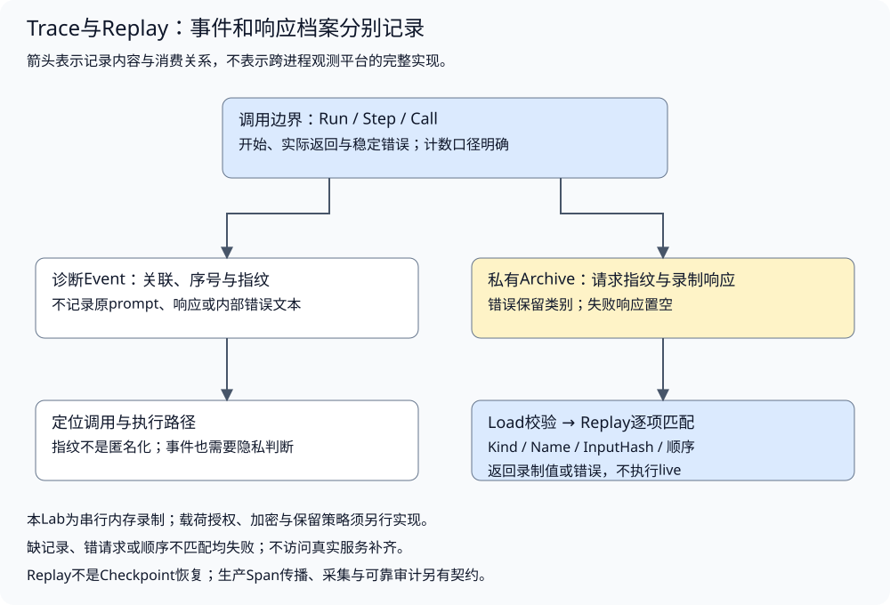

# 可观测性与执行重放

配套实验：[可观测性与执行重放实验](../../../../labs/part3-agent/chapter33/trace-replay/README.md)。

相关实验：[实验：执行轨迹、重放与回归门禁](../../../../labs/part3-agent/chapter33/eval-observability/README.md)。

用户只说“刚才失败了”，服务端却无法把页面请求、模型调用和工具错误关联起来。观察系统需要保留执行事实，而重放需要可核对的原输入与响应。

类似前端请求链路排查，Trace帮助定位一次调用；Replay复现已有过程，不会自动恢复现场或重新获得工具权限。本章将事件、响应录制和离线诊断分别组织。

## 运行关联与记录边界

<a id="topic-agent-trace-replay"></a>

<a id="一次运行如何关联到具体调用"></a>

<a id="runstepcall分别定位"></a>

**Run、Step、Call分别定位**

Run定位一次任务，Step定位运行中的推进单位，Call定位一次模型或工具尝试。重试应有新的Call ID，不能把多次网络请求挤成一条“最终成功”日志。

配套[Event](../../../../labs/part3-agent/chapter33/trace-replay/main.go)记录最小关联信息：

```go
type Event struct {
	Seq                                                                  int
	Run, Step, Call, Kind, Name, Phase, InputHash, OutputHash, ErrorCode string
}
```

教学实现按一次调用分配一个Step，两条事件分别表示开始和结束；这不是Loop样章中的模型轮次。指标和日志必须说明计数口径，不能根据“step=3”猜发生了三次推理。

生产Tracing通常用Span表达操作时间与父子关系，用Context传播Trace身份。基础Recorder独立管理课程事件，配套SDK实验另用OpenTelemetry v1.37.0验证Span与标准carrier传播；接入观测平台时，继续核对跨HTTP、队列和子Agent的关联。

<a id="从业务身份映射到span"></a>

**从业务身份映射到Span**

一次Run可以包含多个模型调用、工具尝试和子任务。每次操作建立自己的Span，调用方的Span作为直接父级；跨服务仍保留同一Trace的关联信息。Run/Call与Trace/Span是应用身份和观测身份的映射，不能按字符串相似或时间接近推断父子关系。[OpenTelemetry上下文传播](https://opentelemetry.io/docs/concepts/context-propagation/)说明了跨边界传递关联上下文的机制。

| 执行边界 | 需要保持的关系 | 应用另外核对 |
| --- | --- | --- |
| HTTP入口与下游请求 | 提取上游观测上下文，建立本地操作，再向下游传递 | 可信用户/租户与授权，远端Trace标识不是身份凭据 |
| 同进程工具或模型调用 | 以当前操作为父级记录尝试，重试有独立操作记录 | 参数、预算、错误与实际usage |
| 后台任务与队列 | 保存可传播的关联元信息，记录接纳和执行阶段 | 任务生命周期与所有权，主请求结束不等于worker结束 |
| 多个上游结果汇合 | 明确主要父级，必要时用Span链接关联其他因果来源 | 不把多个父任务硬塞进一个Parent ID或复制全部载荷 |

Span开始/结束、事件和属性服务于诊断。框架组件结束后，答案仍可能在引用校验或最终授权处被拒绝，因此另记录业务终态及验收结果。把所有Span都标为成功，会隐藏这道出口；把所有业务失败都记成工具故障，也会误导排错。

<a id="序号与时间戳不能互相替代"></a>

**序号与时间戳不能互相替代**

单运行内的序号帮助检查事件顺序；时间帮助观察延迟，但时钟不同、异步写入和缓冲都可能改变到达顺序。并发Span可以重叠，不能照搬本实验相邻started/finished的串行规则去验证所有分布式Trace。

缺少结束事件意味着观测不完整，可能是退出、丢失、采样或尚未结束，不能直接写为成功。采样Trace也不能承担完整审计账本或所有任务的费用记录。

<a id="采集链路也会失败"></a>

**采集链路也会失败**

观测数据通常经历生成、缓冲、导出和存储。队列满、网络中断或进程退出都可能使已产生的事件未到达平台。应用需要决定是否丢弃、短暂等待或使用可靠后端，记录丢失/不完整情况；这些策略的延迟和资源成本也应测量。

诊断导出失败是否影响任务，由场景约定：普通追踪丢失可以保留任务结果并标记观测不完整，强制审计则可能要求先完成可靠提交。不能让一个无界导出等待卡住Agent，也不能用遥测写成功代替业务结果提交。Shutdown/flush同样有时限，进程异常退出后的可靠性另外验证。

当前Recorder保存串行内存事件，不实现Exporter、Collector、采样或跨进程传播；上面的对接要求需要在所选SDK/后端中验证。公开属性、原文录制和必要审计仍按各自权限与保留策略管理。

前面讲的是Trace记录为什么会丢、为什么不能把事件完整性想当然。接下来再看一条更具体的工程边界：传播要交给真实SDK验证，而不是手写一个看起来像 Trace ID 的字符串。

<a id="用真实sdk验证传播而不是手写trace-id"></a>

**用真实SDK验证传播，而不是手写Trace ID**

[SDK对照](../../../../labs/part3-agent/chapter33/trace-replay/otel.go)使用局部TracerProvider和内存Exporter，不更改全局Provider。agent.run是业务根，model.decide和tool.read是子操作；模拟远端server.lookup从carrier提取上下文后继续同一Trace：

```go
	carrier := propagation.MapCarrier{}
	propagator := propagation.TraceContext{}
	propagator.Inject(toolCtx, carrier)
	remoteCtx := propagator.Extract(context.Background(), carrier)
	callCtx, remote := tracer.Start(remoteCtx, "server.lookup", trace.WithSpanKind(trace.SpanKindServer))
```

Trace/Span ID由SDK生成，测试比较真实父子和Trace关系，不固定随机ID。这里carrier仍在同一进程内传递，使用了真实inject/extract，但没有发送HTTP或OTLP；不能据此证明网络中间件、Collector或跨服务部署正确。

模拟操作返回内部错误后，只以稳定分类设置Span状态，未将原始error传给RecordError。公开属性限定为应用Run/Call及业务outcome；原始返回文本也不入Span。内存Exporter在Shutdown前取得快照，Provider以独立的短时限关闭，避免已取消的业务context使清理无法开始。

此路径中模型组件结束，工具/模拟远端为error，业务Run也标task_failed。SDK采集与业务判断仍分别负责；真实结果完整性、费用、审计提交和采集丢失还需原有契约。局部Provider与白名单投影只覆盖本次程序，不证明其他日志或资源属性渠道都已脱敏。

<a id="http边界怎样接上同一条trace"></a>

**HTTP边界怎样接上同一条Trace**

进程内直接传context，到HTTP边界就需要把关联信息编码到请求头。客户端先建立本次请求的Client Span，再将它的上下文注入HeaderCarrier；服务端提取后，以远端操作为父级建立自己的Server Span。若在发送之前结束或丢掉当前上下文，下游就可能成为另一条Trace，时间相近也无法补回可靠的因果关系。

[HTTP中间件](../../../../labs/part3-agent/chapter33/trace-replay/http.go)将提取、建立操作和交给业务处理这三个动作放在入口：

```go
func TraceHTTP(tracer trace.Tracer, next http.Handler) http.Handler {
	return http.HandlerFunc(func(w http.ResponseWriter, r *http.Request) {
		parent := propagation.TraceContext{}.Extract(r.Context(), propagation.HeaderCarrier(r.Header))
		ctx, span := tracer.Start(parent, "http.lookup", trace.WithSpanKind(trace.SpanKindServer))
		defer span.End()
		next.ServeHTTP(w, r.WithContext(ctx))
	})
}
```

一次请求按以下顺序建立关联：

1. **发送方建立操作**：Client Span是本次网络请求的观测身份；把当前上下文注入请求头，然后发送请求。
2. **接收方提取父级**：从请求头提取TraceContext，建立本地Server Span；两个操作共享Trace ID，Server的Parent Span ID指向Client。
3. **业务处理使用新上下文**：Handler通过请求context继续关联下游操作。身份、权限、超时及结果验收仍由业务入口处理，Trace头不授予权限。
4. **结束本地操作**：Handler返回后结束Server Span。此中间件未采集HTTP状态或业务结果，Span结束只代表处理区间结束。

没有合法上游关联时，接收方可以建立新的本地Trace。无效traceparent不等于业务参数非法，也不能因为它携带了合法Trace ID就接受用户身份。应用若需要限制外部Trace的接纳范围，应在边界定义策略，不能把可伪造的关联标识当成授权凭据。

配套HTTP实验实际发送回环请求，验证请求头、远端父级和Handler上下文；两端仍在同一进程，使用同步内存Exporter。它没有验证代理转发、跨机器部署、OTLP导出或Collector。中间件也不记录URL、头部和正文；添加HTTP属性时需先限定字段及敏感性，而不是复制整个请求。

### 诊断事件与响应录制为何分开



公共诊断通常只需要调用身份、状态、耗时、消耗和稳定错误类别。重放则可能需要完整响应，两者的数据敏感性和保留策略不同。

录制档案保存以下最小调用信息：

```go
type RecordedCall struct{ Kind, Name, InputHash, Response, ErrorCode string }
type Archive struct {
	Schema int
	Run    string
	Calls  []RecordedCall
}
```

Response属于私有录制数据，不能因为Event没有原文，就声称整个档案已经脱敏。真实prompt、资料和工具结果可能包含个人信息或秘密，录制需要访问授权、加密、保留期限、删除与审计。

InputHash用于匹配请求，不是匿名化，也不证明档案可信。低熵输入可能被字典猜测；可按需要采用HMAC、删除身份或限制记录内容。校验来源与防篡改另行设计，不能把普通SHA256当作授权签名。

前面区分了“公共事件”和“私有录制”的保留策略。接下来再落到采集动作本身：在调用前后各记什么，哪些原文可以保留，哪些只保留摘要或稳定错误码。

## 调用边界的事件采集

### 如何在调用边界记录事件

配套[Recorder.Do](../../../../labs/part3-agent/chapter33/trace-replay/main.go)在调用前保存started，在返回后归类结果并保存finished：

以下摘录函数内的关键分支，完整校验与资源清理见所链源码。

```go
	r.Events = append(r.Events, event)
	response, err := live(ctx)
	if stop := ctx.Err(); stop != nil {
		err = stop
	}
	if len(response) > 4096 || !utf8.ValidString(response) {
		response = ""
		if err == nil {
			err = ErrTrace
		}
	}
```

```go
	r.Archive.Calls = append(r.Archive.Calls, RecordedCall{Kind: kind, Name: name, InputHash: event.InputHash, Response: response, ErrorCode: code})
	event.Seq = len(r.Events) + 1
	event.Phase = "finished"
	event.OutputHash = digest(response)
	event.ErrorCode = code
	r.Events = append(r.Events, event)
```

它不保存原始输入到公共事件，只存指纹；错误按取消、超时、协议失败、模型失败或工具失败分类，不把内部错误文本直接公开。实时调用方仍收到原错误，日志或API展示时继续按其敏感性处理。

响应返回后再次检查context，迟到文本不能记成正常成功。请求已经发出时，即使取消，仍可能产生消耗；事件记录不能证明Provider撤销计费。

响应还要能以原样文本保存。非法UTF-8在JSON编码时可能被替换，录制后得到的字节就与实时响应不同；本实验将无错误但超限或坏编码的响应记为protocol_failed，不交付文本。输入、调用名和Run标识的编码也在实时调用前检查，重放不接受坏编码请求。

结果检查不能覆盖已经发生的失败。上游取消、包装后的下游超时或普通工具错误仍保留原原因，即使同时返回超大或坏编码的残余文本，也只丢弃文本，不将取消改成协议错误。实时调用方拿到原因，档案保存对应稳定类别；两者的粒度不同，但不能互相矛盾。

记录器是单调用方拥有的串行结构，最多16次调用与32条事件；不支持并发共享写入。真实事件管道还需定义缓冲、背压、落盘和丢弃策略，不能在错误路径阻塞整个Agent。

## 严格重放与恢复的区别

<a id="replay怎样重现一次失败"></a>

<a id="不调用真实工具"></a>

**不调用真实工具**

Replay取得已校验的档案，按顺序匹配Kind、Name与请求指纹，然后返回录制响应或稳定错误类别：

```go
func (r *Replay) Do(ctx context.Context, kind, name, input string) (string, error) {
	if err := ctx.Err(); err != nil {
		return "", err
	}
	if r.Cursor < 0 || r.Cursor >= len(r.Archive.Calls) || len(input) > 4096 || !utf8.ValidString(input) || !utf8.ValidString(name) {
		return "", ErrMismatch
	}
	record := r.Archive.Calls[r.Cursor]
	if record.Kind != kind || record.Name != name || record.InputHash != digest(input) {
		return "", ErrMismatch
	}
	r.Cursor++
	return record.Response, errorFor(record.ErrorCode)
}
func (r *Replay) Done() error {
	if r.Cursor != len(r.Archive.Calls) {
		return ErrMismatch
	}
	return nil
}
```

方法没有实时Handler参数，因此重放不会再次查询模型、工具或外部服务。实验录制一次模型提议与一次工具失败，重放同一任务也在工具位置失败，供调用方复现错误传播。

档案与事件校验还核对调用Kind和错误Code的关系：model_failed不能属于tool，tool_failed不能属于model；取消、deadline与协议错误则可出现在两类调用。枚举值各自合法，组合仍可能矛盾；加载时拒绝，避免把工具故障重放成模型故障。游标为负也返回ErrMismatch，不索引数组或消费记录。

加载还检查原始UTF-8、重复字段及大小写别名、嵌套深度和额外负载。Schema=0后再写Schema=1不能通过覆盖变成合法档案，Run/run也不能改写运行归属。字段名采用本格式的ASCII标识，中文等合法UTF-8值仍可保存；这些形状检查不证明档案签名或内容来源。

重放保留的是声明的类别，不是原始网络堆栈、时间或任意error对象。错误分类的粒度必须满足排查目标；分类太粗会隐藏关键差异，复制原始错误文本又可能泄漏数据。

<a id="匹配失败要可见"></a>

**匹配失败要可见**

以下情况不能静默调用真实服务补齐：

1. **请求改变**：指纹不匹配，可能是代码、输入编码或参数变化。
2. **顺序改变**：当前请求与录制调用不一致，不能随意寻找“差不多”的一条。
3. **记录缺失**：需要的调用不在档案中，失败而不是猜测结果。
4. **记录未消费完**：运行提前结束，Done检查揭示没有走完原轨迹。

本实验按输入字节匹配，空格变化也可能不匹配。需要语义规范化时，先定义稳定编码、字段顺序与版本，不能用忽略差异来掩盖执行行为已经改变。

### 重放、回放、恢复与再次执行有何区别

| 行为 | 使用什么 | 是否发出新动作 | 能证明什么 |
| --- | --- | --- | --- |
| 展示历史事件 | 已记录事件 | 否 | 记录里出现过什么，不代表记录完整 |
| 确定性Replay | 录制的模型/工具响应 | 否 | 相同调用契约下的路径与错误传播 |
| Checkpoint恢复 | 已提交状态、游标与恢复策略 | 可能 | 按策略继续未完成执行 |
| 再次运行真实任务 | 当前模型、工具与环境 | 是 | 新条件下的行为，需要重新评估 |

录制旧响应不能证明新模型的效果；恢复时也不能拿旧响应代替必须重新读取的当前事实。Replay可能只冻结环境响应，而本地程序、时间、随机数和状态仍在变化，需要根据目标固定相应条件。

## 故障定位与回归诊断

### 从Trace定位到具体故障层

先确定相关Run和失败Call，再沿依赖检查：

1. **输入构建**：必要约束、工具定义和观察是否实际进入该请求？
2. **模型响应与adapter**：原始结果是否被正确解析成提议或最终回答？
3. **工具执行**：参数、权限、超时与结果完整性是否成立？
4. **状态提交**：观察、计划或游标是否写入正确位置与版本？
5. **业务验收**：工具成功和最终文本是否真正满足任务要求？

本实验能重现第二次调用失败，但不会自动推断所有根因。真实系统结合资源指标、日志、Span和版本配置缩小范围，再把已确认故障转为Eval用例。

### 重放怎样支持回归诊断

看到一个退化Case，先按RunID找到它对应的配置与调用归档，再用同一任务输入重放；重新运行可能得到另一个答案，不能替代对原失败的解释。[执行与评分集成实验](../../../../labs/part3-agent/chapter33/eval-observability/README.md)把Case/Run关联、严格调用顺序与评分版本放进同一条验证链。

诊断顺序为：

1. **核对记录身份与版本**：确认数据集、资料、配置和评分条件相容，避免把不同任务的结果放进同一比较。
2. **检查调用交接**：每步请求摘要与录制顺序一致，全部响应被消费；错配直接拒绝，不回退调用工具。
3. **核对终态与答案**：重放所得结果应与归档相符；执行失败保持失败，不从评分分母中删去。工具错误要在原调用位置复现，失败后不得继续消耗归档中的其他调用；仅有整次失败标记、没有错误调用的旧记录，不能声称故障已完整重放。
4. **回到任务条件**：定位原先通过、现在失败的行，判断原因与严重程度；原答案复现成功不代表答案正确。

调用摘要只帮助发现请求错配，不认证归档来源。未经签名或可信存储保护的文件可以被整体修改；不能把“能重放”当成安全审计证明。同样，重放后的耗时是本机读取和计算时间，不能当成原模型延迟或用于结算费用。

<a id="最佳实践"></a>
<a id="事件与载荷采用不同保留策略"></a>
<a id="记录输入与配置身份"></a>
<a id="失败档案先验证再重放"></a>

[实验排查与实践建议：最佳实践](../../../../labs/part3-agent/chapter33/trace-replay/README.md#book-agent-trace-replay-最佳实践)。

<a id="常见问题排查"></a>
<a id="重放时偷偷访问了真实服务"></a>
<a id="trace显示成功任务仍失败"></a>
<a id="http两端各自有span却连不起来"></a>
<a id="公共日志没有prompt却仍泄漏信息"></a>

[实验排查与实践建议：常见问题排查](../../../../labs/part3-agent/chapter33/trace-replay/README.md#book-agent-trace-replay-常见问题排查)。

## 小结

1. 运行、步骤和调用身份关联执行事实，白名单日志控制泄漏。
2. 诊断事件与响应录制服务于不同目的，录制同时保存原输入与失败。
3. 严格重放核对调用顺序和数据，既不调用真实工具，也不等同执行恢复。
4. 从协议、执行、输入和任务判定逐层排查，重放结果回到版本化回归。

## 参考文档

- [OpenTelemetry Traces](https://opentelemetry.io/docs/concepts/signals/traces/)：Span、上下文传播与Trace关联。
- [OpenTelemetry Context propagation](https://opentelemetry.io/docs/concepts/context-propagation/)：标准carrier的注入/提取及跨边界关联。
- [Go errors](https://pkg.go.dev/errors)：分类错误及包装后的判断。
- [crypto/sha256](https://pkg.go.dev/crypto/sha256)：教学请求指纹的标准库实现。

[返回全书目录](../../README.md) · [上一篇：服务接入与流式交互](../runtime/chapter33-serving.md) · [下一篇：质量评估与持续改进](chapter35-evaluation.md)
