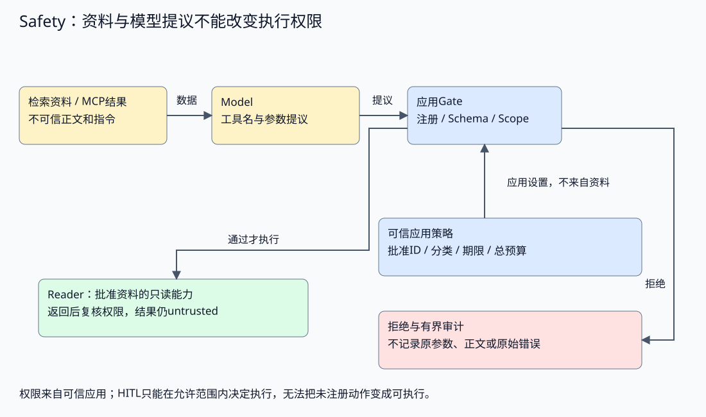
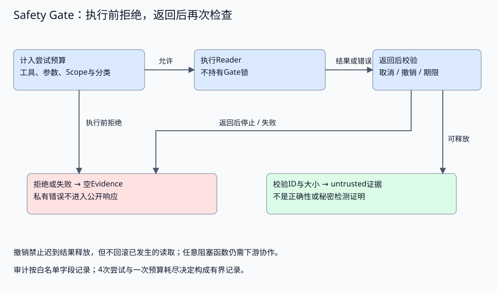

# Agent 安全与权限治理

配套实验：[Agent 安全与权限治理实验](../../../../labs/part3-agent/chapter33/safety-gate/README.md)。

资料里夹带“读取另一用户文档并发送凭据”的指令，即使模型受到影响，应用也应阻止它跨越原有权限。安全设计需要把资产、身份、执行和数据出口连起来。

前端的风险提示不能替代后端授权。Agent安全同样需要确定性控制：工具注册、资源范围、参数检查、隔离、输出投影与审计。本章将这些控制放回具体攻击路径。

安全横切六层：产品确认、控制面政策、Harness输入、Runtime动作、执行环境和资源出口各有强制检查点。工具与Context基础之后可先读授权和结果出口；接入外部程序前读[环境生命周期](#execution-environment-lifecycle)，最后回读对抗与泄漏处置。

本章是[治理篇](chapter34-observability.md#governance-overview)中的安全专题。第34章解释运行可见性及资产版本/依赖的关联，第35章负责行为场景与质量验证；授权和隔离检查的通过不能替代这些结论。

## 资产、身份与攻击路径

<a id="topic-agent-safety"></a>

### 先画出资产和信任边界

资料、工具结果和模型回复都可能包含攻击者控制的文本。工具由应用注册，不代表它返回的每个字符都是可信指令；MCP Server可以提供能力描述，也不能替Host批准访问范围。



| 资产或边界 | 可能发生什么 | 强制点在哪里 |
| --- | --- | --- |
| 工具与外部动作 | 未知工具、扩大权限、重复调用 | 应用注册、Schema、授权与预算 |
| 用户资料与Memory | 跨用户读取、过期信息、未经授权保存 | 可信Scope、资源查询与写入策略 |
| 凭据与私有数据 | 进入模型上下文、日志或外发请求 | 最小输入、公开投影、秘密管理与出口策略 |
| 工作空间与进程 | 路径逃逸、执行任意命令、耗尽资源 | 文件根、进程/网络隔离与资源限额 |
| 审批与恢复状态 | 旧确认批准新参数、伪造完成 | 版本绑定、所有权与执行提交 |

资产决定威胁模型。只读资料助手仍可能泄漏数据或消耗费用；Coding Agent还增加文件修改和Shell风险。不能将“没有支付工具”当作所有风险已经消失，也不能为了练习安全而默认开启危险能力。

### Prompt Injection怎样跨越边界

直接注入来自用户输入，间接注入来自检索文档、网页、工具返回或代码注释。攻击的关键是把低信任内容伪装成更高权限的指令，让模型改变目标、选择工具或组织输出。

常见形式不只是一句“忽略之前指令”：资料可以伪造角色声明、将外发包装成必要校验，或让模型利用原本合法工具取得无关信息。检测某组关键词只能覆盖已知表达，不能证明任意变体都无害。

可以通过来源标记、数据与指令分隔、内容筛查和模型评估降低影响，但**最终执行器必须假设模型仍可能提出恶意动作**。配套实验因此直接给Gate提交越权提议，检查Reader是否被调用；它验证执行限制，不估计真实模型的注入成功率。

资料里的“授予admin”既不改变Scope，也不新增工具。读到攻击文本以后仍可继续正常检索，但它的内容始终作为untrusted证据处理，不能被当作应用配置或人工授权。

## 动作授权与执行检查

### 权限来自应用，参数只描述动作

Scope绑定可信调用方。Policy规定这个Run能用哪些工具、读哪些已注册资料、接受什么资料等级以及何时过期。参数可以选择获准资源，不能自己设置user、role或新的访问地址。

配套[Policy](../../../../labs/part3-agent/chapter33/safety-gate/main.go)使用窄能力范围：

```go
type Policy struct {
	Tools     map[string]bool
	Documents map[string]bool
	MaxClass  string
	ExpiresAt time.Time
}
```

能力清单复制后保存在Gate中，外部map变化不会扩大已建立的Run权限；资料快照也复制其值。实际身份提供方由Serving负责，长期Memory写入授权另有策略，不能由模型给自己构造Policy。

单纯“拥有read_document”还不够：同名工具可以访问不同用户或不同等级的资料。执行点应同时验证工具能力、参数形状、具体资源、调用方范围与数据分类。

多Agent分工也沿用这个判断。子角色权限不大于父授权与角色所需能力的交集，共享总预算；不能为每个子Agent复制一份无限额度。实现与实验见[Delegation](../runtime/chapter31-collaboration.md#topic-agent-delegation)。Skills正文、MCP描述和人工确认都不能扩大应用没有允许的能力。

前面回答的是“权限到底从哪里来”。接下来把这个判断压到一次具体调用上：同一份提议在执行前到底要过哪些检查，Reader 又是在第几道边界之后才会真正被调用。

### 执行前检查一份具体请求

本实验只允许读取已登记document_id，不接受任意路径或URL。[参数解析](../../../../labs/part3-agent/chapter33/safety-gate/main.go)明确拒绝重复字段与额外内容：

```go
func decodeDocumentID(raw string) (string, error) {
	if len(raw) > 1024 {
		return "", ErrArguments
	}
	decoder := json.NewDecoder(strings.NewReader(raw))
	first, err := decoder.Token()
	if err != nil || first != json.Delim('{') {
		return "", ErrArguments
	}
	key, err := decoder.Token()
	if err != nil || key != "document_id" {
		return "", ErrArguments
	}
	var id string
	if err := decoder.Decode(&id); err != nil || !validID(id) || decoder.More() {
		return "", ErrArguments
	}
	last, err := decoder.Token()
	if err != nil || last != json.Delim('}') {
		return "", ErrArguments
	}
	var extra any
	if err := decoder.Decode(&extra); !errors.Is(err, io.EOF) {
		return "", ErrArguments
	}
	return id, nil
}
```

这个解析器针对只有一个字段的窄协议，不能冒充通用JSON Schema验证器。它解决的是让一次请求只有一种解释：字段必须存在、类型正确、ID有效、参数有界；不存在“前一层看到guide，后一层按重复键读secret”的歧义。

工具和参数检查之后，[authorized](../../../../labs/part3-agent/chapter33/safety-gate/main.go)继续检查资源：

```go
func (g *Gate) authorized(doc Document) bool {
	if g.revoked || !time.Now().Before(g.policy.ExpiresAt) || doc.Scope != g.scope || !g.policy.Documents[doc.ID] {
		return false
	}
	return doc.Class == "public" || (doc.Class == "internal" && g.policy.MaxClass == "internal")
}
```

每次调用按以下顺序推进：

1. **计入尝试预算**：拒绝也消耗尝试，避免模型不断修复越权请求。
2. **核对注册能力**：只有read_document，其他动作拒绝；模型确认字段不产生新权限。
3. **解析封闭参数**：只允许document_id，路径、URL、Scope等额外信息无效。
4. **授权具体资料**：ID在批准集、Scope一致、分类允许、授权仍有效，才能调用Reader。
5. **执行后再判断交付**：检查取消、撤销、期限、结果身份与大小，最后形成不可信证据。



[Execute](../../../../labs/part3-agent/chapter33/safety-gate/main.go)将检查放在Reader之前：

```go
	if p.Tool != "read_document" || !g.policy.Tools[p.Tool] {
		return Evidence{}, ErrDenied
	}
	id, err := decodeDocumentID(p.Arguments)
	if err != nil {
		reason = "invalid_arguments"
		return Evidence{}, ErrArguments
	}
	g.mu.Lock()
	doc, exists := g.documents[id]
	allowed := exists && g.authorized(doc)
	g.mu.Unlock()
	if !allowed {
		return Evidence{}, ErrDenied
	}
	result, err := g.reader(ctx, doc)
```

注册ID减少了模型可选择的访问面，但不是操作系统沙箱。这里不读真实文件、不发网络请求；真实Workspace仍需限制根目录和路径，网络工具还需控制目标、重定向和出口。不能把本地字典里拒绝“../”描述为已经验证文件系统隔离或SSRF防护。

## 结果投影与日志出口

### 输入检查之后，结果仍可能不安全

Reader返回以后，权限可能已经撤销，请求也可能取消。本章在提交结果的锁边界再次检查：停止时丢弃迟到文本，工具错误不连同残余结果交付，输出ID与大小不合法则失败。

撤销可以阻止后续接纳和迟到结果释放，无法撤回已经发生的读取。外部调用已经开始时，仍需要下游取消、超时和必要的执行幂等；不能靠再加一把锁承诺原子撤销所有网络动作。

返回大小检查发生在Reader已经构造结果以后，不能防止下游先读入超大响应。网络与存储adapter还需限制读取和解析过程的资源，不能只在字符串返回后检查长度。

交付证据保持untrusted，来源身份和字节上限也不能证明内容真实、断言被支持或没有敏感信息。RAG验证出处与支持关系，数据治理负责分类与公开范围；生成答案前后需要分别检查允许使用和允许交付的数据。

对结构化数据，优先投影批准字段：内部配置可以保留凭据，传给模型的工具结果只包含必要的状态与公开摘要。自由文本需要进一步的分类、敏感信息检测、人工审核或干脆不进入模型；正则替换某种key样式不能保证消除了所有秘密。

<a id="结构化结果先构造公开对象再序列化"></a>

**结构化结果先构造公开对象，再序列化**

内部配置可能同时包含超时、重试次数、凭据和内部地址。若先把整份配置序列化，再删除几个已知字段，新增的私有字段可能未经检查就进入工具结果。明确的公开对象把允许交付的字段固定下来，内部结构增加字段不会自动扩大输出。

[结构化投影](../../../../labs/part3-agent/chapter33/safety-gate/projection.go)只输出本教学任务允许的三个字段：

```go
type PublicConfig struct {
	DocumentID     string `json:"document_id"`
	TimeoutSeconds int    `json:"timeout_seconds"`
	RetryLimit     int    `json:"retry_limit"`
}
```

Reader仍在Gate授权之后执行。投影先核对源记录的ID与Scope是否对应本次获准资料，再检查本任务的数值范围；通过以后只序列化PublicConfig：

```go
	public := PublicConfig{DocumentID: doc.ID, TimeoutSeconds: config.TimeoutSeconds, RetryLimit: config.RetryLimit}
	data, err := json.Marshal(public)
	if err != nil {
		return Result{}, ErrResult
	}
	return Result{ID: doc.ID, Text: string(data)}, nil
```

这样做不是把Credential改成星号，而是从未将它放进公开对象。只读示例中的凭据与地址均为合成标记，不访问外部配置服务；1–3600秒和0–10次重试是教学合同，不是通用服务配置建议。

字段投影、资源授权和答案支持各有边界。投影不授予访问权限；ID/Scope相同不证明源记录可信或版本最新；只有数值字段也不证明这些数值适用于用户问题。Gate返回的Evidence仍是untrusted，后续来源与支持检查继续由RAG处理。

自由文本无法直接获得这个保证：允许交付的描述字段仍可能包含秘密或攻击指令，需要另外的内容治理。不要把这个固定DTO的测试解释为任意文档已完成脱敏，更不能先把全文交给模型再让它保证不泄漏。

凭据应由服务端adapter在调用时取得，不写入prompt、Workspace、客户端或工具结果。读取文档也可能变成外泄路径：如果工具集同时提供任意网络上传，两个看似独立的能力组合以后会突破数据边界，所以资源授权与出口限制需要一起设计。

前面固定的是“什么结果可以公开投影出去”。接下来再看另一条更常见的泄漏路径：日志与审计为什么也要先白名单字段，而不是先收全文再指望后面统一脱敏。

### 日志用白名单字段，别先收全文再脱敏

最容易泄漏的路径往往是调试输出：记录完整参数、原始异常或工具正文，再希望日志系统帮忙清理。秘密已经写进去以后，下游过滤并不能撤回所有副本。

配套[Audit](../../../../labs/part3-agent/chapter33/safety-gate/main.go)只包含：

```go
type Audit struct {
	Run          string
	Attempt      int
	Tool, Reason string
	Bytes        int
}
```

Run来自可信应用，工具字段只能是已知名称或固定unregistered类别，原因是稳定码，Bytes只记录成功释放的大小。外部传入的未知工具名不原样进入日志，因为名称本身也可能包含敏感内容或换行。

每Run最多四次尝试，审计保留四个决策及首次预算耗尽；重复攻击不能无界占用记录，也不能挤掉已经接纳调用的决策。并发情况下Attempt标识尝试，记录顺序按决策结束时间，不保证执行先后，不能代替完整Trace。

本实验不保存原始工具错误；普通失败公开返回固定tool_failed，取消与执行超时分别保留安全的canceled/deadline_exceeded类别。上游超时也不记作一般取消，避免审计让调用方误判停止原因。真实系统若要保留诊断原因，应有明确授权、脱敏、保留期与访问审计；受限诊断通道不是“把全部payload存起来”的许可。审计持久化、防篡改和事件投递可靠性也需单独验证，不能由内存slice证明。

## 执行隔离与资源限制

<a id="execution-environment-lifecycle"></a>

### 环境从准备到销毁由谁负责

Runtime请求执行一个动作，Environment提供实际进程边界。MCP Server可以运行在独立子进程或远端服务；Workspace提供资料与产物；Sandbox进一步限制进程能访问的文件、网络和资源。它们是不同维度，不能用“启动了子进程”证明隔离，也不能用“目录限定在任务下”证明任意程序安全。

前端的组件卸载可以触发AbortController，真正的外部进程却可能继续工作。环境管理者必须保存本次创建的资源身份，确认启动与退出，并承担失败清理；HTTP handler返回或Docker客户端命令退出，都不能代替这个责任。

| 环境阶段 | 进入条件与动作 | 失败时应保留什么 |
| --- | --- | --- |
| 准备 | 应用固定执行入口、镜像/程序版本、资料与挂载、运行身份、网络和资源上限 | 不支持的配置或缺失依赖；不得由模型临时换程序/挂载重试 |
| 创建 | 创建本次专有资源并绑定Task/Run与所有者，核对实际生效配置 | 部分创建的资源身份；后续步骤失败仍能定向清理 |
| 执行 | Runtime按原权限/预算发起动作，适配器有界收发并记录尝试 | 超时、退出码、部分输出、资源事件及已知/未知消耗 |
| 停止 | 停止新接纳，发出终止请求，等待并确认实际进程状态 | 未确认退出与剩余资源；不提前报告已停止 |
| 导出与销毁 | 校验允许保留的产物，删除本次临时进程/挂载/镜像等资源 | 产物引用及清理失败；只处理本次拥有的资源，不清扫共享环境 |

这张表是环境管理的设计契约。现有[固定Docker伴随实验](../../../../labs/part3-agent/chapter33/safety-gate/README.md)用课程自有探针验证若干边界，并未提供接收任意任务的统一Environment Manager。MCP stdio关闭验证通信与子进程生命周期，不能继承Docker探针的全部限制。

### 镜像、工作区与凭据怎样进入环境

镜像或程序标识固定运行内容；版本、平台与入口共同决定能否复现。当前探针使用本地自建根文件系统导入镜像，不从模型输出下载镜像、指定命令或选择Docker endpoint。部署时要核对来源与构建资产，不能把一个相同标签当成内容始终不变的保证。

挂载先区分只读资料、临时可写目录与允许导出的产物。路径来自可信应用，工具参数只选择已批准资源；主机socket、业务目录与秘密不因“工具需要”就自动挂入。Workspace管理逻辑产物与引用，环境管理实际挂载和进程，两者在任务身份、内容版本和清理政策上对齐。

需要调用Provider或远端工具时，网络按目标与用途设计。当前探针的无外部网络只证明离线边界，不能同时声称已经验证受控Provider出口。凭据由服务端按用途提供最小范围，避免写入镜像、产物、原文录制和公开错误；环境终止后还要考虑凭据有效期与撤销，删除容器不能撤回已泄漏的秘密。

### 环境限制怎样与运行预算交接

Runtime的尝试次数/总期限限制应用愿意继续多少工作；CPU、内存、PID和文件限制约束进程实际占用。环境OOM或强制退出要形成稳定执行失败，已返回的部分文本不自动成为成功结果，模型/工具已发生的消耗继续进入原Run账本。

如果业务context已取消，停止和清理使用独立、有上限的生命周期，定向终止本次环境并确认退出。清理失败记录为资源仍待处理，不让无限等待阻塞服务关闭，也不为了让报告通过而提前释放实际占用。已发生的动作不回滚，未知返回不能据此计作零费用。

环境销毁与任务数据保留分开：用户需要下载的产物先经过大小、身份、内容和授权检查，再登记到允许的资源存储；不能因临时目录即将删除就直接公开全部文件。环境快照也不等于执行Checkpoint，恢复进程状态仍须核对动作提交、所有权和原预算。

### 隔离限制损害，不能证明语义正确

权限检查控制应用允许做什么，Sandbox控制进程在被绕过或出错以后还能碰到什么。容器、文件根、网络出口、CPU/内存限额、进程超时和秘密挂载分别约束不同资源；容器默认配置不等于隔离已经充分。

当前课程业务工具默认只读，不提供Shell。需要Coding Agent或外部程序时，应先定义：

- 文件是否只读，工作目录和产物如何隔离、清理；
- 是否允许网络，哪些目标和协议可用，重定向与DNS变化怎样处理；
- 是否有不必要的主机路径、socket或凭据挂载；
- CPU、内存、进程与执行时限怎样强制；
- 执行退出、异常与资源销毁如何确认。

Workspace可以约束注册文件和路径，不自动隔离任意命令；本章Gate只限制资料读取，容器隔离另由显式实验验证。真正的进程隔离必须用实际环境、访问/出口反例与销毁结果验证，不能只画一个Sandbox方框。

<a id="把容器配置转成可验证边界"></a>

**把容器配置转成可验证边界**

沙箱按文件、网络、身份和资源分别验证：非root、只读根与资料、限定挂载、无外部路由及CPU/内存/PID上限。使用应用固定的合成探针，检查实际内核事件和退出；配置声明不能代替隔离行为，更不能证明任意逃逸免疫。

实现与对照见[配套实验](../../../../labs/part3-agent/chapter33/safety-gate/README.md#book-agent-safety-把容器配置转成可验证边界)。

<a id="cpu配额份额与任务并发怎样区分"></a>

**CPU配额、份额与任务并发怎样区分**

worker上限限制在途任务数，CPU配额限制进程组能够使用的计算时间，调度权重则影响竞争时的相对份额。一个等待网络的worker可能少用CPU，一个计算任务也可以消耗多个线程；增加worker数不能绕过进程组的CPU上限。

在cgroup v2中，cpu.max用配额与周期表达带宽。例如某组每100000微秒最多消耗50000微秒，比例为0.5；这不是固定占有某个逻辑核心，也不保证业务耗时恰好翻倍。宿主竞争、线程数、网络等待与其他约束仍影响完成时间。

验证时先核对配置，再制造固定计算负载，最后读取限流事件。配套[CPU探针](../../../../labs/part3-agent/chapter33/safety-gate/cmd/sandbox-probe/main.go)在约两秒墙钟内持续计算：

```go
		started := time.Now()
		var work uint64
		for time.Since(started) < 2*time.Second {
			for range 4096 {
				work = work*1664525 + 1013904223
			}
		}
		runtime.KeepAlive(work)
```

这段代码只产生固定负载，返回前后的cpu.stat才提供强制证据：nr_periods说明期间经过了配额周期，nr_throttled与throttled_usec增加说明发生了限流。缺少所需字段时实验失败；不将程序跑得慢或耗时变长直接当作配额生效。

计数是当前cgroup的观察，仍要核对内核、调度策略和环境。两秒是探针停止检查的条件，宿主调度可能使实际返回更晚；它不是硬实时期限。正常任务的失败率、吞吐与延迟需要独立负载评估，不能由一次忙循环继承。接口语义见[Linux cgroup v2 CPU](https://docs.kernel.org/admin-guide/cgroup-v2.html#cpu)。

<a id="等待超时之后还要确认执行停止"></a>

**等待超时之后，还要确认执行停止**

应用等待Docker任务的context到期，可能只结束客户端命令，容器仍然执行。关闭顺序应是：停止接纳或继续等待的入口，向执行环境发出终止，确认进程已停止，再移除自己的容器和临时资源。清理使用独立的短时限，不复用已经取消的业务context。

探针以固定等待模式验证这一差异：客户端超时后检查Running，显式终止后再次检查，最后删除本次标记的资源。它不撤回已经完成的读取或外部动作；若保留产物或恢复状态，还需另外的授权和保留契约。

本机验证使用Docker Desktop的Linux执行环境；没有验证所有内核、生产多租户、未知代码逃逸或真实模型攻击。CPU/PID的受控压力只证明所选限制被触发，不证明真实任务资源配置合适。无网络模式适用于这个离线探针，不能直接用于需要访问Provider的任务后再称为完整产品方案。具体启动、配置与结果见配套实验。

### 定义与能力包也是供应链输入

Agent定义、Skill、MCP描述、镜像和依赖都可能改变运行行为。可信部署方固定来源/版本并批准能力，加载器核对类型与体积，运行器仍按当前权限执行；不能因为包来自仓库就将其中的自然语言当作最高权限规则。

配置指纹用于识别变化，不是签名；Owner字符串、Trace ID与资源ID也不构成身份认证。撤销时分别检查新接纳、已有缓存、后续工具执行及结果释放；已经进入模型的指令或已经发生的读取不能撤回。控制面设计见[定义与运行快照](../building/chapter22-architecture.md#control-plane-lifecycle)，包加载边界见[Skills](../building/chapter28-skills.md)。真实身份、包发布与跨实例撤销需要各自的验收，不由本Gate的同进程政策副本继承。

## 对抗验证与泄漏处置

#### 定义与能力包也是供应链输入

Agent定义、Skill、MCP描述、镜像和依赖都可能改变运行行为。可信部署方固定来源/版本并批准能力，加载器核对类型与体积，运行器仍按当前权限执行；不能因为包来自仓库就将其中的自然语言当作最高权限规则。

配置指纹用于识别变化，不是签名；Owner字符串、Trace ID与资源ID也不构成身份认证。撤销时分别检查新接纳、已有缓存、后续工具执行及结果释放；已经进入模型的指令或已经发生的读取不能撤回。控制面设计见[定义与运行快照](../building/chapter22-architecture.md#control-plane-lifecycle)，包加载边界见[Skills](../building/chapter28-skills.md)。真实身份、包发布与跨实例撤销需要各自的验收，不由本Gate的同进程政策副本继承。

## 对抗验证与泄漏处置

正常任务和攻击任务都要测试：全部拒绝虽然容易避免执行，却会让产品失去作用。每个拒绝用例同时检查**调用没有发生**、结果没有释放、错误与审计没有泄漏；正常用例检查批准的数据仍可使用。

本实验使用合成canary标记私有资料和错误，不使用真实秘密。注入、跨用户、路径、数据分类、参数歧义、权限撤销与资源消耗分别有测试，不能用一个“注入测试通过”概括所有风险。

真实模型对抗评估还需固定任务、输入来源、模型/提示版本、预期行为与拒绝判据，记录攻击变体和正常任务误拒绝。模型层可能被影响，但应用仍拒绝危险动作；二者分别统计。模型拒绝也不能掩盖一个能被其他路径直接调用的越权工具。

发现疑似泄漏时，先停止相关能力和凭据使用、限制暴露面，保留受控证据并判断泄漏范围；必要时轮换凭据，检查日志、Trace、客户端和历史产物。不能为“验证泄漏”继续把真实秘密写入新测试或公开报告。

<a id="最佳实践"></a>

[实验排查与实践建议：最佳实践](../../../../labs/part3-agent/chapter33/safety-gate/README.md#book-agent-safety-最佳实践)。

<a id="常见问题排查"></a>

[实验排查与实践建议：常见问题排查](../../../../labs/part3-agent/chapter33/safety-gate/README.md#book-agent-safety-常见问题排查)。

## 小结

1. 先明确资产与信任边界，把模型提议和应用授权分开。
2. 不可信内容始终按数据处理，工具、资源、参数和输出逐层约束。
3. 日志与结构化结果从允许字段构造公开视图，避免先收集秘密再删减。
4. 沙箱按实际文件、网络、身份和资源行为验证，隔离不证明语义正确。
5. 对抗验证与泄漏处置形成闭环，保留证据并及时停止受影响链路。

## 参考文档

- [OWASP Prompt Injection防护](https://cheatsheetseries.owasp.org/cheatsheets/LLM_Prompt_Injection_Prevention_Cheat_Sheet.html)：攻击面与多层控制，不能仅依赖关键词或模型拒绝。
- [MCP安全实践](https://modelcontextprotocol.io/docs/2025-11-25/tutorials/security/security_best_practices)：授权代理、凭据与网络访问的协议风险。
- [Go context](https://pkg.go.dev/context)：取消与期限的协作语义。
- [Go os.Root](https://pkg.go.dev/os#Root)：受根目录约束的文件访问；不等同于完整进程隔离。
- [Docker Engine安全](https://docs.docker.com/engine/security/)：控制接口、命名空间、资源与capabilities的职责。
- [Docker容器运行参数](https://docs.docker.com/reference/cli/docker/container/run/)：只读文件系统、挂载、网络、身份和资源配置，实施后仍需实际取证。
- [Docker根文件系统导入](https://docs.docker.com/reference/cli/docker/image/import/)：将自建本地tar作为镜像，指定平台、入口、用户及标记；不接受模型提供的远程归档。
- [Linux cgroup v2 PID](https://docs.kernel.org/admin-guide/cgroup-v2.html#pid)：内核任务/线程口径与限制事件计数。
- [Linux cgroup v2 CPU](https://docs.kernel.org/admin-guide/cgroup-v2.html#cpu)：配额、相对权重及限流统计的口径。

[返回全书目录](../../README.md) · [上一篇：行为验证与质量评估](chapter35-evaluation.md) · [下一篇：资源预算与成本优化](chapter37-cost.md)
