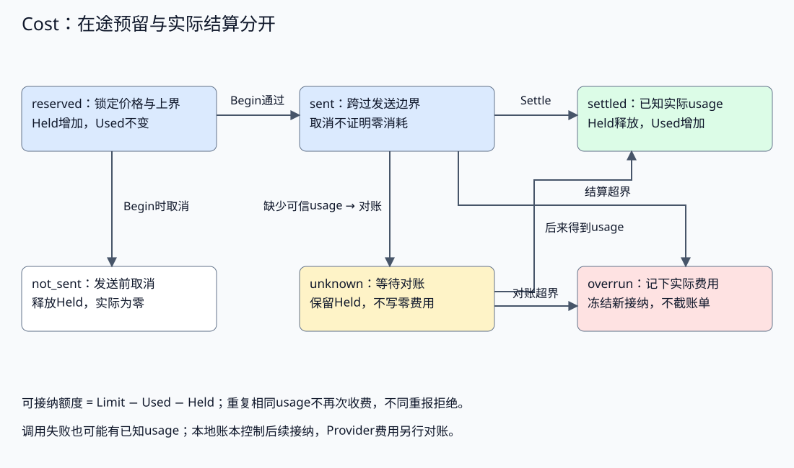
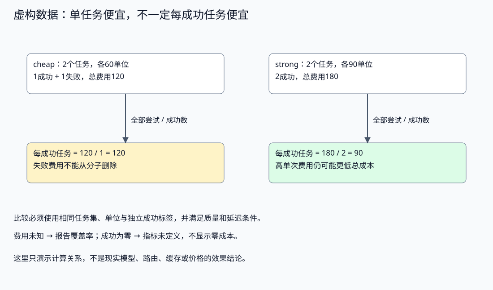

# 资源预算与成本优化

配套实验：[资源预算与成本优化实验](../../../../labs/part3-agent/chapter33/cost-ledger/README.md)。

更便宜的模型可能需要更多重试，并行子任务可能重复发送上下文。只有单次价格，无法回答完成一个任务究竟消耗多少。

本章先统一Token、费用和延迟口径，再讨论预留、实际结算、未知结果与恢复账本。缓存、路由和降级的取舍同时看质量与总消耗。

控制面分配租户配额与Run预算，Runtime在发送前限制接纳，费用账本保存预留、实际与未知消耗，执行环境另有CPU/内存/PID限制。这些约束相互补充；模型提示里的“节省成本”和页面上的额度提示都不能替代服务端检查。

本章承接[治理篇](chapter34-observability.md#governance-overview)的资源与成本责任。资产或策略改动的收益同时关联运行轨迹、质量验证和安全底线；预算检查通过只说明对应约束成立，不能代替任务质量或发布授权。

## 计量来源与价格口径

<a id="topic-agent-cost"></a>

### Token、费用、延迟分别测量

输入Token受上下文、工具定义与历史影响，输出Token受回答和推理配置影响；工具还可能按调用、返回数据或运行时间收费。延迟包括排队、模型、工具、重试与传输，不能用Token数精确推导。

| 记录 | 用来回答什么 | 容易误用的地方 |
| --- | --- | --- |
| 计数或估算Token | 请求大小、剩余上下文与预留 | 字符/文本块数冒充实际Tokenizer与账单 |
| Provider usage | 本次已知消耗及类别 | 字段缺失当零，缓存子项与总输入重复相加 |
| 价格版本与单位 | 如何将usage换算为费用 | 单位、费率条件或生效时间不一致 |
| 各阶段时间 | 排队、推理、工具、首输出与总延迟 | 用并行总时间代替所有调用的累计消耗 |
| 独立任务判定 | 哪些消耗产生了有效结果 | Final、HTTP200或模型自报成功代替Eval |

调用前的估算用于接纳，调用后的usage用于结算，账单用于最终核对。三者可能不同，应记录来源与缺失，而不是强行填成同一个值。

### 先规范usage，再套价格

缓存命中、缓存写入、普通输入和输出可能使用不同费率。各Provider的原始字段口径不同：有的总量包含子项，有的把类别分开报告。adapter须规范化为互斥项，否则会重复计费。

配套[Usage与Price](../../../../labs/part3-agent/chapter33/cost-ledger/main.go)采用四类互斥Token和带版本的单Token费率：

```go
type Price struct {
	Model, Version, Unit                 string
	Input, CacheRead, CacheWrite, Output int64
}
type Usage struct{ Input, CacheRead, CacheWrite, Output int64 }
type Bound struct{ Input, Output int64 }
```

费用计算为：普通输入×输入费率 + 缓存读取×读取费率 + 缓存写入×写入费率 + 输出×输出费率。示例使用整数microcredit和虚构价格，避免浮点累计误差；它不是现实美元报价或完整计费系统。

真实adapter还需处理单位换算、取整、模型/服务区域/上下文档位、工具与其他费用。不能将不同Provider字段机械相加，也不能只计可见文本就认为覆盖全部计费。价格变化应产生新版本，历史调用保留当时的价格快照，不能用今天的费率改写旧报告。

### 配额、运行预算与物理资源限制各管一层

| 约束 | 主责与作用范围 | 超限时的决定 |
| --- | --- | --- |
| 租户/用户配额 | 控制面分配一定周期的可用额度与能力 | 拒绝新接纳或采用已批准降级；不擅自扩额 |
| Run预算 | Runtime限制本任务全部角色、重试与恢复的累计尝试/Token/时间/金额 | 停止新增调用，保留部分事实与失败/未知 |
| Call预留与结算 | Ledger绑定一次物理尝试的价格版本、预留、发送与已知实际 | 发送前检查；发送后未知保守占用，实际超支照实记录 |
| CPU/内存/PID与存储 | 执行环境与资源管理限制实际进程/数据占用 | 强制约束并记录退出、OOM或清理事实，不推断模型账单 |

降低Run预算不保证已发出的调用停止，删除租户额度也不能追回已发生的费用。多Worker共享配额需要持久原子接纳或明确的预分配协议；本Lab的Run内账本不能冒称完整租户计费服务。[SQL次数预留](../runtime/chapter31-collaboration.md#次数预留随任务保存不随epoch重建)已有局部接管实验，但次数Reserved不等于实际发送、真实Token或费用结算。

## 预留、发送与恢复账本

### 在途调用也占预算

如果只在返回后累计费用，两个并发worker都会看到“余额还有100”，各发出一笔80的请求，最终花掉160。接纳时必须扣住在途额度。

**可接纳额度 = 总预算 − 已知实际消耗 − 在途与未知预留。** 输入和输出上界、工具次数、模型轮次与总时限仍是独立预算，金额不替代它们。

[Reserve](../../../../labs/part3-agent/chapter33/cost-ledger/main.go)先按输入最贵类别和输出上界计算，再在锁边界接纳：

```go
func (l *Ledger) Reserve(p Price, b Bound) (int, error) {
	if !p.valid() || p.Unit != l.unit || b.Input < 0 || b.Input > 1_000_000 || b.Output < 0 || b.Output > 1_000_000 {
		return 0, ErrInvalid
	}
	amount := b.Input*max(p.Input, p.CacheRead, p.CacheWrite) + b.Output*p.Output
	l.mu.Lock()
	defer l.mu.Unlock()
	if l.frozen || len(l.entries) >= 64 || amount > l.limit-l.used-l.held {
		return 0, ErrBudget
	}
	l.serial++
	l.entries[l.serial] = Entry{ID: l.serial, State: "reserved", Price: p, Bound: b, Reserved: amount}
	l.held += amount
	return l.serial, nil
}
```

缓存尚未确认时按上界预留，而不是先假设命中；价格和上界随Call保存。子Agent共享同一Run账本，分别申请Call额度；不能各复制一份父预算，汇总时才发现超支。

上界要有来源：实际Tokenizer或Provider计数、已组装输入与最大输出参数。读取大工具结果、重复发送完整历史或更新提示词，都可能改变下一次请求大小。示例使用固定输入上界验证原子接纳，不证明真实Provider永远不会超过预算。



单Run内存账本最多64条Call，整数和Token/费率范围有上限。跨实例服务需要一致的配额存储与持久记录；进程重启丢失Held，可能再次花掉已经在途的额度。把账本放在单个goroutine中也不能解决跨进程所有权。

前面解决的是“为什么在途调用也要先占预算”。接下来才处理重启后的更难问题：这些预留和已用额度怎样重建，哪些条目还能继续占着余额。

### 恢复账本时，重新核对每条调用

恢复时只把保存的Used、Held复制回内存，会把记录错误也当成可用余额。应用先绑定当前Run的可信快照、原单位与预算，再按每条Call的价格、上界和状态复算，核对汇总值；无法对应原任务或存在冲突时拒绝恢复。

| 保存的Call状态 | 重建后的处理 | 为什么 |
| --- | --- | --- |
| reserved | 保留预留及原价格 | 尚未跨过Begin；可信持久发送协议必须保证这份状态确实有效 |
| sent | 转为unknown，继续占预留 | 执行者重启后不能从发送意图推断外部结果，也不能再次Begin同一Call |
| unknown | 保持未知与预留 | 需要可信usage或对账来源，不能自动退款 |
| not_sent | 保留未发送终态，不占预留 | 沿用已记录的发送前取消结论，不能再次发送原Call |
| settled / overrun | 用原价格复算Actual，保留已用额度及冻结 | 不以新价格改历史费用，不因重启解除超额冻结 |

[RestoreLedger](../../../../labs/part3-agent/chapter33/cost-ledger/restore.go)处理未结算记录的分支为：

```go
		case "reserved", "sent", "unknown", "not_sent":
			if e.Actual != 0 || e.Usage != (Usage{}) {
				return nil, ErrState
			}
			if e.State != "not_sent" {
				l.held += reserved
			}
			if e.State == "sent" {
				e.State = "unknown"
			}
```

reserved由本条价格和Bound重新计算，不能相信归档里的一个额度数字；未结算状态也不能同时携带已结算usage。随后核对全部条目的Used、Held与Frozen，Call ID顺序、条目上限和配置保持原契约。重建使用新的容器，后续修改输入快照不改变活跃账本。

例如上限100，已结算20，发送中的调用预留50。恢复后只剩30可接纳，发送中的调用仍不能重发；可信usage确认实际用了40后，Used变为60、Held归零，相同usage重复提交不会再收费。这里是虚构计量示意，与真实账单无关。

RestoreLedger验证账本重建，本身不提供持久提交。若存储保留reserved，但程序已经实际发出请求，旧快照就不能作为未发送证明；发送前的持久确认、Call身份、所有权、原始usage和结算窗口需要共同成立。单位与预算相同也不证明属于同一个Run，身份关联和严格文件解码由可信存储入口负责，不由RestoreLedger认证。

<a id="先确认状态提交再允许发送"></a>

**先确认状态提交，再允许发送**

费用预留、发送意图和外部调用具有不同提交窗口。先持久确认预留再发送；发送后失联保持unknown，不自动退款，恢复时核对原调用身份及结果后才结算。

实现与对照见[配套实验](../../../../labs/part3-agent/chapter33/cost-ledger/README.md#book-agent-cost-先确认状态提交再允许发送)。

<a id="重新准备时不要重复锁定额度"></a>

**重新准备时，不要重复锁定额度**

使用稳定尝试ID与请求指纹幂等准备，跨重开仍返回同一预留。金额相同但身份不符不能复用，配置变化或确认未知时停止新付费接纳；执行状态与费用账本分别核对。

实现与对照见[配套实验](../../../../labs/part3-agent/chapter33/cost-ledger/README.md#book-agent-cost-重新准备时不要重复锁定额度)。

### 发送前取消与发送后未知分开

一次调用沿以下步骤推进：

1. **Reserve**：锁定价格和额度，尚未发送。
2. **Begin**：在发送边界检查context；若已取消，记not_sent并释放预留。
3. **发出请求**：adapter执行调用；超时或断流可能使客户端看不到结果，但服务端仍可能计费。
4. **已知usage结算**：成功和失败都按实际消耗入账，不能只对成功回答收费。
5. **usage未知保留预留**：记unknown，等待可靠记录或账单对账，不能直接退款或写零。

Begin与实际网络发出之间仍是应用协作边界，不是能覆盖所有竞争的分布式事务。发送之后收到取消也不能证明费用为零。若adapter能够可靠证明没有发出请求，可以设计额外的确认状态；本示例不提供调用者随意清零的接口。

流式usage可能直到末尾才完整，连接中断后的部分数据也可能不足以结算。保留上界是一种保守接纳策略，不是准确账单；最终仍要按可靠来源对账，明确无法核对的范围与期限。

## 实际结算与任务成本

### 结算实际值，不把超支截成预算值

[Settle](../../../../labs/part3-agent/chapter33/cost-ledger/main.go)对每个Call只结算一次：

```go
func (l *Ledger) Settle(id int, usage Usage) error {
	l.mu.Lock()
	defer l.mu.Unlock()
	e, ok := l.entries[id]
	if !ok {
		return ErrState
	}
	if e.State == "settled" || e.State == "overrun" {
		if usage != e.Usage {
			return ErrState
		}
		if e.State == "overrun" {
			return ErrOverrun
		}
		return nil
	}
	if e.State != "sent" && e.State != "unknown" {
		return ErrState
	}
	amount, err := usage.Cost(e.Price)
	if err != nil {
		return err
	}
	l.held -= e.Reserved
	l.used += amount
	e.Usage = usage
	e.Actual = amount
	e.State = "settled"
	if amount > e.Reserved || usage.Input+usage.CacheRead+usage.CacheWrite > e.Bound.Input || usage.Output > e.Bound.Output {
		l.frozen = true
		e.State = "overrun"
		l.entries[id] = e
		return ErrOverrun
	}
	l.entries[id] = e
	return nil
}
```

相同usage重复提交不重复收费，不同usage重报返回冲突；无效计数不释放预留。实际消耗超出预留或Token上界时，仍记下已经发生的费用，并冻结后续接纳。

冻结阻止继续花钱，不能追回已经发生的调用。将actual写成min(actual,budget)只会让报告好看，隐藏Provider计数、价格映射或上界失效的问题。超支需要检查输入变化、计费类别、输出控制和并发预留，再决定是否修正规则。

真实账单有延迟或修正时，需要带来源与版本的对账机制；重复结算和账单修订不是同一种操作。本实验仅支持同usage幂等重报，不实现账单调整、退款、税费或财务结算。

### 每成功任务成本包含失败与重试

只计算成功样本的平均费用，会把大量失败和重试从报告中删掉。更有用的工程指标是：

**每成功任务成本 = 同一任务集全部尝试的消耗 / 独立评估成功的任务数。**



Task Record聚合模型、工具、失败尝试和修复的总消耗，Success由Eval独立提供。一个任务重试三次以后成功，分子包含三次调用，分母只加一个任务。

费用覆盖率同样是指标。部分任务缺usage时，报告已知费用与已知任务比例；不能把缺失任务记成零后给出确定的节省率。成功数为零时，这个指标未定义，不能显示“0元/成功任务”。只看总体比值也会隐藏困难或高风险任务，应按任务类型与难度分组。

[Compare](../../../../labs/part3-agent/chapter33/cost-ledger/main.go)先验证同一Case集合和单位，再应用示意质量下限：

以下摘录函数内的关键分支，完整校验与资源清理见所链源码。

```go
	if float64(c.Successes)/float64(c.Tasks) < minSuccessRate {
		return false, "quality_floor", nil
	}
	if !b.CostPerSuccessKnown || !c.CostPerSuccessKnown {
		return false, "incomplete_cost_or_no_success", nil
	}
	if c.CostPerSuccess >= b.CostPerSuccess {
		return false, "no_cost_gain", nil
	}
```

这里的条件只用于固定数据教学。真实选择还需要关键任务回归、安全边界、重复试验与不确定性、延迟和SLO；Aggregate成功率达标不能证明每个重要任务都没退步，也不自动授权部署。

## 缓存、路由与降级取舍

<a id="缓存路由和降级何时值得"></a>

<a id="区分缓存三种东西"></a>

**区分缓存三种东西**

- **Provider前缀缓存**：复用部分输入处理，检查实际命中/写入usage与费率，不能凭提示词相似就宣称命中。
- **检索或工具缓存**：复用外部数据，按用户范围、参数、来源版本和时效绑定，防止过期或跨用户复用。
- **回答缓存**：直接复用输出，需要语义适用条件、权限与答案版本；绕过模型不等于绕过证据校验。

缓存Key、TTL与失效规则是正确性契约。保存更长稳定前缀可能提高命中，也可能把不必要输入长期发送；缓存写入还有自己的成本，命中率不能单独代表净收益。

<a id="写入成本要经过多少次复用才能收回"></a>

**写入成本要经过多少次复用才能收回**

只比较一次命中和普通输入价格，会漏掉首次建立缓存的成本。先固定同一段稳定输入、模型与价格，保持动态输入和输出相同，再计算被复用部分的费用差额。

设这段输入每次普通处理费用为I，首次缓存写入为W，后续一次读取为R；连续n次请求且只写入一次时：

- 无缓存总费用：`n × I`。
- 缓存总费用：`W + (n-1) × R`。
- 当`I > R`时，严格节省要求`n × (I-R) > W-R`。

如果读取不比普通处理便宜，增加复用次数也不保证节省；要继续核对写入费率与适用条件。这里的W是标准化后的缓存写入费用，不能再把同一批Token重复算成普通输入。

用本章虚构费率计算100个稳定Token：普通输入I=200、写入W=300、读取R=100。第一次缓存更贵，第二次累计打平，第三次才开始节省：

| 连续请求数 | 无缓存 | 只写入一次的缓存 | 本例判断 |
| --- | --- | --- | --- |
| 1 | 200 | 300 | 写入成本尚未收回 |
| 2 | 400 | 400 | 打平 |
| 3 | 600 | 500 | 省100 |
| 5 | 1000 | 700 | 省300 |

这是一段输入的费用计算，不是整个任务的账单。动态输入、输出、工具、重试和评分仍要入账，质量、权限与证据检查保持一致。真实命中也需要来自Provider usage，不能按相同字符串自行判定计费类别。

<a id="命中之外还要看重新写入"></a>

**命中之外，还要看重新写入**

同样五次请求，若第四次前缀变化又写入一次，费用变为`2×300 + 3×100 = 900`；若三次每次重写，则900高于无缓存600。缓存期限、版本更新与参数变化影响可复用次数，平均命中率不足以解释这些费用。

[结算对照](../../../../labs/part3-agent/chapter33/cost-ledger/cache_test.go)逐次执行现有Reserve、Begin和Settle，核对写入、读取与Held释放，不模拟Provider缓存是否真的命中。做实际选择时，按一个可复用周期记录写入次数、读取次数、实际usage与任务效果；周期断开后重新计算，不能把旧命中样本拼到新前缀上摊薄成本。

<a id="模型路由需要同任务对照"></a>

**模型路由需要同任务对照**

简单任务用便宜模型、复杂任务升级，是一种策略，不是先验保证。路由器可能误判难度，fallback也会增加一次消耗与延迟。比较时固定任务、输入、工具与评分，记录命中的模型、每次尝试、拒绝、升级和失败费用。

降级不能删掉权限或证据检查。预算不足时可以减少可选检索、缩短已批准输出、报告资料不足或拒绝继续；不能用无依据答案伪装完成。降低质量只能在产品允许的范围内，并由独立评估检查。

<a id="并行减少等待不自动减少费用"></a>

**并行减少等待，不自动减少费用**

多个子Agent同时读相同上下文，端到端耗时可能变短，累计Token和工具次数却变多。取消多余分支时，已发出的请求仍可能计费。应一起看总消耗、完成度、排队与P95延迟，而不是只比较主请求结束时间。

本Lab用固定usage验证计算关系与门禁，不实现真实缓存、模型路由或并行性能评估。受控模型实验另需预算、固定价格来源、usage对账与真实任务标签，不能把手写成功率当成现实效果。

<a id="最佳实践"></a>

[实验排查与实践建议：最佳实践](../../../../labs/part3-agent/chapter33/cost-ledger/README.md#book-agent-cost-最佳实践)。

<a id="常见问题排查"></a>

[实验排查与实践建议：常见问题排查](../../../../labs/part3-agent/chapter33/cost-ledger/README.md#book-agent-cost-常见问题排查)。

## 小结

1. Token、费用和延迟采用明确来源与口径，未知用量不能填零。
2. 在途调用占用预留，执行后按实际值结算，超支事实不能截成预算值。
3. 稳定尝试身份连接预留、发送和结果，失联后保守保留未知与原消耗。
4. 每成功任务成本包含失败与重试，缓存写入、重复上下文和路由质量一起核算。

## 参考文档

- [Claude Prompt caching](https://platform.claude.com/docs/en/build-with-claude/prompt-caching)：缓存输入类别和费率口径；实际适用条件以对应版本为准。
- [Claude价格说明](https://platform.claude.com/docs/en/about-claude/pricing)：核对模型、计费方式与附加费用；本实验不复制现实报价。
- [Go sync](https://pkg.go.dev/sync)：并发接纳与结算的原子边界。
- [Go context](https://pkg.go.dev/context)：取消信号与已经发出的调用不同。

[返回全书目录](../../README.md) · [上一篇：Agent 安全与权限治理](chapter36-security.md)
