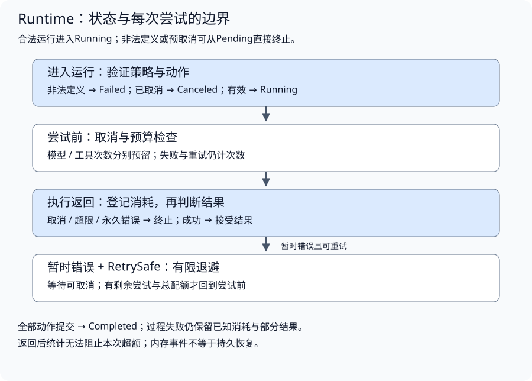
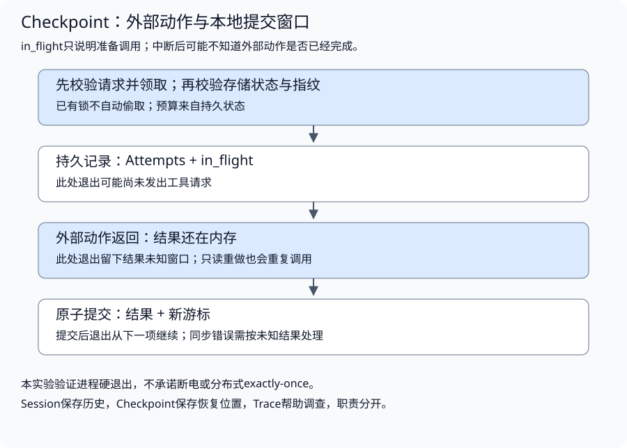

# 运行控制与故障恢复

配套实验：[运行控制与故障恢复实验](../../../../labs/part3-agent/chapter25/runner/README.md)。

相关实验：[实验：提交窗口与进程中断恢复](../../../../labs/part3-agent/chapter25/checkpoint/README.md)。

一次Loop可以在内存里推进，进程退出后却不知道工具是否执行、结果是否保存，甚至可能重新获得完整预算。运行控制与恢复必须共享清楚的身份和提交事实。

浏览器关闭只结束观看，服务端运行仍有自己的寿命。本章从Run、Step与Attempt进入预算、取消和重试，再说明如何保存恢复状态、领取执行资格及处理结果未知。

先读运行身份、事件、预算、重试和取消，建立一次Run的内存控制语义；理解[Session/Context](../building/chapter26-context.md)和后端事务/结果未知后，再读[恢复窗口](#topic-agent-checkpoint)、快照资格及结果/费用交接。控制面分配原约束，Harness绑定部件，本章Runtime落实推进与提交；Checkpoint恢复的是执行事实，不能重新授予一份完整配额。

## 运行身份、状态与事件

<a id="topic-agent-runtime"></a>

<a id="一次运行与一次模型调用有何区别"></a>

<a id="runstep与attempt"></a>

**Run、Step与Attempt**

用户请求可以触发多轮决策，每轮又可能执行多个工具；暂时故障还可能引发同一个动作的重试。因此需要分清三个尺度：

- **Run**：从接收任务到进入终态的一次运行，拥有总预算与终止原因。
- **Step**：运行中的一个逻辑推进单位，例如一次模型决策或一个工具动作。定义要随Runtime契约明确。
- **Attempt**：一个动作的实际尝试。重试产生新的Attempt，也会消耗调用配额。

Loop样章的`MaxSteps`计模型轮次。本章实验为每个固定Job记录Attempt，并分别累计模型与工具尝试；这两个计数不是同一个指标。观测系统要保留定义，不能把“执行了两步”同时用于模型轮次、工具次数和消息条数。

<a id="runtime支持固定流程也承载动态决策"></a>

**Runtime支持固定流程，也承载动态决策**



固定工作流预先列出动作；Agent Loop根据观察决定下一项动作。两者都需要调用限制、失败分类与终态。为了先看清策略，本章用固定动作序列演示执行边界，动态选择仍由Loop负责。

[Job定义](../../../../labs/part3-agent/chapter25/runner/main.go)只表达一个受控动作：

```go
type Job struct {
	Name      string
	Kind      string
	RetrySafe bool
	Execute   func(context.Context) (Result, error)
}
```

Kind区分模型与工具计数，Execute执行一次尝试，RetrySafe是应用对重复执行安全性的声明。模型不能自行设置RetrySafe；真实工具即使只读，也可能计费或给下游造成重复压力。

将这个机制接入动态Loop时，Loop逐次提出动作，Runtime逐次检查与执行，再把结果交回Loop。不能每个动作都重新创建总预算，否则任务可以通过多次“新运行”绕过配额；本章的局部Report在一次Run内持续累积。

<a id="状态转换必须由执行结果决定"></a>

<a id="状态与原因分别保存"></a>

**状态与原因分别保存**

配套实现使用Pending、Running、Completed、Failed、Canceled五个状态。DeadlineExceeded与主动取消都进入Canceled，但返回错误保留原始原因；状态适合查询和展示，错误适合调用方分类。

| 转换 | 条件 | 需要保留的信息 |
| --- | --- | --- |
| Pending→Running | 输入与策略合法，context仍有效 | 运行开始事件 |
| Pending→Failed | 策略或动作定义非法 | 校验错误，无动作执行 |
| Pending→Canceled | 开始前已取消 | 对应context错误 |
| Running→Completed | 全部规定动作成功提交 | 已接受结果与已知消耗 |
| Running→Failed | 动作失败、协议违约或预算触发 | 原因、已发生尝试和结果 |
| Running→Canceled | 上游或下游取消/超时 | 取消原因与已知消耗 |

终态之后不能再收到普通成功提交。实验同步运行，在返回前用同一出口设置终态；[Run的收尾逻辑](../../../../labs/part3-agent/chapter25/runner/main.go)为：

```go
	defer func() {
		switch {
		case errors.Is(err, context.Canceled), errors.Is(err, context.DeadlineExceeded):
			report.State = Canceled
		case err != nil:
			report.State = Failed
		default:
			report.State = Completed
		}
		report.event("", 0, "run_finished")
	}()
```

这段defer只管理返回时的状态，不捕获panic，也不能处理进程崩溃。任务失败时，之前已经成功的Outputs仍保留；“整个运行失败”不等于“前面没有发生任何动作”。服务化时应向调用方明确区分最终结果、部分结果和运行原因。

<a id="每次运行独占自己的可变状态"></a>

**每次运行独占自己的可变状态**

Report在Run内部创建并独占，完成后交给调用方。两个Run可以并发执行，但不能共享不安全的Job闭包状态。上层若需要实时读取运行进度，应使用受控事件通道或同步存储，不能一边写slice一边让HTTP Handler直接遍历。

Session负责会话历史；Report负责本次执行事实。把Report重新塞进聊天历史并不能替代可查询任务状态；保存历史也不能恢复执行游标。

前面固定的是一次运行里“有哪些状态要分开保存”。接下来才看这些状态在执行边界上怎样真正控制动作：哪些预算必须先扣，哪些消耗只能在返回后确认。

### 事件如何解释运行过程

只输出一条“任务失败”无法区分坏配置、配额拒绝或执行错误。实验记录开始、尝试开始、尝试结束、退避与终态事件，每个事件包含递增序号、动作名字、尝试编号与当时状态。

[Event](../../../../labs/part3-agent/chapter25/runner/main.go)将事件位置与动作尝试分开记录：

```go
type Event struct {
	Seq     int
	Job     string
	Attempt int
	Kind    string
	State   State
}
```

Seq回答“在这次Run里先发生哪个事件”，Job和Attempt回答“属于哪个动作的哪次尝试”，Kind说明边界，State是记录时的运行状态。attempt_finished时Run可能仍为Running，因此不能用State判断该动作成功；还要核对执行结果、错误与是否提交Output。attempt_started也只表示进入Runtime尝试边界，不证明SDK已发送请求。

排查一次重试时，按以下顺序核对：

1. 找到同一Job的尝试开始与结束，确认失败发生在哪次Attempt。
2. 核对已回报usage与成功输出，失败尝试仍占次数和已知消耗。
3. 检查retry_wait以及下一次尝试，判断总预算和context是否允许继续。
4. 最后核对run_finished与返回原因；动作曾成功和运行最终失败可以同时成立。

序号来自Run内的单一写入者，不表示全系统顺序。接入多Run与并发后，还需要Run ID、Step ID和Call ID；时间戳用于观察，关联ID用于定位，不能只按时间猜因果。

事件本身不保存原始prompt、工具数据或密钥。它也不是持久事件日志：进程退出后内存记录会丢失。Trace章负责诊断关联与回放，Checkpoint负责恢复游标，Streaming负责向用户呈现；三者都能使用事件，但职责不同。

### 身份怎样连接配置、尝试与最终结果

| 身份或版本 | 由谁绑定 | 与相邻对象的关系 |
| --- | --- | --- |
| Task / Session | 应用入口绑定可信Scope | 一个任务可关联多次运行；会话可以跨Run，不据此共享全部权限 |
| Run / 配置快照 | 运行接纳入口 | 固定本次目标、定义/政策版本与原预算；显式恢复不另发完整额度 |
| Step / 逻辑调用 | Runtime根据已保存提议登记 | 一个Step可以有多条工具提议，每条保留原ToolCallID及参数身份 |
| Attempt / Call | 每次实际尝试的执行边界 | 重试产生新尝试，关联原逻辑动作、费用条目和观测操作 |
| Worker / Epoch / Revision | 可信执行者与权威存储 | Worker领取资格、领取代际与状态版本分别约束提交，角色名不替代Worker身份 |
| Artifact / Case / Score版本 | 资源管理与评估端 | 产物绑定任务与内容版本，评分绑定实际Run及评分条件 |

这里是跨章交接约定，不表示当前各Lab已有相同字段或一套统一身份服务。特别是原ToolCallID与观测Call ID的用途不同，adapter须明确映射，不能仅因为都叫Call就去重掉物理重试。当前文件Checkpoint、Delegation SQLLease和费用账本各有局部身份，联合恢复要核对映射及原预算，不能拼接不同运行的成功记录。

## 资源预算、重试与取消

<a id="预算检查分为调用前与返回后"></a>

<a id="次数在执行前扣除"></a>

**次数在执行前扣除**

[Policy](../../../../labs/part3-agent/chapter25/runner/main.go)分别限制模型调用、工具调用、累计Token、单次输出字节、每动作尝试次数与退避：

```go
type Policy struct {
	MaxModelCalls  int
	MaxToolCalls   int
	MaxTokens      int
	MaxOutputBytes int
	MaxAttempts    int
	Backoff        time.Duration
}
```

次数可以在执行前准确检查。一次尝试失败也已经调用了下游，因此仍计入配额；同一Job的重试不能绕过总上限：

```go
func (r *Report) reserve(p Policy, kind string) error {
	if r.Tokens >= p.MaxTokens {
		return fmt.Errorf("%w: tokens", ErrBudget)
	}
	if kind == "model" {
		if r.ModelCalls >= p.MaxModelCalls {
			return fmt.Errorf("%w: model calls", ErrBudget)
		}
		r.ModelCalls++
	} else {
		if r.ToolCalls >= p.MaxToolCalls {
			return fmt.Errorf("%w: tool calls", ErrBudget)
		}
		r.ToolCalls++
	}
	return nil
}
```

例如模型调用总配额为1，首次尝试暂时失败，即使MaxAttempts允许2次，也不能再调用。**重试上限与总调用预算同时生效，较先触发的限制结束执行。** 它们不是互相替代的配置。

本实验没有并发执行，检查和扣除由单个调用方完成。改为并发时，需要原子预留剩余配额，再执行动作；不能让多个worker分别看到“还有一次”而同时发出请求。

<a id="实际消耗在返回后登记"></a>

**实际消耗在返回后登记**

Token通常随响应回报，因此只能在调用前检查已知剩余量，返回后登记实际值。本实验包括失败返回携带的usage，防止重试费用被丢掉：

```go
			if result.Tokens < 0 {
				err = fmt.Errorf("%w: negative usage", ErrInvalid)
				return
			}
			if result.Tokens > int(^uint(0)>>1)-report.Tokens {
				report.UsageOverflow = true
				report.OverflowUsage = result.Tokens
				err = fmt.Errorf("%w: token sum overflow", ErrInvalid)
			} else {
				report.Tokens += result.Tokens
				if report.Tokens > p.MaxTokens {
					err = fmt.Errorf("%w: reported tokens", ErrBudget)
				}
			}
```

返回后发现超限可以停止后续动作，但本次消耗已经发生；超大的Text也已在内存中产生，本地拒绝无法替代下游读取上限。要形成更强约束，还需在Provider请求中设置输出上限、在网络读取时限制大小、在调用前估算或预留费用，并在服务支持时使用服务端配额。

结果没有usage，不代表免费。本实验将未回报Token记为0以演示计数，不能把它作为实际账单事实；真实ledger需要标明已知、估算与未知。成本章再讨论价格版本与结算，Runtime先固定限制执行的位置。

<a id="计数溢出不能变成低消耗"></a>

**计数溢出不能变成低消耗**

两次回报都能用int表示，累加后却可能超出范围。例如第一项为1，第二项为平台最大int，直接相加会回绕成负数。[Go整数溢出规则](https://go.dev/ref/spec#Integer_overflow)并不让这种运算自动panic。即使预算错误已经阻止后续动作，这份消耗报告仍然错误。

因此先检查表示范围，再累加和判断配额。总数可表示但超出MaxTokens时，保存实际值并返回ErrBudget；总数不可表示时，返回ErrInvalid，UsageOverflow标记该情况，Tokens保留此前可表示的部分，OverflowUsage保留本次回报。**不能把这个部分数值当作完整总消耗。** 调用方需要更宽的数值表示或独立账本合计两部分，不应直接相加后再次溢出。

溢出不会撤销已发生的调用，也不抹掉前面接受的结果；本次Text不提交，后续动作停止。若同一次返回还遇到取消，取消仍决定运行终态，usage的两部分继续保留。这里检查计数表示能力，不证明Provider回报正确，也不替代真实费用核对。

前面讨论的是一次尝试结束后怎样登记结果与消耗。下一层才讨论“要不要再来一次”：失败要想进入重试，必须同时满足错误分类、重复安全和总预算三个条件。

<a id="重试为什么需要两个条件"></a>

<a id="暂时失败与重复安全缺一不可"></a>

**暂时失败与重复安全缺一不可**

“失败了再来一次”会把格式错误、权限拒绝和业务失败都变成重试。应用需要同时判断：

1. **错误是否暂时**：例如受控测试里的ErrTemporary；不根据错误文本猜测。
2. **动作是否可重复**：RetrySafe由应用确定，不能由模型或工具响应授予。
3. **尝试与总预算是否足够**：每次实际执行都占用配额。
4. **请求是否仍有效**：取消与超时直接终止，不继续退避。

配套实现用稳定错误与`errors.Is`判断分类，保留包装后的错误链。真实Provider的429/5xx等分类应先由adapter提供，再由策略决定；无法确认执行是否已发生时，副作用动作不能盲目重试。

<a id="退避等待也必须可取消"></a>

**退避等待也必须可取消**

网络调用响应context，等待却用长时间Sleep，会导致用户取消后仍迟迟不能结束。实验的等待函数使用Timer与context竞争：

```go
func wait(ctx context.Context, delay time.Duration) error {
	timer := time.NewTimer(delay)
	defer timer.Stop()
	select {
	case <-ctx.Done():
		return ctx.Err()
	case <-timer.C:
		return ctx.Err()
	}
}
```

Timer到期后再次读取ctx.Err，避免已经取消的请求继续重试。实验使用固定退避，便于确定性验证；生产重试还可能需要指数退避、抖动和Retry-After，以降低同步重试压力。先验证策略正确，再增加这些选择。

格式修复与网络重试也要分开：结构化输出校验失败需要反馈具体问题；暂时网络失败不一定得到可反馈的内容。多层嵌套重试会放大尝试次数，总预算必须覆盖整个Run。

<a id="sdk内部重试不等于runtime已经记账"></a>

**SDK内部重试不等于Runtime已经记账**

Runtime调用一次Job.Execute，SDK却在内部向同一服务请求三次，Report就只能看到一个Job尝试。Job.Kind=model并不会让Runtime自动观测每次HTTP请求。当前MaxModelCalls与MaxToolCalls限制的是Execute边界，不是任意下游客户端的物理请求总数。

考虑三层都允许“最多三次尝试”的最坏失败过程：Runtime尝试3次，每次SDK尝试3次，而代理层又对每次请求尝试3次，最底层可能收到`3×3×3=27`次请求。这里是尝试数，不是“重试三次”；若每层允许首次加三次重试，对应上限就变成`4×4×4=64`。取消、错误分类和预算可能提前结束过程，但不能只看最外层计数推断真实消耗。

| 观察层 | 应记录什么 | 不能从中推断什么 |
| --- | --- | --- |
| Runtime Job | 调用方发起多少次Execute及其终态 | SDK每次实际发出了几个请求 |
| adapter/SDK | 每次真实发送、响应/错误、退避与usage | 服务端动作必然没有重复或账单已最终确认 |
| 服务端/外部账单 | 实际接纳、执行身份、用量或结算依据 | 客户端未收到响应就表示请求未发生 |

先为一条调用链确定重试负责人。可以关闭SDK重试，由Runtime统一分类和等待；也可以保留SDK已定义的重试，但将其真实尝试与消耗汇报，并在每次发送前共享同一剩余配额。不要让多层分别获得新的完整预算。代理层的行为也需要明确，无法观测的尝试或用量保留未知，不能补成零。

[AWS的重试与退避实践](https://d1.awsstatic.com/builderslibrary/pdfs/timeouts-retries-and-backoff-with-jitter.pdf)讨论了分层重试的放大与重试位置选择。该判断不意味着所有调用链只能有一层恢复：参数修复、网络重试和业务恢复仍可分别存在，但应有不同触发条件，并共同受总时限与费用约束。重试接口返回成功后，任务目标与副作用状态仍要独立检查。

<a id="总时限不能在重试时重新开始"></a>

**总时限不能在重试时重新开始**

本实验由调用方给Run传入带截止时间的context，Policy只定义次数、Token、输出与退避。这个context贯穿全部Job、Attempt及退避等待；每次重试重新设置一份完整时限，会把总限制变成每次尝试的限制。

例如Run只剩2秒，策略却准备退避5秒，应在总截止时间到达时结束，而不是等完后再开启一份新的调用时限。单次Provider请求可以有更短的子context，它仍受Run的父context约束；次数配额和时间预算分别检查，任何一个耗尽都不能继续执行。调用方传Background时，本实验没有额外的总时间上限，不能仅凭MaxAttempts声称请求将在指定时间内结束。

### 取消在哪里生效

取消是协作信号，不能强制抢占任意Go函数。Runtime在执行前、执行返回后以及退避中检查context，Job仍需把它传给HTTP、数据库或其他下游。

执行返回后按以下顺序判断：

1. **登记已知消耗**：即使取消，已发生的尝试仍要留下证据。
2. **检查上游取消**：丢弃不再有效的结果。
3. **检查下游取消错误**：包装后的Canceled或DeadlineExceeded也终止。
4. **处理预算与输出限制**：超限停止后续动作。
5. **接受结果或决定重试**：只有通过前面边界才能提交。

检查不能原子覆盖“检查之后立即取消”的竞争。若服务要求结果提交与取消有严格胜负关系，需要定义状态版本或提交锁；这属于服务任务契约，不能仅增加几次ctx.Err就宣称消除了竞争。

取消不是回滚。只读工具可能已完成查询和计费；应用对自己状态的写入可能已经提交。下文的Checkpoint部分进一步处理进程中断和结果未知；当前runner实验保持内存状态，持久恢复由独立checkpoint实验验证。

前面处理的是动作还能不能继续执行；最后再把这些边界变成可观察事件，避免调用方只看到一句“运行失败”却不知道失败发生在哪个阶段。

## 恢复事实与提交窗口

<a id="topic-agent-checkpoint"></a>

<a id="恢复需要知道哪些事实"></a>

<a id="游标结果与身份一起保存"></a>

**游标、结果与身份一起保存**

配套[State](../../../../labs/part3-agent/chapter25/checkpoint/main.go)记录格式版本、运行身份、计划指纹、执行位置、尝试次数与已提交结果：

```go
type Identity struct{ Tenant, User, Session, Run string }
type Result struct{ Action, Text string }
type State struct {
	Schema           int
	Identity         Identity
	PlanHash, Phase  string
	Cursor, Attempts int
	MaxAttempts      int
	Results          []Result
}
```

Cursor表示下一项待执行动作，Results只包含游标之前已提交的结果。保存时要求两者一致，否则可能跳过未完成动作或重复已完成工作。

Identity绑定可信租户、用户、会话与Run；恢复必须核对同一个身份，不接受模型自报拥有某份状态。PlanHash避免同一恢复文件被另一个动作序列使用。本实验只对固定动作ID求指纹，真实系统还需纳入参数、工具版本、资料版本与状态契约，不能假定同名动作永远等价。

格式Schema与PlanHash各有用途：前者决定如何解码状态，后者决定恢复哪项任务。版本不认识时拒绝，不用零值补齐后继续执行。

尝试次数与总上限也要一起保存。Attempts回答已经用了几次，MaxAttempts决定这项任务最多允许几次；恢复时重新传入更大的上限，会扩大原来的执行权限。当前格式固定这两个值的关系，调用配置与持久上限不一致时，在执行前拒绝。旧格式未保存上限，不能根据今天的默认值补齐后继续；显式迁移要有原预算的可信依据。

<a id="会话历史和诊断记录不能替代游标"></a>

**会话历史和诊断记录不能替代游标**

Session保存对话，Trace记录发生过的调用。二者可能帮助调查，却不必包含恢复时所需的结果提交状态、领取身份或执行预算。

Checkpoint也不必保存所有原始数据。大产物可以用受控引用表示，但引用对应的文件、版本、权限和保留期限必须满足恢复需要；一条临时路径不构成持久证据。

前面回答的是“恢复至少要知道什么”。接下来才进入最关键的恢复判断：外部动作与本地提交之间有哪些未知窗口，为什么聊天历史和游标都不足以替它们下结论。

### 外部动作与本地提交之间有三个窗口



| 中断位置 | 持久状态能证明什么 | 恢复选择 |
| --- | --- | --- |
| 尚未保存in_flight | 没有开始新的持久尝试记录 | 从已确认位置继续，核对是否存在其他执行入口 |
| in_flight已保存，结果未提交 | 动作可能未开始、执行中或已完成 | 结果未知；查询外部状态、幂等处理或按明确只读策略重做 |
| 结果与游标已提交 | 该结果已经属于恢复状态 | 从下一项继续，避免重复提交 |

in_flight不能证明工具已经执行。它只是应用准备进入外部调用的记录；进程可能在这之后、调用之前退出。同样，工具函数返回后还没写结果，持久状态也无法分辨它已经返回。

外部服务和本地存储通常不是同一个事务。要缩小未知窗口，需要幂等键、外部结果查询、事务性outbox或其他专门协议；不能因为本地游标保存原子，就承诺整个业务动作exactly-once。

## 快照保存与恢复资格

<a id="文件保存怎样避免半份状态"></a>

<a id="写临时文件再替换"></a>

**写临时文件，再替换**

普通覆盖写可能在退出时留下半份JSON。实验采用私有目录下的固定临时文件，写入、同步文件、关闭，再替换正式文件并同步目录：

```go
func (s Store) saveBytes(target, candidate string, data []byte) error {
	if len(data) > 64<<10 {
		return ErrState
	}
	// 固定文件名位于私有单写者目录，不接受模型提供的路径。
	f, err := s.Root.OpenFile(candidate, os.O_WRONLY|os.O_CREATE|os.O_EXCL, 0600)
	if err != nil {
		return err
	}
	defer s.Root.Remove(candidate)
	if _, err = f.Write(data); err != nil {
		f.Close()
		return err
	}
	if err = f.Sync(); err != nil {
		f.Close()
		return err
	}
	if err = f.Close(); err != nil {
		return err
	}
	if s.beforeRename != nil {
		s.beforeRename()
	}
	if err = s.Root.Rename(candidate, target); err != nil {
		return err
	}
	dir, err := s.Root.Open(".")
	if err != nil {
		return err
	}
	defer dir.Close()
	return dir.Sync()
}
```

Save先编码State，再调用这个保存函数；普通执行与联合实验的调用点分别固定文件名，target与candidate不来自模型。临时文件与目标在同一根目录，运行期间只有一个写者。`os.Root`约束路径访问，默认目录由应用创建，状态文件权限0600；访问控制仍依赖部署身份和文件系统，不等于多租户服务已经实现。

File.Sync、Rename与目录Sync分别处理不同步骤。它们的支持和持久性取决于操作系统与文件系统，必须检查错误。本实验验证进程硬退出后的可读状态，没有模拟断电、磁盘故障或网络文件系统，因此不宣称覆盖所有持久化风险。

保存返回错误时，不能凭内存中已经递增的Cursor认定提交成功；尤其替换后目录同步失败，结果可能已经可见。调用方应保留未知状态、重新读取或按恢复协议判断，不盲目重复外部动作。

<a id="临时文件存在不代表结果已经提交"></a>

**临时文件存在，不代表结果已经提交**

进程可能在临时文件已经同步、正式文件尚未替换时退出。此时checkpoint.json仍是上一份已提交状态，checkpoint.tmp可能保存了更靠后的候选；恢复不能按哪份Cursor较大就选择哪份。只有正式提交协议才能决定哪个状态有效。

Save中的beforeRename是可信测试钩子，正常运行时为nil。硬退出实验在这个窗口停止真实子进程，确认旧状态未变、工具尚未执行，并保留临时文件。固定临时名使用O_EXCL，残留文件会阻止下次保存，运行器不会静默覆盖或自动提升它。

处置按顺序进行：

1. **确认原执行者终止**：已有锁或超时本身不能证明这一点；测试使用Wait取得明确退出结果。
2. **保留并核对状态**：检查正式状态的身份、计划和格式，留存调查所需的候选文件。
3. **显式处理残留**：操作者按当前保存协议处置锁与临时文件，不能把临时候选当成已提交结果。
4. **从已确认位置恢复**：再次检查只读重做与预算，失败仍保持可见。

如果正式文件缺失、损坏或目录同步失败，不能照搬测试中“旧正式状态有效”的前提；需要先判断提交窗口。这个实验只验证相应进程退出位置，不证明断电或文件系统故障后的状态。

<a id="读取也要严格校验"></a>

**读取也要严格校验**

输入限制64 KiB，拒绝未知字段、额外JSON负载、身份不匹配、计划不匹配、非法阶段和游标/结果不一致。文件存在或JSON能解析，不证明可以恢复。

未知字段检查还不能排除同一字段写两次。比如一份状态先写MaxAttempts=1，后写maxattempts=8，Go的类型解码可能用后者覆盖前者；看见最终值合法，并不证明原文件只有一个确定的上限。嵌套Identity也可能包含重复的租户字段。

因此先检查原始字节与键，再做类型和任务语义校验。[Load](../../../../labs/part3-agent/chapter25/checkpoint/main.go)的解码前检查为：

```go
	if len(data) > 64<<10 || !utf8.Valid(data) || uniqueStateJSON(json.NewDecoder(bytes.NewReader(data)), 0) != nil {
		return State{}, ErrState
	}
```

uniqueStateJSON逐个对象检查解码后的键，对ASCII大小写别名一起去重；转义写法相同的键也不能绕过。字段名限定ASCII，递归深度上限为8（根节点按0计），中文结果文本仍可正常保存。非法UTF-8字节直接拒绝，不先替换成其他字符再恢复。检查通过后，原有未知字段、尾随数据和状态约束继续生效。

这是避免有歧义状态被接受，不是文件来源认证。攻击者若能一致改写整份状态，键唯一仍不能证明身份、预算或事实可信；私有目录、可信入口与提交协议各自承担边界。遇到解析冲突应保留文件调查，不选较大的上限或自动删键修复。

迁移状态格式时，明确兼容版本与转换规则，并用旧状态夹具验证；不能每次升级程序都“尽量读取”后重新执行。原文、缓存与产物的格式变化也需要相应处理。

前面固定的是“哪份状态文件算可接受”。再往下就从文件形状切到执行所有权：状态文件合法，也不代表只有一个恢复者会继续往下跑。

### 谁可以领取一次恢复

两个进程同时读取相同游标，仍可能重复执行。原子文件替换只保护状态文件的形状，不负责执行所有权。

实验通过创建writer.lock取得单写者资格；已有锁时返回ErrBusy：

```go
func (s Store) claim() (func() error, error) {
	f, err := s.Root.OpenFile("writer.lock", os.O_WRONLY|os.O_CREATE|os.O_EXCL, 0600)
	if err != nil {
		if errors.Is(err, os.ErrExist) {
			return nil, ErrBusy
		}
		return nil, err
	}
	if _, err = fmt.Fprintf(f, "pid=%d\n", os.Getpid()); err != nil {
		f.Close()
		s.Root.Remove("writer.lock")
		return nil, err
	}
	if err = f.Close(); err != nil {
		s.Root.Remove("writer.lock")
		return nil, err
	}
	return func() error { return s.Root.Remove("writer.lock") }, nil
}
```

这是本地私有目录的排他锁，不是分布式租约。进程硬退出会留下锁文件。测试必须先Wait确认子进程已经终止，再由操作者处置遗留锁；运行器不会仅凭文件时间或“看起来过期”自动偷锁。

生产多个worker通常需要数据库CAS、租约与fencing token，确保失去资格的旧worker不能继续提交。超时仅说明等待结束，不证明原执行者已经停止；错误处理还要记录锁释放失败，而非默默声称资源已经回收。

<a id="租约过期以后旧worker仍可能返回结果"></a>

**租约过期以后，旧worker仍可能返回结果**

worker A领取任务后暂停，租约到期；worker B重新领取并推进游标。A随后恢复，把旧结果提交回来。如果存储只检查Run ID，两个提交都可能被接受。**租约决定何时允许重新领取，提交端还必须拒绝失去资格的写者。** 这也是[fencing token](https://martin.kleppmann.com/2016/02/08/how-to-do-distributed-locking.html)要在被保护资源处校验的原因。

可以为同一Run维护单调递增的领取代次`epoch`，并为每次状态更新维护`revision`。二者解决不同竞争：前者识别旧领取者，后者识别同一领取者基于旧快照重复提交。

| 步骤 | 所有权与状态 | 提交判断 |
| --- | --- | --- |
| A领取 | epoch=7，revision=12 | A获得该代次的执行资格 |
| A暂停，B重新领取 | epoch=8，revision=13 | 新领取在权威存储原子更新所有权 |
| A返回旧结果 | 携带epoch=7、revision=12 | 存储拒绝；A不得重新读取版本后把旧结果伪装为新执行 |
| B提交结果 | 携带epoch=8、revision=13 | 核对当前资格与游标后，一起提交结果并推进revision |

下面是提交条件的协议示意，配套文件实验仍使用单写者锁：

```text
atomic commit(run, expected_epoch, expected_revision, result):
    require 当前调用方获准访问run
    require 当前领取者和epoch与请求相同
    require 租约仍满足存储定义的有效条件
    require revision == expected_revision
    require result属于当前待执行调用
    保存结果、推进游标、增加revision
```

**检查与写入必须在同一个原子提交边界内。** 在worker里先检查，再单独写文件，仍留下检查后失去资格的窗口。发放代次与提交校验还须使用一致的权威状态；随机ID和worker本机时间不能替代这份契约。

这只能约束接受该协议的提交端。旧worker若已调用外部工具，本地拒绝结果不能撤销调用；外部系统也需自己的幂等或资格校验。否则仍按前面的未知窗口处理。租约续期、权威存储故障和跨实例恢复需要独立实现与验证，不能从本地`writer.lock`推导成立。

前面解决的是“谁有权继续”和“谁有权提交”。接下来才把这些判断真正串成恢复步骤：从载入状态、分类未知窗口，到再次执行和提交下一份结果。

## 结果、观察与费用的恢复交接

### 如何从持久状态继续执行

一次动作的恢复顺序为：

1. **核对任务**：验证身份、Schema、动作指纹、游标与结果。
2. **判断未知窗口**：in_flight没有可确认结果时，先选择安全恢复策略。
3. **检查剩余预算**：尝试次数来自持久状态，不能因重启重置。
4. **记录在途尝试**：先增加Attempts并保存in_flight。
5. **执行并检查取消**：迟到结果不直接提交，已经执行的动作仍可能形成未知状态。
6. **提交结果与新游标**：二者一起保存，通过后再继续下一项。

配套Run的关键提交片段为：

```go
		state.Results = append(state.Results, Result{Action: action, Text: text})
		state.Cursor++
		state.Phase = "pending"
		if state.Cursor == len(actions) {
			state.Phase = "completed"
		}
		if err = store.Save(state); err != nil {
			return state, err
		}
		if hook != nil {
			hook("after_commit")
		}
```

只读重做开关由可信应用设置，不由模型决定。即使查询不改变业务数据，也可能再次计费、观察到新版本或增加下游压力；恢复所需的资料版本与一致性条件仍要明确。

本实验保存的是固定只读动作序列，不包含任意模型状态、流式连接或并发任务。将它接入Loop时，还需保存待执行调用、已提交观察、策略版本与结果身份，不能简单重启整个Loop。

<a id="接入loop时保存模型提议而非重新猜测"></a>

**接入Loop时，保存模型提议而非重新猜测**

假设模型一次提出两个工具调用`call-A`和`call-B`。A已经完成，B尚未开始时进程退出。重新询问模型可能得到另一组工具、参数或调用ID；把它当成原提议继续执行，会让观察失去归属。恢复应首先完成已批准的这一轮，再进入下一次决策。

恢复记录需要把以下关系保存为同一轮的状态：

| 恢复信息 | 作用 |
| --- | --- |
| Run身份、轮次与策略版本 | 确定继续哪次执行，校验旧状态是否兼容 |
| 已保存的assistant提议及调用ID/参数 | 保留原来的动作集合，不以重新生成替代 |
| 每项调用的状态和结果引用 | 区分未开始、在途未知、结果已提交 |
| 已提交的tool观察与关联ID | 保证下一轮模型能看到本轮结果，避免重复回填 |
| 累计尝试、预算和未知消耗 | 重启后继续约束同一任务 |

对串行执行，恢复顺序为：

1. **载入并核对提议**：检查身份、版本、权限及参数；持久状态存在不代表权限仍有效。
2. **处理已提交调用**：从保存结果形成对应观察；若观察已提交则不追加第二条。结果、观察提交标记与游标须有一致的事务或幂等契约。
3. **处理在途调用**：按工具能力查询结果、幂等重试或停止，不能把缺少结果视为从未执行。
4. **完成未开始调用**：在剩余预算内执行，并保存调用结果与观察关联。
5. **进入下一轮决策**：本轮所需观察齐全后再调用模型；若中断发生在模型请求期间，其费用也可能未知，重试须计入预算。

并行工具不能只用一个递增游标表示进度。需要按调用ID记录各项状态，定义观察顺序、部分失败与取消规则；完成先后不改变原提议的身份。流式文本若已经发给客户端，恢复还涉及事件编号与重复展示，发送完成也不能由Checkpoint文件独自证明。

这里给出Loop恢复所需的交接契约，现有实验验证的是固定只读动作序列与文件提交窗口。把这套契约实现为可恢复的Agent，还需覆盖模型响应保存、观察提交、权限变化及重复领取的中断位置。

<a id="请求失联以后预留不能自动消失"></a>

**请求失联以后，预留不能自动消失**

尝试预算与费用账本解决不同问题。一次请求只占一次Attempts，却可能消耗大量Token；记录了尝试，也不代表知道它是否发出、用了多少或最终是否计费。

恢复端需要区分三种账本状态：

| 持久记录 | 恢复时怎样约束下一步 | 不能作出的推断 |
| --- | --- | --- |
| 已知实际消耗 | 继续从同任务预算扣除，重复结算按Call身份核对 | 任务失败不意味着费用退回 |
| 在途或发送结果未知的预留 | 保留占用，按可信记录或账单对账 | 客户端超时不证明请求未发送，也不能补零费用 |
| 已有可信未发送确认 | 按结算协议释放对应预留，并保留确认依据 | 只有本地发送意图记录，不能自动归入未发送 |

例如上限100，已知消耗20，某请求尚占用50且usage未知。重启后的可接纳额度仍为30；新worker不能只载入20，再认为余额80。若按只读政策重做，新调用需要另一份预留，旧请求的未知记录仍保留。数字是预算语义示意，不是实验账单。

执行记录与费用记录还要绑定同一个Call。先保存发送意图再调用，进程仍可能在发送前退出；本地记录无法原子证明外部请求是否发生。结果已提交而费用结算未确认时，也不能重新生成一个Call ID绕过旧预留。恢复应先核对当前账本，再按可信usage补结算或保持unknown，分别验证重复回报和提交失败。

基础Run持久化尝试计数与上限。Cost章的[预留与结算](../governance/chapter37-cost.md#在途调用也占预算)负责费用状态，[持久账本](../governance/chapter37-cost.md#先确认状态提交再允许发送)验证独立费用文件的进程恢复。下文RunJoint再用共同Call身份连接这两边；它已有固定动作的联合证据，真实模型、通用费用与跨实例仍需分别验证。

<a id="执行与费用分开保存时如何对齐"></a>

**执行与费用分开保存时，如何对齐**

工具结果已存入Checkpoint，费用结算却失败了。重新执行工具会重复消耗；仅把费用标成成功，又可能丢掉未确认的账单。反过来，费用已结算也不能证明工具成功，更不能证明它的结果已经成为下一轮观察。两份记录要能找到同一次执行，才能决定补哪一步。

先区分三个标识：

| 标识 | 表达什么 | 重试时怎样处理 |
| --- | --- | --- |
| 原提议身份 | 哪个Run、轮次、ToolCallID及已批准参数 | 同一逻辑调用继续保留；不能重新询问模型后替换原提议 |
| 实际尝试身份 | 哪次物理调用或明确的未发送尝试 | 查回原结果仍是原尝试；真正重新调用则新建尝试，累计预算不清零 |
| 费用条目身份 | 该尝试在指定账本中的预留与结算 | 同一条目的结算幂等；不能更换ID使旧未知消耗消失 |

当前费用ID是一个Ledger内的整数，另一个Run也可以有ID=1；ToolCallID也不能单独代表跨轮次、跨会话身份。运行层须把完整执行范围映射到费用Run，再将原提议、参数/工具版本、尝试与费用条目持久绑定。这个关联保证一致性，不代替用户认证、当前权限或来源校验。

一种串行的双记录协议可以按以下顺序组织。配套RunJoint已实现固定只读动作的联合样例；模型提议、动态计划和真实Provider仍需扩展同样的交接：

1. **保存执行意图**：绑定原提议、有效版本与尝试身份，记录本次预算占用；恢复不能重新分配无限尝试。
2. **按尝试身份预留费用**：账本为同一身份返回已有预留或原子建立新条目，同时核对价格与上界；重复准备不生成第二份额度。费用侧[ReserveAttempt](../governance/chapter37-cost.md#重新准备时不要重复锁定额度)保存尝试/请求指纹/条目映射，执行记录持有同一尝试身份；基础Reserve的整数ID不能替代它。
3. **确认两边关联后发送**：执行记录保存费用条目映射与在途状态；费用Begin持久确认发送意图。任何确认失败都不进入工具；有孤立预留时先核对协议，不猜它未曾发送后立即释放。
4. **保存返回证据**：记录原结果、错误和usage来源，分别检查结构、身份与取消。执行失败也可能有消耗，不能因没有可用观察删掉账本记录。
5. **确认费用状态**：有可信usage时按原条目幂等结算，未知时确认保留预留。确认失败先停止新的付费接纳并重新读取，不把未确认的内存余额用于下一次动作；已保存的返回证据不因此重做。
6. **提交可用观察与交接标记**：验证通过的结果、回填身份和游标一起提交；失败、取消或超额只保留证据与费用，不把文本当作成功观察。done表示这次交接已确认，不保证任务目标达到或所有费用已知。

这套顺序不让两个文件获得共同事务。它依靠持久身份、各自原子提交与恢复核对处理部分成功；要采用同一事务存储还是保留独立账本，取决于状态归属与外部计费边界。

恢复先查双方状态，而不是只看游标：

| 执行记录 | 费用记录 | 需要补什么 |
| --- | --- | --- |
| 仅准备，尚无结果 | 无条目或已有预留 | 按持久尝试身份完成幂等映射，确认预算与发送条件 |
| 在途，结果未知 | sent或unknown | 查可信执行结果；需要批准重做时新建尝试，旧预留仍保留 |
| 已有有效结果和可信usage | unknown或结算未确认 | 补同条目结算与核对，不再次执行工具 |
| 结果缺失或执行失败 | 已结算 | 保留费用；结果查询或新尝试另按恢复政策决定，不推导任务成功 |
| 观察已提交 | 相同条目已结算 | 核对版本并继续，不重复回填或收费 |
| 身份、参数或条目绑定冲突 | 任意状态 | 停止并保留原记录，不能挑余额更大或游标更靠后的那份 |

结果有效、费用确定、任务完成仍是三项判断。未知费用必须在成本报告中保留，已保存的观察也要符合当前目标、资料与权限；联合恢复验证的是这些交接，不替代Eval的最终任务判断。

<a id="外部费用回应也要核对身份"></a>

**外部费用回应也要核对身份**

费用子进程退出0，但回应来自另一Session，或报告的Held与条目不一致，执行端仍不能使用这份余额。进程成功、协议有效和当前动作确认分别检查，才知道是否可以继续。

配套[FeeCLI客户端](../../../../labs/part3-agent/chapter25/checkpoint/fee_client.go)通过固定JSON命令与费用Lab互操作，避免导入它的私有实现。解码以后先核对版本、动作和身份：

```go
	if dec.Decode(&r) != nil || dec.Decode(new(any)) != io.EOF || r.Schema != 1 || r.Action != request.Action || r.Identity != id {
		return FeeReply{}, ErrFeeProtocol
	}
```

随后按固定合成计费契约核对条目与Used/Held/Frozen，检查prepare的尝试/请求回显，以及begin或settle的目标状态；明确错误与退出码必须一致。费用拒绝是可分类失败，坏回应是协议失败，两者都不能回退到直接执行工具。

执行Identity包含Session，费用协议的Run由完整Identity派生，使同一用户不同Session的同名Run不会混用。这个派生只建立一致关联，用户身份仍由可信入口绑定。协调者固定程序、来源与摘要，限制子进程时间和输出；校验后程序还必须保持不可被不可信方修改，不能将一次哈希读取宣称为原子执行认证。

客户端验证费用侧回应，执行状态机再用持久尝试身份连接返回证据和观察提交；一条合法费用回应不证明工具结果已经保存。

<a id="返回证据先落盘恢复才不必重新取数"></a>

**返回证据先落盘，恢复才不必重新取数**

[RunJoint](../../../../labs/part3-agent/chapter25/checkpoint/joint.go)将每次尝试区分为prepared、received、done与unknown。prepared保存原动作、请求指纹和费用映射；received保存实际返回文本、稳定失败类以及usage是否已知；done表示费用状态已确认，并提交可用结果和游标。unknown保留缺少结果的旧尝试，不占用一个新的结果位置。

这个样例选择“返回证据→费用确认→结果与游标”的顺序。返回证据落盘后，即使费用结算或最后的结果提交中断，恢复也只补这些步骤，不再次调用工具。结果与游标一起推进的出口为：

```go
		call.Phase = "done"
		if call.Failure == "" {
			state.Results = append(state.Results, Result{Action: call.Action, Text: call.Text})
			state.Cursor++
		}
		if err := store.saveJoint(state); err != nil {
			return state, err
		}
```

失败、取消和费用超额仍保存返回证据与已知消耗，但不把文本写入可用Results。取消以后费用调用尚未完成时，received留待下一次可信恢复补结算，旧任务仍保持取消语义；不能借新context把迟到文本变成成功。未知usage则确认保留预留，不填零消耗。

仅有prepared而费用已发送时，原结果仍未知。只读重做必须由应用明确允许，并建立新尝试；旧未知预留继续占额度，原MaxAttempts也不改变。恢复前核对已绑定费用条目，缺失或已知消耗冲突时停止，不用一份新空账本掩盖原支出。

**相同金额不代表同一次调用。** 两个尝试都消耗40，将结果的费用ID换到另一条已结算记录，汇总仍可能看起来正确。恢复还要查询本尝试key与请求指纹对应的原条目，再核对ID；不存在或不一致时停止，不为“查找”再创建一份预留。费用侧lookup只查询已有映射，配套反例验证这类误绑会被拒绝。

当前联合样例采用固定动作、合成usage和本地单写者文件。它证明这些交接的进程退出行为，尚不涵盖任意模型状态、跨实例租约、真实账单或完整推理策略收益。

## 用故障验证恢复判断

### 怎样验证一次恢复判断

恢复函数返回成功，只说明这次控制流程结束。要判断是否正确续跑，还需要核对原动作有没有重复、已提交结果是否保留、观察是否回填一次，以及原预算是否继续约束新尝试。

先选择需要检验的提交窗口，再注入中断：

1. **冻结任务与预期**：保留身份、动作指纹、原预算和完成条件；事先写清该窗口中结果应是已提交还是未知。
2. **在明确边界中断**：区分工具返回、返回证据落盘、观察与游标提交、费用结算；随机终止只能制造故障，难以证明具体判断。
3. **读取持久证据**：核对正式状态、尝试身份、结果与费用记录，不从上次日志的一句“成功”推断提交。
4. **恢复并核对行为**：分别检查真实工具次数、结果来源、观察去重、游标推进与预算。未知结果保持未知，不能因为恢复后出现答案就补记旧请求成功。

| 中断位置 | 恢复应关注什么 | 容易误判的地方 |
| --- | --- | --- |
| 工具完成，结果尚未保存 | 外部结果是否能查询，是否允许只读重做，旧消耗是否保留 | 把本地无结果解释为工具没执行 |
| 返回证据已保存，费用尚未确认 | 按原尝试补核对与结算 | 为修复费用重复执行工具 |
| 结果与游标已经提交 | 保留原结果并从后续动作继续 | 重启整个流程，重复回填或调用 |
| 恢复资格或身份冲突 | 停止并保留调查材料 | 选择游标更大或余额更多的那份状态 |

这些检查针对选定的故障窗口。进程硬退出、断电、磁盘损坏与网络文件系统故障有不同条件；本地恢复成功也不证明外部幂等或跨实例所有权。生产结论必须与实际覆盖的故障类型一致。

<a id="最佳实践"></a>
<a id="策略集中动作保持可测试"></a>
<a id="先确定所有权再引入并发"></a>
<a id="终止原因用于后续选择"></a>

[实验排查与实践建议：最佳实践](../../../../labs/part3-agent/chapter25/runner/README.md#book-agent-runtime-最佳实践)。

<a id="常见问题排查"></a>
<a id="重试次数有上限总调用仍超额"></a>
<a id="用户取消后系统继续等待"></a>
<a id="运行失败却已有工具结果"></a>

[实验排查与实践建议：常见问题排查](../../../../labs/part3-agent/chapter25/runner/README.md#book-agent-runtime-常见问题排查)。

<a id="提交单位围绕恢复判断设计"></a>
<a id="未知结果先分类"></a>
<a id="恢复预算也属于任务"></a>

[实验排查与实践建议：最佳实践](../../../../labs/part3-agent/chapter25/checkpoint/README.md#book-agent-checkpoint-最佳实践)。

<a id="重启后重复执行首个动作"></a>
<a id="锁文件存在恢复无法开始"></a>
<a id="新版本读取旧状态后结果异常"></a>

[实验排查与实践建议：常见问题排查](../../../../labs/part3-agent/chapter25/checkpoint/README.md#book-agent-checkpoint-常见问题排查)。

## 小结

1. Run、Step与Attempt分别表达运行、步骤和物理尝试，状态与原因一并保留。
2. 调用前限制次数与预留，返回后登记消耗；重试还需暂时失败与重复安全。
3. 恢复保存身份、原提议、提交事实和预算，结果未知不能盲目重做。
4. 领取、版本与提交资格在同一边界核对，原子文件替换不等于外部动作事务。
5. 执行、观察和费用分开提交时按各自事实恢复，并用故障窗口验证。

## 参考文档

- [AWS重试与退避实践](https://d1.awsstatic.com/builderslibrary/pdfs/timeouts-retries-and-backoff-with-jitter.pdf)：分层重试放大、重试位置与抖动的设计取舍。
- [context](https://pkg.go.dev/context)：取消、截止时间与下游传播。
- [errors](https://pkg.go.dev/errors)：Is/As与包装错误的分类。
- [Go整数溢出](https://go.dev/ref/spec#Integer_overflow)：计数范围与运行时溢出行为。
- [time.Timer](https://pkg.go.dev/time#Timer)：可取消等待所用的标准库计时器。
- [Go内存模型](https://go.dev/ref/mem)：并发访问与同步关系。
- [os.File.Sync](https://pkg.go.dev/os#File.Sync)：文件同步及平台行为。
- [os.Root](https://pkg.go.dev/os#Root)：约束根目录内文件访问。
- [How to do distributed locking](https://martin.kleppmann.com/2016/02/08/how-to-do-distributed-locking.html)：Martin Kleppmann对租约、暂停与提交端fencing的分析；本章状态代次示意为原创设计。
- [LangGraph Persistence](https://docs.langchain.com/oss/python/langgraph/persistence)：对照框架保存点、线程状态和恢复概念。

[返回全书目录](../../README.md) · [上一篇：Skills 与领域能力复用](../building/chapter28-skills.md) · [下一篇：持久状态与工作空间](chapter30-state.md)
