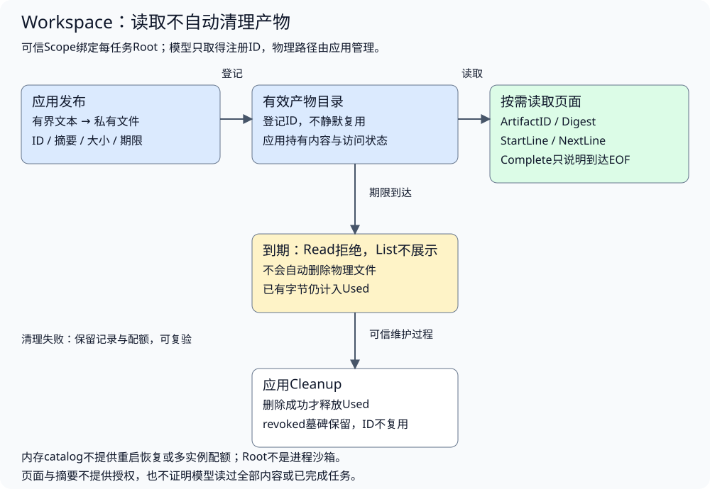
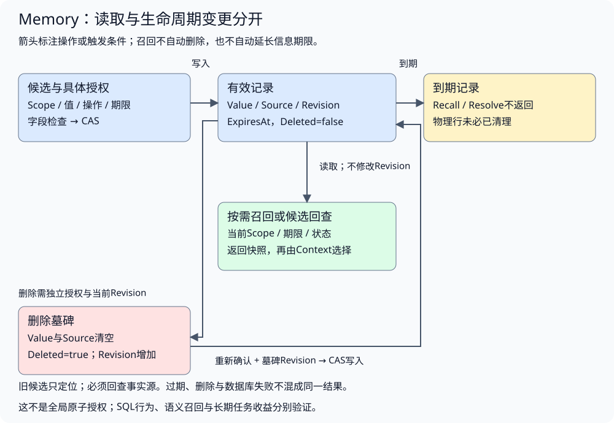
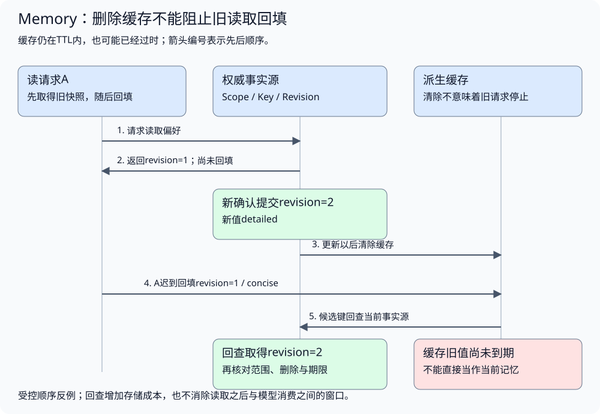

# 持久状态与工作空间

配套实验：[持久状态与工作空间实验](../../../../labs/part3-agent/chapter27/user-memory/README.md)。

相关实验：[实验：产物引用、分页与任务隔离](../../../../labs/part3-agent/chapter30/workspace/README.md)。

用户修改了偏好，缓存仍返回旧值；报告保存成文件后，另一个任务又拿着旧引用读取。长期事实和任务产物都需要持久身份、授权、版本及失效规则。

它们类似页面里的服务端数据与下载资源，但不能只靠前端ID隔离。Memory管理跨会话事实，Workspace管理任务资料和产物；执行恢复快照另由运行控制章负责。

Memory与Workspace都属于Data/Resource，但身份和生命周期不同。学习知识系统时先读Memory写入、回查与失效；接入外部进程前可先读[Workspace](#topic-agent-workspace)的任务绑定和受控读取。执行游标由[Checkpoint](chapter29-execution.md#topic-agent-checkpoint)管理，实际进程与资源由[执行环境](../governance/chapter36-security.md#execution-environment-lifecycle)管理，不用文件目录代替二者。

## 长期事实与任务产物

<a id="topic-agent-memory"></a>

### 哪些信息值得成为长期记忆

稳定偏好、确认过的业务背景和可复用知识可能需要跨会话保存。临时要求、未经确认的推断、工具错误和敏感信息，不应默认永久保留。

先判断四件事：信息是否需要长期使用，来源是否可靠，用户是否授权这个范围，何时应失效。让模型提出候选可以辅助发现信息，但最终写入由应用校验与执行。

实验只保存response-style与locale两类明确偏好，取值采用固定枚举。这使授权和冲突可以直接验证，不代表任意开放知识已经得到提取和治理。

<a id="信息内容与共享范围分别选择"></a>

**信息内容与共享范围分别选择**

“需要长期使用”不意味着“所有用户都能使用”。用户偏好、当前任务进度和团队知识有不同的所有者、使用范围与更新依据，先决定这些关系，再选择后端。

| 信息 | 合适的范围与归属 | 使用前要核对什么 |
| --- | --- | --- |
| 用户确认的语言或风格偏好 | 指定租户和用户的Memory | 是否仍有效，当前请求是否覆盖该偏好 |
| 本次任务的待办、观察与未决问题 | Runtime、Session或Checkpoint，按任务用途保存 | 当前运行/会话及状态版本，不因保存较久就变成长效偏好 |
| 团队批准的运行手册 | 受授权控制的共享资料库，可经RAG使用 | 团队成员权限、文档版本与适用环境 |
| 执行失败形成的经验建议 | 有任务及环境范围的经验记录 | 反馈依据、适用版本和失效条件；建议不提升为确定事实 |

本实验的Scope只有Tenant/User，不提供团队或Agent共享命名空间。将User统一写成public，会丢掉原有用户隔离含义，不能作为共享设计。确需团队共享时，另行定义可信成员身份、资源权限、写入责任与删除范围；通用经验和个人资料也不能因为都进入模型输入就合并授权。

内容形式与存储方式同样分开：偏好可以是结构化字段，事件经验可以带失败轨迹，程序性指导可以由Skills按需加载。把它们放进同一个数据库，仍需不同的准入、检索和使用规则。

前面先判断“什么值得长期保存、范围该放到哪里”。接下来再固定另一条主线：事实本身和授权条件为什么必须分开表示，不能让一条已保存记录顺手替代当前许可。

### 存储事实与授权分别表达

[Record与Consent](../../../../labs/part3-agent/chapter27/user-memory/main.go)保存版本、期限与确认范围：

```go
type Scope struct{ Tenant, User string }
type Record struct {
	Key, Value, Source string
	Revision           int64
	ExpiresAt          time.Time
	Deleted            bool
}

// Consent由可信应用根据用户操作产生，不从模型输出解码。
type Consent struct {
	Scope                 Scope
	Key, Operation, Value string
	Allowed               bool
	ExpiresAt             time.Time
}
```

Consent由可信应用根据用户操作产生，绑定租户、用户、字段、具体值、操作和期限。模型返回allowed=true不能作为授权；用户确认简洁风格，也不能被模型替换成另一个长期偏好。

Source定位写入依据，不是正确性证明。真实系统应关联确认事件或可信资料身份，并明确推断与用户明确声明的区别。记忆值进入模型时仍按信息来源使用，不提升成可覆盖应用政策的指令。

Scope来自认证后的调用方，不让模型通过参数选择User或Tenant。存储主键和每条查询都包含该范围，不能只在首次创建时检查身份。

<a id="topic-agent-workspace"></a>

<a id="从大结果到可读取产物"></a>

<a id="卸载需要保留入口"></a>

**卸载需要保留入口**

把结果移出prompt，不等于信息已经被模型使用。应用应返回简洁摘要、产物身份、大小、来源和读取方式，让后续决策知道何时需要补读。

读取之后的片段进入Context，并保留对应产物和范围。来源不足时不能让模型根据文件名猜内容；资料没有被读取，也不能因为“已经保存到文件”就当作回答依据。



Workspace可以采用虚拟后端、真实文件、对象存储或数据库。统一的逻辑路径不代表统一的物理权限，不同后端还需要相应隔离和保留策略。

<a id="产物id优先于任意路径"></a>

**产物ID优先于任意路径**

配套[Artifact与Page](../../../../labs/part3-agent/chapter30/workspace/main.go)把公开身份和内部文件名分开：

```go
type Artifact struct {
	ID, Digest string
	Bytes      int
	ExpiresAt  time.Time
	path       string
	revoked    bool
}
type Page struct {
	ArtifactID, Digest string
	Text               string
	StartLine          int
	NextLine           int
	Complete           bool
}
```

模型用注册ID读取，不提供磁盘路径。Digest用于识别当前内容，Bytes帮助预算，ExpiresAt说明可用期限；内部path不进入模型可见元信息。

ID在当前Workspace中不可复用。过期文件删除后仍保留墓碑，避免旧引用突然指向另一份资料。需要新版内容时使用新身份，关联旧版本与失效原因。

## 记忆写入与并发修订

### 写入如何经过应用边界



[Write](../../../../labs/part3-agent/chapter27/user-memory/main.go)先检查context、具体授权、枚举与TTL，再进入存储版本提交：

```go
func (m Memory) Write(ctx context.Context, s Scope, key, value, source string, expected int64, ttl time.Duration, c Consent) (Record, error) {
	if err := ctx.Err(); err != nil {
		return Record{}, err
	}
	now := m.Now()
	if !m.authorized(s, key, "write", c, now) || c.Value != value {
		return Record{}, ErrDenied
	}
	if expected < 0 || expected == int64(^uint64(0)>>1) || ttl <= 0 || ttl > 30*24*time.Hour {
		return Record{}, ErrInput
	}
	if err := validate(key, value, source); err != nil {
		return Record{}, err
	}
	return m.Store.CAS(ctx, s, Record{Key: key, Value: value, Source: source, ExpiresAt: now.Add(ttl)}, expected)
}
```

这些判断有顺序：未经授权时不查写入是否“看起来合理”，字段合法时也不能跳过权限。TTL属于信息保留策略，不能由模型无限延长；实验上限30天，真实期限按用途与用户选择定义。

格式校验不能证明事实正确。对开放文本或推断型记忆，还需要证据、置信与人工确认策略。不要把自然语言“可能喜欢”直接写成永久确定偏好。

<a id="冲突与对象重建怎样处理"></a>

<a id="版本检查防止旧值覆盖新值"></a>

**版本检查防止旧值覆盖新值**

两个运行都读到revision=1，再分别更新，只有一个能提交。失败的一方需要读取当前状态并重新判断，不盲目用旧候选覆盖。

实验Fake与SQLStore实现同一个Backend契约。关系型主键包含tenant、user_id和memory_key，创建与更新分别处理：

```go
func (s SQLStore) CAS(ctx context.Context, scope Scope, r Record, expected int64) (Record, error) {
	var row *sql.Row
	if expected == 0 {
		row = s.DB.QueryRowContext(ctx, `INSERT INTO course_memory_entries(tenant,user_id,memory_key,value,source,revision,expires_at,deleted) VALUES($1,$2,$3,$4,$5,1,$6,$7) ON CONFLICT(tenant,user_id,memory_key) DO NOTHING RETURNING revision`, scope.Tenant, scope.User, r.Key, r.Value, r.Source, r.ExpiresAt, r.Deleted)
	} else {
		row = s.DB.QueryRowContext(ctx, `UPDATE course_memory_entries SET value=$4,source=$5,revision=revision+1,expires_at=$6,deleted=$7 WHERE tenant=$1 AND user_id=$2 AND memory_key=$3 AND revision=$8 RETURNING revision`, scope.Tenant, scope.User, r.Key, r.Value, r.Source, r.ExpiresAt, r.Deleted, expected)
	}
	if err := row.Scan(&r.Revision); errors.Is(err, sql.ErrNoRows) {
		return Record{}, ErrConflict
	} else if err != nil {
		return Record{}, err
	}
	return r, nil
}
```

INSERT冲突不覆盖，UPDATE带revision条件，RETURNING没有行时返回ErrConflict。参数化查询同时表达身份与版本，避免把字符串拼接当作数据过滤。

这不是任意业务数据库写权限。Memory只维护本实验授权的偏好表；接入服务时使用合适数据库角色，迁移和运行身份分开。可按需要增加行级安全，但不能以本实验的应用WHERE测试声称验证了RLS或数据库管理员隔离。

<a id="删除保留修订墓碑"></a>

**删除保留修订墓碑**

删除清空Value和Source，标记Deleted并增加revision。旧请求持有早期版本，再写入会发生冲突，不能让删掉的信息重新成为事实。

用户再次确认偏好时，可以基于最新墓碑版本重新创建内容；新revision继续增加，不恢复为1。若必须物理删除全部元信息，应另设计不可复用代次或删除令牌，避免对象重建后的版本复用。

墓碑也有数据保留边界。备份、日志、事件和其他副本不因主表清空就自动删除，需要明确用途与清理政策。

前面处理的是长期事实怎样写入、冲突和删除怎样表达。接下来才回到模型侧：这些仍然有效的记录怎样进入本轮输入，又怎样避免旧偏好和旧候选悄悄复活。

## 事实回查与本轮输入

<a id="长期信息如何进入本轮输入"></a>

<a id="当前有效性在召回时检查"></a>

**当前有效性在召回时检查**

Recall先按当前Scope查询，再在返回前检查context、期限和有效记录的字段/枚举/修订；重复键或异常记录返回错误，不交付前面已收集的部分内容。到期与删除记录不进入输入，结果按Key排序，避免Fake的map次序与SQL排序产生无关差异。取回记录后，Context仍需要根据当前任务选择：故障排查可能用语言与风格偏好，但不必提供用户的所有长期信息。

到期在读取时失效，不代表物理行已清理。应用时钟、数据库时钟与精度需要统一，本实验注入时钟以复现边界，SQL使用TIMESTAMPTZ保存时间。多实例服务不能依赖各自错误时钟判断授权。

历史偏好可能与当前请求冲突，例如长期偏好简洁，本次要求详细说明。保留优先级与作用范围，当前明确任务要求通常应覆盖相应表达偏好；不能让Memory强迫所有会话采用同一方式。

<a id="将有效记录投影为任务输入"></a>

**将有效记录投影为任务输入**

故障诊断需要知道用户希望怎样阅读解释，不需要知道哪次确认写入了数据库。若把Record整条序列化，Source、ExpiresAt和Deleted也会进入提示词，模型可能把维护字段误当成任务事实；可信Scope和Consent更应留在应用侧。

输入组装先确定本次需要哪些偏好，再回查这些键，最后投影允许字段。[Memory.Input](../../../../labs/part3-agent/chapter27/user-memory/input.go)沿用Resolve的隔离、当前事实与期限检查：

```go
type MemoryInput struct {
	Key      string `json:"key"`
	Value    string `json:"value"`
	Revision int64  `json:"revision"`
}

func (m Memory) Input(ctx context.Context, scope Scope, keys []string) ([]MemoryInput, error) {
	records, err := m.Resolve(ctx, scope, keys)
	if err != nil {
		return nil, err
	}
	input := make([]MemoryInput, 0, len(records))
	for _, record := range records {
		input = append(input, MemoryInput{Key: record.Key, Value: record.Value, Revision: record.Revision})
	}
	if err := ctx.Err(); err != nil {
		return nil, err
	}
	return input, nil
}
```

这里的revision帮助应用定位本次使用的事实修订，不是授权令牌。记录仍由可信Scope取得；模型收到键和值，也不能通过返回另一个修订号取得新权限。每次组装重新回查，不把上轮输入当作新的事实源。

例如旧缓存保存concise@1，当前事实源已更新为detailed@2，输入应只包含response-style、detailed与修订2。删除或到期之后，同一个候选键不再产生偏好输入；应用按当前请求或自己的默认表达规则继续，不能偷偷从历史恢复已删除偏好。当前请求要求详细说明时，也不应让长期简洁偏好覆盖它。

Context随后决定这份输入与任务、历史和资料怎样组合，计算总预算。偏好决定表达方式，资料证据决定可以陈述哪些事实；“希望回答详细”不能替代缺失的诊断依据。正确投影只能证明应用提供了当前所选信息，模型是否采用、回答是否正确仍需任务对照。

<a id="证据正文还需要保留字段含义"></a>

**证据正文还需要保留字段含义**

把键、值和修订投影出来以后，adapter仍可能在下一次转换时丢掉信息。若引用ID叫response-style，而证据正文只剩detailed，应用知道它是表达偏好，模型却需要从引用名字推断这层关系。ID用于定位，不应承担正文全部含义。

可以将已回查的投影视图表达为字段和值，同时保留独立引用身份。[EvidenceText](../../../../labs/part3-agent/chapter27/user-memory/input.go)只做格式化：

```go
func (i MemoryInput) EvidenceText() string { return i.Key + "=" + i.Value }
```

这里的正文变为response-style=detailed，原Value仍是detailed，Revision仍是事实修订。该格式适用于当前已校验的固定字段和枚举；格式化本身不读取事实源、复核授权或证明值正确，不能把外部构造的MemoryInput当成已授权记录。

字段含义更清楚，也不保证回答满足任务。问题只要求偏好值时，模型可能照抄整个字段表达，或混入多余协议字段。输入转换和输出契约应分别验证：保留真实提交消息，检查原始输出中的值、引用和字段，不删属性或改写回答后冒充原生成通过。

配套对照保持原任务、模型和预算：纯值视图误拒答，字段和值视图开始返回断言，但尚未满足严格值与协议要求。输入变化、行为变化与任务收益分别判断；实际故障解释是否采用偏好仍是另一项任务。

<a id="输入可见不代表偏好已经被采用"></a>

**输入可见，不代表偏好已经被采用**

应用已经取得detailed，并且实际模型请求确实包含它，模型仍可能拒答或忽略偏好。排查时先确认事实、投影与提交消息，再看生成结果；只检查存储里有值，无法判断失败发生在哪一层。

验证需要保留状态变化的先后关系。先在更新后的事实仍有效时完成一次生成，再用另一个用户读取同一候选并生成，最后删除原事实、重新构建输入并生成。若先收集多个状态的输入、全部变更完成后才批量生成，旧输入只是历史快照，不能据此证明模型使用了当时的当前事实。

这条链路分别回答四个问题：

1. **事实是否当前有效**：SQL记录、期限和Scope是否满足读取契约，旧缓存是否只提供候选键。
2. **输入是否真实提交**：键、值和修订经过应用投影，实际messages与提交视图一致；确认记录和评分依据不进入模型。
3. **回答是否使用依据**：原文中是否包含正确值与对应引用，还是拒答、改值或出现坏格式；不能从模型看见资料推断它已正确使用。
4. **偏好是否影响实际任务**：回答一个偏好值，与按该偏好解释故障是不同任务。后者还需任务正确性、表达要求和当前请求优先级的对照。

配套真实生成对照已经串起SQL、Redis旧候选、当前投影与本地模型输入，当前值问答仍出现误拒答。这个失败保留在实验中；不能通过补写答案或只展示空输入拒答，把整个链路说成成功。生成期间更新与最终公开时的许可，还需消费或交付位置的复核。

<a id="读边界也有时间与一致性条件"></a>

**读边界也有时间与一致性条件**

查询开始时有效的记录，可能在返回时到期。后端筛选之外，Memory用当前时钟复核期限；读取期间取消，也不返回迟到内容。已删除墓碑的值与来源本来就为空，先排除失效记录，再校验仍有效的偏好，避免把合法删除当成损坏数据。

这个检查形成一次读取快照，无法与后续模型调用之间的并发删除原子化。需要更严格使用规则时，保留revision与读取依据，在消费或提交位置再次核对，或者设计合适事务与撤销协议；不能承诺一次Recall会让偏好持续有效。

授权也要说明检查时点。当前Write在发起CAS前核对Consent，数据库错误或超时仍可能形成结果未知；若要求提交时授权依然有效，必须将相应条件纳入存储事务或其他可验证协议。模型不能通过重新声明allowed来解决这个窗口。

<a id="向量与缓存候选要回查事实源"></a>

**向量与缓存候选要回查事实源**

向量索引可能尚未处理删除，缓存也可能带着旧revision。仅凭候选ID直接把内容交给模型，会绕过期限与撤销。

[Resolve](../../../../labs/part3-agent/chapter27/user-memory/main.go)模拟候选键回查：

以下摘录函数内的关键分支，完整校验与资源清理见所链源码。

```go
		record, err := m.Store.Peek(ctx, s, key)
		if stop := ctx.Err(); stop != nil {
			return nil, stop
		}
		if errors.Is(err, ErrNotFound) {
			continue
		}
		if err != nil {
			return nil, err
		}
		if !record.Deleted && m.Now().Before(record.ExpiresAt) {
			if record.Key != key || record.Revision <= 0 || validate(record.Key, record.Value, record.Source) != nil {
				return nil, ErrInput
			}
			out = append(out, record)
		}
```

去重后用可信Scope读取当前记录，再检查取消、Deleted与ExpiresAt；有效记录还须匹配请求键，具有合法修订、偏好值与来源。后端返回了另一键或异常值时整体失败，不能当成没有记忆。候选只有定位作用，不能携带最终权限事实；真实索引还应同步删除与版本，但同步延迟不能作为允许泄漏旧值的理由。

候选数量与单个键的大小分别限制。回查前整批检查键非空白、UTF-8合法且不超过128字节，坏键使整批失败，不先读取合法前缀；去重不会替代体积检查。未知但符合格式的键仍可得到无记录结果，不裁剪长键或改写标识去猜另一份记忆。

实验没有向量库，只用旧候选键验证回查边界。真实语义召回质量与索引同步需要独立任务、标签和故障测试。

### 关系型、缓存与向量存储怎样选择

| 方式 | 擅长什么 | 需要额外管理 |
| --- | --- | --- |
| 关系型事实源 | 明确字段、版本、事务与删除状态 | Schema、迁移、查询范围、连接和权限 |
| Redis等缓存 | 快速读取、短期状态与期限 | 失效、回源、持久性与原子更新语义 |
| 向量索引 | 按语义寻找候选信息 | 表示空间、相关性、范围过滤与事实回查 |
| 文件或对象后端 | 文档型记忆与产物 | 内容版本、访问范围、原子发布和检索 |

一种后端不能自动解决所有问题。关系表保存授权事实，缓存和向量可以服务查询，但要明确哪一份状态具有最终权威。资料知识库也不自动等于用户Memory，外部RAG有自己的来源与更新规则。

本实验提供内存与真实PostgreSQL适配，默认离线契约和显式数据库测试分开。另有显式Redis缓存对照，验证旧缓存候选的当前事实源回查；分别使用Fake和真实PostgreSQL裁决当前状态，不作为Redis长期事实后端或向量存储实现。

<a id="缓存ttl与记忆有效期是两只时钟"></a>

**缓存TTL与记忆有效期是两只时钟**

缓存TTL决定一份副本还能保存多久，Record.ExpiresAt决定原信息还能使用多久，Consent.ExpiresAt限制相应确认操作的有效范围。它们不能相互代替：缓存还有十分钟，用户却刚删除偏好，副本就已失去使用依据；缓存刚过期，事实源里的偏好可能仍有效，可以按当前范围重新读取。

缓存命中至少需要核对作用范围、字段、版本与信息期限。范围进入缓存键或索引命名空间，但缓存键本身不是凭证；调用方身份仍由应用绑定。不要在刷新缓存时延长Record.ExpiresAt，也不要把一次读取变成新的Consent。

| 变化 | 缓存可能仍然怎样 | 使用时该判断什么 |
| --- | --- | --- |
| 事实更新 | TTL未到，值却来自旧revision | 是否允许陈旧；严格读取回查当前修订 |
| 用户删除 | 旧值与索引候选仍存在 | 事实源墓碑或撤销状态，不能等待缓存自然过期 |
| 信息到期 | 副本还有剩余TTL | 原ExpiresAt是否已到，而非只看缓存时钟 |
| 缓存连接失败 | 没有取得候选 | 按明确策略回源或报错，不能解释成用户从未授权 |

<a id="更新后删缓存为什么还会读到旧值"></a>

**更新后删缓存，为什么还会读到旧值**

缓存失效不能阻止一个早已开始的读取。考虑下面的受控顺序：



1. **A取得旧快照**：事实源返回revision=1、concise，A尚未把它填入缓存。
2. **用户确认更新**：另一请求提交revision=2、detailed，然后清除缓存。
3. **A晚到回填**：A继续写入revision=1；这个值可以带着尚未到期的TTL重新出现。
4. **下一次读取命中旧值**：如果直接把缓存内容放进Context，就会违背当前偏好。
5. **候选回查当前事实源**：沿前面的Resolve，只使用缓存候选键定位；返回revision=2，并再次核对范围、删除与ExpiresAt。

这里旧的是内容与修订，不是TTL。把TTL设得更短只缩短可能陈旧的时间；先写事实源、再删缓存，也没有原子关闭旧请求的回填窗口。固定延迟后再删一次仍依赖耗时假设，不能替代版本或一致性协议。

配套受控反例保存A读到的旧Record，完成真实Fake后端CAS更新后再回填旧副本。回查取得新值，删除后旧候选也不能恢复内容；另一个Scope使用同一候选键，仍只能访问自己的事实源。这验证的是既有Resolve交接规则，没有启动Redis，也没有证明分布式时序或缓存加速效果。

<a id="回查安全失效与读取成本怎样取舍"></a>

**回查、安全失效与读取成本怎样取舍**

每次回查都需要访问事实源，可能抵消缓存减少存储请求的收益。因此先定义“什么信息允许多旧”，再选读取协议，不能同时承诺零回源开销和立即撤销。

| 方案 | 能得到什么 | 必须补上的条件 |
| --- | --- | --- |
| 只缓存候选ID，再回查 | 由当前事实源判断内容、期限与删除 | 保留源读取成本；读取后到模型消费仍有窗口 |
| 缓存完整快照并允许短暂陈旧 | 减少源读取，适用于明确允许陈旧的内容 | 明确最大陈旧范围，删除/权限变化不能未经设计沿用该窗口 |
| 按版本与失效协议维护快照 | 限制旧回填和失效副本使用 | 更新与版本发布一致，缓存提交拒绝旧代次，通知/连接故障有降级规则 |

[Redis的客户端缓存说明](https://redis.io/docs/latest/develop/reference/client-side-caching/)介绍服务端辅助失效通知。它有助于维护副本，但应用仍需处理失效通道不可用和重新建立连接时的缓存状态；若Redis自身也是数据库的派生缓存，Redis的通知并不会自动观察源数据库中的每一次变化。版本校验、删除传播与使用边界需要沿完整链路设计。

当前实验选择候选回查，不实现完整值缓存的失效协议。显式Redis对照已确认晚回填旧值仍有有效TTL，而更新、删除和范围由当前事实源回查裁决；同一契约也已接入真实PostgreSQL，核对字段、修订及期限所代表的时间点，删除与范围判断由SQL事实源完成；停止缓存后由应用明确回源，没有把错误当成无记忆。该联合路径不包含失效通知或跨实例事务，通知机制尚未验证，后续还应分别测命中率、回源次数、陈旧窗口、删除传播和错误降级，再检查召回内容是否进入了错误的任务；只展示快速GET不能证明Memory可靠。

## 工作空间身份与受控读取

<a id="工作空间怎样绑定身份与任务"></a>

<a id="根目录来自可信调用方"></a>

**根目录来自可信调用方**

Scope包含Tenant、User和Task，部署方根据认证与运行身份构造；模型不能通过参数选择另一个用户或任务目录。

[New](../../../../labs/part3-agent/chapter30/workspace/main.go)限制标识字符，并为任务打开独立os.Root：

```go
func New(base *os.Root, scope Scope, now func() time.Time) (*Workspace, error) {
	if !validID(scope.Tenant) || !validID(scope.User) || !validID(scope.Task) || now == nil {
		return nil, ErrDenied
	}
	path := scope.Tenant + "/" + scope.User + "/" + scope.Task
	if err := base.MkdirAll(path, 0700); err != nil {
		return nil, err
	}
	root, err := base.OpenRoot(path)
	if err != nil {
		return nil, err
	}
	return &Workspace{root: root, scope: scope, now: now, artifacts: map[string]Artifact{}}, nil
}
```

这提供实际目录约束与逻辑注册表双层检查。Root之外的符号链接无法访问，未知ID也不能读；任务目录结构仍应由可信应用管理，不允许其他租户修改目录或植入别名。

每个任务持有一个Workspace实例。Mutex保护该实例的注册表，不是跨进程锁；重复打开同一任务目录的多个实例不能共享它的配额与权限事实。多实例或重启需要持久、原子的目录与产物清单，不能仅用文件夹名字保证一致性。

<a id="路径合法与访问合法分别判断"></a>

**路径合法与访问合法分别判断**

路径规范化、Root约束、ID登记和身份绑定解决不同问题。只检查没有..不够，符号链接仍可能跳出；只检查文件位于某个大目录也不够，它可能属于另一个任务。

当前工具只接受注册产物ID，不开放通用read_file、glob、grep或Shell。需要这些能力时，分别定义范围、模式、结果大小和最终授权，不能把底层文件API全部挂成工具。

### 谁可以发布与修改产物

发布由应用完成，Agent接口保持只读。配套Publish在写入前检查身份格式、内容编码、单文件与总配额，并拒绝已存在的ID。

文件以0600权限创建，任务目录0700；这些是本地实验的保护，不等于完整服务身份系统。文件写入完成后才登记产物，失败不把半份内容当作可读取结果。

本实验不是持久产物库：没有catalog落盘、事务发布或崩溃恢复。写入失败留下孤儿文件、进程重启丢失登记时，需要运营或持久后端处理；Checkpoint保存引用之前，也必须确认产物真正可恢复。

若将来允许模型修改文件，应额外定义授权、编辑匹配、版本冲突、验证与撤销边界。当前课程只读主线不会因Workspace存在而自动开放这些能力。

### 分页怎样保留完整性信息

[Read](../../../../labs/part3-agent/chapter30/workspace/main.go)先查登记与过期，再受限读取文件、核对摘要，最后按行生成页面：

```go
	if len(data) != artifact.Bytes || digest(string(data)) != artifact.Digest || !utf8.Valid(data) {
		return Page{}, ErrChanged
	}
```

```go
	end := start + min(count, len(lines)-start)
	text := strings.Join(lines[start:end], "")
	if len(text) > 4096 {
		return Page{}, ErrQuota
	}
	if err := ctx.Err(); err != nil {
		return Page{}, err
	}
	if !w.now().Before(artifact.ExpiresAt) {
		return Page{}, ErrDenied
	}
```

返回页面前再次检查context与ExpiresAt。如果读取期间到期，即使内容摘要正确，也返回拒绝且不交付页面；这个最后检查点不保证结果返回后仍永久有效。长任务应继续按引用期限读取，恢复前也重新核对。

每页携带ArtifactID、完整内容Digest、StartLine、NextLine与Complete，调用方可以核对来源、已读范围和下一段入口。按行读取保留UTF-8文本边界，不能将一次成功误解为读完整份文件。

<a id="拼接之前先核对身份与范围"></a>

**拼接之前先核对身份与范围**

两份产物的第一页都可能写“摘要如下”，后续正文却不同。只拼接Text，无法确认这些片段是否属于同一内容。页面的Digest对应整份已登记文件，不能用当前页文本重新计算后当作同一个摘要。

续读结果进入Context前，按以下步骤核对：

1. **确认产物身份**：页面ArtifactID与当前任务登记一致；ID在Workspace内唯一，Host仍需保留任务绑定。
2. **确认内容身份**：各页Digest与首次取得的Artifact一致；内容变化时拒绝续读，不能混入新版尾页。
3. **确认行范围**：顺序拼接时，本页StartLine应接前页NextLine；缺口、重叠或乱序另行处理。
4. **确认完整性**：Complete表示已经到该文件末尾，跳过前面的页再读末尾，并不表示整份文件都已取得。

需要完整内容时，应用不能只看最后一页的Complete。[Assemble](../../../../labs/part3-agent/chapter30/workspace/assembly.go)从当前Workspace登记中取得产物信息，逐页核对连续范围和同一摘要，再核对总字节及整份内容：

```go
	if text.Len() != artifact.Bytes || digest(text.String()) != artifact.Digest {
		return Collected{}, ErrPageSequence
	}
```

因此，漏掉第一页、混入另一产物、重叠、乱序、提前结束或改写同长度文本，都不能交付半份拼接结果。每页仍限制128行和4 KiB，组装另限制页数与总字节；输出使用Collected，避免把整份文本当作一张仍受4 KiB限制的Page。

组装器检查已读取内容与本实例有效登记的一致性，返回前复核取消与到期。它不重新读取磁盘，也不证明谁实际读取了页面、资料是否真实或后续授权仍有效；需要最新文件状态或严格撤销的应用，必须在对应消费边界另行核对。不能让模型自报一份Artifact元信息，再用正确摘要代替可信目录与访问检查。

完整组装也不自动进入模型输入。任务只需要某几行时保留局部页与范围，避免为了组装重新把大报告全量塞回prompt；确需全文时先给出总字节预算，再由Context统计实际请求Token与输出预留。

读到末尾后的空页仍返回同一ID与Digest，StartLine=NextLine；它与未知产物或读取失败不同。返回拒绝、变化或取消错误时，页面为零值；最后检查点仍按前述协作边界处理。页身份用于关联，不提供权限，也不证明资料事实；相同内容摘要出现在两个任务里，仍要分别核对访问范围。

实验先读取并校验最多32 KiB的完整文件，再返回小页。这减少模型输入，不是大型文件后端的流式读取；真实大产物可使用块级摘要、稳定版本与分页后端，但每页仍要绑定同一内容身份。

每页Text最多4 KiB，附带身份与范围后的完整输出还需进入Context预算检查。单行太长时返回配额失败，不能裁成半行却仍标Complete。需要更细的字符或字段分页，应定义偏移单位、编码和续读规则。

## 版本、失效与回收

### 产物变化为何要拒绝旧引用

文件被替换、修改或指向别处，旧登记的长度与摘要不再匹配。实验返回ErrChanged，不使用“路径仍然存在”作为成功证据。

Digest可以发现内容变化，不证明资料真实或可信，也不是访问授权。文件有权限且摘要正确，仍可能含不可信指令；读取内容进入模型时保留资料身份，不能覆盖应用规则。

对需要长期引用的产物，应保留内容版本或不可变对象。缓存同样绑定身份和版本；不能因为缓存命中，就忽略权限变更或删除。

### 过期、撤销与回收如何衔接

1. **访问检查**：达到ExpiresAt后，不再读取或列出产物。
2. **应用回收**：Cleanup删除过期文件并标记撤销。
3. **配额结算**：成功清理后减少当前实例的已登记字节。
4. **保留身份墓碑**：旧ID不重新指向新内容。
5. **检查其他副本**：缓存、备份、Trace与模型输入的保留另行处理。

过期不等于文件立即删除，也不代表所有副本都已清除。清理失败保留记录，便于复验；不要只从catalog移除，再无法定位剩余内容。

实验限制每任务实例最多16个已登记ID，包括撤销墓碑；活跃内容总量64 KiB。它是明确运行预算，不是无限存储。长期任务需要更合适的持久配额、回收和索引策略。

### Workspace与Sandbox为何不同

Workspace决定任务资料如何组织与访问，Sandbox限制程序执行的文件、网络、CPU、内存等资源。受限目录不等于安全Shell，虚拟文件后端也不自动隔离执行环境。

容器本身同样需要权限与资源配置。要执行不可信代码时，使用适合的隔离方案并验证边界；不能因为读文件用了Root，就认为任意命令可以安全运行。

本实验没有执行接口。Skills引用参考文件时可以采用类似的根目录与预算规则，但Skill加载仍不能授予Workspace写权限。

### 资源引用怎样贯穿任务生命周期

| 对象 | 主责与身份 | 失效后必须处理的引用 |
| --- | --- | --- |
| Session | 用户/会话的交互事实，按版本追加 | Context候选历史与续聊入口 |
| Checkpoint | Run及执行代际的提议、游标、尝试和提交事实 | 恢复资格、原预算与结果引用 |
| Memory | 已授权跨会话事实及修订 | 缓存/向量候选、后续输入；召回时回查 |
| 检索索引 | 资料版本、编码空间与发布代次 | 查询句柄、证据片段及答案交付判断 |
| Workspace / Artifact | Scope/Task、产物ID、内容版本与保留期 | 分页、卸载摘要、下载和模型中的读取引用 |
| 录制档案 | Run/Call、输入指纹、原响应与用途授权 | Replay、诊断、评估报告的访问与保留 |

任务结束不自动删除所有对象：用户授权的长期偏好可能继续保留，临时环境应按政策销毁，产物可有下载窗口，录制另有用途和期限。任务删除同样要明确派生索引、缓存、导出与备份的处置；删除工作目录不代表全部副本已消失。

实现时先登记引用与拥有者，再按状态关闭新访问，执行有界清理并记录失败，最后按墓碑或版本规则防止旧引用指向新内容。不同存储没有共同事务时，应允许重试清理并报告尚未完成的范围，而不是先删除目录记录再失去追踪。现有Lab分别验证局部失效，不提供跨全部存储的统一资源目录或删除协调器。

环境快照保存进程/文件环境的特定状态，Checkpoint保存应用执行事实；恢复环境并不能证明某个工具结果已提交，保留Workspace也不能证明可以继续旧Run。环境与产物交接见[执行环境生命周期](../governance/chapter36-security.md#execution-environment-lifecycle)。

### 如何验证记忆没有越界

同一套契约至少覆盖：未确认不写、确认值不被替换、其他用户不可召回、版本竞争只有一个成功、到期不返回、删除后旧候选无法复活、再确认保持新修订。

SQL测试需要真实隔离数据库，验证查询与并发行为；fake通过只能证明接口与应用规则。关闭连接再读取、进程重启或磁盘恢复的证据，也不能由内存测试替代。

长期使用效果另行检查：是否减少重复询问，是否误写偏好，是否把过期或不相关内容带入输入。更多记忆不必然更好，写入与召回错误都可能积累。

<a id="最佳实践"></a>
<a id="把确认和候选分开"></a>
<a id="用事实源裁决当前状态"></a>
<a id="生命周期进入接口"></a>

[实验排查与实践建议：最佳实践](../../../../labs/part3-agent/chapter27/user-memory/README.md#book-agent-memory-最佳实践)。

<a id="常见问题排查"></a>
<a id="新会话读到另一个用户的设置"></a>
<a id="删除后旧偏好又出现"></a>
<a id="偏好突然被旧任务改回去"></a>

[实验排查与实践建议：常见问题排查](../../../../labs/part3-agent/chapter27/user-memory/README.md#book-agent-memory-常见问题排查)。

<a id="在工具返回处决定卸载"></a>
<a id="公开逻辑身份隐藏物理布局"></a>
<a id="把副本与生命周期一起设计"></a>

[实验排查与实践建议：最佳实践](../../../../labs/part3-agent/chapter30/workspace/README.md#book-agent-workspace-最佳实践)。

<a id="第一页正常模型却把它当成全文"></a>
<a id="换了任务还能读旧产物"></a>
<a id="文件仍存在但引用不可用"></a>

[实验排查与实践建议：常见问题排查](../../../../labs/part3-agent/chapter30/workspace/README.md#book-agent-workspace-常见问题排查)。

## 小结

1. 长期事实与任务产物具有不同生命周期，存储选择服从身份、授权和一致性要求。
2. 写入和修订经应用批准，删除保留必要版本约束，缓存或向量候选回查当前事实。
3. 进入Context的是受控投影，输入可见不等于偏好被正确采用。
4. 产物读取核对任务、版本、范围和完整性，文件路径合法不能替代访问授权。
5. 更新、撤销、过期与回收共同设计，工作空间不提供执行沙箱隔离。

## 参考文档

- [PostgreSQL INSERT](https://www.postgresql.org/docs/18/sql-insert.html)：条件冲突处理与RETURNING。
- [PostgreSQL行级安全](https://www.postgresql.org/docs/18/ddl-rowsecurity.html)：数据库隔离的补充层及角色边界。
- [database/sql](https://pkg.go.dev/database/sql)：查询context、事务与结果处理。
- [Redis客户端缓存](https://redis.io/docs/latest/develop/reference/client-side-caching/)：失效通知与本地副本管理，需结合实际客户端和部署版本验证。
- [Deep Agents长期记忆](https://github.com/datawhalechina/deepagents-in-action/blob/main/content/ch08-long-term-memory.md)：对照线程范围与跨会话信息。
- [os.Root](https://pkg.go.dev/os#Root)：限制目录范围及其边界。
- [io.LimitReader](https://pkg.go.dev/io#LimitReader)：有界读取。
- [Deep Agents虚拟文件系统](https://github.com/datawhalechina/deepagents-in-action/blob/main/content/ch03-virtual-filesystem.md)：按需文件读取与上下文组织的补充讨论。

[返回全书目录](../../README.md) · [上一篇：运行控制与故障恢复](chapter29-execution.md) · [下一篇：多 Agent 协作与任务编排](chapter31-collaboration.md)
