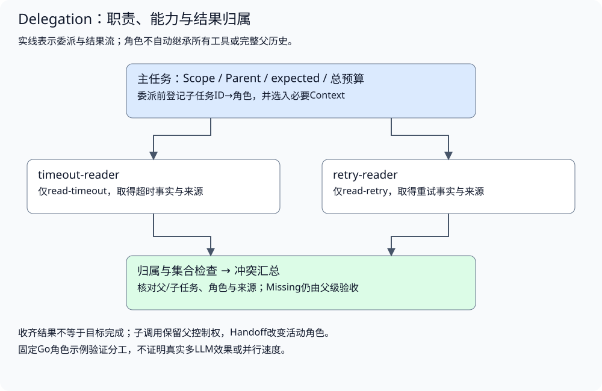
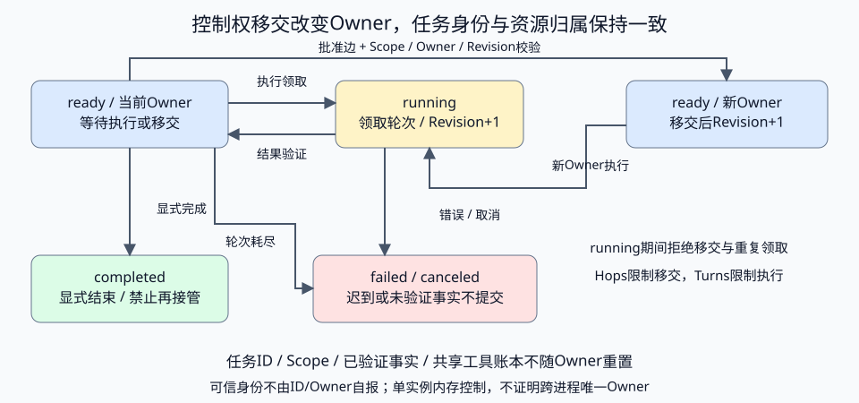
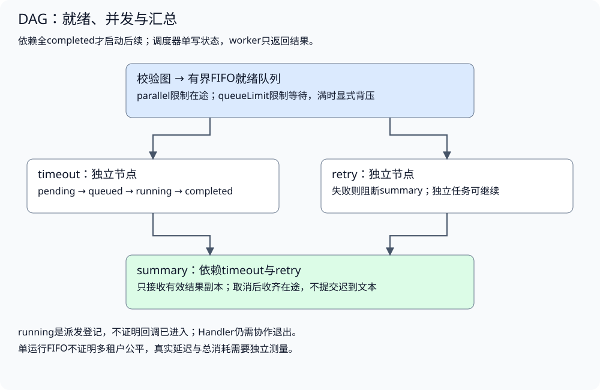
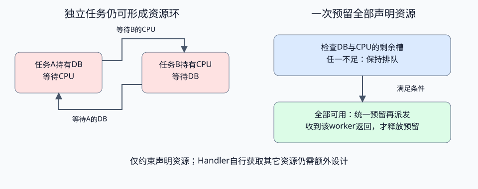

# 多 Agent 协作与任务编排

配套实验：[多 Agent 协作与任务编排实验](../../../../labs/part3-agent/chapter31/delegation/README.md)。

相关实验：[实验：有界并发、背压与失败传播](../../../../labs/part3-agent/chapter31/dag-scheduler/README.md)。

两份查询可以分工处理，汇总却拿到了错角色的结果；依赖尚未满足，调度器又提前执行了后续节点。分工、控制权与调度需要共享任务和结果契约。

本章先解释交给谁、允许做什么、如何验收返回，再引入Handoff与DAG。并行收益需要与单执行者或串行流程比较，失败、协调开销和共享预算一起保留。

## 分工价值与角色选择

<a id="topic-agent-delegation"></a>

### 什么问题适合分工

复杂子任务、领域专长或需要隔离中间信息时，可以考虑委派。短查询、固定计算或已知流水线，用普通函数或工作流可能更合适。

| 情况 | 分工可能带来的收益 | 额外代价 |
| --- | --- | --- |
| 大量中间观察 | 主上下文只接收必要结果 | 子结果可能省略关键条件 |
| 不同能力范围 | 每个角色只取得需要的工具 | 角色政策、路由与版本要管理 |
| 可独立任务 | 并行减少等待 | 更多调用、汇总与资源竞争 |
| 验证与执行分工 | 引入测试、工具或独立证据 | 验证本身也可能失效或偏差 |

同一模型看同样的信息反复讨论，不能仅凭角色数量证明质量改善。真正有用的验证需要新增信息或可执行证据，不能由另一段自信文字替代。

<a id="执行者调度和等待分别选择"></a>

**执行者、调度和等待分别选择**

“交给专家”只回答了由谁执行，尚未说明任务能否并行、谁继续控制流程，以及结果如何收取。先把这些选择分开，才知道需要哪种机制。

| 选择 | 要决定什么 | 对应机制 |
| --- | --- | --- |
| 执行者与能力范围 | 哪个角色处理子问题，拿到哪些信息和工具 | Delegation及角色路由 |
| 依赖与并发资源 | 哪些子任务可以开始，哪些结果必须等待 | DAG调度 |
| 调用与任务寿命 | 调用方等待结果，还是先取得ID继续交互 | 同步调用或Async Tasks |
| 后续控制权 | 子结果返回父流程，还是新角色接管当前任务 | 子调用或Handoff |

查超时与查重试可以委派给不同角色，也可以由同一角色完成；二者独立时可以并行，但主请求仍能同步等待。把报告任务放到后台以后，内部仍可能串行执行。角色数量、并发度和异步化分别增加自己的开销，不能用一个“多Agent模式”替代这些判断。

### 怎样选择执行角色

路由需要任务要求与可用角色，而不是一份越长越好的角色列表。每个角色描述应说明能够处理的输入、交付的结果和能力边界；“擅长所有研究”既难以区分候选，也无法验证是否选对。

| 路由方式 | 适用判断 | 必须保留的边界 |
| --- | --- | --- |
| 应用规则直接选择 | 任务类型明确，例如固定参数查询 | 映射有版本，未知类型明确拒绝或转澄清 |
| 模型从登记角色中提议 | 需要理解开放请求，角色能力有可辨认差异 | 返回名称只作候选，应用查表并检查本次允许范围 |
| 先澄清再路由 | 目标、资料范围或交付物尚不明确 | 不让角色名称掩盖任务缺口，澄清同样计入总预算 |

路由之后仍要生成有界子任务：目标、必要背景、结果要求与身份由父流程绑定，角色只能取得批准的能力。未知名字不能通过创建新角色“自动修复”；选中合法角色也不证明它能完成任务，子结果仍需验收。

<a id="已登记角色仍可能选错"></a>

**已登记角色仍可能选错**

timeout-reader和retry-reader都可以是合法角色，但查超时任务不能因为模型提议了retry-reader就直接执行。注册表回答“角色是否存在”，任务路由表回答“本次类型允许哪些角色”，Dispatcher继续检查“这个子任务能执行哪些工具”。三层各有判断，不能只做一次名称查表。

[SelectRole](../../../../labs/part3-agent/chapter31/delegation/routing.go)接收应用绑定的任务类型、可选角色提议及只读配置。类型只有一个候选时，应用直接选择；存在多个允许候选却没有选择依据时，返回ErrClarify。模型提议只能在本次候选中选择：

```go
	if proposed != "" {
		if !validName(proposed) {
			return "", ErrDenied
		}
		for _, name := range candidates {
			if proposed == name {
				return name, nil
			}
		}
		return "", ErrDenied
	}
```

配置先核对数量、重复候选及角色登记，坏配置与未知任务类型返回ErrRoute；未知角色或合法但不适用的提议返回ErrDenied。这些分支都发生在Worker启动以前。不能把歧义修复为“随机选第一个”，也不能为未知名字动态创建Handler。

路由到执行依次完成：**绑定任务类型 → 验证本次候选 → 接受选择或澄清 → 生成子任务 → Delegate校验与执行 → 验收结果**。任务类型、Scope与预算由应用控制；真实模型可以辅助分类，但分类结果也要经过允许集合与任务要求检查。选中合法候选只证明选择范围成立，语义是否选对、结果是否满足目标，仍需评估。

当前实验提供应用类型映射与固定角色提议，Dispatcher仍接收选定roleName，不包含自然语言分类器或真实模型路由器。固定映射验证不了开放请求的分类准确率；真实路由对照应另外保留错误选择、未找到合适角色和澄清成本。

前面先回答了“谁来做”。接下来要固定的是“交出去的到底是什么”：子任务契约、上下文范围、结果归属，都不能只靠一个角色名隐式继承。

## 子任务、能力与结果契约

### 子任务契约先于角色名称

配套[Task与Result](../../../../labs/part3-agent/chapter31/delegation/main.go)保留任务、父级、身份、选定上下文和结果：

```go
type Scope struct{ Tenant, User string }
type Fact struct{ Key, Value, Source string }
type Task struct {
	ID, Parent string
	Scope      Scope
	Goal       string
	Context    []Fact
	Depth      int
}
type Result struct {
	TaskID, Parent, Actor string
	Scope                 Scope
	Facts                 []Fact
	Missing               []string
}
```

Goal说明要取得什么，Context是主流程明确选择的事实；它不是父级全部历史。Result带回TaskID与Parent，使调用方能分别核对子任务和所属父任务，再处理结构化事实、来源与缺失项。

任务ID与Scope由可信运行层绑定。子模型不能自行改Tenant/User，也不能把自己的回答附到另一个父任务。Depth属于运行元数据，不由模型重置成0以绕过递归限制。

本实验的角色是固定Go函数与只读工具，不调用LLM；用它们隔离委派契约。真实子Agent可以包含自己的Loop，但输入、输出、权限和预算仍通过同样边界。

### 上下文隔离不等于完全断开信息



完全复制父历史会继承不相关内容、失败和敏感数据；完全不提供任务背景又会丢目标。按子任务选择必要约束、资料和已确认事实，保留来源与作用范围。

子角色产生的详细观察可以存于自己的Trace或受控Workspace，主流程取得摘要与可回查引用。只传摘要节省输入，但可能丢掉适用条件，所以还需要结果Schema和任务验收。

配套实现复制选定Context。即使Worker修改自己拿到的列表，也不能改变父输入；结果验证使用原始可信事实，而不是子角色修改后的副本。

共享文件或Memory也不是免费通信通道。读写范围、资料版本、并发提交和删除分别管理，不能因为“都是队友”就默认访问同一用户的全部数据。

上下文隔离只限制传给子角色的信息。它不自动隔离进程、文件系统、网络或数据库连接；同一进程中的Handler也仍是可信应用代码。需要限制这些能力时，由工具授权、工作空间和执行环境落实，不能凭两份不同system prompt宣称已经建立安全沙箱。

<a id="条目数量与单项大小分别限制"></a>

**条目数量与单项大小分别限制**

“最多8条事实”仍可能是8段很长的文本；一条`Missing`也可能塞入整份报告。来源合法与体积可接受是两个独立条件。父级选入的资料、工具返回的观察以及子结果都要在自己的交接处检查，不能等汇总时才发现主上下文已被撑满。

事实字段使用同一份[校验](../../../../labs/part3-agent/chapter31/delegation/main.go)：

```go
func validFact(f Fact) bool {
	return f.Key != "" && len(f.Key) <= 128 && f.Source != "" && len(f.Source) <= 256 && len(f.Value) <= 4096
}
```

| 交接位置 | 校验时机 | 拒绝后的行为 |
| --- | --- | --- |
| 父级选定Context | 子角色开始前；Handoff在初始化时也检查 | 不执行子角色，不消耗工具配额 |
| 工具返回Fact | 返回后、写入观察前 | 不收录坏观察；已发出的工具尝试仍计费或占用配额 |
| 子角色返回Missing | 验证结果时，每项非空且不超过256字节 | 拒绝整份子结果，不截断成看似完整的说明 |

这里的`len(string)`统计UTF-8字节，不是字符数或模型Token；256个汉字可能超过256字节。限制字段长度保护内存与交接契约，Context Builder仍要检查实际模型输入预算。完整产物需要受控Workspace引用，不能把资料悄悄塞进来源标识或缺失项。

**来源检查使用通过体积校验的原始事实。** 不先截断再比较，否则既可能丢掉条件，也可能改变来源身份。选入8条合法事实不保证任务相关、证据充分或无冲突，这些判断仍在各自机制中完成。

<a id="子角色如何取得能力"></a>

<a id="显式交集不默认全继承"></a>

**显式交集，不默认全继承**

角色请求哪些工具，与父级允许哪些工具分别表达。Dispatcher只提供两者交集；不存在或未批准能力不会因角色描述出现而获得执行函数。

配套[Delegate](../../../../labs/part3-agent/chapter31/delegation/main.go)建立独立Toolbox并校验输出：

以下摘录函数内的关键分支，完整校验与资源清理见所链源码。

```go
	child := task
	child.Depth++
	child.Context = append([]Fact(nil), task.Context...)
	box := &Toolbox{scope: task.Scope, tools: map[string]Tool{}, ledger: d.Ledger}
	for _, name := range role.Tools {
		if tool, approved := d.ParentTools[name]; approved {
			box.tools[name] = tool
		}
	}
```

```go
	allowed := append(append([]Fact(nil), task.Context...), box.observed...)
	for _, fact := range output.Facts {
		found := false
		for _, known := range allowed {
			if fact == known {
				found = true
			}
		}
		if !found {
			return Result{}, ErrResult
		}
	}
```

本地Name/Actor对应应用登记角色，不相信模型自报身份。角色Registry运行前构建，执行期间只读，不能同时修改它再声称并发安全。

<a id="预算跨角色共享"></a>

**预算跨角色共享**

每个子任务拿一份完整新预算，会使总调用随角色数量膨胀。实验所有Toolbox共享Ledger，每次实际工具调用先扣配额；失败也占用已经发出的尝试。

Depth限制委派层次，调用配额限制实际资源，二者不能替代。真实系统还需要模型、工具、Token、时间与费用预算，并明确子任务是否可以再次委派。

子角色内部不必知道完整预算账本，更不能修改它。应用发放可用能力和剩余配额，持续记录已知消耗；取消与关闭仍需下游协作。

前面讲的是子角色能拿什么、还能花多少。下一层才看这些执行过的结果怎样重新回到父流程，变成可验收、可汇总的观察。

### 子结果怎样成为可用的父级观察

校验顺序至少包括：

1. **身份归属**：子任务、父任务、角色和Scope是否匹配本次委派。
2. **结构与体积**：检查结果数量与缺失项大小；事实只来自已校验的父输入或工具观察，不靠来源合法跳过大小限制。
3. **事实来源**：结果是否来自本次受控工具或显式输入。
4. **缺失与失败**：哪些目标没有证据，是否需要补查或停止。
5. **任务完成**：结果是否满足父任务，不由子角色“成功”声明决定。

实验只接受与已观察Fact相等的固定结构化结果，拒绝凭空来源。它不能判断任意自然语言释义，也不证明来源本身真实；自由生成使用RAG和Eval的独立判断。

普通工具失败传播为可见错误，迟到结果在context取消后不提交。父流程应知道这次子任务失败，而不是收到一段看似完整的总结。

### 汇总如何处理冲突

两个角色返回同一参数不同值，不能任意选一个，也不能把两段文字简单拼接。核对来源、版本和条件，确认是否需要新证据或澄清。

汇总前，父流程先登记本次预期的子任务和目标角色。收到结果以后再从结果构造“预期集合”，就无法发现漏收或混入。配套[Aggregate](../../../../labs/part3-agent/chapter31/delegation/main.go)核对该集合，再处理固定事实冲突：

```go
func Aggregate(scope Scope, parent string, expected map[string]string, results []Result) (map[string]Fact, error) {
	if err := validateResultSet(scope, parent, expected, results); err != nil {
		return nil, err
	}
	facts := map[string]Fact{}
	for _, result := range results {
		for _, fact := range result.Facts {
			if old, ok := facts[fact.Key]; ok && old.Value != fact.Value {
				return nil, ErrResult
			}
			facts[fact.Key] = fact
		}
	}
	return facts, nil
}
```

**同一用户不代表同一父任务。** 用户同时发起两份报告时，租户与用户完全相同，子结果仍须回到各自Parent。Aggregate从可信调用方取得本次父任务ID，拒绝不同父级、重复子任务或其他用户的结果；子角色返回错误Parent时，Dispatcher已经先拒绝。

核对结果集合时按以下顺序判断：

1. **固定预期**：父流程在委派前绑定子任务ID与目标角色，集合由运行层持有；模型和子结果不能追加成员。
2. **检查收取数量**：少收或多收先拒绝；数量相同仍可能存在重复或替换，继续检查集合。
3. **检查每份归属**：核对子任务是否被发起、角色是否匹配，再核对Scope、Parent与重复ID；到达顺序不决定合法性。
4. **合并并检查冲突**：有效事实同键不同值时停止汇总，不返回半份事实来冒充完整结果。
5. **另查业务目标**：结果已收齐仍可能携带Missing或错误产物，父流程保留这些标记，再按目标与证据验收。

**结果收齐与目标完成是两层判断。** 子角色可能正确返回“未找到超时资料”，结果集合仍完整，目标却没有依据。不能删掉这份结果，或把空事实汇总视为任务成功。

Aggregate只消费已通过Dispatcher校验的内部结果，检查归属、集合和冲突，不重新认证角色或证明事实来源真实。Parent是关联标识，不是授权凭证；Task.Scope仍需由可信入口绑定。当前集合与角色配置由单个父流程固定使用，不支持一边修改预期map一边汇总；动态增删任务还需版本与同步协议。

它不实现通用自然语言仲裁。结果省略、来源重复、角色共享同一错误输入也需要评估；两个一致答案不等于两个独立证据。

<a id="一致冲突与缺证据要分别处理"></a>

**一致、冲突与缺证据要分别处理**

两位角色分别报出“超时30秒”和“超时60秒”，先不要让第三位角色投票。数值不同可能是资料版本不同、环境不同、单位不同，也可能确实有一份回答错误。只比较文本无法区分这些情况。

| 子结果关系 | 还需要核对什么 | 父流程的选择 |
| --- | --- | --- |
| 同值、同来源 | 是否只是重复读取了同一份资料 | 可以去除重复记录，不将其算成独立证据 |
| 同值、不同来源 | 是否共享同一上游，版本和适用条件是否一致 | 保留各自出处；来源数不直接代表可信度 |
| 不同值、不同环境 | 各值分别适用于哪个环境 | 按条件表达结果，不强行压成单一值 |
| 不同值、同一环境 | 版本、单位、权威性与当前有效性 | 补查能够区分两者的证据；没有依据时保留冲突或请求澄清 |
| 部分角色无结果 | 缺项是否影响用户要求 | 根据交付契约给出明确缺项，或停止完整报告的交付 |

父级处理冲突时，顺序是**保留原结果 → 对齐条件 → 找到差异 → 定向补查 → 重新验收**。补查需要新的信息：重新查当前配置、核对单位或读取变更记录。把相同资料交给同一模型再总结一次，可能只是重复原错误；若没有新增证据，应在预算内停止，而不是无限增加审核角色。

当前Fact只有Key、Value、Source，没有单独的环境、单位与版本字段。Aggregate用Key比较Value；同值不同Source时，后到的Fact覆盖先前记录。因此，返回map是固定参数视图，不是完整证据集合。**需要回查或仲裁时保留完整子结果，不能只保存汇总map。** 来源标识也只是关联信息，来源是否有效、是否支持结论，仍由资料准入、RAG和Eval检查。

如果任务要求分别回答测试环境与生产环境，就应先在子任务契约中表达这两个范围，再选择结果结构。不能把“60覆盖30”作为适配方法，也不能默默采用最新到达的回答。怎样扩展Fact与汇总接口，需要连同权限、版本和迁移一起设计；当前实验未实现通用证据仲裁。

[CollectResults](../../../../labs/part3-agent/chapter31/delegation/collection.go)提供完整收取入口：先复用身份、集合和体积检查，再复制每份事实及缺项，按子任务ID稳定排序。它保留同键不同值，也保留同值不同来源，不在收取时替父级仲裁。

```go
func CollectResults(scope Scope, parent string, expected map[string]string, results []Result) ([]Result, error) {
	if err := validateResultSet(scope, parent, expected, results); err != nil {
		return nil, err
	}
	collected := make([]Result, len(results))
	for n, result := range results {
		collected[n] = result
		collected[n].Facts = append([]Fact(nil), result.Facts...)
		collected[n].Missing = append([]string(nil), result.Missing...)
	}
	sort.Slice(collected, func(i, j int) bool { return collected[i].TaskID < collected[j].TaskID })
	return collected, nil
}
```

稳定排序只方便呈现与核对，不表示优先信任较小ID的角色；两份不同Source也不自动成为独立证据。切片复制防止调用方修改收取结果时影响原输入，不支持输入在复制期间被并发修改。CollectResults继续消费Dispatcher验证后的内部结果，不重新认证来源，也不把缺项或冲突变成成功。

<a id="角色数量不能替代效果对照"></a>

**角色数量不能替代效果对照**

比较单Agent与委派时，先固定用户任务、资料版本、允许工具和任务验收，再记录父级与全部子级的消耗。主助手输入变短，不代表总输入减少；子角色重复读取和汇总重写也属于成本。

至少保留两个比较角度：相同总预算下能否提高完成度，以及允许更多预算后质量改善是否值得。前者检查分工效率，后者检查投入与收益。若两个方案采用不同模型、不同资料或不同预算，保留这些差异，不能把所有变化归因于委派。

失败也纳入结果：路由选错、背景遗漏、重复搜索、来源冲突、汇总漏项分别回到相应交接处定位。整体报告合格与每个子任务正确分别评分；只看最终流畅文字，会掩盖子任务失败但父级仍编出答案的情况。

[Anthropic的多Agent研究系统经验](https://www.anthropic.com/engineering/multi-agent-research-system)强调子任务目标、输出格式和边界，并指出信息探索适合分工，而高度依赖共享上下文的任务未必适合。这里借用其设计问题，不将该系统的模型组合、成本或评测收益当成本课程的结果。当前固定角色实验只验证交接契约，真实子Loop的效果仍需独立对照。

前面比较的是“分工值不值得”。再往下切一层，才是控制权问题：子调用收结果回来，Handoff则改变下一步由谁继续说、继续做。

## 控制权交接与持久所有权

### 子调用与Handoff为什么不同

子调用由主流程保留控制权，等待结果再继续；Handoff将后续交互与控制权移交给另一角色。两者都需要目标、上下文、身份和终止契约，但不能混用“返回结果”与“接管任务”。

Handoff还需明确当前用户由谁响应、哪些状态转移、原角色能否恢复、如何撤回，以及目标角色权限是否仍受原任务范围约束。改变角色提示词不构成完整控制权移交。

### 移交的是活动角色，不是另建一份任务

同步委派中，父流程等待子结果，然后继续决策。Handoff中，运行层改变当前活动角色；下一次执行由新角色承接原任务，不自动回到旧角色。工具调用、图路由或中间件都可以实现这种控制权变化，具体接口不同，核心仍是状态与路由的交接。

配套[Handoff状态](../../../../labs/part3-agent/chapter31/delegation/handoff.go)将任务身份与当前Owner分开：

```go
type HandoffState struct {
	ID            string
	Scope         Scope
	Owner, Status string
	Revision      uint64
	Hops, Turns   int
	Facts         []Fact
}
```

ID、Scope和目标在移交后保持不变，Owner决定下一次由谁执行。Facts只保存已经验证的选定事实；新角色不默认取得旧角色的全部历史。Revision标记状态版本，Hops计移交次数，Turns计角色执行次数，工具消耗仍记在原来的共享Ledger上。

角色工具可以改变，但始终是新角色声明与原任务批准能力的交集。旧角色只能读超时，新角色可以读重试，并不意味着权限自动扩大：两项能力都必须已由任务批准。角色描述或目标名字不能登记新的Handler。

<a id="先领取执行再原子移交"></a>

**先领取执行，再原子移交**



一次角色切换按如下顺序处理：

1. **领取当前执行**：核对可信调用方绑定的Scope、Owner和Revision，将ready改为running，再释放锁执行角色；其他调用方不能同时领取或移交。
2. **验证结果**：复用委派的身份、来源与能力校验，检查取消与事实冲突。通过后保存必要事实、更新版本，回到ready。
3. **提交移交提议**：请求只表达目标角色与预期版本，运行层检查批准的角色边、身份与次数上限。
4. **切换下一次路由**：在同一临界区更新Owner、Hops和Revision。旧Owner的迟到请求因身份或版本不符而被拒绝；下次Execute使用新Owner。
5. **明确结束**：由应用调用完成出口，或因执行失败、取消、轮次耗尽进入终态。运行completed不等于业务目标已达到，仍需Eval判断。

[Transfer](../../../../labs/part3-agent/chapter31/delegation/handoff.go)没有执行目标角色，也不接受模型传入新Scope或任意上下文：

```go
func (h *Handoff) Transfer(ctx context.Context, req HandoffRequest) error {
	h.mu.Lock()
	defer h.mu.Unlock()
	if err := ctx.Err(); err != nil {
		return err
	}
	if !h.authorized(req) || !h.edges[req.From][req.To] {
		return ErrHandoff
	}
	if h.state.Hops >= h.maxHops {
		return ErrBudget
	}
	h.state.Owner = req.To
	h.state.Hops++
	h.state.Revision++
	return nil
}
```

authorized核对任务、Scope、当前Owner、Revision及ready状态。To必须属于初始化时批准的转移边，当前版本只是并发一致性条件，不是凭证；身份必须由可信入口绑定，不能把用户自报From当成认证。

<a id="有界移交与资源预算分别约束"></a>

**有界移交与资源预算分别约束**

从A到B再回A可能是合法澄清，也可能形成循环。实验允许批准的回边，但用Hops限制移交总数，用Turns限制没有工具调用的重复执行，用共享Ledger限制实际工具尝试。次数用完不能靠更换角色重置。

移交次数耗尽时拒绝切换，当前角色仍可在剩余执行预算内处理或明确结束；执行轮次耗尽则标记失败。角色执行期间发生错误或取消，不提交新事实，也不自动重试；原先已验证的事实仍保留，失败不能撤销已发生的工具动作。

当前实验是同进程内存控制权交接，互斥锁保证本实例一次只有一个活动执行者。它没有跨进程租约、崩溃恢复、撤回已执行动作或持久用户会话；跨实例时需要把Owner与版本条件放入存储事务，处理租约过期和结果提交窗口，不能把一把内存锁当成分布式唯一执行保证。

<a id="活动角色与执行实例要分开"></a>

**活动角色与执行实例要分开**

两个服务实例都可以运行retry-reader。Owner保持同一个角色名，并不能阻止它们同时领取任务；角色切换也不要求一定换进程。跨实例恢复要另外回答：这次执行由哪个worker持有，哪次尝试有权提交，它的权限何时失效。

| 状态 | 表达的含义 | 不能替代什么 |
| --- | --- | --- |
| 活动角色 | 下一步采用哪个已批准角色及其能力 | 具体执行者的领取身份 |
| 执行者与尝试ID | 哪个worker的哪次执行取得了领取权 | 用户认证、角色权限或最终任务验收 |
| 状态版本/执行代际 | 领取、接管或修订后的提交条件 | 单靠版本号不能停止已发出的外部请求 |
| 租约期限 | 何时允许按恢复政策重新竞争领取 | 期限到达不证明旧worker已经退出 |
| 已提交结果与剩余预算 | 哪些事实可以续用，哪些消耗已经发生或未知 | 重新领取不能取得一份新的完整配额 |

这些是持久交接的设计状态，不是当前HandoffState已经实现的字段。状态版本与执行代际可以采用同一递增字段，也可以分开，但协议必须明确谁分配、哪些操作使旧提交失效，以及如何拒绝重用。它们由可信应用和存储协调，不由模型从提示里生成。

<a id="租约到期以后旧worker仍可能返回"></a>

**租约到期以后，旧worker仍可能返回**

考虑下面的故障过程。数字仅用于解释执行代际，没有代表运行记录：

1. **A领取**：存储原子确认任务可执行，为worker A分配尝试a与代际7，持久记录预算预留；A开始只读查询。
2. **A失联**：续租停止，任务仍没有已提交结果。协调端按自己的时间规则判断租约到期；不把A机器上的本地时钟直接当成一致判断依据。
3. **B接管**：恢复政策允许重做这项只读查询，存储条件更新产生尝试b与代际8。B承接原任务、活动角色、已提交事实及剩余预算，不复制一份新任务。
4. **A迟到**：A拿着尝试a/代际7返回。结果提交端原子核对当前任务、执行者、尝试、代际、状态及租约规则，拒绝旧提交；A不能覆盖B的状态或把自己的答案直接发送给用户。
5. **B提交**：B仍满足当前条件时，已校验结果与状态转换在同一提交协议中完成，提交成功后才进入后续汇总或交付。

**接管改变提交权，不能保证旧计算已经停止。** A和B可能都完成过读取，两次调用及其消耗都要记录。针对外部副作用，仅在本地结果表拒绝旧提交还不够；外部执行端也需要支持对应幂等或代际检查。本课程默认只读，不能由这个设计推导支付、预订等动作可以安全重做。

数据库实现通常采用短事务中的条件更新：把预期版本、当前执行者和允许状态放在更新条件里，并检查实际更新的行；不能先读出条件，释放事务，再无条件写回。PostgreSQL的[UPDATE与RETURNING](https://www.postgresql.org/docs/18/sql-update.html)说明了条件更新与实际更新行的返回方式，[事务隔离](https://www.postgresql.org/docs/18/transaction-iso.html)说明并发更新的等待与条件复查行为。具体隔离级别、续租和错误重试仍要按所选协议验证；工具或模型调用不宜占着长事务等待。

<a id="提交端怎样实际拒绝旧代际"></a>

**提交端怎样实际拒绝旧代际**

接管时生成新的执行代际，提交端原子核对任务、执行者、代际、状态和有效期，拒绝旧worker迟到写入。检查必须在取得数据库锁后按服务器当前时间完成；租约不能保证旧计算已停止，也不替代外部动作幂等。

实现与对照见[配套实验](../../../../labs/part3-agent/chapter31/delegation/README.md#book-agent-delegation-提交端怎样实际拒绝旧代际)。

<a id="次数预留随任务保存不随epoch重建"></a>

**次数预留随任务保存，不随epoch重建**

持久预算绑定原Scope与Task，接管继承原上限和已预留消耗。领取资格与余额在同一锁定边界核对，确认未知保守保留；次数接纳不等于实际发送或费用，稳定尝试ID和完整账本交接另行设计。

实现与对照见[配套实验](../../../../labs/part3-agent/chapter31/delegation/README.md#book-agent-delegation-次数预留随任务保存不随epoch重建)。

<a id="静止快照怎样移交角色与剩余预算"></a>

**静止快照怎样移交角色与剩余预算**

仅在可恢复的静止状态编码任务身份、活动角色、策略版本、已验证事实、修订和累计消耗。重开核对配置与允许角色边，已完成任务不重复读取；旧快照不能回退当前更高消耗。

实现与对照见[配套实验](../../../../labs/part3-agent/chapter31/delegation/README.md#book-agent-delegation-静止快照怎样移交角色与剩余预算)。

<a id="文件保存与进程执行怎样形成一次交接"></a>

**文件保存与进程执行怎样形成一次交接**

文件快照先原子保存，再将执行意图落盘并确认，才允许调用工具。排他写者和进程退出窗口必须单独验证；锁文件存在不能证明进程存活，也不能直接删除锁后盲目重做。

实现与对照见[配套实验](../../../../labs/part3-agent/chapter31/delegation/README.md#book-agent-delegation-文件保存与进程执行怎样形成一次交接)。

<a id="缺项也要随角色结果一起保存"></a>

**缺项也要随角色结果一起保存**

归档逐角色的Result、Missing与来源，父级恢复后仍需知道哪些要求没有完成。不能只存成功事实并把缺项消失解释为任务完成；旧记录未保存的历史不事后补造。

实现与对照见[配套实验](../../../../labs/part3-agent/chapter31/delegation/README.md#book-agent-delegation-缺项也要随角色结果一起保存)。

<a id="工具返回与角色提交之间还有一个窗口"></a>

**工具返回与角色提交之间还有一个窗口**

工具已返回不等于角色结果已提交。先保存有界原始返回或错误与尝试身份，再验证和发布角色结果；重开优先消费已保存证据，未确认部分保留unknown。

实现与对照见[配套实验](../../../../labs/part3-agent/chapter31/delegation/README.md#book-agent-delegation-工具返回与角色提交之间还有一个窗口)。

<a id="接管以前先判断结果是否已经提交"></a>

**接管以前，先判断结果是否已经提交**

没有收到worker的成功消息，存在两种不同情况：结果已提交但通知丢失，或工具已完成但结果尚未提交。恢复端先查询可信状态，再决定是否需要执行。

| 恢复时看到什么 | 可以怎样继续 | 需要保留的风险 |
| --- | --- | --- |
| 已提交结果与任务版本匹配 | 续用结果，从下一步继续；重复通知按结果身份去重 | 已提交事实仍需符合当前资料/授权与父目标 |
| 在途尝试，无已提交结果 | 核对租约与所有权，再按只读重做或结果查询政策处理 | 外部调用是否发生仍可能unknown，不能推算零费用 |
| 新目标或资料版本与旧结果不匹配 | 明确失效范围，重新取证或重新规划 | 不通过修改结果标签使它冒充新目标的证据 |
| 状态读取/提交失败 | 保留失败或待核查，不交付半份结果 | 数据库失败不能变成自动另建任务、放大配额的理由 |

结果存储与事件通知分属两个系统时，还会出现“结果提交成功，通知发送失败”的窗口。可以使用同事务记录待发布事件、消费者按身份去重等协议处理，但仍需验证重复、延迟和故障；收到一条消息不能代替读取当前有效状态。Checkpoint负责执行窗口与预算恢复，Delegation负责角色与结果归属，Async Tasks负责父子更新和结果收取，三者应共用明确身份关系，不能各自认定一次成功就推导整条交接完成。

MessageBus、函数调用和共享产物都是通信选择。它们有不同失败与一致性问题，不是多Agent的必需定义。本实验真实执行同步委派与同进程Handoff契约，不实现消息总线或真实模型角色收益对照。

<a id="只读重做保留旧消耗也改变控制代际"></a>

**只读重做保留旧消耗，也改变控制代际**

只有应用明确批准的只读未知动作才可建立新尝试，保留旧消耗与原始记录并递增控制代际。旧执行者后续变更被拒绝；新尝试不会获得新的完整预算，也不提供任意副作用安全重做保证。

实现与对照见[配套实验](../../../../labs/part3-agent/chapter31/delegation/README.md#book-agent-delegation-只读重做保留旧消耗也改变控制代际)。

## 依赖建模与并发调度

<a id="topic-agent-dag"></a>

<a id="任务图描述什么调度器决定什么"></a>

<a id="节点与依赖分开"></a>

**节点与依赖分开**

节点有稳定ID、依赖与应用登记的执行入口：

```go
type Node struct {
	ID      string
	Depends []string
	Run     func(context.Context, map[string]string) (string, error)
}
```

Run是可信应用注册的Go函数，不来自模型文本。若模型提出节点ID，应用先映射到允许能力并验证参数，不能加载它生成的代码。

Depends描述结果前置关系。超时与重试两个查询独立，summary依赖二者；如果第二次查询参数来自第一次结果，它们就不能并行。角色不同不表示任务独立，工具相同也不表示一定冲突。

### 无环不代表依赖完整

假设目录查询返回当前配置版本，超时与重试查询都必须使用这个版本。若图里只画了“超时、重试→汇总”，它仍然无环，却可能让两个查询各自读到不同版本。调度器可以正确执行一张业务上错误的图。

建立依赖时，逐个节点检查输入来自哪里：

1. **列出必要输入**：查询对象、版本、范围、参数和已有事实分别由谁提供。
2. **找到产生者**：需要另一个节点的输出，就建立结果依赖；输入已由应用冻结时，不为形式另加节点。
3. **明确成功条件**：前置completed以后，下游需要的是可用值，还是还须检查完整性、版本和来源。字符串非空不足以证明这些条件。
4. **检查终点覆盖**：汇总的前置应覆盖全部必要结论；遗漏重试查询，即使汇总成功也只能得到半份比较。

| 情况 | 应怎样表达 | 错误表达的后果 |
| --- | --- | --- |
| 查询参数来自目录结果 | 目录→参数查询 | 查询提前执行，使用缺失或猜测的版本 |
| 两次查询都使用应用已冻结的同一版本 | 两个独立节点，各绑定该版本 | 多加一条顺序边只增加等待，不增加依据 |
| 两个独立节点竞争同一个DB槽 | 资源配额，由调度器预留 | 为限制并发伪造依赖边，会把资源策略写死进任务语义 |
| 汇总需要两份可用结果 | 两个查询都指向汇总 | 缺一条边可能提前汇总，正常完成状态掩盖内容缺失 |

**依赖边表达结果前置，资源槽表达能否同时执行。** 这两类约束可以同时存在，但不能互相替代。前者按任务语义确定，后者随运行容量调整；调大连接池不应让原本缺少输入的节点提前就绪。

模型提出计划时也按这些问题审查，再做结构校验。当前Node的Run只取得声明的依赖结果map，便于限制输入；Handler若通过外部共享变量偷偷读其他节点，仍会绕过这份关系。任务输入应显式传递，关键版本在执行入口复核，不能只依靠图画得完整。

<a id="就绪与运行是两种状态"></a>

**就绪与运行是两种状态**

pending等待依赖，queued已满足条件且被队列接纳，running表示调度器已派发并登记在途，completed有已接受的成功结果，failed产生失败，blocked因依赖失败不能执行，canceled因运行停止而终止。goroutine的回调可能尚未进入，不能只用running状态证明实际查询已经开始。

状态描述执行事实，不等于任务质量。所有节点completed仍可能回答错问题；依赖只控制顺序，来源与目标正确性由RAG/Eval继续检查。

<a id="让业务检查成为下一步的输入条件"></a>

**让业务检查成为下一步的输入条件**

前置函数调用成功可能只返回not found，节点completed不保证下游所需事实存在。将格式、范围与业务条件检查作为显式依赖，失败时阻断汇总，保留可独立继续的分支及证据错误。

实现与对照见[配套实验](../../../../labs/part3-agent/chapter31/dag-scheduler/README.md#book-agent-dag-让业务检查成为下一步的输入条件)。

### 图必须在执行前验证

配套[Validate](../../../../labs/part3-agent/chapter31/dag-scheduler/main.go)检查节点、依赖与循环：

```go
		if colors[id] == 1 {
			return ErrGraph
		}
		if colors[id] == 2 {
			return nil
		}
```

```go
		colors[id] = 1
		seen := map[string]bool{}
		for _, dep := range node.Depends {
			if seen[dep] {
				return ErrGraph
			}
			seen[dep] = true
			if err := visit(dep); err != nil {
				return err
			}
		}
		colors[id] = 2
```

ID重复、引用不存在节点、自依赖和间接环都拒绝，不先执行一部分再发现结构有错。DFS颜色表示未访问、正在访问与已完成，回到正在访问节点意味着环。

本实验最多16节点和每节点16依赖，有界结构便于验证。大图需要考虑复杂度、增量更新和Admission预算，不能以“支持DAG”作为无限任务容量承诺。

没有图环，也可能有资源死锁：两个任务各持有一个锁，再等待对方资源；任务等待自己占用的连接池也会阻塞。图校验不能发现任意程序内部等待，资源顺序、超时和不持有资源等待其他任务需要另行设计。

### 谁拥有共享状态



Report由调度器单线程更新。worker只取得独立依赖结果map，执行后通过channel报告，不直接写States或Results。

派发片段复制依赖结果并限制并发：

```go
		for !stopping && active < parallel && len(queue) > 0 {
			node := queue[0]
			queue = queue[1:]
			deps := map[string]string{}
			for _, dep := range node.Depends {
				deps[dep] = report.Results[dep]
			}
			report.States[node.ID] = "running"
			report.Events = append(report.Events, "started:"+node.ID)
			active++
			report.Peak = max(report.Peak, active)
			go func(n Node, input map[string]string) {
				text, err := executeWork(child, func(ctx context.Context) (string, error) {
					return n.Run(ctx, input)
				})
				done <- completion{id: n.ID, text: text, err: err}
			}(node, deps)
		}
```

active是已派发且尚未收齐结果的任务数，Peak记录本次最大值；回调入口与实际下游调用另行观察。复制map防止worker更改其他任务读取的数据；节点依赖也复制，执行回调不持有原计划的可变slice。

这只是状态所有权方案，不让所有任务自动线程安全。Handler内部的连接、缓存、工具客户端与数据库操作仍需各自同步或独占，race通过也不证明所有外部资源一致。

前面固定的是谁持有调度状态、谁只回报结果。接下来再看这些结果还没回来时，队列怎样有界地积压，避免“依赖已就绪”直接变成“无上限排队”。

### 就绪队列怎样形成背压

调度器仅把依赖全completed的pending节点接纳为queued。输入图顺序提供当前运行的FIFO次序，之后按并发配额启动。

queueLimit限制等待队列，parallel限制在途任务，两者不同。不能因为worker暂时有空就无限堆队列，也不能把“已入队”显示成“已执行”。

实验队列满返回ErrQueue并停止运行，未启动任务标canceled，已启动工作协作停止并收齐。这是明确的Admission策略：它不会丢任务或偷偷扩大缓冲，但不等于生产系统只能整体拒绝。实际服务可让上游等待、分批提交或持久排队，必须定义超时与拒绝反馈。

当初始就绪节点超过queueLimit，实验在派发前就拒绝；这有意让有限队列边界可预测。队列容量不是总图节点数，多个依赖层可能分阶段进入。

## 失败、取消与结果收齐

<a id="失败怎样传播而不掩盖部分结果"></a>

<a id="依赖失败阻断后续"></a>

**依赖失败阻断后续**

一个节点failed，它的直接及间接依赖者不能执行。其他独立节点可以继续完成，结果与整体运行错误一起保留。

这称为部分继续策略。另一种策略是fail-fast：任一关键失败取消全部任务。选哪一种取决于任务、资源与结果是否仍有价值，不能由go协程的执行先后碰巧决定。

<a id="执行策略与业务部分结果分别判断"></a>

**执行策略与业务部分结果分别判断**

如果retry查询失败，timeout仍然可以取得有效参数；但要求比较两项参数的summary不能按正常路径启动。保留timeout的结果有诊断或后续修复价值，不代表这次比较已经完成。

| 策略 | 独立分支怎么办 | 汇总与交付要决定什么 |
| --- | --- | --- |
| 部分继续 | 无失败依赖的分支继续执行 | 保留成功结果和失败原因；缺失前置的正常汇总不启动 |
| Fail-fast | 停止派发，取消并收齐在途 | 不发布未满足要求的整体结果；已发生动作和费用仍保留 |
| 业务允许部分回答 | 执行可以采用上述任一策略 | 另定义哪些缺项可接受、怎样标注，不能把失败节点改成completed |

本章Run对普通节点失败采用部分继续；外层取消和队列接纳失败则停止运行并收齐。若要改为“任一节点失败就停止”，应明确失败触发点、尚未派发节点的终态和在途资源回收，再验证竞争顺序。只在汇总前过滤掉failed节点，会让结果集合悄悄改变，也无法回答哪些用户要求尚未完成。

重试或重规划属于后续控制决策，不由DAG中的依赖边自动产生。修复以后是否可以重新运行blocked节点，还需版本、证据有效性和共享预算；当前Run执行一次固定图，不自动修改图或重做失败节点。

<a id="收齐结果后再判断"></a>

**收齐结果后再判断**

配套调度器在提交边界检查取消，再更新结果：

```go
		active--
		terminal++
		switch {
		case stopping:
			report.States[result.id] = "canceled"
		case result.err != nil:
			report.States[result.id] = "failed"
			cause = errors.Join(cause, ErrFailed, result.err)
		default:
			report.States[result.id] = "completed"
			report.Results[result.id] = result.text
		}
```

运行失败时返回ErrFailed和原原因，已成功的独立结果仍在Report。汇总只在依赖全部completed时启动，不接受失败节点返回的残余文本。

工具错误、子任务超时与外层取消有不同归属。记录节点身份和原因，调用方明确是否继续；不能把某个角色一句“已经完成”覆盖状态中的失败。

### 取消为什么要收齐在途任务

停止派发不代表已开始工作已经退出。worker还可能返回、占连接或向结果channel发送。如果调用方直接丢掉整个函数，发送方可能永久阻塞，资源也可能泄漏。

实验的done缓冲等于parallel，取消后关闭子context，并继续接收所有在途结果；迟到文本不进入成功结果。尚未开始的pending/queued标canceled，不再启动。

<a id="派发以后回调入口仍要检查取消"></a>

**派发以后，回调入口仍要检查取消**

running说明调度器已经登记在途，goroutine可能尚未获得执行机会。此时父任务取消，worker若直接进入Handler，仍可能多发一次数据库或模型请求。仅在调度器派发前检查，无法覆盖等待调度的这段时间。

[executeWork](../../../../labs/part3-agent/chapter31/dag-scheduler/worker.go)由图调度与资源调度共用，在入口和返回处检查同一子context：

```go
func executeWork(ctx context.Context, run func(context.Context) (string, error)) (string, error) {
	if err := ctx.Err(); err != nil {
		return "", err
	}
	text, err := run(ctx)
	if stop := ctx.Err(); stop != nil {
		return "", stop
	}
	if len(text) > 4096 {
		return "", ErrGraph
	}
	if err != nil {
		return "", err
	}
	return text, nil
}
```

入口已经取消时，不调用Handler，仍经done回报一次完成事件，由调度器收齐并回收原在途名额与资源。不能直接丢弃这条回报，否则active计数可能永远不能归零。返回处先检查取消，再判断输出上限；超大的迟到文本不会把context原因改成ErrGraph。回调返回错误时不交付残余文本；非取消情况下，超大输出按ErrGraph分类，输出合规的普通错误保留原原因。

检查之后立刻发生取消，仍可能与回调入口竞争；已经进入的调用也必须向下游传递context。这里减少取消已可见时的多余执行，不提供原子授权、抢占或回滚。Async Tasks通过任务版本隔离失效尝试，DAG则管理本次图的派发与收齐；两者都需要真正的退出回报，才能重新使用资源。

Task必须协作响应context，调度器无法抢占忽略它的阻塞函数。取消检查也不能原子覆盖所有竞争；如果结果提交需要严格胜负规则，应定义版本与同步，而非仅增加几次ctx.Err。

取消不是回滚，已经发生的查询与消耗仍存在。需要恢复的任务保存Checkpoint，不能把goroutine或channel当作持久队列。

## 资源公平与协作收益

### 资源竞争与公平怎样扩展

单运行FIFO只提供一个局部次序，不承诺多用户公平。如果一个用户持续产生任务占满队列，其他用户仍可能饥饿。

可根据需求使用按用户队列、轮询、权重、全局与租户配额、优先级老化等策略。优先级会影响公平，资源型任务也可能需要独立配额，不能用一个并发数字管理CPU、数据库连接与Provider速率。

调度前预留共享资源，完成后按实际消耗结算；重试与新子任务继续占总账。不要让每个Agent各建一个worker pool，却没有上层容量限制。

### 无环任务为何仍会互相等待

假设两个独立任务都需要DB与CPU槽。A先取得DB，B先取得CPU，随后各自等待对方持有的资源；没有任何任务依赖边，却无法继续。配套实验用两个真实goroutine与有容量的channel复现这一等待，再通过context取消释放资源，不以sleep或运行先后猜测是否发生阻塞。



调度器可以在派发前一次预留任务需要的全部声明资源。任一不足就保持排队，不让worker带着半份资源进入等待。[资源预留](../../../../labs/part3-agent/chapter31/dag-scheduler/resources.go)由调度器单一持有者执行：

```go
func (p *resourcePool) take(job ReadyJob) bool {
	for _, name := range job.Needs {
		if p.free[name] < 1 {
			return false
		}
	}
	for _, name := range job.Needs {
		p.free[name]--
	}
	p.held[job.ID] = append([]string(nil), job.Needs...)
	return true
}
```

第一轮只检查，全部满足后第二轮才扣槽；两个阶段都由同一调度循环执行，worker不能直接修改pool。预留记录按任务ID保存，回收使用该记录，不依赖worker返回的资源清单。成功、失败和取消都要释放，重复释放不能增加容量。

这个方法消除的是声明资源的“持有一部分等待另一部分”。若Handler内部自行取得其他锁、等待同池子任务，或把逻辑DB槽当成已经取得真实连接，仍可能阻塞。真实连接池与Provider配额必须和预留策略衔接；调度计数不能替代下游资源管理。

<a id="公平比较先固定任务与资源"></a>

**公平比较先固定任务与资源**

新增[就绪任务实验](../../../../labs/part3-agent/chapter31/dag-scheduler/README.md)接收已经满足依赖的任务，不重新实现DAG判断。先按可信租户范围分队列，再按租户轮询；每个租户队列内部保持提交次序，队头资源不足时本轮跳过该租户。

相同五个任务都需要一个DB槽，容量为1。提交次序是a1、a2、a3、b1、b2，按顺序扫描可派发任务会先处理完a的三个任务；按租户轮询得到a1、b1、a2、b2、a3。完成结果相同，但b首次取得执行机会时，前面经过的派发次数不同。

派发顺序与公平不能只看一次运行截图：

1. **限定参与者**：租户身份由可信入口绑定，不能让一个租户冒充多个队列取得更多机会。
2. **分别限制接纳与执行**：每租户队列限制等待量，全局parallel限制在途，资源槽再限制能够同时开展哪类工作。
3. **只派发可预留任务**：依赖就绪不等于资源充足；本轮无合适候选时等待在途结果，不忙等，也不强行超额派发。
4. **回收后重新选择**：worker只报告结果，调度器释放预留、提交终态，再轮询下一位租户。
5. **按目标衡量公平**：派发机会、等待时长、资源占用和完成吞吐是不同指标；耗时很长的任务不能靠轮询顺序变短。

RunReady对照使用有限、预先接纳的就绪任务，真实goroutine执行，比较的是派发机会；它不证明持续新任务到达时无饥饿、加权公平、任务抢占或SLO。队头资源不足也可能阻塞该租户后续小任务，需要根据业务选择队头保持、分资源队列或允许绕行，并重新评估公平与顺序。

原DAG.Run仍负责依赖、失败阻断与全局FIFO；RunReady单独负责就绪任务的多队列资源接纳。两者没有自动组成生产调度服务，分布式队列与持久任务仍需独立协议。不能由Peak或这组次序推导生产容量。

<a id="新租户在运行中加入轮询从哪里继续"></a>

**新租户在运行中加入，轮询从哪里继续**

动态接纳时保留最近派发位置，等待按初始容量判断合法性，真正派发再核对空闲资源。限制排队与总接纳，关闭输入后收齐在途任务；有限Run中的轮询机会不证明无限持续流量无饥饿。

实现与对照见[配套实验](../../../../labs/part3-agent/chapter31/dag-scheduler/README.md#book-agent-dag-新租户在运行中加入轮询从哪里继续)。

<a id="调度器结束以后生产者也要退出"></a>

**调度器结束以后，生产者也要退出**

队列超限或取消后，调度器收齐worker，调用层还要取消并等待producer退出。只由producer关闭输入，发送响应context；不能只回收worker而留下继续阻塞发送的生产者。

实现与对照见[配套实验](../../../../labs/part3-agent/chapter31/dag-scheduler/README.md#book-agent-dag-调度器结束以后生产者也要退出)。

<a id="队头阻塞与公平是两项选择"></a>

**队头阻塞与公平是两项选择**

资源不足的任务已经满足图依赖，却还不能派发。调度器可以保持队头等待，也可以绕过它寻找能够预留资源的任务；这会改变利用率与租户内部次序。

考虑DB和CPU各有一个槽，parallel为2，任务按以下顺序提交：

| 任务 | 租户 | 需要资源 | 此时的条件 |
| --- | --- | --- | --- |
| a-hold | a | DB | 先派发并持有DB |
| a-wait | a | DB | 等待a-hold释放 |
| a-small | a | CPU | CPU空闲，但排在a-wait之后 |
| b-small | b | CPU | 另一租户的队头，CPU空闲 |

现有顺序扫描基线会跳过a-wait，派发a-small；租户轮询则保持a的队头，跳到b派发b-small。前两个实际开始的任务分别为a-hold/a-small与a-hold/b-small。前者允许同租户绕行，后者保持租户内次序并给b一次机会；这组差异不能只称为“轮询更公平”。

轮询的[选择实现](../../../../labs/part3-agent/chapter31/dag-scheduler/resources.go)只检查每个租户的第一个任务：

```go
		for offset := 0; offset < len(tenants); offset++ {
			n := (cursor + offset) % len(tenants)
			tenant := tenants[n]
			queue := queues[tenant]
			if len(queue) > 0 && pool.take(queue[0]) {
				queues[tenant] = queue[1:]
				cursor = (n + 1) % len(tenants)
				return queue[0], true
			}
		}
```

任务开始后仍受资源与取消契约约束。配套测试让两个已开始的worker等待context，观察派发选择后再取消并收齐；不靠sleep决定谁先执行，也不把goroutine的开始信号顺序当成调度顺序。CPU/DB在回收后各恢复一个槽，迟到文本不提交。

选策略时分别回答：是否必须保持租户内提交次序，是否允许小任务绕过大任务，以及要按派发机会、占用时长还是完成吞吐衡量公平。允许绕行可能让资源更忙，却延长大任务等待；严格保持队头也可能让可用槽空闲。增加按资源队列或优先级时，重新检查租户配额与参与机会，避免一位租户拆成多队列获得额外份额。当前有限批次没有验证持续到达下的等待上界。

<a id="怎么验证并发收益和正确性"></a>

<a id="先找无法并行的关键路径"></a>

**先找无法并行的关键路径**

设目录耗时1秒，查超时2秒，查重试3秒，汇总1秒。两个查询都依赖目录，汇总依赖两次查询。以下数字是用于推导的假设，不是配套实验的测量结果：

| 节点 | 前置 | 假设耗时 | 资源充分时的最早完成时刻 |
| --- | --- | --- | --- |
| 目录 | 无 | 1秒 | 1秒 |
| 超时 | 目录 | 2秒 | 3秒 |
| 重试 | 目录 | 3秒 | 4秒 |
| 汇总 | 超时、重试 | 1秒 | 5秒 |

串行逐项执行需要`1+2+3+1=7秒`；查询可同时进行时，理想耗时是`1+max(2,3)+1=5秒`。关键路径是“目录→重试→汇总”，即使增加更多worker，这条5秒的依赖链仍须依次完成。节点固定耗时、前置完成后才能开始且忽略调度开销时，最早完成时间为“自身耗时 + 所有前置最早完成时间的最大值”；全图取终点的最大值。

因此，这个例子的理想加速比是`7/5=1.4`，不能因为两个查询并行就称为“两倍加速”。若两次查询还共用一个DB槽，它们无法重叠，按上述假设又回到7秒；若汇总耗时远大于查询，增加查询并发也只能改善小部分总时间。

[OpenCilk的work/span说明](https://www.opencilk.org/doc/reference/cilkscale/)用总工作量与关键路径分析计算并行度。本例借用关键路径思路做任务耗时估算；远程I/O、Provider限流、重试和共享资源不是CPU处理器模型，不能直接把worker数量代入CPU加速公式后当作服务SLO。节点耗时也会随并发和输入改变，实际关键路径需要回到Trace确认。

前面只是纸面上的关键路径估算。真正验证并发有没有值，还得把“在等什么”与“真正在跑什么”分开测量。

<a id="实测时把等待与执行分开"></a>

**实测时把等待与执行分开**

节点等待可能来自前置未完成、就绪队列、资源不足或下游限流；它们需要不同的修复。保存接纳、就绪、派发、实际开始与完成的时间，才能判断更多worker是否有用。Run的Events与Peak用于观察派发契约，没有提供这些完整时间戳，不能由它们计算服务P95或关键路径耗时。

判断一次并发改动按下面顺序推进：

1. **先保留结果正确性**：相同任务、资料版本、权限和验收标准，不删必要步骤来换取更短时间。
2. **再定位最长等待链**：对照实际开始与结束，检查瓶颈来自依赖、队列、资源还是下游；失败和超时也保留。
3. **只调整相应约束**：独立且资源充足的节点才增加并发；慢前置、昂贵汇总或限流应在对应层处理。
4. **复测代价与长尾**：同时报告完成度、总体延迟、排队和所有尝试的消耗，确认平均时间下降没有伴随更多失败。

先用通道控制两个独立任务同时开始，验证汇总等待、并发上限、输入复制与取消；再用失败与队列满反例检查终态和传播。

真实任务比较串行与并发时，保留相同输入与能力，记录完成度、整体延迟、在途与队列长度、Provider限制和总消耗。同步任务中的固定值只证明执行契约，不代表真实模型多Agent加速。

工具有速率限制、资源冲突或大量汇总成本时，并发可能降低可靠性。先用测量定位瓶颈，不把“更多goroutine”作为优化结论。

### 怎样证明分工值得采用

先比较同任务的单一执行者和受控角色，固定资料、能力、输入与预算，再记录完成度、遗漏、冲突、模型/工具调用与延迟。

实验的直接读取和两个角色读取取得相同固定事实，工具次数相同，但委派多了两次角色调用与校验。它证明契约可以保持，不证明真实模型效果提升或并行加速。

真实多Agent可能因为输入分工改善表现，也可能重复劳动、累积错误或增加成本。对照必须说明新增信息和资源变化，不把收益全部归因于“更多Agent”。

<a id="最佳实践"></a>
<a id="角色有窄职责与结果契约"></a>
<a id="分享必要信息不分享隐式权限"></a>
<a id="汇总先验证失败保持可见"></a>

[实验排查与实践建议：最佳实践](../../../../labs/part3-agent/chapter31/delegation/README.md#book-agent-delegation-最佳实践)。

<a id="常见问题排查"></a>
<a id="子角色能调用父级所有工具"></a>
<a id="父历史被子任务修改"></a>
<a id="两个子结果无法关联或互相矛盾"></a>

[实验排查与实践建议：常见问题排查](../../../../labs/part3-agent/chapter31/delegation/README.md#book-agent-delegation-常见问题排查)。

<a id="将依赖建立在可用结果上"></a>
<a id="状态有单一提交者"></a>
<a id="背压可以被调用方理解"></a>

[实验排查与实践建议：最佳实践](../../../../labs/part3-agent/chapter31/dag-scheduler/README.md#book-agent-dag-最佳实践)。

<a id="汇总拿到空或旧结果"></a>
<a id="race通过却仍死锁"></a>
<a id="取消后cpu或连接仍被占用"></a>

[实验排查与实践建议：常见问题排查](../../../../labs/part3-agent/chapter31/dag-scheduler/README.md#book-agent-dag-常见问题排查)。

## 小结

1. 角色、任务、能力和结果分别定义，委派不会自动继承父级全部权限。
2. 汇总核对预登记子任务集合，保留来源冲突、缺项与失败。
3. Handoff转交控制权，持久接管还要核对执行者、代际、提交资格和原预算。
4. DAG表达业务依赖，调度器验证并管理就绪、并发、背压和失败传播。
5. 取消后收齐在途任务，公平与关键路径收益通过可比任务和真实消耗验证。

## 参考文档

- [Deep Agents子Agent](https://github.com/datawhalechina/deepagents-in-action/blob/main/content/ch05-subagents.md)：上下文隔离与角色能力的补充讨论。
- [Anthropic多Agent研究系统](https://www.anthropic.com/engineering/multi-agent-research-system)：具体系统中的协作与评估取舍，不视为通用收益保证。
- [LangChain Handoffs](https://docs.langchain.com/oss/python/langchain/multi-agent/handoffs)：比较活动角色、状态更新与上下文交接的实现方式，不将其接口视为通用要求。
- [Go context](https://pkg.go.dev/context)：子调用取消传播。
- [PostgreSQL CTE物化](https://www.postgresql.org/docs/18/queries-with.html#QUERIES-WITH-CTE-MATERIALIZATION)：理解MATERIALIZED与父查询条件的计算边界，配合行锁等待反例核对检查时点。
- [PostgreSQL 18条件更新](https://www.postgresql.org/docs/18/sql-update.html)与[事务隔离](https://www.postgresql.org/docs/18/transaction-iso.html)：理解持久领取与提交条件；SQLLease实验核对领取和提交代际，尚未与完整Handoff及预算恢复联合。
- [Go context](https://pkg.go.dev/context)：任务取消与下游协作。
- [Go内存模型](https://go.dev/ref/mem)：channel与共享状态同步。
- [Go sync](https://pkg.go.dev/sync)：Handler内部共享资源的同步工具。
- [OpenCilk Cilkscale](https://www.opencilk.org/doc/reference/cilkscale/)：总工作量、关键路径与并行度；用于理解理论边界，不直接代替Agent服务的容量测量。

[返回全书目录](../../README.md) · [上一篇：持久状态与工作空间](chapter30-state.md) · [下一篇：异步任务与生命周期管理](chapter32-async-tasks.md)
