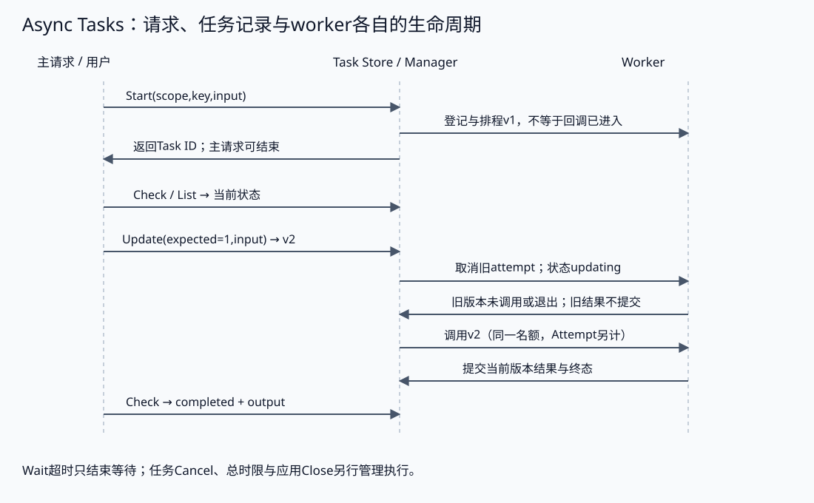
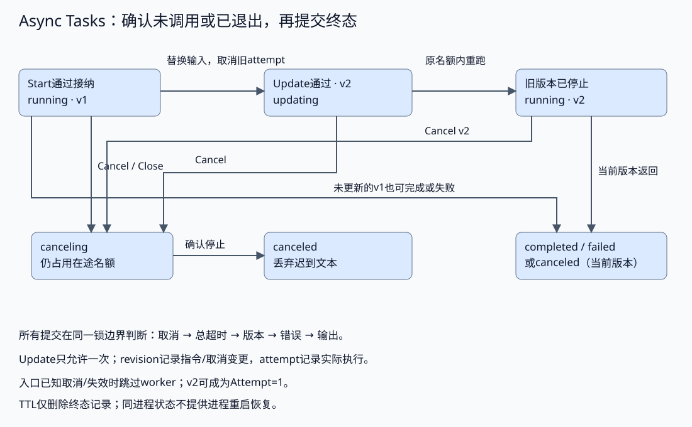

# 异步任务与生命周期管理

配套实验：[异步任务与生命周期管理实验](../../../../labs/part3-agent/chapter31/async-tasks/README.md)。

主请求返回后，长任务仍要支持查询、修改和取消。仅启动一个goroutine，无法说明任务归谁、目标是哪一版、迟到结果能否提交。

这与后台导出或长作业页面相似，但服务端必须独立保存任务状态。本章先建立身份与生命周期，再讨论控制请求、父子结果准入、取消竞争和资源回收。

这里的任务管理位于Runtime，start/check/update/cancel/list则是交给Product/Interface的控制契约。[Serving](chapter33-serving.md)负责认证与HTTP映射，Manager负责状态与worker寿命。先核对同进程的接纳、更新和退出，再讨论队列与跨实例恢复，不能因接口已经返回Task ID就推导任务已持久化。

## 请求、父任务与后台生命周期

<a id="topic-agent-async-tasks"></a>

### 主请求返回了，任务由谁负责

同步调用把结果作为本次调用的返回值；异步调用先返回任务ID，结果之后再收取。DAG中的两个worker可以并行，但调用方仍可以同步等待整个图结束。并行描述同时执行多少工作，异步描述调用方是否需要一直等待，两者不是同一个选择。

| 选择 | 调用方得到什么 | 适合的条件 | 新增责任 |
| --- | --- | --- | --- |
| 同步委派 | 本次调用的结果或错误 | 延迟可接受，不需要中途操作 | 超时、取消及失败传播 |
| 异步任务 | 稳定任务ID与接纳状态 | 请求不宜长时间等待，过程需要查询或调整 | 状态保存、所有权、结果收取、清理与恢复策略 |

是否异步不靠固定的“几秒钟”阈值判断。要看用户能否等待、网关和客户端的超时、是否需要中途交互，以及系统是否承担得起新增状态。快速查询保持同步通常更容易理解；长任务也可以先拆成可独立完成的阶段。

后台任务的context由应用生命周期与任务总时限管理，不能直接沿用已经返回的HTTP请求context。等待者离开只结束一次等待；显式取消任务与应用关闭才改变后台执行。另一类产品选择“连接断开就取消”，也可以成立，但应写成入口策略，不能由某个连接回调悄悄决定所有任务的寿命。



应用必须有关闭入口：停止接纳、取消活跃任务、等待worker退出、释放资源。若worker忽略context，Go无法强行杀掉它；把等待放进另一个goroutine并不能解决泄漏。

<a id="父任务结束后台工作怎样处置"></a>

**父任务结束，后台工作怎样处置**

父Agent取得任务ID后，可能继续回答、改变目标或被取消。后台工作仍存在时，应用要说明它是父任务的一部分，还是已经独立接纳的任务；否则用户看到“停止了”，系统却继续消耗资源。

| 生命周期策略 | 父任务结束后的处理 | 适用条件与责任 |
| --- | --- | --- |
| 跟随父任务 | 显式父取消传给子任务，再等待退出 | 子结果只为当前父目标服务；收齐与资源回收有明确责任方 |
| 独立任务 | 父调用结束，任务继续由自己的期限和入口管理 | 用户仍可查、改、停；保留ID、所有权与结果窗口 |
| 先确认再继续 | 在明确状态等待可信调用方选择继续或停止 | 等待有期限，未确认时不能自行扩充工具或预算 |

这几种策略与“浏览器断开”分开：连接断开可以只结束等待，也可以按产品规则触发显式取消，但不能靠丢掉父消息自动管理任务。若采用跟随父任务，取消信号还要到达后台执行者，确认退出后才释放名额；仅在主历史中写“已停止”无法完成这个契约。

结果返回时再核对它服务于哪版目标。父任务已改为“只看今年”，旧任务的成功文本即使能够查询，也不能自动加入新报告。应用需要保留父子关联与目标版本，决定弃用、重新验证还是启动新的工作；子任务的Revision只描述自身更新，不能替代父目标版本。

当前Manager提供独立任务寿命及显式Cancel/Close，Task没有Parent字段，也没有父任务注册表。父关联由应用持有；配套[结果准入](../../../../labs/part3-agent/chapter31/async-tasks/parent.go)在Start/Update返回任务快照时，将父目标版本与子任务版本绑定：

```go
type ParentGoal struct {
	ID       string
	Scope    tasks.Scope
	Revision uint64
}
type ChildBinding struct {
	parentID, taskID             string
	scope                        tasks.Scope
	parentRevision, taskRevision uint64
}
```

ChildBinding只供本应用持有，不从模型JSON或用户表单恢复；父目标快照也必须来自可信应用。ID和版本只是关联条件，不是身份认证。收取结果以后按以下顺序判断：

1. **核对父目标**：父ID、Scope与目标Revision仍匹配本次绑定；“只看今年”已经生效时，旧目标的完成结果不能自动使用。
2. **核对子任务**：ID与Scope来自本次Start/Update返回的任务，结果Revision与绑定一致；同一个Task ID更新后也需要新绑定。
3. **核对执行终态**：completed、无Failure且输出有界，才返回候选结果；running或失败不能被父Agent总结为成功。
4. **继续业务验收**：输出还需来源与目标检查，准入通过不能继承答案质量。

这里在一次应用调用中检查当前快照，没有将父目标存储、子任务更新与后续客户端交付组成同一事务。准入之后父目标又变更时，提交位置仍要明确如何复核。也不能把旧completed任务重新绑定到新目标来跳过验收；创建/重试的幂等身份应同时考虑父目标与子输入，重用旧结果另有明确条件。

该实验已验证旧父目标的迟到完成被拒绝、子任务更新后旧版本绑定失效。显式父停止还需要取消与收齐协议，不能从Start返回ID或一次AdmitChild通过推导。

<a id="父停止先关闭结果入口再取消本组子任务"></a>

**父停止先关闭结果入口，再取消本组子任务**

父方决定停止时，先在自己的状态中关闭结果准入或增加目标版本，再按原父快照与已有绑定取消旧工作。否则在取消信号发出之前，迟到结果仍可能进入当前报告。

[CancelBoundChildren](../../../../labs/part3-agent/chapter31/async-tasks/parent.go)只处理调用方提供的本组绑定，不关闭共享Manager：

1. **整批核对归属**：父ID、目标版本、Scope与childID不能混用；重复或无效绑定在任何取消前拒绝，列表最多8项。
2. **核对子版本再发送取消**：按绑定版本调用Manager.Cancel。子任务已经更新时报告冲突，不读取新版本后擅自重试；已经取消的同次操作可以继续等待。
3. **共享等待期限收齐**：先发送本组取消，再按同一context等待；已completed的任务只收取终态，不伪装为动作已撤销。
4. **保留未退出事实**：等待取消或到期返回错误，worker仍可能canceling并占名额。其他父任务的工作保持自己的寿命，不靠Manager.Close结束整个服务。

多个子任务的运行期取消不是一个事务：前一项取消已发生，后一项可能因版本竞争失败。调用方须查明各项状态并决定下一步，不能根据一个error推断全部未取消，也不能根据部分成功宣称已经收齐。结果准入关闭与取消操作由可信应用协调；这个函数不提供持久父账本或自动发现子任务。

受控示例验证本组取消后另一父任务仍可完成，以及停止等待时执行者继续占用名额。它不强行抢占worker，不撤销外部动作，也不实现跨服务收齐与进程恢复。

前面处理的是“父停止时，旧子任务怎样被关掉或拒收结果”。接下来再固定另一件更基础的事：这些任务身份和状态不能只靠聊天历史记着。

### 任务身份与状态不依赖聊天历史

任务ID如果只写在一条工具消息里，Context裁剪以后就难以找回。Task Store保存可查询的任务记录，Session保存对话，Context选择本轮模型输入；三者可以互相引用，但不能相互替代。

配套[Task定义](../../../../labs/internal/tasks/tasks.go)把身份、指令版本、尝试次数与结果分开：

```go
type Task struct {
	ID         string
	Scope      Scope
	Input      string
	Revision   uint64
	Attempt    int
	State      string
	Output     string
	Failure    string
	FinishedAt time.Time
}
```

- **ID定位任务**：一次更新不换ID；重建任务才产生新ID。
- **Scope限定可见范围**：由可信应用提供租户和用户，查询、更新、取消、列表都使用同一范围；知道ID不等于有权限。
- **Revision定位指令版本**：更新或取消改变版本，调用方带上读取时的版本，避免覆盖另一请求刚做的操作。
- **Attempt记录调用尝试**：一个任务可以因更新调用worker两次；未启动就失效的旧版本不计入，版本递增不等于新执行已经启动。
- **State描述执行事实**：结果、失败与结束时间属于记录，不能只从模型回复猜测当前状态。

这个Task只含值类型，Check返回副本。若后来加入map、slice或指针，需要同步设计复制或不可变快照；仅复制struct并不能隔离所有嵌套数据。

本章ID在同一Manager生命周期内稳定，进程重启后不恢复。持久服务还需存储任务、全局唯一身份或实例命名空间，以及恢复时的执行所有权；不能把教学示例的序号直接用作跨实例唯一ID。

## 提交、查询与控制协议

### 五个操作各自承诺什么

接口名方便记忆，真正重要的是它们的行为边界：

| 操作 | 输入与返回 | 必须保证的边界 |
| --- | --- | --- |
| Start | Scope、幂等键、输入 → 任务快照 | 接纳与登记一致；重复请求不能重复启动 |
| Check | Scope、ID → 当前快照 | 读真实状态，不从对话推测；未完成时不交付最终结果 |
| Update | Scope、ID、预期版本、新输入 → 新快照 | 明确替换、追加或下轮生效；拒绝旧版本覆盖 |
| Cancel | Scope、ID、预期版本 → 取消状态 | 请求取消与实际退出分开；不承诺撤销已发生动作 |
| List | Scope → 当前保留任务 | 隔离查询范围，提供找回ID的入口；不泄漏其他用户任务 |

<a id="start先接纳再启动"></a>

**Start先接纳，再启动**

接纳检查在启动worker之前完成。配套[Start](../../../../labs/internal/tasks/tasks.go)先处理重复请求，再检查容量：

```go
	k := startKey{scope, key}
	if id, ok := m.keys[k]; ok {
		r := m.records[id]
		if r.initial != input {
			return Task{}, ErrConflict
		}
		return r.task, nil
	}
	if m.active >= m.limit || len(m.records) >= 16 {
		return Task{}, ErrCapacity
	}
```

幂等键绑定Scope和**初始输入**。同键同输入返回已有任务；同键换输入拒绝，否则客户端因网络重试可能悄悄把另一项工作当作旧任务。更新也不改掉初始请求的幂等语义。即使系统已经满额，返回已有任务的重试仍不需要新名额。

随后在同一锁边界登记记录、增加在途计数，再启动goroutine。这样Check不会看到没有记录的任务，两个并发Start也不会同时通过容量检查。

示例最多8个在途任务、16条保留记录，输入与输出有字节上限；容量不足直接拒绝，没有隐含无界队列。生产服务可以加入有限等待队列，但应分别规定排队时限、队列容量、取消与公平性。字节上限也不能替代Token或费用预算。

<a id="check与list不负责猜进度"></a>

**Check与List不负责猜进度**

running只说明尚未提交终态，不证明已经查完多少资料。需要进度时，让worker提交有定义的阶段、计数或事件，注明时间与版本；不要由模型根据耗时编造百分比。

Check的结果是当前快照，返回以后状态可能变化。显示进度可以使用快照，修改任务必须携带Revision。任务完成后，主Agent拿到结果仍需校验来源、目标与权限范围，再决定是否用于回答；不能把后台返回的completed当作答案质量标签。

<a id="怎样查询才不会重新阻塞主流程"></a>

**怎样查询，才不会重新阻塞主流程**

Start返回以后立即重复Check，虽然没有阻塞单次调用，却把主Agent困在状态查询循环里。用户仍然无法获得控制权，模型和工具预算也在不断消耗。异步交互应先交付任务ID和当前已知状态，之后按用户请求或应用策略收取更新。

| 收取方式 | 适用情形 | 要管理的代价与边界 |
| --- | --- | --- |
| 用户询问时Check | 用户需要继续聊天，状态更新不频繁 | 说明快照版本；没有询问时不让模型持续查状态 |
| 应用定时查询 | 页面需要持续显示状态，暂未建立通知通道 | 查询间隔、总次数、截止时间与失败重试由应用控制 |
| 有期限地等待终态 | 调用方确实需要结果，允许保持一次等待 | 等待占用连接或调用资源；等待结束不等于任务被取消 |
| 事件或通知后回查 | 更新较多，已有可靠事件通道 | 处理丢失、重复与断线；事件触发回查，不凭旧事件覆盖新版本 |

例如50个活跃任务，每秒各查一次，理想情况下就是每秒50次查询；改为每5秒查询一次则是每秒10次。这只是查询次数估算，不是吞吐测量，还没有计入重试、多个客户端或模型调用。更长间隔减少请求，但用户看到变化会更晚；所有客户端同一时刻查询还可能形成突发。页面查询不需要每次都重新调用模型，模型也不需要决定固定的轮询间隔。

本地[Wait](../../../../labs/internal/tasks/tasks.go)等待任务退出信号，并接受单独的等待context。它适合应用内部有期限地收取终态，不是进度订阅，也不是已经实现的远程长轮询。用户希望继续交互时，不应把它直接放回主Agent的响应路径。

应用收取状态可以按以下顺序处理：

1. **保留身份与要求**：记录可信Scope、完整任务ID、父目标版本及当前子版本，不能只留一段聊天摘要。
2. **选择收取时机**：用户询问就查询；自动刷新则由应用设置有限预算，停止无变化的密集查询。
3. **区分等待与任务**：等待超时或连接断开时报告尚未取得终态；是否取消任务另按产品策略显式执行。
4. **核对新快照**：旧版本通知或迟到查询不能倒退当前视图；completed之后仍按结果准入和任务目标检查。
5. **结束本次收取**：取得终态、耗尽查询预算或用户关闭视图时停止等待，不无界地重新启动查询。

状态查询只能反映记录。任务长期running时，应检查是否等待资源、下游超时或worker未退出；增加查询次数不会让执行推进。当前Manager提供Check、List和本地Wait，定时查询、远程通知与断线恢复需要在Serving入口另行设计。

Revision也不是查询响应的全序号：同一输入版本可以先running、后completed。若远程查询响应倒序到达，仅比较Revision仍可能把已显示的终态改回running。客户端还要管理查询序列或服务端事件序号，并遵守同版本的合法状态转换；当前直接调用没有实现这份网络顺序协议。

前面讲的是怎样收取状态而不把主流程重新拖回轮询。接下来再看控制请求本身：Start、Update、Cancel 没确认时，为什么不能直接假设它们没发生。

### 控制请求没有确认，先查询再决定

用户提交“只看今年”以后连接断开，不能据此判断Update没有生效。服务可能已经登记新要求，只是成功响应没有到达。Cancel也一样：没有看到确认，后台仍可能已经进入canceling。

| 未确认的操作 | 可以怎样核查 | 不能怎样处理 |
| --- | --- | --- |
| Start | 在同一实例、Scope和去重窗口内，以原键及初始输入重试 | 换键再启动，或用更新后的输入改写原始请求身份 |
| Update | Check核对当前Input、Revision和State；若更新已登记，原版本重试会冲突 | 自动取得新Revision后再次覆盖，跳过其他调用方的修改 |
| Cancel | 查询当前版本与状态；canceling时继续等待退出，已完成时按完成事实处理 | 把取消响应当成已退出，或冲突以后新建任务来“恢复取消” |

以一次已启动的旧执行为例，交互过程应能解释清楚：

1. **读取旧快照**：ID保持不变，Revision=1，输入是旧要求。
2. **提交更新，确认缺失**：应用可能已经保存新输入并进入Revision=2/updating；旧worker仍在退出过程中。
3. **查询实际状态**：看到新输入与新版本，说明当前记录已经改变；保留更新等待，不再用旧输入另建工作。
4. **等待新版本结果**：旧worker退出后才开始新attempt，收到结果还须核对当前父目标、子版本和业务条件。

**版本冲突是状态需要重新判断的信号，不是自动重试许可。** 多个控制者存在时，Revision增加不能证明变更来自自己的那次请求；Input与State匹配也只说明当前快照相符。若远程应用必须确认某个控制请求是否成功，需要另外保存操作ID、请求摘要与确认结果，并定义去重窗口；本章Manager没有这份控制操作账本。

Start的幂等键绑定初始输入。任务已经更新后，以原键和原输入重试Start会返回当前任务快照，不把输入改回旧值；用同键和新输入Start则冲突。这是请求身份与当前状态的区别。清理或进程重启后，去重保证也不再成立，客户端必须保留对应窗口与实例边界。

Cancel用旧Revision重复可能返回冲突，查询若确认仍是同一版本的canceling，可以继续等待；直接调用本地接口时，用当前版本重复Cancel不会再次增加版本。确认完成的任务则不能靠取消撤回输出。配套实验主动丢弃本地成功返回值来验证这些状态契约，没有模拟真实HTTP链路或跨实例确认。

## 目标修订与结果准入

### 更新与完成竞争，谁能提交结果

Update至少有三种合理语义：向现有会话追加要求、等当前步骤结束后作用于下一步、取消旧执行后按新输入重跑。三者对历史、预算与工具结果的要求不同，接口不能只承诺“更新成功”。

本章采用**替换输入、中断旧attempt、串行重跑**。只读任务可以重做，但重复读取仍有延迟和费用；涉及外部副作用时，需要幂等和提交窗口，不能直接沿用此策略。一次任务最多接受一次更新，总超时覆盖全部attempt。

更新按以下顺序发生：

1. **读取并核对版本**：任务仍可更新，预期版本与当前版本一致。
2. **登记新要求**：替换Input、增加Revision，标为updating。
3. **取消旧attempt**：发送协作取消信号，保留在途名额。
4. **等待旧执行退出**：旧输出不允许提交为当前结果。
5. **启动新版本**：使用剩余总时限重跑，ID与名额保持不变。

[Update](../../../../labs/internal/tasks/tasks.go)将前面三步放在同一锁边界：

```go
func (m *Manager) Update(scope Scope, id string, expected uint64, input string) (Task, error) {
	if !validInput(input) {
		return Task{}, ErrInput
	}
	m.mu.Lock()
	defer m.mu.Unlock()
	r, err := m.lookup(scope, id)
	if err != nil {
		return Task{}, err
	}
	if m.closed {
		return Task{}, ErrClosed
	}
	if r.task.State != "running" || r.task.Revision != expected || r.task.Revision >= 2 {
		return Task{}, ErrConflict
	}
	r.task.Input = input
	r.task.Revision++
	r.task.State = "updating"
	r.cancel()
	return r.task, nil
}
```

Update返回updating表示新要求已经登记，不表示新执行已经开始。旧worker若不响应取消，任务会停留在这个状态，不会靠多启动一个worker“加速”更新。

完成也在同一锁边界判断。若旧执行先提交终态，Update被拒绝；若Update先登记，旧输出被丢弃并进入新attempt。两种先后都合法，关键是不能出现“接受了新要求，却交付旧结果”。

<a id="更新传的是完整目标还是一条追加指令"></a>

**更新传的是完整目标，还是一条追加指令**

原任务是“分析这些文档中的超时与重试，比较当前配置并标出来源”，用户补充“只看今年”。如果Update将Input直接改成“只看今年”，新worker取得的就只是一条筛选条件：要分析什么、怎样比较、需要哪些来源，都没有保留。

上面的实现执行`r.task.Input = input`，不会合并旧输入，也不维护子Agent的消息历史。调用层应将增量要求转为完整的新任务，再提交预期Revision。例如新要求仍包含分析对象、超时/重试两个目标、来源要求，并把资料范围收紧为今年。任务Scope、工具许可和总时限仍由应用绑定，不能从这段文字重新取得权限或预算。

| 更新契约 | 新执行看见什么 | 必须解决的问题 |
| --- | --- | --- |
| 替换完整输入，本实验采用 | 应用提交的新Input快照 | 保留仍有效的原目标，撤销不再适用的条件，避免只剩一句增量要求 |
| 向会话追加指令 | 原历史与新增消息 | 旧指令、已取得事实与新要求怎样选择，冲突和过期信息怎样处理 |
| 当前步骤之后应用变更 | 已登记但尚未生效的新版本 | 哪个步骤起生效，旧步骤结果能否进入新目标，暂停和取消怎样协调 |

[参考课程的异步子Agent章节](https://github.com/datawhalechina/deepagents-in-action/blob/main/content/ch06-async-subagents.md)描述了在同一thread上中断原run，再带会话历史和新增指令启动新run的方式；本实验没有这个会话服务。比较时关注输入保留、执行替换和结果归属，不因为两个接口都叫update，就假定它们能够交换调用代码或继承相同恢复能力。

增量整理也需要验证。用户把“所有资料”改为“今年”，旧年份结果不能因先前完成就继续交付；用户只修改报告长度，则已经取得且仍有效的资料可能继续使用，但应核对来源版本与目标。应用若无法确认哪些要求仍有效，可以先澄清，不让模型自行猜测并立即扩大执行范围。

本实验重跑只接收新Input，不自动复用旧观察。需要复用时，应另定义经过核对的事实输入及版本边界，区分已确认资料与旧目标下的草稿；同一任务ID保持关联，不能证明新旧目标等价。

前面区分的是“更新的输入语义是什么”。下一层再看执行边界：既然旧版本已经失效，worker 入口怎样尽早跳过不该再启动的尝试。

<a id="在worker入口跳过失效尝试"></a>

**在worker入口跳过失效尝试**

Start先登记任务，再由goroutine进入执行；返回running不代表worker已经调用。调度延迟期间，用户可能取消，任务总时限可能耗尽，也可能已经登记新的输入。只在worker返回以后拒绝结果，会让一个已经失效的尝试仍然开始工作。

[执行入口](../../../../labs/internal/tasks/tasks.go)在Manager锁下检查context、取消状态与关闭，再登记本次调用尝试：

```go
		invoke := ctx.Err() == nil && r.task.State != "canceling" && !m.closed
		if invoke {
			r.task.Attempt++
			snapshot.Attempt = r.task.Attempt
		}
		m.mu.Unlock()
		output, err := "", ctx.Err()
		if invoke {
			output, err = m.worker(ctx, snapshot)
		} else if err == nil {
			err = context.Canceled
		}
```

入口已经观察到取消或到期时，不调用worker，由已有分支提交取消或超时终态；旧context因Update失效时，先按版本进入新尝试。若旧版本从未调用worker，新版本可以是Attempt=1；若旧worker已进入调用，再重跑就是Attempt=2。计数对应调用边界，不按版本数量猜测执行次数。

这个检查不与后续函数调用原子绑定：取消仍可能发生在解锁后、worker调用前。worker和下游必须继续检查context，返回与提交边界也继续复核。入口检查负责跳过已经可见的失效，不提供强制抢占或外部动作撤销。

## 取消、超时与资源回收

### 取消不是立即消失，超时不是结果

Cancel先标为canceling并发送取消信号，执行器确认尚未启动或已有worker退出后，才提交canceled。**取消期间继续占用名额**：提前释放会让系统启动新任务，而旧任务还在使用连接、内存或Provider配额，实际并发量突破上限。



配套执行器在worker返回以后进行如下判定，后续分支只在前面没有成立时处理：

```go
		if r.task.State == "canceling" || m.closed {
			r.task.State = "canceled"
		} else if r.life.Err() != nil {
			r.task.State = "failed"
			r.task.Failure = "deadline_exceeded"
		} else if r.task.Revision != snapshot.Revision {
			ctx, r.cancel = context.WithCancel(r.life)
			r.task.State = "running"
			snapshot = r.task
			m.mu.Unlock()
			continue
		} else if errors.Is(err, context.Canceled) {
			r.task.State = "canceled"
			r.task.Failure = "worker_canceled"
		} else if errors.Is(err, context.DeadlineExceeded) {
			r.task.State = "failed"
			r.task.Failure = "worker_deadline_exceeded"
		} else if err != nil {
			r.task.State = "failed"
			r.task.Failure = "worker_failed" // Do not persist arbitrary err.Error() in a public task status.
		} else if output == "" || len(output) > 8192 {
			r.task.State = "failed"
			r.task.Failure = "invalid_output"
		} else {
			r.task.State = "completed"
			r.task.Output = output
		}
```

判定顺序承担不同职责：

1. **取消或关闭优先**：迟到文本不得把任务变回completed。
2. **检查任务总时限**：更新不能重置deadline；超时后的文本也不作为成功结果。
3. **检查指令版本**：旧版本返回以后才启动新attempt，二者不重叠。
4. **处理worker失败**：有错误时不保存残余文本，公开状态只带稳定分类。
5. **验证输出边界**：非空且未超字节上限才能提交completed，随后记录终态、释放名额并通知等待者。

这里是在协作边界观察context，不是能与物理时钟原子同步的硬实时保证。取消和结果提交的先后由锁排序；若完成已经提交，随后Cancel应返回冲突，调用方重新查询，而非把已经完成的结果伪装成撤回。

worker还可能使用自己的子context：外层任务尚未超时，子请求已经取消或到期。当前版本的包装Canceled记为canceled/worker_canceled，包装DeadlineExceeded记为failed/worker_deadline_exceeded；任务总时限则保留deadline_exceeded。两者都不提交残余文本，也不公开包装中的诊断。

版本更新判断先于这些worker错误。如果Update已经登记，旧attempt因协作取消返回，应该丢弃它并串行重跑新版本；不能把这次预期停止当作新任务失败。真正终态仍在worker退出后提交并释放名额。

Wait只是收取终态的辅助接口。Wait自己的context超时，任务可以继续；任务的总deadline超时，任务最终记为failed。把这两种超时混在一起，会造成用户刷新页面时无意终止后台工作。

前面固定的是单个任务怎样更新、取消和提交终态。最后再看这些终态离开执行期以后怎么办：保留多久、怎样清理，以及一旦跨进程就还缺哪些协议。

## 保留、清理与远程部署

### 结果保留、清理与远程部署

终态结果需要保留一个明确时间窗口，以便用户稍后查询；记录也不能无限积累。清理只处理已经退出的终态任务，不删除running、updating或canceling记录。

示例的Cleanup同时删除任务与幂等键。**TTL也是去重窗口**：清理后，同键Start属于新任务，会产生新ID；旧ID查询失败。需要更长的去重保证时，单独保留幂等墓碑或业务请求账本，不要误以为清理结果不会影响去重。

| 运行形态 | 可以得到什么 | 必须补齐什么 |
| --- | --- | --- |
| 同进程Manager | 短链路、直接调用、容易验证竞争 | 总时限、关闭、保留上限；进程退出后任务与记录丢失 |
| 独立服务与HTTP调用 | 主应用与执行服务分开部署 | 鉴权、网络重试、接纳确认、状态查询和断连语义 |
| 持久队列与worker | 任务可跨进程领取和恢复 | lease、重复投递、Checkpoint、结果提交、失联回收与版本所有权 |

把Manager包一层HTTP不会自动获得最后一行能力。接纳已成功但响应丢失时，客户端需要幂等重试；worker崩溃时，不能靠“running时间长”直接重复执行。Checkpoint解释执行到哪里，队列和lease决定谁有权继续，两者需要共同定义。

### 持久Worker需要把领取与提交接在一起

将同进程Manager换成数据库或队列，不只是替换存储容器。接纳要先保存Task、目标版本与原预算，再给客户端稳定身份；Worker领取后创建Attempt，在执行与提交边界核对当前所有权，通知只告诉调用方“有变化”，当前有效状态仍从权威存储读取。

| 交接 | 要防止的故障 | 必须共同验证的条件 |
| --- | --- | --- |
| 接纳后回复 | 已持久化但HTTP响应丢失导致重复派单 | 身份范围、幂等请求指纹和原Task绑定 |
| 领取与执行 | 两个Worker处理同一任务，旧执行者继续运行 | 领取代际、期限、任务版本及实际执行尝试 |
| 重投与恢复 | 把结果未知当作从未执行，重置调用预算 | 原提议/提交事实、已知/未知预留和受批准重做政策 |
| 结果提交 | 旧目标或过期Worker的迟到成功覆盖新状态 | 当前Owner/Epoch、目标版本、状态与结果在提交边界校验 |
| 状态与通知 | 结果已保存但通知丢失或重复 | 可重试发布、消费去重和查询兜底；通知不替代结果提交 |

续租失败必须停止后续接纳并关闭旧提交资格，不能仅凭客户端还在运行就认为租约有效。即使旧提交被拒绝，旧计算或外部读取仍可能已经发生；新Worker的恢复政策与全部尝试消耗要一并记录。

已有[SQLLease与次数预留](chapter31-collaboration.md#提交端怎样实际拒绝旧代际)可以验证局部提交资格，[Checkpoint](chapter29-execution.md#topic-agent-checkpoint)可以验证执行窗口，后端[任务队列](../../part2-backend/chapter15.md)解释持久投递。这些机制尚未联合成完整Agent Worker服务，续租、重投、稳定尝试、费用及通知必须在同一任务下做故障验证，不能将各自PASS相加得到恢复结论。

<a id="最佳实践"></a>

[实验排查与实践建议：最佳实践](../../../../labs/part3-agent/chapter31/async-tasks/README.md#book-agent-async-tasks-最佳实践)。

<a id="常见问题排查"></a>

[实验排查与实践建议：常见问题排查](../../../../labs/part3-agent/chapter31/async-tasks/README.md#book-agent-async-tasks-常见问题排查)。

## 小结

1. 后台任务独立于请求与聊天历史保存身份、目标版本和状态。
2. 提交、查询、更新、取消与列举各有契约，确认未知先查询而非盲目重试。
3. 父子结果绑定目标及版本，旧目标和失效worker不能提交新结果。
4. 取消是协作停止，超时保留未知，资源释放与结果保留分别管理。

## 参考文档

- [Go context](https://pkg.go.dev/context)：截止时间、取消传播与协作边界。
- [Go sync](https://pkg.go.dev/sync)：互斥与并发状态提交。
- [Go内存模型](https://go.dev/ref/mem)：goroutine之间的同步与可见性。
- [Deep Agents异步子Agent](https://github.com/datawhalechina/deepagents-in-action/blob/main/content/ch06-async-subagents.md)：对照独立任务状态和交互接口；其框架会话与更新策略不等同于本章Manager。

[返回全书目录](../../README.md) · [上一篇：多 Agent 协作与任务编排](chapter31-collaboration.md) · [下一篇：服务接入与流式交互](chapter33-serving.md)
