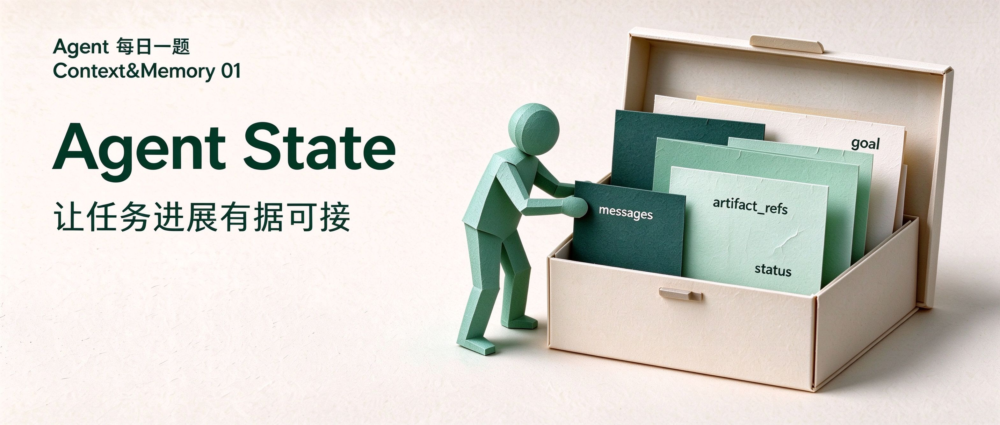

# Agent 每日一题｜Context&Memory 01：Agent State 应该存哪些内容？



# 有了计划，为什么换一轮又像重新开始？

假设我们让 Agent 更新产品帮助中心：对照旧版帮助文档和新版产品说明，整理差异清单、FAQ 草稿和来源映射，只保存草稿，不直接上线。

Agent 已经排好计划，也核对了部分差异。任务中途暂停，下一轮继续时，它却重新比较材料，还把“草稿已保存”当成“任务已完成”。

即使把聊天记录全部交给模型，它仍要从材料、错误、旧结论和新要求中辨认当前进展：哪些已经核验，哪些还没做，哪些要求仍然有效。

要接着完成任务，应用需要记录当前目标、有效材料、已有成果和剩余工作，让后续步骤据此行动。这些任务数据由 Agent State 管理。

# Agent State：把任务进展留成可用的数据

## 概念：State 记录哪些任务信息？

### State 是什么？

Agent State（运行状态）是应用在执行过程中维护的任务数据。它记录目标与约束、必要的消息和观察、产物引用，以及进度、验收结果和阻塞事项。后续步骤读取这些数据，判断接下来做什么，再提交更新。

State 的维护者是应用或 Harness，而不是模型。比如在 LangGraph 中，节点读取共享的 State，并返回需要更新的字段；框架再按字段规则合并，供后续节点使用。[1]

### State 记什么？

<mark>State 应保存后续步骤需要继续使用的任务数据。</mark>目标与约束、材料版本、产物地址、验收结果和待办，都属于这类信息。可直接推导的内容按需计算；长文档存放在外部，State 保留引用。

下面用四字段 schema（字段定义）展示基本形态，实际字段按任务需要扩展。[1][4]

```python
from typing import Annotated, Literal
from typing_extensions import TypedDict
from langchain_core.messages import AnyMessage
from langgraph.graph.message import add_messages

# 字段定义，运行时填值；可扩展来源、验收与阻塞信息。
class AgentState(TypedDict):
    goal: str  # 任务目标
    # 必要消息，按 add_messages 规则合并。
    messages: Annotated[list[AnyMessage], add_messages]
    # 产物名 → 地址；引用不证明文件存在。
    artifact_refs: dict[str, str]
    # 阶段声明不替代真实验收。
    status: Literal["working", "waiting_review", "done"]
```

### State 在模型调用中的位置

每次调用模型前，应用从 State 中选出本轮需要的消息、当前阶段和有效结果，根据引用读取必要材料，再组成模型请求。

下面是一次请求示意：tools 是独立的工具定义字段，messages 是消息列表。模型通过传入的消息和工具结果获取任务信息，应用也可以把当前进展整理成状态摘要。摘要采用什么角色、放在哪里，取决于具体实现。[1][7][8]

<section class="request-diagram"><p class="request-label">状态摘要在模型请求中的位置</p><section class="request-group"><p class="request-label">request.tools · 独立请求字段</p><p class="request-code">[read_file, ...]  // 工具定义的示意简写</p></section><section class="request-group"><p class="request-label">request.messages · 消息列表（结构示意）</p><p class="request-code">[</p><section class="request-group"><p class="request-label">系统指令</p><p class="request-code">{ role: &quot;system&quot;,
  content: &quot;你是帮助中心更新助手…&quot; }</p></section><section class="request-group"><p class="request-label">用户请求</p><p class="request-code">{ role: &quot;user&quot;,
  content: &quot;核对新版说明，先保存草稿，不上线。&quot; }</p></section><section class="request-group"><p class="request-label">工具调用 · 调用标识 tc1</p><p class="request-code">{ role: &quot;assistant&quot;,
  tool_calls: [{ id: &quot;tc1&quot;, function: read_file(...) }] }</p></section><section class="request-group"><p class="request-label">工具结果 · 与 tc1 对应</p><p class="request-code">{ role: &quot;tool&quot;, tool_call_id: &quot;tc1&quot;,
  content: &quot;新版说明的相关原文…&quot; }</p></section><section class="request-group"><p class="request-label">近期对话 · 中间历史省略</p><p class="request-code">{ role: &quot;assistant&quot;, content: &quot;草稿已保存，仍待核对。&quot; }
{ role: &quot;user&quot;, content: &quot;继续检查来源映射。&quot; }</p></section><section class="request-highlight"><p class="request-label">应用生成的状态摘要 · 高亮的是输入，不是完整 State</p><p class="request-code">{ role: &quot;developer&quot;, content:
  &quot;&lt;agent_status&gt;
   当前阶段：waiting_review
   剩余工作：核对来源映射
   用户约束：只保存草稿，不上线
   &lt;/agent_status&gt;&quot; }</p></section><p class="request-code">]</p></section></section>

图2：一次模型请求中的状态摘要位置示意

### State、Context、Memory 的区别

| 概念 | 应用 | 技术 |
| --- | --- | --- |
| Agent State<br>应用维护的当前任务数据 | 让后续步骤读取目标、观察、产物和进度，继续处理当前任务。 | State schema、字段合并规则；如 LangGraph StateGraph、reducers。[1] |
| Context<br>一次模型调用实际收到的输入 | 向模型提供本轮决策需要的状态和材料； | 消息组织、按需读取、检索与压缩；状态摘要是其中一种表达。[5][10] |
| Memory<br>跨会话可复用的信息 | 复用稳定偏好和持续项目背景，临时任务要求不自动转成永久规则。 | 按用户/项目组织存储与检索；如 LangGraph Store。[2] |
| 检查点<br>执行边界上的状态快照 | 从已保存的执行状态恢复同一线程或任务；外部文件与操作结果仍需复核。 | Checkpointer、持久存储、恢复重放与幂等设计。[2][3] |

可见，保存 State 和组织 Context 是两件事：前者保留任务数据，后者决定本轮把哪些内容交给模型。

## 代码示例：State 怎样更新？

以 langgraph 为例，下面一段 Python 代码演示 State 如何更新：

```python
# 演示局部更新、同 ID 消息替换，并保留待审核状态。
# 仅操作内存中的 State，不调用模型或读写外部产物。
from typing import Annotated, Literal
from typing_extensions import TypedDict
from langchain_core.messages import AIMessage, AnyMessage
from langgraph.graph import END, START, StateGraph
from langgraph.graph.message import add_messages
from langgraph.checkpoint.memory import InMemorySaver

class AgentState(TypedDict):
    goal: str
    messages: Annotated[list[AnyMessage], add_messages]
    artifact_refs: dict[str, str]
    status: Literal["working", "waiting_review", "done"]

def prepare_handoff(state: AgentState):
    # 引用只是候选产物地址，不代表文件已存在或通过验收。
    names = ", ".join(state["artifact_refs"])
    return {
        "messages": [AIMessage(
            id="handoff",
            content=f"目标：{state['goal']}；待核验产物：{names}",
        )],
        "status": "waiting_review",  # 不把准备交接当成完成。
    }

builder = StateGraph(AgentState)
builder.add_node("handoff", prepare_handoff)
builder.add_edge(START, "handoff")
builder.add_edge("handoff", END)
graph = builder.compile(checkpointer=InMemorySaver())
config = {"configurable": {"thread_id": "demo-state-01"}}

result = graph.invoke({
    "goal": "生成可审阅的帮助中心更新稿",
    "messages": [{"role": "user", "content": "先保存草稿，不上线。"}],
    "artifact_refs": {"draft": "artifacts/help-draft.md"},
    "status": "working",
}, config)
assert result["status"] == "waiting_review"

# 同一 ID 更新原消息；不会再追加一条 handoff。
graph.update_state(config, {
    "messages": [AIMessage(id="handoff", content="草稿仍待独立验收。")],
})
snapshot = graph.get_state(config)
assert len(snapshot.values["messages"]) == 2
assert snapshot.values["status"] == "waiting_review"
print("State 示例测试通过：字段保留、消息替换、待验收状态正确。")
```

# 小结

| 知识点 | 核心结论 |
| --- | --- |
| State 是什么 | 应用维护的当前任务数据。保存目标与约束、必要消息和观察、产物引用，以及进度、验收结果和阻塞事项，供后续步骤使用。[1] |
| 与 Context、Memory 的区别 | State 保存当前任务数据；Context 是本次模型调用收到的输入；长期 Memory 保存跨会话可复用的信息。数据已保存，不等于已传入模型。[1][2][5] |
| 长什么样 | schema 定义字段和类型，运行时填入当前值。本文四字段是入门示例，具体字段按后续决策、核验和恢复需要选择；长文档可放在外部，State 留引用。[1] |
| 怎么用 | 节点读取 State 并返回局部更新，框架按字段规则合并。应用另行检查权限和验收条件；恢复任务还要复核外部操作结果，不能只相信状态标签。[1][2][3] |
| 在模型调用中的位置 | 完整 State 在应用侧。应用选取本轮所需内容，组织成消息、材料和状态摘要供模型读取；工具定义另放 tools。摘要的角色与位置由具体实现决定。[1][7][8] |

# 回到开头：这份帮助中心任务怎样接着做？

这份任务应该从未完成的来源映射和审核继续。应用先取回已保存的差异清单和 FAQ 草稿，核对材料版本；版本一致且核验仍有效的部分可以沿用，不必从头比较。

为此，State 需要保存目标与“只保存、不上线”的约束、材料版本、草稿地址、已核验项和待办。应用读取这些信息后安排下一步，并在模型请求中说明“草稿已保存，来源映射仍待审核”。保存记录和完成条件分开，才能避免重复工作或过早宣布完成。

# 参考资料

[1] LangGraph：Graph API overview。State、reducers、add_messages 与 runtime context。<br>https://docs.langchain.com/oss/python/langgraph/graph-api

[2] LangGraph：Memory。线程级短期记忆、长期 Store 和检查点。<br>https://docs.langchain.com/oss/python/langgraph/add-memory

[3] LangGraph：Durable execution。恢复重放与幂等要求。<br>https://docs.langchain.com/oss/python/langgraph/durable-execution

[4] LangGraph：Thinking in LangGraph。客服邮件教学示例与状态设计。<br>https://docs.langchain.com/oss/python/langgraph/thinking-in-langgraph

[5] Anthropic：Effective context engineering for AI agents。按需加载、压缩与笔记。<br>https://www.anthropic.com/engineering/effective-context-engineering-for-ai-agents

[6] Anthropic：Effective harnesses for long-running agents。功能清单与进度交接。<br>https://www.anthropic.com/engineering/effective-harnesses-for-long-running-agents

[7] Codex 公开源码（提交 d84c872）：SessionState、时间提醒维护与消息角色。模型调用顺序见同一提交的 session/turn.rs。

https://github.com/openai/codex/blob/d84c872464aca4821dc5cb548a651651aefd84fa/codex-rs/core/src/state/session.rs

https://github.com/openai/codex/blob/d84c872464aca4821dc5cb548a651651aefd84fa/codex-rs/core/src/session/time_reminder.rs

https://github.com/openai/codex/blob/d84c872464aca4821dc5cb548a651651aefd84fa/codex-rs/core/src/context/current_time_reminder.rs

https://github.com/openai/codex/blob/d84c872464aca4821dc5cb548a651651aefd84fa/codex-rs/core/src/session/turn.rs

[8] Claude Code：Hooks reference。additionalContext 的注入位置、会话保存与恢复重放。

https://code.claude.com/docs/en/hooks

[9] Claude Code：Customize your status line。终端底部状态显示与本地脚本数据流。

https://code.claude.com/docs/en/statusline

[10] Claude Code：How Claude Code works。会话记录、上下文管理与压缩。

https://code.claude.com/docs/en/how-claude-code-works
