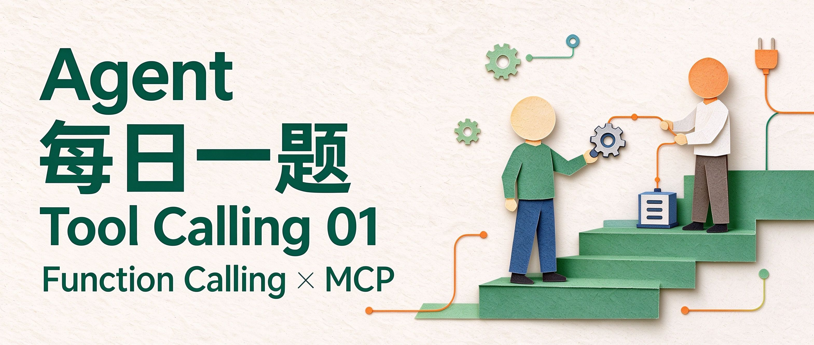
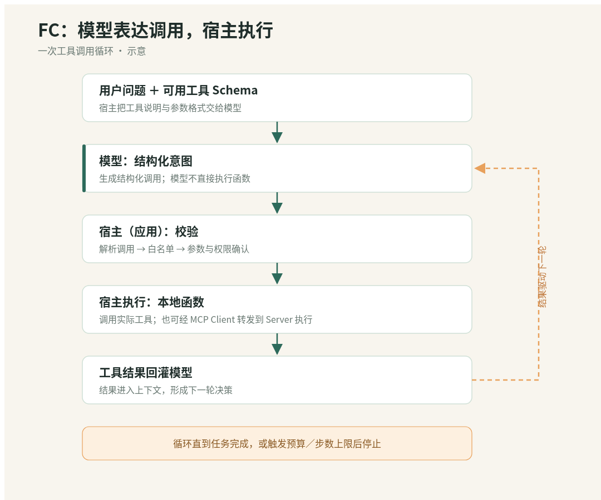
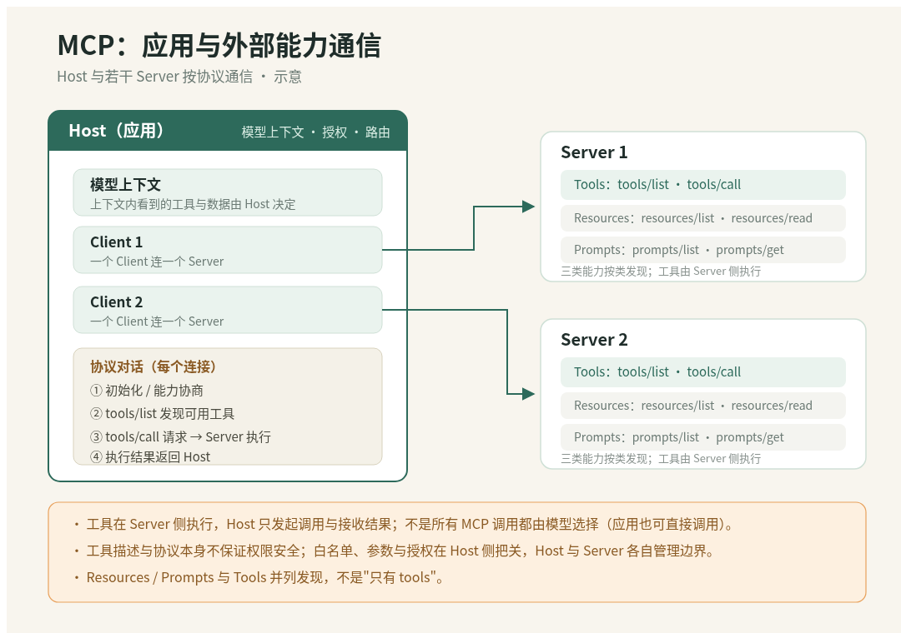

# Agent 每日一题｜Tool Calling 01：Function Calling 与 MCP 是什么关系？

# 一个多接了两个资料库的 Agent，为什么先卡住了？



上一道题里，我们做过一个选型报告：让 Agent 读完 A、B、C 三份资料，从部署方式、数据权限、运维成本三个角度做比较，最后附上来源。现在再加新要求：比较的时候顺手查两个新数据源——一个企业内部文档库、一个公开技术资料库，而且两边调用要带各自的权限。

听起来只是"多挂两个工具"。真动手时问题来了：三个数据源的参数格式不一样、鉴权方式不一样、返回的时间字段也不一样；工具描述散落在各自代码里，模型该先查哪个、怎么拼参数，每加一个都要重做一遍胶水。

这引出两件常被混在一起的事：**Function Calling** 管"模型怎么把一次调用说清楚"，**MCP** 管"工具和外部能力怎么被组织、怎么和应用通信"。前者是模型侧的标准动作，后者是 Agent 应用与外部能力之间的通信协议。

# Function Calling：让模型把意图说成一次调用

## 概念：模型只表达调用，宿主决定怎么执行

Function Calling（Tool Calling）的分工很清楚：模型不直接执行任何函数，它只输出一段结构化的调用意图——要调哪个工具、传什么参数；真正的执行由你的应用完成，执行结果再交回模型继续 [1][2]。也就是说，模型的产物是一段标准化的结构化输出，能调什么、传什么、要不要二次确认，全由应用这一层决定。

## 流程与实现：从用户一句话到结果回灌

一次完整的循环大致是：用户提问 → 应用把"可用工具清单+说明"连同问题给模型 → 模型输出结构化调用 → 应用解析、按工具 schema 校验、在白名单内执行 → 结果作为新消息回灌 → 模型基于结果继续。



```python
# 接口约定：pick_tool 返回结构化意图 {"kind":"tool",...} 或 {"kind":"final",...}；其他 kind 一律拒为非法。
# parse_call 解析 JSON 后按对应 tool.input_schema 做参数校验；allowlist 限定可用工具；预算耗尽即停。
# 注：本伪代码是抽象控制流（model.reply 为示意接口），不是某个 SDK 的可直接运行代码；
# 真实 API 中模型侧 tool_calls 与宿主侧 function call 结果消息的字段形式，以对应平台文档为准 [1]。
def fc_loop(question, tools, pick_tool, parse_call, allowlist, authorizer,
            execute_tool, budget=8):
    history = []
    for _ in range(budget):
        try:
            call = pick_tool(question, tools, history)   # 模型只输出意图文本
        except Exception as e:                           # 模型侧异常也作为观察，不死循环
            history.append({"type": "observation", "error": f"pick_failed:{e}"})
            continue
        kind = call.get("kind")
        if kind == "final":
            return call["answer"]
        if kind != "tool":                               # 非法 kind 直接拒收
            history.append({"type": "rejected", "reason": f"bad_kind:{kind}"})
            continue
        tool = next((t for t in tools if t.name == call["tool"]), None)
        if tool is None or tool.name not in allowlist:
            history.append({"type": "rejected", "reason": "tool_not_allowed"})
            continue
        try:
            args = parse_call(call["args"], tool.input_schema)   # JSON + schema 校验
        except ValueError:
            history.append({"type": "rejected", "reason": "bad_args"})
            continue
        if not authorizer.allow(tool.name, args):        # 工具级权限在宿主侧
            history.append({"type": "rejected", "reason": "unauthorized"})
            continue
        try:
            result = execute_tool(tool, args)            # 真正执行在宿主里
        except TimeoutError:                             # 超时也是观察，不崩
            result = {"error": "timeout"}
        history.append({"type": "observation", "call": call, "result": result})
    return "已达预算上限，未完成。"
```

注：代码只展示控制流；真实系统还要处理重试、鉴权失败与结果脱敏，不代表生产实现。

## 案例应用：多资料库查询为什么容易乱

回到开头的场景，如果每个数据源都手写一段工具描述、手写参数适配，工具一多，应用侧就要重复维护"怎么连、怎么鉴权、怎么把结果统一格式"。

Function Calling 在这里的价值就是：把"模型怎么表达一次工具调用"标准化了，剩下"这些工具描述从哪来、怎么统一发现、权限在哪一层收口"，就是 MCP 要接的问题。

# MCP：把"应用怎么和外部能力通信"标准化

## 概念：Host、Client、Server 三件套

MCP（Model Context Protocol）把"接一个外部能力"变成标准对话 [3][4]。Host 是你正在用的那个 Agent 应用；Client 是 Host 内部负责跟 Server 对话的一侧；Server 是把自己能力暴露出来的一方，其核心类型有三类：**tools**（可调用的函数）、**resources**（可读的数据）、**prompts**（预置提示模板）[4]；



要特别注意三点：

1. **工具是 Server 侧执行的**。Client 通过协议发调用请求，由 Server 自己执行工具并把结果返回；Host 这一层负责决定授权谁、路由到哪个 Server，而不是"Host 替 Server 执行函数"。
2. **不是每个工具都必须经过模型选择**。应用可以按业务逻辑确定性地直接调用某个工具，模型只在需要判断"这步该查什么"时才参与；平台侧内置的远程工具，也可能由平台直接执行后把结果喂给模型。
3. **标准协议并不能代替授权与业务语义实现**。它统一的是消息格式、能力发现与 schema 交换；字段语义不一致、权限怎么收口、哪些工具该给谁用，仍要在应用这一层设计。也不是所有数据源都该做成 Server：少量稳定的自家工具，直接用 Function Calling 往往就够了。安全上也不是每次调用都要人工弹窗，而是按授权范围确认，外部写入等高风险动作需要额外审批。

## 流程与实现：发现、声明、分发

以模型参与工具选择的场景为例，流程可分为五步：[[3]](https://modelcontextprotocol.io/specification/2025-06-18/basic/lifecycle)[[4]](https://modelcontextprotocol.io/specification/2025-06-18/server/tools)

1. **连接与初始化：**Host 创建 Client，连接目标 Server；Client 发送 `initialize`，双方确认协议版本与能力，再发送 `notifications/initialized`，进入正常通信。
2. **发现可用能力：**Client 按已声明的能力请求列表。工具通过 `tools/list` 获取名称、说明与 `inputSchema`；资源和提示模板走各自接口，列表有分页时继续读取。
3. **适配模型声明：**Host 筛选允许使用的工具，把说明和参数 schema 转成模型支持的格式，处理同名工具，再交给模型选择。**这一步是应用逻辑，不是 MCP 的必经步骤。**
4. **校验并分发调用：**模型输出工具名与参数；Host 校验权限、参数和路由，Client 用原始工具名发送 `tools/call`。Server 再做输入与访问控制检查，执行工具。
5. **返回结果并继续：**Server 返回结果或错误，Client 交给 Host；Host 检查、转换后传回模型，模型据此继续调用或生成回答。

下面 Python 伪代码把初始化与分页封装在 Client 中，重点展示 Host 如何发现工具、适配声明和分发调用。

```python
# 接口约定：client.list_all_tools() 封装初始化握手与分页；call_tool 用 MCP 原始 name。
# 模型侧只见安全 alias（tool_001）；dispatch 查 alias → client/tool，先校验 schema 与授权再发原始调用。
# 注：抽象骨架，不是某个 SDK 可直接运行的代码；真实协议另有握手、错误码与流式返回。
class McpHost:
    def __init__(self, clients, authorizer):
        self.authorizer = authorizer
        self.routes = {}                                # alias -> (client, tool)
        for c in clients:
            for t in c.list_all_tools():                # 初始化 + 分页由 client 内部处理
                alias = f"tool_{len(self.routes) + 1:03d}"
                self.routes[alias] = (c, t)

    def model_tools(self):                              # 喂给模型的声明：name=alias
        return [{"name": alias,
                 "description": t.description,
                 "inputSchema": t.input_schema}
                for alias, (c, t) in self.routes.items()]

    def dispatch(self, call):
        route = self.routes.get(call["tool"])           # 模型侧只认 alias
        if route is None:
            return {"type": "rejected", "reason": "unknown_tool"}
        client, tool = route
        try:
            args = parse_call(call["args"], tool.input_schema)
        except ValueError:
            return {"type": "rejected", "reason": "bad_args"}
        if not self.authorizer.allow(tool.name, args):
            return {"type": "rejected", "reason": "unauthorized"}
        result = client.call_tool(tool.name, args)      # 用 MCP 原始 name 调，Server 执行
        return {"type": "observation", "result": result}
```

注：新版协议的接入方式已有变化，实现应以实际使用版本为准（[版本说明](https://modelcontextprotocol.io/specification/latest/basic/lifecycle)）

## 案例应用：多资料库的 MCP 接法

把两个新数据源各接成一个 MCP Server，变化是：Server 自己声明能力，Host 用统一的发现接口建目录；同名工具在路由表里用安全 alias 区分；授权收口在 authorizer 一处。

模型那一侧要做 schema 适配、结果类型转换，但整体循环结构不变——变的是"工具从哪来、谁维护"。

反过来，如果团队只有两三个稳定内部工具，直接 Function Calling 也是合理选择。

# 小结

两者可以配合使用，不是互相替代的方案：**Function Calling 让模型表达调用，MCP 约定应用如何与外部能力通信。**

| **技术** | **特性** | **适用场景** | **工程边界** |
|-|-|-|-|
| **Function Calling** | **模型只表达调用，应用决定怎么执行。**  <br/>模型输出工具名与参数，应用执行后把结果交回模型。[[1]](https://platform.openai.com/docs/guides/function-calling) | 让 Agent 查询资料、调用内部脚本等，需要模型根据任务选择工具的场景。  <br/>少量稳定的自家工具，可直接向模型注册工具声明，由应用实现执行，无须先接 MCP。 | **调用先受检：**校验工具白名单、参数 schema 与权限；模型输出调用不等于获准执行。  <br/>**结果要回灌：**把执行结果、错误与拒绝原因传回模型；设置超时、重试与总预算。  <br/>**写入要受控：**由应用按授权范围判断，高风险动作另行确认，不把执行权交给模型。 |
| **MCP** | **把应用怎么和外部能力通信标准化。**  <br/>Host 通过 Client 与 Server 通信；tools、resources、prompts 按类发现，工具由 Server 执行。[[3]](https://modelcontextprotocol.io/specification/latest)[[4]](https://modelcontextprotocol.io/specification/2025-06-18/server/tools) | 团队有多个文档库、工单系统等，希望在不同 Agent 应用间复用连接能力，减少重复开发连接器。  <br/>需要模型选择工具时，可把发现的工具适配成模型声明，与 Function Calling 配合；应用也可按业务逻辑直接调用。 | **协议不替代业务实现：**鉴权、业务权限与字段语义仍需设计，不能靠接入 MCP 自动统一。  <br/>**路由要明确：**区分跨 Server 的同名工具，适配模型工具名限制；用别名映射回原始工具名调用。  <br/>**职责要分清：**Host 管授权与路由，Client 发请求，Server 执行工具；并非每次调用都必须由模型选择。 |

# 回到开头：多接两个资料库，该先动哪一层？

正面回答：先看工具数量与稳定性。少量稳定的自家工具，直接 Function Calling 往往就够了；外部能力多、来源杂、要按团队复用，再考虑 MCP，让 Server 自己声明能力、Host 统一授权。一句话收个尾：**MCP 约定 Agent 如何与外部能力通信，Function Calling 让模型表达调用。**

# 参考资料

1. OpenAI. Function calling guide. https://platform.openai.com/docs/guides/function-calling
2. Azure. Function calling with the OpenAI service. https://learn.microsoft.com/en-us/azure/foundry/openai/how-to/function-calling
3. MCP Specification（最新版入口）. https://modelcontextprotocol.io/specification/latest
4. MCP Specification. Tools. https://modelcontextprotocol.io/specification/2025-06-18/server/tools
5. OpenAI Agents SDK. Tools. https://openai.github.io/openai-agents-python/tools/
