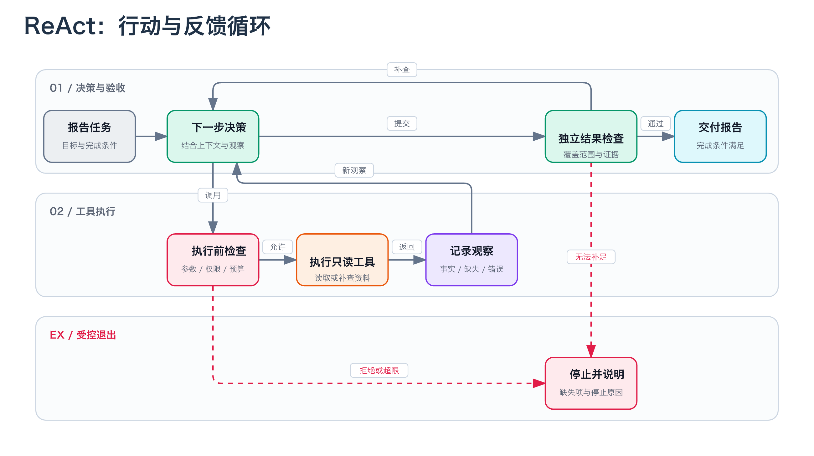
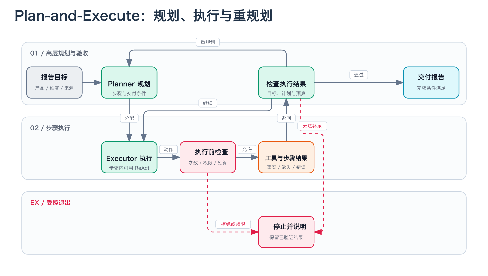

# Agent 每日一题 001｜ReAct 和 Plan-and-Execute，到底怎么选？

你要做一个 Agent：读取三份产品说明，对比部署方式、数据权限和运维成本，写出一页带来源的选型报告。

任务看似简单，执行时却遇到麻烦：A 的权限说明缺了一段，B 的资料读取超时，C 的两份文档互相矛盾。接下来，是继续执行原计划，还是先补查缺失信息？

这就是今天的问题：**ReAct 和 Plan-and-Execute 有什么区别，业务里怎么选？**

## 先抓住一个区别：决策怎样组织

ReAct 把推理与行动交错起来，让观察结果参与后续决策；Plan-and-Execute 把高层计划与步骤执行拆开，由不同职责的组件处理。

前者强调行动与反馈的循环，后者强调规划与执行的分工。它们可以组合，不能简单理解成“一个会思考，一个只会照做”。

## ReAct：让反馈进入下一步决策

ReAct 中的 Re 和 Act 分别对应 Reasoning 与 Acting。原论文讨论了如何在交互过程中利用推理整理信息、形成或调整计划，再通过行动获取新的观察。**因此，ReAct 并不意味着没有计划。**[1]

回到报告任务。一条教学轨迹可以是：读取 A 的说明，发现权限信息不全，补查权限章节，再决定继续读 B，还是先核实 A 的适用条件。

这里的重点是：后续动作取决于已经获得的信息。下图把这种关系画成反馈循环；它是控制流程示意，不是某次模型的运行记录。

工程实现还要把两件事分开：模型提出动作，程序负责检查并执行。模型说“继续搜索”，不代表工具就必须无限执行；模型说“完成了”，也不代表报告满足了要求。

## Plan-and-Execute：把大任务拆成有验收条件的步骤

同一个报告任务，可以先制定四步计划：读取资料、抽取事实、比较差异、校验报告。Planner 负责组织步骤，Executor 负责完成当前步骤，再根据结果决定继续、调整或结束。[3]

计划最好不只写“分析产品”。可以写成：“抽取 A/B/C 的三个维度，每项附资料位置，缺失内容标为未知。”这样，执行器才有明确的交付物，检查器也知道该检查什么。这是本文对案例的工程设计建议。

还要注意版本差异：LangChain 2023 年介绍的初版没有重访计划，2024 年示例则包含重规划。本文图示采用带重规划的教学版本，而非宣称所有实现都相同。[2][3]

执行器内部也可以使用 ReAct 式循环：上层分配“核实 A 的权限范围”，下层再根据工具反馈决定具体查哪一段。分工的粒度不同，并不妨碍组合。[2]

## 业务里怎么选？先检查任务结构

下面是面向这个案例的选型检查表，不是性能排行榜。

| 判断问题 | 可考虑的方向 |
| --- | --- |
| 下一步需要什么信息，必须做完当前动作才知道？ | 从较小的反馈循环开始验证 |
| 任务能否拆成输入、输出和完成条件清楚的步骤？ | 尝试显式计划与步骤执行 |
| 大步骤明确，但每一步内部充满不确定性？ | 上层计划，步骤内逐步决策 |
| 流程完全确定，只需按固定顺序处理数据？ | 先评估普通工作流是否足够 |

例如，探索一组陌生资料时，很难预先知道要补查哪些概念，可以先验证逐步决策。若每周都要按相同维度生成报告，显式列出步骤和交付物，可能更方便定位遗漏。这些是待任务数据检验的设计假设。

不要直接写“ReAct 更快”或“规划更省钱”。一个系统可能反复调用同一个大模型，另一个则把步骤分配给小模型或确定性程序；重试和工具延迟也会改变结果。

比较时应固定任务集、工具权限和预算，分别记录完成率、总耗时、调用次数与费用。检查失败样本往往更有用：到底是没查到证据、计划漏了维度，还是答案没有引用来源？

## 出错以后：先分清重试、重规划和停止

给报告案例设定三个故障，可以检验设计是否完整。以下是预期处理方案，不是已经执行过的实验。

**B 的资料读取超时：先判断当前动作能否重试。**

如果它是只读请求、错误可能是暂时的，而且还有时间和调用预算，可以有限重试。持续失败则记录资料缺失，不能把读取失败写成“该产品没有此功能”。若工具会产生外部写入，还必须先处理重复执行风险。

**C 的两份资料矛盾：检查计划假设是否仍成立。**

原计划若假设每个维度都只有一个确定答案，此时就需要增加版本、适用范围或来源核对。预算不足以消除矛盾时，应保留分歧。换一种措辞生成同样的结论，不算解决了冲突。

**同一检索重复出现：由执行层阻止空转。**

可以记录工具名、参数和结果摘要，检测持续没有信息增量的重复动作。上限必须由程序执行，不能只在提示词里请求模型自觉遵守。

例如，为这个教学案例暂设最多 8 次工具调用、单次故障最多重试 1 次、最多重规划 2 次。这些数字只是演示参数，生产阈值应根据真实任务与预算决定。到达上限时，返回已验证的结果、缺失项和停止原因。

“写出一段流畅文字”不是完成条件。这个报告至少要覆盖三种产品和三个维度；事实有来源，缺失项和矛盾项被明确标出。检查通过，才能认为交付完成。

## 面试官还会追问什么？

**1. 执行到一半失败，要重试还是重规划？**

先区分动作失败与计划失效。临时超时可能适合重试；目标、依赖或关键假设变化，才需要调整计划。权限不足、预算耗尽则可能要求停止。

**2. 为什么不每一步都重新规划？**

可以这样设计，但要检验是否值得。记录重规划带来的有效调整、额外调用与总耗时。如果每次都重写一份几乎相同的计划，就应审视触发条件。

**3. 怎么证明 Agent 真的完成了？**

先定义可检查的交付条件，再验证结果。用独立于“模型宣布完成”的检查逻辑核对覆盖范围、证据和未知项；检查不了的部分应交给人确认。

## 30 秒面试回答

ReAct 让推理和行动交错，根据工具反馈决定后续动作；Plan-and-Execute 把高层规划与步骤执行拆开，也可加入重规划。我会先看任务能否明确拆分，以及新信息是否经常改变路径。大步骤清楚、内部探索性强时，可以组合两者。无论哪种方案，都要定义完成条件、限制调用预算，并区分工具重试和计划失效。

## 留一个练习

给本文的报告任务写出三条完成条件，再设计一次“资料矛盾”的输入：Agent 应补查什么，何时停止，最终怎样向用户说明？先把这些规则写清，再考虑选择哪个框架。

## 参考资料

[1] Yao 等，ReAct: Synergizing Reasoning and Acting in Language Models，arXiv v3，2023-03-10。参见第 1、2 节，理解推理、行动、观察与计划调整的关系。
https://arxiv.org/html/2210.03629v3

[2] LangChain，Plan-and-Execute Agents，2023-05-10。参见 Implementation 与 Future Directions，了解初版的职责划分和限制。
https://www.langchain.com/blog/plan-and-execute-agents

[3] LangChain，Plan-and-Execute Agents，2024-02-13。参见 Plan-And-Execute，了解包含重规划的示例架构。
https://www.langchain.com/blog/planning-agents

本文案例、流程图与故障处理方案为教学设计，不代表真实产品对比或已测量的性能结果。来源中的历史架构示例不构成当前 SDK API 用法保证。
