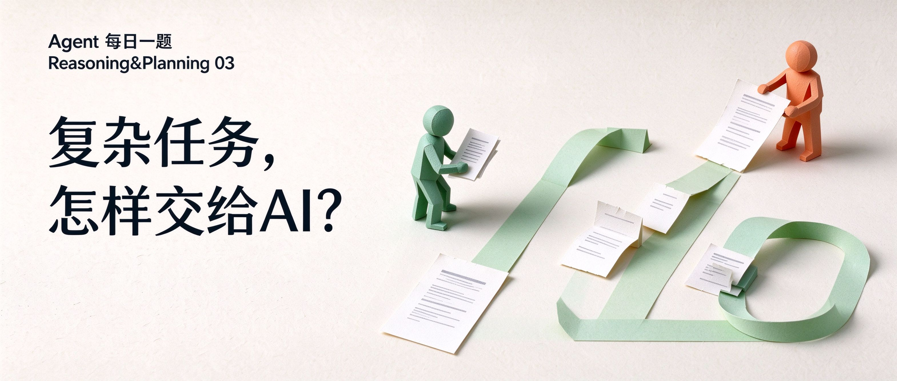
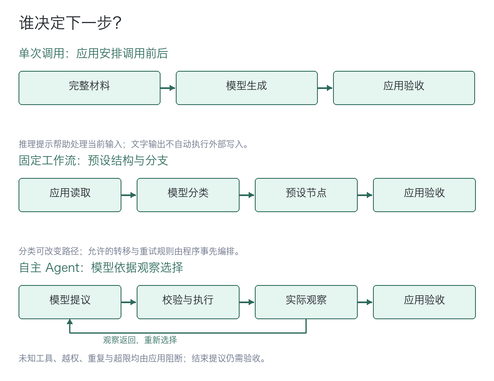
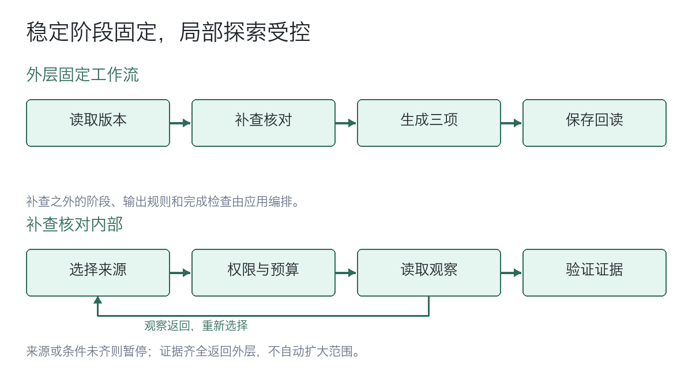

# Agent 每日一题｜Reasoning&Planning 03：复杂任务的 Agent 设计：提示工程、工作流编排与自主智能体



# 设计一个智能体，哪些决定该交给模型？

假设你正在设计一个帮助中心更新智能体（Agent）。它读取旧帮助文档与新版产品说明，识别受影响的内容，交付差异清单、FAQ 草稿和来源映射。

读取与写入工具已接入，输出数据结构和验收标准也已确定。要让这些环节衔接起来，需要厘清提示工程、工作流编排与自主智能体各自承担什么职责。

# 先分清：提示工程与执行架构

<mark>提示工程（Prompt Engineering）</mark>通过指令、示例、分隔结构和输出约束等方式设计模型输入。面向推理任务的提示设计，既可用于单次调用，也可用于工作流节点或智能体循环。CoT 提示（Chain-of-Thought Prompting，思维链提示）是其中一种具体方法。

<mark>工作流编排（Workflow Orchestration）</mark>由应用组织大语言模型（LLM）与工具的调用。Anthropic 的架构区分：预设工作流的节点、转移规则和终止条件由程序定义，运行时仍可包含分类路由、反馈循环和动态子任务。例如，拆分、分发和汇总的结构由程序确定，具体子任务可以由模型生成。[1][4]

<mark>自主智能体（Autonomous Agent）</mark>由模型结合目标与环境观察（Observation），在可用工具和许可范围内选择后续动作。环境观察是工具调用或执行过程实际返回的信息，模型提出动作后，应用仍要校验提议、执行工具并反馈结果。注意，自主程度描述的是行动选择的范围，权限始终由应用限制。[1]



图1：谁决定下一步？

<mark>提示工程与执行架构是两个设计层面，可以组合使用，不能当作同一层的互斥方案。</mark>任务规划（Planning）用于任务分解和执行安排；ReAct 将推理与行动交错，用环境观察支持后续判断。预设工作流可以包含规划节点，自主智能体也可以在固定阶段内运行 ReAct 式循环。

值得注意的是，无论采用哪种架构，调试时都应保留执行轨迹（Trace）：模型输入与输出、工具调用及其结果，以及校验和停止原因。这些记录帮助开发者定位失败，无需公开模型的隐藏思维链。

# 提示工程：把比较要求落实到模型输入

提示工程把任务目标、材料和输出要求组织成模型输入，告诉模型要处理什么、按什么要求作答。它既能用于单次调用，也能用于工作流中的模型节点。<mark>提示设计模型输入，程序组织调用与工具执行。</mark>

在帮助中心案例中，若新旧文档和附录已齐全，且材料、指令与所需输出能在上下文窗口内处理，可以先做一次比较。提示可以写得具体：对照新旧版本列出变化，生成受影响的 FAQ，并为每条修改建议注明来源文档和段落；依据不足就标为待确认。这里，材料提供比较依据，输出要求让候选稿便于核对。

先用代表性样例检查遗漏和来源支持，把这次调用作为基线；通过验收的候选稿再由程序保存、回读。如果长文比较反复漏项，或需要分别检查差异抽取、FAQ 生成和来源核验，就把这些职责拆成独立步骤，即让程序安排每一步的输入、输出和衔接。

# 工作流编排：把更新任务拆成可检查的步骤

沿着这个思路，帮助中心更新可以拆成一条工作流：读取指定版本 → 抽取差异 → 生成 FAQ → 校验来源 → 持久化并回读。工作流编排，就是由程序安排这些步骤怎样连接：差异清单交给生成环节，候选 FAQ 交给核验环节，核验通过才能保存。

<mark>工作流的控制权在程序：模型处理指定环节，程序安排步骤衔接与工具执行。</mark>工作流也可以有分支和反馈，例如，先让模型判断哪些帮助主题受影响，再由程序送到对应的处理节点；或者，让模型列出要修改的子任务，由程序分发并汇总。

不过，步骤安排清楚了，材料范围仍可能不够。假设程序只读取两份指定文件，而新版说明把企业版策略放在另一份附录，就会漏掉依据。如果附录链接和版本规则稳定，程序增加引用遍历与版本校验就能处理这类情况。难的是另一种情况：要读完当前资料，才知道缺什么、该到哪里补查。

# 自主智能体：让模型决定还需要查什么

继续看这个信息缺口：模型读到企业版说明与通用说明冲突，需要先核对版本附录，才能判断 FAQ 该采用哪种说法。下一次读取什么，取决于这次读到了什么，如果这类判断难以可靠写成规则，就可以让模型在许可范围内选择补查动作。这是自主智能体在这个案例中承担的工作。

<mark>模型依据观察选择下一步动作，应用负责校验与执行。</mark>应用把“提出动作、执行读取、反馈结果”接起来，形成智能体执行循环（Agent Loop）：

1. 应用把目标、已读证据、可用工具和资源上限交给模型，例如要求核对企业版与通用说明的冲突。
2. 模型提议下一步：读取版本附录、提交候选稿，或请求补充条件。
3. 应用检查动作类型、工具名、参数和来源授权，再执行读取；越界或没有进展的重复调用应被阻止。
4. 实际读取结果作为观察反馈给模型。证据仍不足就继续核对或暂停，预算耗尽则终止；模型提议完成时，应用仍要验收候选。

在这个循环里，整理模型输入、检查动作和执行工具，都是应用侧的工作，本文统称为运行层。帮助中心任务的工具权限、预算、停止和验收规则，都要在这一层落实，不能只在提示中要求模型遵守。

```python
# 只读教学循环：模型适配器提议动作，应用校验并执行。
# choose/read/verify 是可信回调；数据须可复制，deepcopy 不是沙箱。
# read 适配器校验响应格式、大小和超时；verify 核对来源与内容。
# 仅固定来源，不自动发现新资料；返回 draft 后另行保存、回读。
from collections.abc import Mapping
from copy import deepcopy


def collect_draft(choose, tools, verify, known_ids, max_turns=6):
    if type(max_turns) is not int or not 1 <= max_turns <= 20:
        raise ValueError("无效轮次预算")
    if not isinstance(known_ids, (list, tuple, set, frozenset)):
        raise ValueError("来源范围必须是明确的 ID 集合")
    if any(not isinstance(s, str) or not s.strip() for s in known_ids):
        raise ValueError("来源 ID 必须是非空字符串")
    if not isinstance(tools, Mapping):
        raise ValueError("工具注册表无效")
    read = tools.get("read")  # 固定应用注册的回调，模型不能替换
    if not all(callable(fn) for fn in (choose, read, verify)):
        raise ValueError("决策、读取与验收回调必须可调用")
    allowed, read_ids = frozenset(known_ids), set()
    observations = []
    for _ in range(max_turns):  # 包含提交候选；不替代超时和费用预算
        try:
            action = choose(deepcopy(tuple(observations)), allowed)
            if not isinstance(action, dict):
                return {"status": "pause", "reason": "动作格式错误"}
            kind = action.get("kind")
            if kind == "pause":
                return {"status": "pause", "reason": "需要补充条件"}
            if kind == "draft":
                if "value" not in action:
                    return {"status": "pause", "reason": "候选字段缺失"}
                draft = deepcopy(action["value"])
                accepted = verify(deepcopy(draft), deepcopy(tuple(observations)))
                if accepted is True:
                    return {"status": "draft", "value": draft}
                return {"status": "pause", "reason": "候选未通过验收"}
            source = action.get("source")
            if (kind != "read" or not isinstance(source, str)
                    or source not in allowed or source in read_ids):
                return {"status": "pause", "reason": "越界或重复动作"}
            result = read(source)
            observations.append((source, deepcopy(result)))
            read_ids.add(source)
        except Exception:
            # 回调或复制失败均停止；生产环境另记脱敏诊断，不盲目重试。
            return {"status": "pause", "reason": "回调或数据处理失败"}
    return {"status": "pause", "reason": "轮次预算耗尽"}
```

# 组合使用：在工作流中嵌入局部自主智能体

上一节的自主智能体循环，可以嵌入预设工作流，而不必接管整个任务。组合时，先看给定材料能否支持任务完成、补查路径能否可靠编排，再评估模型依据观察选择动作是否带来可测收益。

发现信息缺口时先补充证据，若程序能够可靠获取这些信息，就不必为此引入自主智能体。<mark>稳定步骤由程序编排，依赖观察且难以预设的补查判断交给局部智能体</mark>。

在帮助中心案例中，可以组合使用工作流编排和局部自主智能体：外层工作流安排版本读取、产物校验、持久化和回读；局部自主智能体只参与补充检索与冲突核对，模型提议下一步读取什么，运行层检查并执行，同时限定工具集合、来源范围、资源预算和终止条件。



图2：稳定阶段固定，局部探索受控

这套组合方案上线前还需要验证：局部自主补查能否更好地补齐信息缺口、核对资料冲突，以及这些改善是否值得额外成本。评估可从以下四点展开：

1. **比较条件：**用同一组代表性任务比较单次调用、预设工作流与局部自主方案，保持初始资料、工具能力和资源上限一致。
2. **产物质量：**检查受影响的内容是否覆盖，差异清单和 FAQ 是否有来源支持。
3. **失败表现：**记录各方案的失败类型，看信息遗漏、来源不足或冲突未解决等问题出现在哪个环节。
4. **时间与费用：**记录模型调用、工具调用、端到端耗时和费用；智能体为取得新观察而增加的调用与读取成本也要计入。

# 小结

| 设计层面 | 适用条件 | 控制方式 | 验证重点 |
| --- | --- | --- | --- |
| 提示工程 | 用于各类调用；单次基线需资料齐全、输入可容纳 | 设计当前模型输入；调用前后由应用安排 | 模型输出有无遗漏、来源是否支持；持久化另行执行 |
| 工作流编排（预设控制流） | 节点与转移规则能可靠编排 | 程序约束结构，可含路由、反馈与动态子任务 | 异常覆盖、结构校验与内容验收 |
| 自主智能体 | 观察影响后续动作，路径难以预设 | 模型在许可范围内动态提议动作 | 授权、预算、无进展终止及完成条件 |

# 回到开头：这个帮助中心智能体怎样设计？

提示工程设计模型输入，执行架构决定调用与动作怎样组织。

这个帮助中心智能体可以先验证简单方案，由程序读取版本明确的资料，用单次模型调用生成差异清单、FAQ 草稿和来源映射；需要分段处理时，再拆成工作流节点，能够按索引遍历的补充检索由程序完成，产物经过校验后保存并回读。

只有补充检索对象取决于当前观察、且路径难以可靠预设时，才在该环节加入受控智能体循环。模型提议读取对象，运行层检查授权范围并执行；证据不足或版本冲突未解决时暂停。是否增加自主决策，要评估任务结果能否改善，以及额外的成本和风险是否值得。<mark>三项产物通过验收，保存后回读一致，就是这个案例的完成条件。</mark>

# 参考资料

[1] Anthropic：Building effective agents（2024年架构分类文章；当前页面已提示工具生态变化）。https://www.anthropic.com/research/building-effective-agents

[2] Wei等：Chain-of-Thought Prompting Elicits Reasoning in Large Language Models（arXiv v6）。https://arxiv.org/html/2201.11903v6

[3] Yao等：ReAct: Synergizing Reasoning and Acting in Language Models（arXiv v3）。https://arxiv.org/html/2210.03629v3

[4] LangGraph：Workflows and agents（路由、动态子任务及Agent循环示例）。https://docs.langchain.com/oss/python/langgraph/workflows-agents

[5] Claude Code：How Claude Code works（循环、工具与模型外运行层）。https://code.claude.com/docs/en/how-claude-code-works

[6] OpenAI：Reasoning best practices（推理模型的提示建议；具体适用范围以文档为准）。https://developers.openai.com/api/docs/guides/reasoning-best-practices

[7] OpenAI：Safety in building agents（Agent Builder风险与防护建议）。https://platform.openai.com/docs/guides/agent-builder-safety
