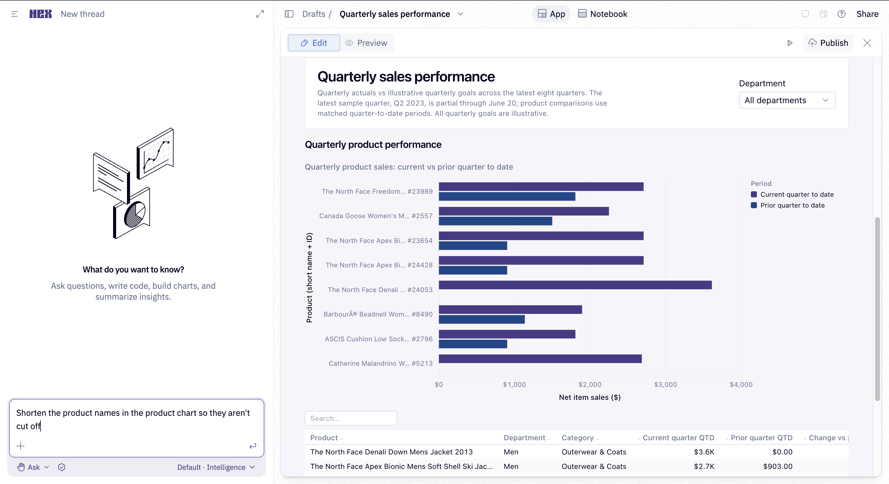
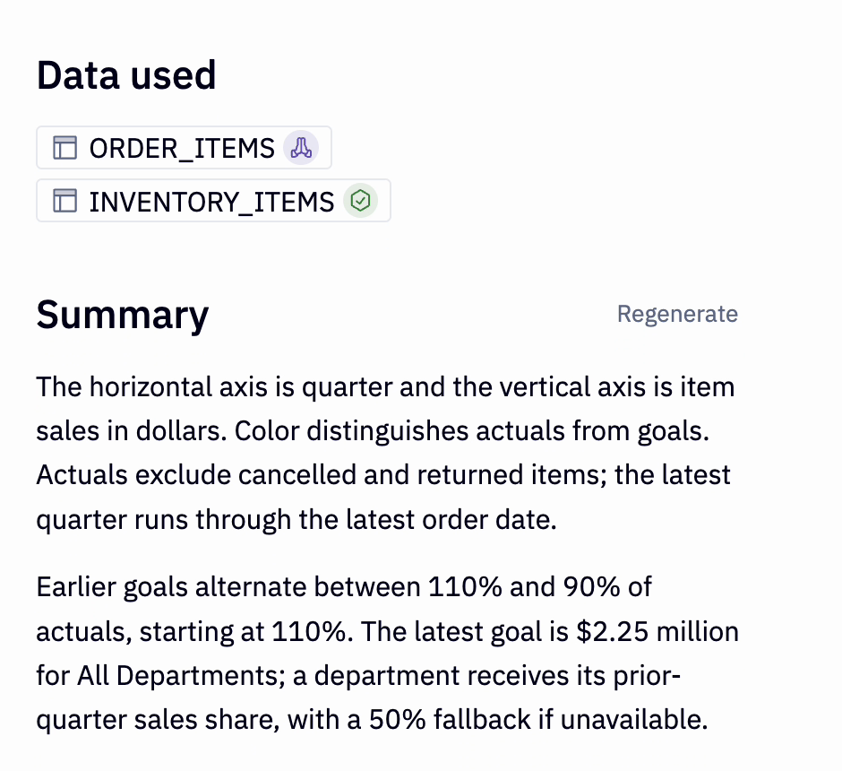

# Hex 4.0：AI 做完分析以后，我还想接着问

一份季度销售分析，画完图以后，还有不少事要做。

比如只看自己负责的部门，把显示不全的产品名改短一点。或者盯着一笔突然上涨的收入，想确认退款到底算没算进去。

如果每改一次条件，都要重新描述需求、再发一张图，来回几轮，分析就又成了整理材料的工作。

Hex 4.0 想把这些事放在同一个页面里做。它是一款面向团队的数据分析平台，能把查询、计算和图表做成可以继续操作的应用：在页面上调整条件，也能接着向 AI 提要求。

这篇先看它的公开演示。我还没有登录账号实测，文中的界面和功能观察都以演示为限。

## 产品名没显示全，就接着提修改要求

Hex 的季度销售演示里，右边已经有了对比图、数据表，以及一个部门筛选框。左边的输入框中，是一句很具体的要求：把图表里的产品名缩短，别让文字显示不全。

图1：对着眼前的销售页面，继续提修改要求。

这个细节挺贴近做报表时的需要。图画出来了，接下来还得把名字放清楚，让看图的人知道每根柱子对应什么；内容多了，又想按部门缩小范围。

这些修改都围绕眼前的结果展开。对话框与分析页并排放着，不用把刚做好的图另存一份，再向另一个工具解释要改哪里。

截图展示的是这条修改请求，并不能证明修改一次就成功。但它说明了 Hex 的交互思路：分析做出来以后，用户还能接着调整。

## 分析做成应用，别人也能接着用

一页销售对比、一个筛选条件，再加一张数据表，就能组成一个简单的分析应用。

拿到它的人可以继续选条件、看数据，不必每次都请做分析的同事重新发图。对于经常需要反复沟通的报表，这比多生成几张图片更实用。

Hex 4.0 把查询、计算、图表和页面布局都放在代码文件里。AI 可以修改这些内容，人也能打开代码检查，或者手动调整。只需要看结果的人，则可以留在应用页面。

这样，一份分析既有方便使用的界面，也保留了往下检查的入口。

不过，页面上的筛选框不能替团队确定业务口径。“销售额”按下单金额算，还是按付款后扣除退款的金额算，得先说清楚。否则页面再完整，讨论的也可能是两回事。

## 数字有疑问，往下找计算依据

这也是我对 Inspect 更感兴趣的原因。

一张图里的数字突然变高，先别急着解释业务发生了什么。看看它用了哪些数据、统计到哪天、有没有排除退款，可能更有帮助。

Hex 的 Inspect 视图把这些信息放到了结果旁边。下面这张演示局部，上方列出使用的数据表，下方是一段计算摘要。

图2：Inspect 中的数据表与计算说明局部。

摘要里写得很具体：实际销售排除了取消和退回的商品，最新季度的统计截止到最新订单日期。

如果两个季度的数据看起来差别很大，这些说明就值得先看一遍。统计区间是否一样，退款怎么处理，都会影响图上的比较。还要继续核对时，可以进入底层逻辑和代码。

**图表给出结果，计算说明让人有机会检查这个结果。**

当然，能找到计算过程，不代表分析结论就成立。用了不合适的数据表、问偏了业务问题，或者把同时变化的两个指标当成因果关系，仍然需要人判断。这里展示的是制作侧的 Inspect，也不能直接推断所有已发布应用的读者都有相同入口。

## 常用的 AI 助手，也可以参与进来

除了 Hex 自己的对话框，Claude、Codex、Cursor 等 AI 助手也可以连接 Hex，参与数据分析或项目编辑。

如果已经习惯在其中一个工具里整理需求，就有机会从那里继续做，再把分析放进 Hex 项目，不必完全换一套工作入口。

但这里有套餐和权限门槛。Hex 的 MCP 服务当前面向 Team、Enterprise 套餐，编辑项目还需要 Editor 或更高角色。平时能用某个 AI 助手，并不等于已经具备连接、修改 Hex 项目的权限。

偶尔处理一份表格，可能用手边的工具就够了。团队已经有数据环境，又经常要把分析交给别人使用，才更值得看看这套连接方式是否适合。

## 改个筛选条件，不必等整页重算

Hex 团队自己做过一个很贴近实际使用的项目：用 4.0 分析自家产品界面的使用情况。在它公开的实例中，鼠标悬停和点击都可以触发筛选状态切换。

这类操作适合边看边找问题：看到一处值得留意的数据，顺手切个条件，再看看相关图表。要是每次都得等整页重新计算，连续探索很容易变成点一下、停下来等一会儿。

4.0 对这种等待做了调整。一个输入发生变化时，重新运行的是受影响的计算和后续步骤，不相关的结果继续保留；彼此独立的查询可以并行执行，哪张图先算完，哪张图就先显示。

回到前面的销售分析，切换部门时，用户关心的是相关图表怎样变化，用不着同时等那些与部门无关的计算重来一遍。这是理解这套机制的一个例子，实际等待时间仍取决于项目和数据环境，不能把 Hex 的内部展示当作任何报表都能瞬间响应。

但交给同事日常使用，还要看另外几件小事。

截至 11 月 11 日查阅的 Beta 路线图，PDF 导出已经上线，定时运行仍在开发中，已发布应用里的 Inspect、评论和发布前审核还列在后续计划里。做完页面想发一份 PDF，和希望它每天自动更新、让查看者随时追查计算依据，目前是不同的使用条件。

所以，现阶段更适合先关注一份分析能否方便地调整、由制作方检查清楚。需要定时分发、多人审核或让每个读者自行查逻辑的团队，还得逐项核对功能是否已开放。

4.0 仍在 Beta 阶段。发布页已写公测，部分概览说明还留着私测口径，账号权限也要单独确认。这里整理的是公开使用实例和当前功能状态，尚不是我的账号实测结论。
