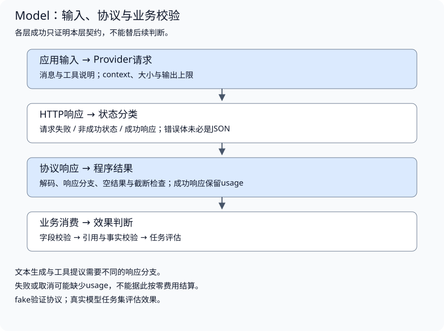

# 示例：hello-llm

## Goal

Understand the minimal LLM call chain in Go: the message model (system /
user / assistant roles), a `Provider` interface with a deterministic offline
fake, an OpenAI-compatible HTTP adapter tested against `httptest`, and
token/cost bookkeeping. Real provider calls stay behind the explicit
`E2E_LIVE` gate and never run in default tests.

Non-goals: streaming, tool calling, and retry policies — those belong to
later chapters.

## Prerequisites

- Book chapter: `content/book/part3-agent/building/chapter22-architecture.md`.
- Go toolchain per `labs/go.mod`; all labs share that single module.

## Concepts

- `Message` + `Role`: system carries stable rules, user carries the current
  request, assistant carries prior model output.
- `Provider` interface: callers depend on `Generate(ctx, []Message)`, so the
  fake and the HTTP adapter are interchangeable without caller changes.
- `FakeProvider`: deterministic rule-based replies with estimated token
  usage, so tests assert exact output offline.
- `OpenAICompatibleProvider`: POSTs OpenAI-style `/chat/completions` with a
  timeout, a response size cap, and `HTTPError` so callers can branch on the
  status code.
- `estimateCost`: hardcoded example prices, clearly marked as not a real
  bill.

## Run

```bash
gofmt -l labs/part3-agent/chapter22/hello-llm
go -C labs vet ./part3-agent/chapter22/hello-llm
go -C labs test ./part3-agent/chapter22/hello-llm -race -count=1
go -C labs test ./part3-agent/chapter22/hello-llm -cover
go -C labs build -o /tmp/hello-llm ./part3-agent/chapter22/hello-llm
go -C labs run ./part3-agent/chapter22/hello-llm
```

Expected output:

```text
reply: pong
tokens: prompt=10 completion=2
estimated cost: $0.00000270 (example price, not a real bill)
```

`TestE2ELiveProvider` skips by default. To run it explicitly (real cost,
never in default CI):

```bash
E2E_LIVE=1 LLM_BASE_URL=https://your-provider.example.com LLM_API_KEY=... LLM_MODEL=... \
  go -C labs test ./part3-agent/chapter22/hello-llm -run TestE2ELiveProvider -count=1
```

## Code Map

- [main.go](main.go): message model, `Provider` interface, `FakeProvider`,
  `OpenAICompatibleProvider`, cost estimation, and the demo `main`.
- [main_test.go](main_test.go): fake determinism, httptest-backed success /
  HTTP 500 / timeout paths, and the E2E gate that skips by default.

## Variation Exercises

- Add a fake rule (e.g. messages containing "weather" get a fixed reply) and
  extend `TestFakeProviderDeterministic` to assert it.
- Add a 429 test case to the httptest server and assert `HTTPError.StatusCode`
  lets the caller distinguish rate limiting from a 500.


## Continue

- [structured-output](../structured-output): make the provider return JSON,
  validate it against a schema, and retry with feedback on visible failures.

## Sources

Original code for this course, MIT licensed. Request/response shape follows
the OpenAI chat completions API conventions.

## 调用边界与故障定位

请求最多64 KiB，文本生成请求发送max_tokens=256，响应默认最多1 MiB。非JSON的429/502仍返回HTTPError；200但坏JSON、无choices、空文本或finish_reason=length返回协议错误。超时保留底层错误链。字段属于本adapter的Chat Completions方言，接入服务时核对支持情况。

新增响应边界测试TestProviderResponseBoundaries；TestFakeHonorsCancellation检查开始前取消。默认测试不需要密钥。真实E2E只验证一次受限调用，不代表模型效果或最终账单。

练习22.1：本地服务器返回429，分别使用JSON和纯文本错误体，断言errors.As保留HTTPError及429。随后说明哪些失败可以重试，并给出总尝试预算。

<a id="book-ch22-llm-api-最佳实践"></a>

## 最佳实践

## 最佳实践

### 先验证协议，再比较模型

先用fake验证消息和业务分支，用httptest验证adapter，再显式启用真实调用。fake返回正确结构，只能证明程序按契约工作；模型换了版本、采样参数或输入分布，回答质量仍需独立评估。

### 记录消耗时标明数据来源

真实usage来自Provider响应，本地字符估算只用于教学趋势。费用计算还依赖价格版本、缓存、失败请求和其他计费项；不能将示例价格转换结果当作实际账单。调用失败却没有usage时，应保留“消耗未知”，不能凭空填零。

### 不在Provider里悄悄重试

adapter保留失败原因，Runtime明确决定能否重试、次数、退避和预算。结构修复属于输出契约处理，也要记录尝试次数，避免同一失败被多个层次重复重试。


<a id="book-ch22-llm-api-常见问题排查"></a>

## 常见问题排查

## 常见问题排查

### 429被显示成JSON解析失败

先看HTTP状态，再看错误体。若错误体是HTML或纯文本，修复分类顺序；用同状态、不同格式的本地响应验证HTTPError仍保留429。不要先调提示词。

### JSON能解析，业务却拿到空字段

直接反序列化到结构体可能把缺字段与零值混在一起。先检查必填字段是否存在，再检查类型和范围；拒绝违约输出，而非吞掉错误继续。输出格式问题解决后，才检查引用与事实。

### 取消后页面仍显示答案

检查取消是否进入HTTP请求，以及返回后是否再次检查context。模型成功返回与用户仍需要结果不是同一条件；丢弃迟到结果，但保留已知消耗。取消不能保证Provider撤销已完成计费。

## Provider与消息接口



Provider适配器包住厂商的请求形状、响应形状和HTTP错误。调用方使用课程实验中的[Provider接口](main.go)：

```go
type Provider interface {
	Generate(ctx context.Context, messages []Message) (Response, error)
}
```

接口传递context，让取消与截止时间进入网络调用。响应保留文本和usage；调用方才能把“拿到文本”和“实际消耗”一起处理：

```go
type Usage struct {
	PromptTokens     int
	CompletionTokens int
}

// Response 是一次生成的结果：文本加上 token 用量。
type Response struct {
	Text  string
	Usage Usage
}
```

这套接口是**文本生成的最小契约**，没有覆盖所有Provider功能。接入Loop后，响应还要表达工具提议、调用ID、终止原因等信息，不能把工具提议伪装成最终文本。不同Provider对消息和工具调用的表示可能不同，应在adapter中转换，并验证这种转换不会丢失关联。

当前adapter只在成功响应中返回usage。请求失败、取消或截断时，返回的零值不表示没有消耗；服务端可能已经处理请求。需要费用账本时，应将“已知用量”和“用量未知”分开记录，再按Provider的实际报告对账，不能把错误路径按零费用结算。

本实验沿用Chat Completions风格的文本接口，适合观察HTTP边界；它不是对所有OpenAI兼容服务的兼容承诺。新接入先核对服务的请求字段、usage和错误定义，再写adapter测试。

## 消息来源与请求状态

### 消息角色与信息来源

消息角色帮助模型识别内容来源。课程的文本实验使用以下最小消息形状：

```go
type Message struct {
	Role    Role   `json:"role"`
	Content string `json:"content"`
}
```

- **system**承载应用提供的稳定规则，例如输出格式与角色要求。
- **user**承载用户请求与参数。
- **assistant**承载模型先前的回复；保留它才能继续对话或反馈输出错误。
- **tool**承载应用执行后的观察，在Loop章中通过调用ID与工具提议配对。

这些分类解释数据来源，不等于服务端权限。即使模型接受了一条恶意指令，它仍只能请求应用允许的能力。检索资料、网页和工具结果也应保留来源身份，不能因为包含“忽略规则”就升级为应用指令。

### 请求状态与业务会话

本实验每次Generate都显式传入消息。续聊时，应用选择需要的历史，并重新构造请求；真实服务也可能提供服务端会话或响应关联能力，适配器应说明如何使用，不能据此省略应用的数据隔离。

一个常见错误是把本轮问题插入system，随后又把历史全部拼接进去。这样会混淆稳定规则与请求参数，也让上下文选择越来越难。先按来源保存消息，再由Context部件选择本轮输入；Session负责历史的保存与隔离，不由Provider承担。

## 请求与传输错误处理

### 请求、传输与响应准入

一次调用至少经过以下步骤：

1. **检查请求**：消息不能为空，编码后的请求不能超过应用上限。
2. **发出受限请求**：绑定context，配置客户端超时与输出Token上限。
3. **读取有界响应**：限制字节数并关闭响应体。
4. **判断状态**：非成功状态先归为HTTP失败，错误体未必是JSON。
5. **检查协议**：成功响应必须能够解码，并包含所需结果。
6. **检查是否仍有效**：取消、空文本或已知截断不能作为正常答案提交。

[HTTP适配器](main.go)在读取时多取一个字节，用于区分“刚好到上限”和“确实超限”：

> **传输成功、结构合法与任务正确需要逐层验证；任何一层通过都不能代替下一层。**

```go
	maxBytes := p.MaxBytes
	if maxBytes <= 0 {
		maxBytes = 1 << 20
	}
	data, err := io.ReadAll(io.LimitReader(resp.Body, maxBytes+1))
	if err != nil {
		return Response{}, fmt.Errorf("hello-llm: read response: %w", err)
	}
	if int64(len(data)) > maxBytes {
		return Response{}, fmt.Errorf("hello-llm: response exceeds %d bytes", maxBytes)
	}
```

`LimitReader`约束本地读取，不等于约束服务端生成。实验另外发送`max_tokens: 256`，编码请求最多64 KiB。输出参数属于这个adapter的API方言；换Provider时必须确认字段是否支持，不能把字节上限当作Token上限。

### HTTP分类先于错误体解析

网关返回429时可能只有一行文本，返回502时可能是一页HTML。先要求错误体解码成功，会丢掉真正的HTTP分类：

```go
	if resp.StatusCode != http.StatusOK {
		// 网关的错误页未必是JSON；状态分类不依赖错误体能否解析。
		_ = json.Unmarshal(data, &parsed)
		msg := http.StatusText(resp.StatusCode)
		if parsed.Error != nil && parsed.Error.Message != "" {
			msg = parsed.Error.Message
		}
		return Response{}, &HTTPError{StatusCode: resp.StatusCode, Message: msg}
	}
```

这段适配逻辑保留状态码；JSON错误体能解析时补充服务端消息，不能解析时仍返回HTTPError。上层再决定限流退避、故障重试或直接失败。来自服务端的消息仍可能包含内部信息，公开日志与模型反馈需要脱敏。

| 结果 | 意味着什么 | 应用下一步 |
| --- | --- | --- |
| 请求失败或超时 | 尚未取得可用响应，服务端是否已消耗资源可能未知 | 保留错误链，按预算和重试策略处理 |
| 非200 | Provider或网关拒绝了本次调用 | 按状态分类，不靠错误文本猜测 |
| 200但非法JSON或无结果 | HTTP成功，响应协议失败 | 检查adapter与服务契约 |
| 空文本或长度截断 | 没有完整的文本答案 | 返回可见失败；不要提交成空答案或完整答案 |
| 合法文本与usage | 文本调用契约成立 | 继续业务校验与效果评估 |

这里只接受文本响应，因此空文本被拒绝；支持工具调用的adapter应先检查工具分支，不能沿用“没有文本就是失败”的规则。
