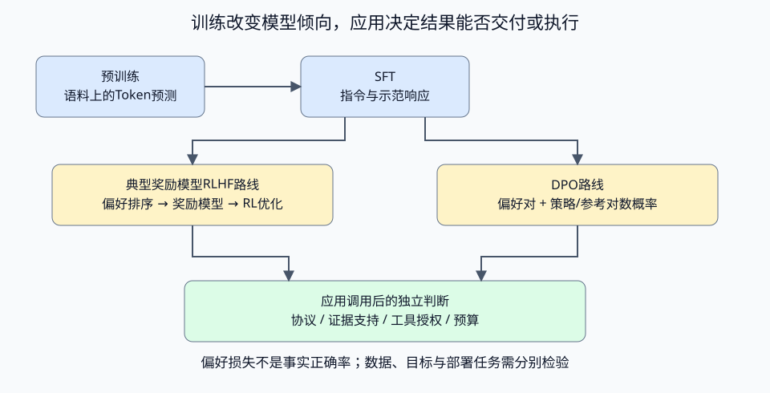
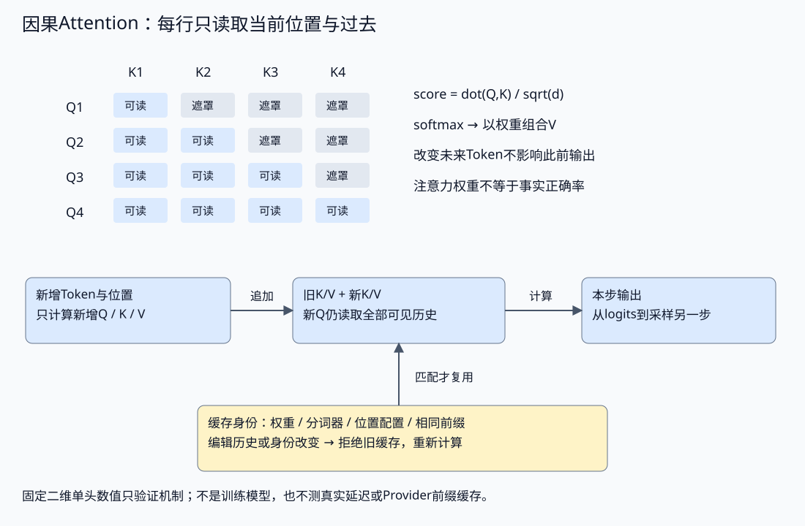

# 推理机制：字节分词、因果Attention、KV与采样

以真实数值运算解释接口背后的机制。标准库、固定向量与规则，不下载权重、不调用Provider。前置：Go slice/数学函数，理解向量点积；关联[Agent架构总览](../../../../content/book/part3-agent/building/chapter22-architecture.md#topic-ch22-llm-api)。

## 这几个小实验各证明什么

- Tokenizer从UTF8字节开始，按已给定pair rank合并，Decode拼回原始字节。规则没有训练，词表不是任何Provider的真实tokenizer；不实现预切分、特殊Token、聊天模板或计费。
- Attention使用独立的四ID词表、二维固定embedding/线性投影和位置夹具；它不是Tokenizer输出接入训练模型，也不是完整Transformer（没有多头、FFN、残差、LayerNorm或LM头）。
- FullCausal每一行只读当前位置及以前的K/V。KVCache每次追加一个Token，只生成新增投影，并拒绝编辑历史或更换缓存身份。数值等价在1e-12容差内；Projections/ScorePairs是运算计数，不能当实际耗时或GPU benchmark。
- 采样从给定logits按temperature计算softmax、top-p保留并归一化，再用显式u选样；不包含模型预测质量。temperature=0采用稳定argmax，只证明这个固定分布的greedy规则。
- 输入有界：文本4096字节、64条merge、Attention/缓存64个教学ID、分布256项；检查NaN/Inf/类型范围。单调用方拥有缓存，未实现线程共享或跨服务缓存。

## 预测、运行与观察

从仓库根目录执行，准备见[运行约定](../../../../content/book/introduction.md#running-examples)：

```bash
go -C labs run ./part3-agent/chapter22/inference-mechanisms
```

输出：

```text
bytes=11 runes=7 toy_tokens=9 roundtrip=true
cache_equivalent=true full_projections=10 cached_projections=4 cached_score_pairs=10
top_p_probabilities=[0.731 0.269 0.000] fixed_draw=1
```

先预测：修改词表合并优先级，会不会改变Token？修改缓存的第一个历史ID以后，是否可以只追加最后一个ID？提高temperature是不是意味着答案正确率提高？

runes统计Unicode码点，不是组合字符的视觉长度。第一行使用“AI学习 AI”：AI合并，其余UTF8字节仍作为回退Token；三个长度不能相互替代。第二行对每个前缀重算与缓存递增对照；缓存保留旧K/V，但新Q仍读所有历史K。第三行logits=[2,1,0]、temperature=1、top-p=.8，保留前两项；u=.9选ID1，没有现实语言或正确性结论。

```bash
go -C labs test ./part3-agent/chapter22/inference-mechanisms -race -count=1 -v
```

应全部PASS：字节往返、中文/emoji、pair优先级、非法UTF8；未来ID改变不影响已有因果行；缓存与全计算等价、历史/身份变化拒绝且不改变状态；分布归一化、温度/保留集合、固定draw与非有限数值拒绝。

## 练习

| 任务 | 起点与提示 | 边界与验证 |
| --- | --- | --- |
| 增加merge规则 | NewTokenizer规则表，先确认只能引用已有ID | Encode/Decode仍往返；同文本Token可变，不能将结果冒称真实模型计数 |
| 改变历史或位置 | Cache.Step的identity与prefix | 必须拒绝或明确重算，不复用旧K/V；拒绝不污染缓存 |
| 检查因果遮罩 | 在副本让较早Q读取全部K | 改未来ID使过去输出变化，测试应失败；恢复只读前缀后复验 |
| 比较采样 | 给同一logits固定u，对照temperature和top-p | 概率归一，保留集合符合规则；不从概率推断正确率 |
| 测量真实延迟 | 在受控Provider实验分离首输出、每步、总时长和usage | 锁定模型/输入/并发，记录缓存命中证据；不能用这里的投影次数宣称实际提速 |

## 来源与许可

原创实现、固定数值与图示，MIT。机制依据：[Attention论文](https://arxiv.org/abs/1706.03762)、[Hugging Face BPE课程](https://huggingface.co/learn/llm-course/en/chapter6/5)、[KV Cache解释](https://huggingface.co/docs/transformers/en/cache_explanation)、[生成策略](https://huggingface.co/docs/transformers/en/generation_strategies)。未复制实现、图片或训练权重。

## 偏好目标数值，不训练模型

preference.go以完整响应的策略/参考对数概率计算单样本DPO损失，beta是训练目标参数。原CLI另外打印偏好概率0.2/0.5/0.8时损失1.609438/0.693147/0.223144；参考概率固定0.5，beta=1。

```bash
go -C labs test ./part3-agent/chapter22/inference-mechanisms -run '^TestPreference' -race -count=1 -v
```

测试检查参考相同时log(2)、极端差值稳定性、非有限/正对数概率与非法beta拒绝。函数只算目标，不验证概率是否来自同一提示/分词器/模型；不做梯度、SFT、奖励模型或RL更新，也不报告事实正确率或微调效果。对应模型概率应来自实际完整响应计分，不能任意换成逐Token平均。

练习：策略已经偏好一个响应时更换参考概率，解释损失变化；再构造“人更喜欢但事实错误”的候选，说明为什么偏好目标与任务正确性必须分别评估。不要用降低损失代替真实模型训练与验收。

机制参考[InstructGPT](https://arxiv.org/abs/2203.02155)与[DPO目标](https://arxiv.org/abs/2305.18290v3)，公式实现为原创，不复制上游训练代码。

<a id="book-ch22-llm-api-后训练怎样影响接口行为"></a>

## 后训练怎样影响接口行为

### 后训练怎样影响接口行为

模型能续写文本，仍可能不按要求回答、不遵守JSON形状，或者对错误事实表现得很肯定。训练阶段的目标不同，形成的倾向也不同；应用需要知道这些倾向从哪里来，才能选择模型与评估任务。

| 阶段或路线 | 用什么信号优化 | 对工程选择的影响 |
| --- | --- | --- |
| 预训练 | 语料上的Token预测 | 学到语言与知识模式，调用仍需给足上下文与任务说明 |
| SFT | 指令与示范响应 | 学习示范中的回答方式和格式，效果依赖数据与部署任务的关系 |
| 典型奖励模型RLHF | 偏好排序训练奖励模型，再用RL调整策略并约束偏离参考模型 | 优化的是偏好反馈，奖励分数仍需独立任务验证 |
| DPO | 同一提示的偏好响应对，加上策略与参考模型对数概率 | 直接优化偏好目标，数据身份和评分口径必须一致 |



SFT通常在示范响应Token上计算负对数似然，数据格式与损失mask决定哪些Token参与学习。[InstructGPT论文](https://arxiv.org/abs/2203.02155)展示了示范微调、偏好排序与奖励模型强化学习的具体路线；RLHF还有其他实现，不能把这一流程当成所有后训练的定义。

[DPO](https://arxiv.org/abs/2305.18290v3)对同一提示x的偏好响应y+与非偏好响应y-，比较它们相对于参考模型的对数概率变化。令m为这个差，单样本损失为`-log(sigmoid(beta*m))`。它不要求为这一目标另训独立奖励模型，也不需要每次优化时在线重新采样响应；偏好数据仍需事先准备。

[PreferenceLoss](preference.go)只计算这个目标值：

```go
func PreferenceLoss(policy, reference PairLogProb, beta float64) (float64, error) {
	if !finite(beta) || beta <= 0 || beta > 1e6 {
		return 0, ErrInput
	}
	for _, value := range []float64{policy.Chosen, policy.Rejected, reference.Chosen, reference.Rejected} {
		if !finite(value) || value > 0 || value < -1e6 {
			return 0, ErrInput
		}
	}
	margin := (policy.Chosen - reference.Chosen) - (policy.Rejected - reference.Rejected)
	z := beta * margin
	// Stable -log(sigmoid(z)), including large positive and negative margins.
	if z >= 0 {
		return math.Log1p(math.Exp(-z)), nil
	}
	return -z + math.Log1p(math.Exp(z)), nil
}
```

Chosen与Rejected是完整响应的对数概率，policy与reference必须对应同一提示、响应与计分约定。m先分别减去参考值，再比较两条响应；beta是训练目标参数，与推理temperature作用不同。稳定写法避免大幅度正负差值导致指数溢出，函数只检查数值范围，不能验证概率来自什么模型与数据。

两候选教学例中，参考概率均为0.5；策略偏好响应概率从0.2变为0.8时，损失下降。若策略与参考已经相同，损失仍为log(2)，说明这个目标关注相对变化。实验没有梯度更新或训练权重，损失数值也不证明回答真实、任务完成或模型能力提升。

示范与偏好反馈会影响格式、回答风格和拒绝倾向。部署后仍要检查截断、拒绝、结构合法性与独立任务指标，数据分布改变时重新评估。工具权限继续由应用决定，来源与事实支持由RAG/Eval检查；后训练不会授予执行权限，也不会把模型的confidence变成校准后的正确概率。

前面讨论的是模型能力为什么会呈现出当前的输出倾向。接下来再把视角收回到工程接入：无论底层模型怎样训练，应用仍然只能通过 Provider 契约接住一次调用的输入、输出和失败。

## 从输入到生成：机制解释

### 上下文窗口与本次可见输入

一次推理基于本次请求提供的上下文。模型不会因为应用保存了聊天记录，就自动看到这些记录；应用必须选择消息、工具说明和相关资料，再送入调用。

输入中的文本先被分成Token，模型在上下文基础上逐步生成后续Token。Token与字符没有固定比例；不同语言、代码和分词器的结果都不同。**上下文窗口限制本次输入与可生成内容的空间，不能把全部历史无限追加。** 具体容量与输入/输出计算方式取决于Provider和模型。

从系统角度看，几个机制直接影响接口设计：

| 机制 | 对应用的影响 | 应保留的判断 |
| --- | --- | --- |
| Token与上下文窗口 | 长历史与大工具结果挤占生成空间 | 输入预算与输出预算分别管理 |
| Attention | 模型利用上下文中的信息生成响应 | 信息放入窗口不保证被正确使用 |
| KV Cache | 复用已有前缀的中间计算可减少重复推理 | 缓存命中依赖服务实现和输入布局，不能当作会话存储 |
| 采样 | 相同输入可能产生不同输出 | 确定性协议测试与模型效果评估分开 |
| 训练形成的能力 | 决定模型可能完成哪些任务 | 工具权限和事实来源由应用控制 |

Embedding用于把文本映射到向量空间，主要在检索中比较相似性；它不等于生成模型的答案。选模型时先确认任务需要文本生成、结构化结果还是工具提议，再比较能力、延迟与成本，不要只比较上下文窗口大小。

### Token由词表决定，不按字符计数

分词器将文本变成模型词表中的ID。一个字符可以对应多个ID，多个字符也可以合成一个ID；空格、代码标点、聊天模板和特殊标记都会影响输入。预算应绑定所用模型及分词器，不能把字符数乘一个固定系数就当作精确计量。

配套[数值机制实验](README.md)实现一个字节级pair合并教具：先把UTF8字节作为回退ID，再按照给定rank合并已有相邻ID。[Encode](main.go)每次选最优先的可用pair：

```go
		if bestRank < 0 {
			return ids, nil
		}
		ids[bestPosition] = 256 + bestRank
		ids = append(ids[:bestPosition+1], ids[bestPosition+2:]...)
```

新ID对应原有字节串，Decode按词表拼回原文；合并改变分段，不应悄悄丢空格或替换中文。rank冲突按规则决定，同一文本在另一词表中可以产生不同Token。实验规则由应用给定，不包含词表训练、真实聊天模板或Provider tokenizer，计数不能拿去结算费用。

接口层由此需要两份判断：发送前计数/估算用于输入与输出预留，返回后usage来自服务实际口径。Tokenizer一致不保证窗口全部可用，系统规则、工具描述和结构化约束也占输入；Context负责在窗口内选择信息，Model保留相关能力与计量差异。

### Attention组合信息，Embedding不等于证据

生成模型通常先把Token ID映射为向量，加上位置信息，再经过多层变换形成下一步预测。Attention的一步是从表示得到Query、Key、Value：Q用于本位置的信息选择，K参与匹配，V提供被组合的数值。它们是学习到的变换，不是文档ID或应用权限。

单头计算可以写成：`scores = QK^T / sqrt(d)`，加上可见性遮罩后做softmax，再以权重组合V。配套[Attention](main.go)采用固定二维向量：

```go
func Attention(q Vec, keys, values []Vec) (Vec, []float64, error) {
	if len(keys) == 0 || len(keys) > 64 || len(keys) != len(values) {
		return Vec{}, nil, ErrInput
	}
	for _, vectors := range [][]Vec{{q}, keys, values} {
		for _, v := range vectors {
			for _, x := range v {
				if !finite(x) || math.Abs(x) > 1_000_000 {
					return Vec{}, nil, ErrInput
				}
			}
		}
	}
	scores := make([]float64, len(keys))
	for n, k := range keys {
		scores[n] = (q[0]*k[0] + q[1]*k[1]) / math.Sqrt(2)
	}
	weights, err := Softmax(scores)
	if err != nil {
		return Vec{}, nil, err
	}
	out := Vec{}
	for n, v := range values {
		out[0] += weights[n] * v[0]
		out[1] += weights[n] * v[1]
	}
	return out, weights, nil
}
```

自回归的因果遮罩让第i个位置只读当前位置与过去。本实验用K/V前缀形成每一行，改变未来ID时，已经计算的早期行保持不变。训练与prefill可以并行计算多行，但“并行”不表示早期位置可以偷看未来答案。

Attention输出是信息组合，不是数据库查询结果；较大的权重也不等于正确、可信或因果解释。资料放进窗口后仍可能被忽略或误用，所以输入布局与Context效果要评估。检索用Embedding把资料放进可比较的向量空间，生成模型内部表示则参与预测，两者不保证相同，也不能替代来源和断言校验。

这里没有多头、残差、归一化、FFN或训练权重，不能把一次二维加权当成完整Transformer。它足以展示数据依赖，完整模型对语言与任务的能力还来自训练和架构，而非应用层注册工具。

### Prefill与Decode为什么需要KV Cache

prefill处理当前输入前缀，decode随后逐步产生新Token。每个新位置都有新Q，但过去位置的K/V可以在相同模型与前缀条件下复用，避免每步重新做这些投影。



[KVCache.Step](main.go)只接受精确前缀后追加一个ID：

```go
func (c *KVCache) Step(identity CacheIdentity, prefix []int) (Vec, error) {
	if identity != c.identity || len(prefix) != len(c.tokens)+1 || len(prefix) > 64 || !slices.Equal(prefix[:len(c.tokens)], c.tokens) {
		return Vec{}, ErrCache
	}
	p, err := project(prefix[len(prefix)-1], len(c.tokens))
	if err != nil {
		return Vec{}, err
	}
	// Previous K/V remain unchanged; the new query still attends over all accepted history.
	keys := append(append([]Vec(nil), c.keys...), p.K)
	values := append(append([]Vec(nil), c.values...), p.V)
	out, _, err := Attention(p.Q, keys, values)
	if err != nil {
		return Vec{}, err
	}
	c.tokens = append([]int(nil), prefix...)
	c.keys = keys
	c.values = values
	c.Projections++
	c.ScorePairs += len(keys)
	return out, nil
}
```

复用的条件包括权重、分词器、位置配置和前缀ID一致。修改历史文本、在前面插一条规则、更换模型或位置布局以后，旧缓存不能仅凭“都是同一会话”继续用。示例对身份或前缀变化明确拒绝，调用方需重新计算；真实服务按自己的缓存策略决定可重用范围。

缓存保留旧K/V，不表示不再访问历史：新Q仍与可见K做匹配，再读取V。上下文更长时，这部分计算与显存占用仍增长。普通未压缩KV的容量与层数、序列长度、KV头数、头维度和数值精度相关；GQA、量化、滑窗或缓存卸载会改变具体消耗，不能仅凭窗口长度推导总容量。

本地KV、Provider前缀缓存和Session历史是不同的状态。Session用于组织输入，KV是特定模型的中间计算，Provider缓存还受服务布局、有效期和计费策略约束。CPU教具中的投影计数能验证省掉了什么，不证明GPU加速倍数、实际缓存命中或真实首Token延迟。

### 采样选择候选，不输出正确概率

模型最后产生的是词表上的logits，选择下一个ID还需要解码策略。Greedy取最大项；temperature改变logits差距，top-p则根据归一化概率保留累计质量达到阈值的候选，再重新归一化。

配套[Distribution](main.go)固定相同logits，按温度与保留集合计算：

```go
	scaled := make([]float64, len(logits))
	for n, v := range logits {
		scaled[n] = v / temperature
	}
	probs, err := Softmax(scaled)
	if err != nil {
		return nil, err
	}
	order := make([]int, len(probs))
	for n := range order {
		order[n] = n
	}
	sort.SliceStable(order, func(i, j int) bool { return probs[order[i]] > probs[order[j]] })
	kept := make([]float64, len(probs))
	mass := 0.0
	for _, n := range order {
		kept[n] = probs[n]
		mass += probs[n]
		if mass >= topP {
			break
		}
	}
	for n := range kept {
		kept[n] /= mass
	}
```

降低温度会使这个分布更集中，提高温度使候选更分散；top-p不是“保留前p比例的词”，而是累计概率阈值。显式给定随机draw能够稳定检验落在哪个区间，方便区分分布计算与模型能力。

预测概率表示模型在给定上下文下对下一Token的相对偏好，不是答案正确率。相同参数也不能保证所有Provider逐字重复，真实服务还可能有并行计算、实现和策略差异。协议回归用固定输出，模型比较锁定配置、保留重复试验，不能把temperature=0当作任务正确或完全可重现的保证。
