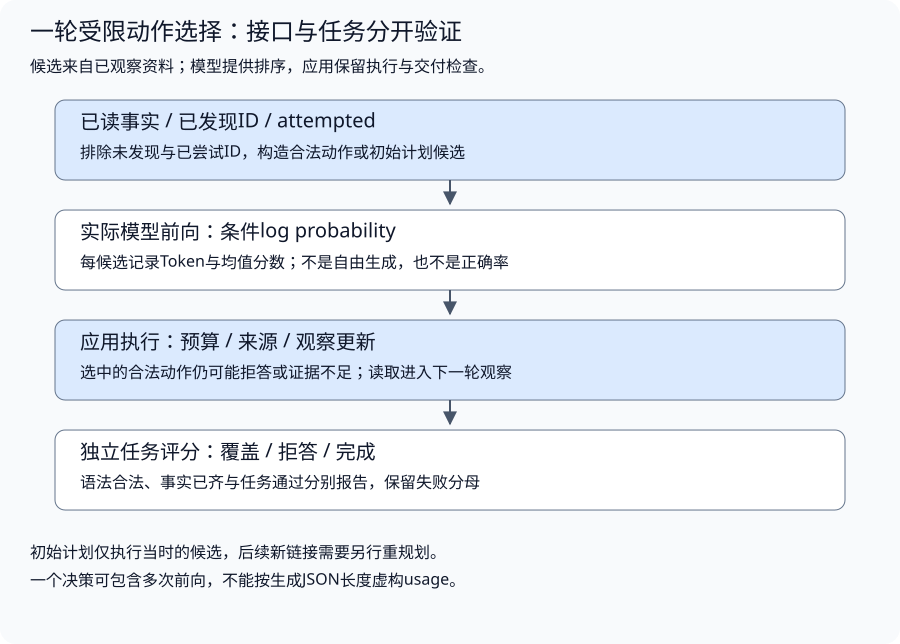

# 策略对照：子问题、计划与有界证据修复

独立只读资料实验，在同一结构化任务、语料、版本条件和预算下比较五种控制流程。前置：[ReAct](../../../../content/book/part3-agent/building/chapter24-decision-loop.md#topic-agent-react)、[Planning](../../../../content/book/part3-agent/building/chapter25-planning.md#topic-agent-planning)、Eval。

默认控制器是固定Go函数，不调用LLM，不复现论文的提示/模型实验；显式伴随实验分别验证本地动作/计划生成、受限候选选择、自然语言追问、语言反思与后续Actor、模型候选搜索。实际生成、条件似然选择与固定控制是不同证据，失败和新增代价分别保留。

默认Requested keys已经是结构化要求，Self-Ask控制器不自动理解自然语言；它展示子问题与中间观察的依赖。修订器检查缺项和版本，按实际已观察链接探索候选，不读评分值。真实模式已运行，但多跳综合、可靠经验采用和搜索效果仍未完成；不能由固定比例或局部修订推出这些策略的普遍收益。

## 同条件比较什么

- direct：仅消费root资料；固定任务基线。
- react-control：按缺项反馈尝试root候选，最多2个；观察不足时可换参考。
- self-ask-control：显式子问题，根据返回文档里的链接追问，最多2跳；首候选不存在时仍可能失败。
- plan-control：保存固定初始节点，查询首候选；不修订。
- reflection-control：先同样执行初始计划，再依据未完成要求/版本形成Critique，最多1次修复；候选只来自已读文档，每缺项最多2个，不用隐藏答案排名。

所有策略使用相同Input{Root,Version,Required}，评分Labels.Values/Refuse在控制器外；同一Corpus和Limits，最多8读/16决策/1修订。来源版本不符合要求的值不收集；已完成事实的来源保留，同版本冲突记录并拒答，不静默覆盖。失败、拒答和超限保留，不仅统计成功样本。

Dataset version为fixture-v1，六种情况：直接事实、多目标、需要两跳、首引用缺失、首版本陈旧、确实无资料。UsageKnown为false，决策次数不是模型调用次数或Token。没有网络/文件/写工具，工具是语料字典读取。

## 运行

从仓库根目录执行，Go准备见[运行约定](../../../../content/book/introduction.md#running-examples)：

```bash
go -C labs run ./part3-agent/chapter24/strategy-comparison
go -C labs test ./part3-agent/chapter24/strategy-comparison -race -count=1 -v
```

程序输出每种策略在全部6个任务上的fixture_passed、总reads/decisions/repairs和usage=unknown。预期direct通过2项、react-control通过5项、self-ask-control通过4项、plan-control通过3项、reflection-control通过6项。数字由这些固定结构设计产生，不是模型成功率或性能基准；比较时同时看额外读和修复步骤。

先预测nested：root只指出router，router才给出timeout链接。直接策略和固定计划不能补第二跳，子问题控制可以依据中间资料继续。alias/stale则是不同问题：首参考失败或版本不符，单一跟进仍可能失败，有界修复才尝试新的已知候选。

测试应全部PASS：所有策略覆盖同案例、工具预算一致、问题依赖观察、修改评分答案不改变执行、旧版本不当事实、预算不能被修订重置、取消不读资料，修复保留完成证据且冲突不被隐藏。

## 分支搜索的宽度与总预算

[bounded_search.py](bounded_search.py)是独立的标准库调度示例，不加载模型、不读取外部工具，也不改变原有Go策略比例：

```bash
python3 labs/part3-agent/chapter24/strategy-comparison/bounded_search.py
python3 labs/part3-agent/chapter24/strategy-comparison/bounded_search.py --self-check
```

固定root提出dead与bridge，评分故意偏向dead，只有bridge能到answer。宽度一返回exhausted，生成/评价均2；宽度二返回root→bridge→answer，生成/评价均3；宽度二但nodes=2返回node_budget，生成/评价仍2。根节点不计入nodes，被剪枝候选计入；exhausted只表示保留前沿走完，不证明全部问题空间无解。

自检覆盖误评价剪枝、宽度、深度、总节点、循环、候选重复/超额、非有限分数和回调后取消；提议列表复制为tuple，评价回调修改原列表不能改变待处理兄弟分支。路径为不可变状态ID，不是对任意对象的深复制；回调错误向调用方传播。取消只在协作边界检查，不抢占忽略取消的回调。脚本兼容当前默认Python 3，不引入依赖。

迁移任务：保持同一状态图与目标检查，改变启发式并比较不同宽度/总节点下的结果；再用实际模型产生与评价候选，记录生成、评价、最终验证和剪枝各自消耗。真实模型对照使用不提示正确路径的状态ID，终局标签留在评分侧。不要将固定图计数当作LLM usage，或把搜索到命名answer当作真实任务成功。原Self-Ask、语言Reflection/Reflexion与独立策略效果仍按原要求补齐。

### 生成后验证与保留后验证

search新增可选goal_policy='generated'参数，默认retained不变；CLI与已有模型记录仍采用原默认。generated在新候选计入节点额度且排除路径循环后、评分前检查目标。目标已成立即返回，不评分它；未完成分支仍按启发式剪枝，不保证完整搜索或全局最优。

```bash
python3 labs/part3-agent/chapter24/strategy-comparison/goal_policy_test.py -v
python3 labs/part3-agent/chapter24/strategy-comparison/model_search_test.py -v
```

四个策略测试检查：width=1时低分answer可在剪枝前验证；最后一个允许节点可验证，额度不足不越界；初始目标不展开；循环不验证/评价；迟到取消与非bool目标结果不能成功。generated反例计处理节点2、评价1，不把省去一次评价当作真实模型费用收益。目标验证回调也可能昂贵，应另记次数/消耗；nodes限制处理量，propose整批产生的开销仍保留，不能按返回前处理数删除同批生成费用。

模型重放另将原v4记录送入generated策略，八个终态仍与原记录相同，未出现被剪掉的已完成产物。它是离线策略诊断，没有新模型调用或新Case，原始记录不改写。run_case也接受该可选策略，但既有模型CLI默认保持retained。

### 先核对算术任务的可解性

[arithmetic_reference](model_search.py)用精确Fraction枚举两两合并，按当前数值与叶集合去重，不加载模型。最多32768次合法转换尝试；solved返回可重放的三步解，全部探索结束才能报告exhausted，预算不足返回solvable=null。它使用独立参照预算，不是原模型搜索的同预算竞争者。

在仓库根目录执行：

```bash
python3 - <<'PY'
import json
import sys
from pathlib import Path
directory = Path('labs/part3-agent/chapter24/strategy-comparison')
sys.path.insert(0, str(directory))
from model_search import arithmetic_reference
for case in json.loads((directory / 'search-cases.json').read_text())['cases']:
    result = arithmetic_reference(case['numbers'])
    print(case['id'], result['reason'], result['attempts'], result['expression'])
PY
```

固定遍历顺序的实际结果：

```text
product solved 41 (4*(3+(1+2)))
fractions solved 2074 (8/(3-(8/3)))
pairing solved 496 ((2/4)*(6*8))
low-range exhausted 854 None
```

计数是程序尝试的合法运算数，包含转入已访问状态的操作，不是模型调用或Token。相同值但不同叶集合不合并，确保原数字各用一次；state的表达式不会由eval执行。

后续报告应将三道可解任务的求解情况与无解题的谨慎停止行为分开。旧记录的“未得到24”口径保持原样，不能把程序参照的无解结论补写成模型判断；若要求模型证明无解，需要另设任务协议、证据与评分版本。参照既不改善已有模型结果，也不改变原四题的开发用途。

```bash
python3 labs/part3-agent/chapter24/strategy-comparison/model_search_test.py
```

新增检查重放三题的全部步骤，验证精确24、三次转换和完整叶集合；检查第四题完整探索无解，以及只有一次额度时返回未知。将[3,3,8,8]的max_attempts改为1，应得到node_budget和solvable=None，不得据此判无解。原模型记录、开发划分与四题身份不变；参照表达式不进入生成输入，也不增加案例数。

### 接入真实候选生成与评价

[model_search.py](model_search.py)复用同topic的搜索调度器与固定Qwen资产加载器，用四个原创算术任务比较宽度一/二。模型提出left/right当前下标和op，再对派生状态给出0–1启发式评分；应用用Fraction计算、消费互斥的原始数字叶子，独立检查是否只剩一个值且恰好等于目标24。不使用eval或执行模型代码，表达式由应用根据合法操作构造。

按既有模型准备设置STRATEGY_PYTHON、STRATEGY_ASSETS，输出指向尚不存在的新文件：

```bash
LOCAL_STRATEGY_E2E=1 "$STRATEGY_PYTHON" \
  labs/part3-agent/chapter24/strategy-comparison/model_search.py \
  --assets "$STRATEGY_ASSETS" --output "$STRATEGY_SEARCH_OUTPUT" \
  --prompt arithmetic-search-v2
```

默认提示v1可原样复现。v2将固定的JSON对象前缀放入模型输入：propose使用{"proposals":，evaluate使用{"score":。应用只提供结构前缀，不填操作、下标或评分；完整raw由前缀与生成后缀组成。记录application_prefix与generated_text，输入Token包含前缀，输出Token仅计模型后缀。这不是完整约束解码，仍可能格式或参数失败。

两种宽度共享depth=3、nodes=10、per_parent=2、每运行18次模型上限；候选160/评价64新增Token，输入1024，总进程300秒，CPU单线程、greedy且关闭thinking。每次返回保存实际调用、raw、派生状态与评分，完整记录上限512KiB；中断保留complete=false及active记录。依赖版本与资产SHA256复核，不下载或加载远程代码；当前期限机制适用于Linux/macOS。

固定search-cases.json只包含数字和目标，不给模型正确表达式、可解性或Case ID。v1八个运行均在候选封装阶段失败，没有评价调用。v2发生41次实际模型调用（19次候选、22次评价），均因后续operand_index失败，没有通过最终验证的表达式；宽度一/二在pairing上分别7/10次调用，其他任务各4次。状态缩短后仍请求旧下标，模型评分没有修复参数合法性。未知返回计数为null，已知实际模型调用和Token照常保留。

v2全部评价均为0.5，当前没有区分候选的排序信号；总输入6533 Token、模型后缀输出816 Token。前缀已计入输入，不能再计作模型生成。改变状态标识、候选批次拒绝策略或评分提示时保留旧配置与记录，并使用新的独立任务检查，不把这些开发样本作为泛化证明。

记录在testdata/arithmetic-search-v1-result.json与arithmetic-search-v2-result.json；默认model_search_test.py用录制返回复核模型视图、算术状态、评分与失败，不重新加载模型。bounded search失败不证明任务无解，低范围任务也不因未找到表达式而计为正确拒答；当前开发样本不复现ToT论文指标或证明某个宽度更好。

### v3：稳定操作数，保留候选失败

使用同一命令并显式选择--prompt arithmetic-search-v3，输出仍须新文件。v3沿用v2 JSON前缀，当前项改为term_id/value/expression，left/right须为两个不同的当前字符串ID。未合并项的ID不随列表位置变化，消费过的独立叶不能再引用；ID只在当前候选状态解释，不是跨分支的值身份。默认v1与旧v2不变。

同一Qwen0.6配置、四题/两宽度及原预算的实际v3记录在[testdata/arithmetic-search-v3-result.json](testdata/arithmetic-search-v3-result.json)。八个运行均形成过合法子状态，最后都因候选缺少op而step_shape失败，未交付验证表达式。宽度一每题7调用，宽度二依次9/10/9/10；总66调用、输入11475 Token、后缀输出1332 Token，评价仍全部0.5。新接口/提示同时变化，只能说明当前配置的故障位置发生变化，不证明稳定ID的独立因果收益或搜索任务成功。

不填缺失操作符，不删除同批坏候选，不把中断计数null改成已知值。model_search_test.py现在逐请求重放三版原始记录，核对当前view、前缀/后缀、派生状态、原评分与全部失败；默认不加载模型。另有稳定ID测试验证下标/未知/重复/已消费ID拒绝、精确运算、整批无部分发布与同一搜索引擎闭环。

### v4：完整字段仍须当前状态与目标验证

显式--prompt arithmetic-search-v4在v3基础上提示先写op、末步也必须提供操作符并避免重复步骤。应用不填缺失字段、不提供正确运算，也不增加预算或修改评分。旧配置保持；命令和新输出文件要求同前。

实际记录在[testdata/arithmetic-search-v4-result.json](testdata/arithmetic-search-v4-result.json)：八个运行均未达目标。product/pairing/low-range两种宽度都operand_identity失败：模型引用已消费的t0_1，low-range还提出同一项两次。fractions两种宽度的动作通过，但结果不等于24，最后depth_budget；不是成功，也不证明任务无解。

宽度一调用数7/8/7/7，宽度二10/13/10/10，共72调用、input14023/output1446，无截断；评价仍全部0.5。字段完整性改善没有带来目标通过，消耗也未下降。任务已用于开发诊断，不作为新的独立泛化题。model_search_test.py严格重放v1-v4原始调用、状态和终态，默认不加载模型，不将合法同批候选从错误批次中挑出交付。

## 模型生成Self-Ask跟进问题

[self_ask_model.py](self_ask_model.py)使用自然语言任务，模型提出公开跟进问题和来源引用，外部只读资料返回中间答案与新引用，随后模型继续提问、综合或拒答。查表工具按已发现ID取固定资料，不是通用语义搜索；问题质量、分解覆盖与最终语义仍需独立评价。初始模型输入只有问题和一个来源ID，不含完整corpus、Case ID或评分标签。

比较single-query与self-ask：前者只允许一次外部查询，后者最多三次；两者模型轮次上限5，查询带来的新信息和额外成本需要同时记录，不能把差异全部归因模型推理更强。应用只允许当前已发现且未读的引用，未知ID不查询；最终引用ID必须已读，quote必须来自实际文本，评分侧有限检查请求值是否同时出现在回答和引用片段中。refuse必须有已观察资料，协议失败不计正确拒答。

按既有锁定Python与模型资产准备，输出使用新文件：

```bash
LOCAL_STRATEGY_E2E=1 "$STRATEGY_PYTHON" \
  labs/part3-agent/chapter24/strategy-comparison/self_ask_model.py \
  --assets "$STRATEGY_ASSETS" --output "$SELF_ASK_OUTPUT" --prompt self-ask-v4
```

CPU单线程、greedy/thinking关闭；单次输入1024、输出192 Token，四任务×两策略共最多40次模型调用，进程300秒、结果512KiB。每次返回保存原始后缀、应用JSON前缀、实际Token、问题和工具观察；中断结果保持complete=false。该Unix期限适用于Linux/macOS，默认检查不加载模型。

登记v1/v2/v3三个配置，不删除旧失败：v1混合动作分支，在首次查询前unknown_action；v2应用固定首个ask前缀，但模型遗漏reference，question_shape；v3允许唯一可用来源省略引用并记录sole_available_reference，多来源仍需明确ID，未知ID不猜测。这个规则是应用路由契约，不是模型生成了缺失ID。

四个开发任务八条运行：v3执行8次问题/读取、16次模型调用，两策略均0/4通过有限覆盖检查。取得目录以后模型没有继续查配置，而是提前answer并遗漏引用，或只写refuse动作而遗漏reason；还保留了未读事实的编造。当前只证明真实问题生成与首次外部反馈已发生，不证明完整Self-Ask分解、再追问与综合已经成功。

三版记录见testdata/followup-development-v1-result.json、v2和v3；默认self_ask_test.py用固定模型完整走两问一答并验证中间答案进入下一轮，同时重放真实失败与校验，不能将固定闭环当真实模型效果。继续调优这些题时作为回归；后续需要新任务、实际多跳和问题/引用/语义评分，不放宽解析让提前回答通过。

### v4：协议反馈能修什么

v4保留唯一来源绑定，增加最多一次JSON或顶层动作形状修复。反馈只有稳定code，不提供正确数值或来源；模型重新生成，不由应用删字段、补引用或改答案。它消耗原有五轮预算，资料和已读ID保留；修复后的合法动作会清除待处理反馈。未知来源、未观察引用、截断和读取上限直接结束，不作为格式错误修复。

[v4原始记录](testdata/followup-development-v4-result.json)包含同四个开发任务的八条运行：20次模型调用、8次读取、4次修复；输入/输出Token总数6992/482。single-query有限覆盖0/4，self-ask为1/4，唯一通过项是无资料任务的正常拒答，没有用到协议修复。两种策略仍未执行第二次外部读取，未形成真实多跳综合。

格式与事实分别诊断：

| 情况 | 当前记录 | 判断 |
| --- | --- | --- |
| 修复后仍缺字段 | 超时任务重复缺citations，单次查询路径又遗漏answer | 修复预算耗尽，原始错误保留，不交付为成功 |
| 字段与摘录合法，数值没有依据 | 重试回答写2，引用的目录只指向cedar-policy | 运行error为null不代表任务通过；有限覆盖检查失败，语义仍未校准 |
| 比较任务直接编造 | 回答1200/800，引用仅描述服务归属 | 资料没有提供数值，引用存在不证明支持 |
| 明确拒答 | self-ask无资料任务给出完整reason | 这条覆盖通过不证明问题分解、再追问或修复有效 |

v4同时调整了提示和修复控制，不能把与v3的差异归因于某一个因素。后续应分别比较协议控制和提问策略，以新任务检查真实第二跳与综合；已经用于调优的四题继续作为回归。默认测试核对一次反馈后两问一答的固定闭环、共享读取预算、修复上限、不可修复来源以及四版原始记录，不运行模型。

### v5：读到第二份资料，仍没有形成回答

v5缩短动作说明，将已经返回的资料展开为read_documents，分别列出未读ID与剩余查询次数。模型输入仍不包含未读语料、Case ID或评分字段。模型自行选择追问、回答或拒答；没有由应用强制第二次读取，也没有替模型生成问题、数值或引用。初次ask前缀和唯一已知来源绑定仍是明确的应用控制。

五轮模型上限、一次协议修复、single-query一次查询与self-ask三次查询、精确引用及评分器均保留。复验沿用已参与调优的四题，因此只能作为回归诊断；提示与输入呈现同时改变，不能分别归因。

```bash
LOCAL_STRATEGY_E2E=1 "$STRATEGY_PYTHON" \
  labs/part3-agent/chapter24/strategy-comparison/self_ask_model.py \
  --assets "$STRATEGY_ASSETS" --output "$SELF_ASK_OUTPUT" --prompt self-ask-v5
```

输出必须使用新的文件路径，避免覆盖旧记录。[v5原始记录](testdata/followup-development-v5-result.json)显示：

| 观察 | single-query | self-ask |
| --- | --- | --- |
| 有限覆盖通过 | 0/4 | 0/4 |
| 实际资料读取 | 4 | 6 |
| 模型调用 / 协议修复 | 9 / 1 | 10 / 0 |
| 输入 / 输出Token | 2159 / 257 | 2485 / 268 |

self-ask在超时与重试题中取得了配置/策略资料，随后仍请求同一ID，返回unobserved_reference；重复提议未执行查询。两次问题文本都重复原问，没有根据中间答案细化。比较题与无资料题仍在第一次观察以后请求已读目录；single-query也没有在查询额度耗尽时可靠选择回答或拒答。

这次证明第二份外部资料已进入实际模型输入，没有证明完整Self-Ask分解、综合、正确拒答或策略收益。19次调用的4644输入/525输出Token包括最终被拒绝的提议，不因失败删除消耗。默认测试重放全部五版记录，并核对v5的实际输入投影、累计预算与一次修复边界；不加载模型。

### v6：合法动作提示不能代替证据判断

v6根据累计查询预算和当前未读ID，在模型输入中列出allowed_actions：没有额度或没有未读ID时不列ask；answer和refuse仍由模型选择。已读资料只投影ID、原文与读取错误，先前问题和链接列表保留在完整轨迹中，避免模型把旧链接当作新的可读目标。提示要求已有事实足够时回答，不足时利用中间信息提出具体追问。

allowed_actions是提示数据，没有修改生成器logits或强制解码。运行控制和所有边界继续由execute校验；列出answer也不表示已验证资料足够。初次ask前缀、唯一来源绑定、模型/读取/修复预算及评分器与v5相同。这是提示和输入呈现的联合变化，不能单独归因于合法动作字段。

显式命令沿用前一节，替换为`--prompt self-ask-v6`并使用新的输出文件。[v6原始记录](testdata/followup-development-v6-result.json)包含同四题的八条回归运行：

| 观察 | single-query | self-ask |
| --- | --- | --- |
| 有限覆盖通过 | 0/4 | 0/4 |
| 实际资料读取 | 4 | 4 |
| 模型调用 / 协议修复 | 9 / 1 | 9 / 1 |
| 输入 / 输出Token | 2257 / 379 | 2266 / 399 |

两种策略都未继续读取配置。超时和重试题引用未读ID，被unobserved_citation拒绝；比较题引用的目录与摘录确实存在，回答中的1000/800毫秒却没有资料支持，有限覆盖检查不通过。无资料题返回空citations的answer，一次修复后仍为answer_shape，没有正常拒答。

查询数从v5减少不能解释为效率提高，任务仍未完成。先检查新信息是否足够，再检查动作选择、引用归属、断言支持与任务完成度；不能靠隐藏失败、补写引用或减少查询得到“更好”的结果。默认十项离线检查包含全部六版重放和合法动作的额度/空目录边界，不运行模型；真实分解、综合、可靠拒答与独立收益继续验收。

### 同一协议与任务下比较模型配置

Self-Ask可显式选择`--model qwen3-1.7b`；默认仍为`qwen3-0.6b`。两种名称只映射到仓库登记的固定资产清单，不接受任意锁文件。1.7B的两份safetensors权重、索引、分词配置与官方LICENSE须按[资产锁](model-lock-1.7b.json)准备在独立目录，沿用既有Python依赖；程序不下载、升级依赖或加载远程代码。权重不进入仓库，来源与许可见[第三方说明](../../../../THIRD_PARTY_NOTICES.md)。

```bash
LOCAL_STRATEGY_E2E=1 "$STRATEGY_PYTHON" \
  labs/part3-agent/chapter24/strategy-comparison/self_ask_model.py \
  --assets "$SELF_ASK_LARGER_ASSETS" --model qwen3-1.7b \
  --prompt self-ask-v6 --output "$SELF_ASK_OUTPUT"
```

`SELF_ASK_LARGER_ASSETS`是经校验的本地资产目录；用新的输出路径。模型名称、revision、CPU线程和实际dtype进入记录，文件大小不等于加载后内存。该入口不改变其他策略或语言反思程序的默认模型。

同一版代码、v6提示、四个回归任务、评分器及所有预算下，分别复验两个模型；两条路径均为CPU单线程、float32、greedy和nonthinking。原始记录见[0.6B](testdata/followup-capacity-0.6b-v6-result.json)与[1.7B](testdata/followup-capacity-1.7b-v6-result.json)。

| 模型配置 | 模型调用 / 协议修复 | 实际读取 | 输入 / 输出Token | single-query / self-ask覆盖 |
| --- | --- | --- | --- | --- |
| 0.6B | 18 / 2 | 8 | 4523 / 778 | 0/4 / 0/4 |
| 1.7B | 16 / 0 | 8 | 3997 / 740 | 0/4 / 0/4 |

1.7B的八条运行都通过动作形状与引用归属检查，却没有第二次读取。超时与重试题说配置未提供，甚至建议查看policy，但声明的动作仍是answer；比较题编造30/45秒；无资料题也返回answer而非约定的refuse。协议合法、自然语言建议和目标完成分别判断，减少修复与Token不能在任务仍失败时记为效率收益。

这是一组模型配置诊断，参数量、权重、配置及训练结果不是独立变量，不能将差别单独归因于规模。四题已经参与调优，不提供独立效果结论；新任务、真正的分解与综合、语义评分和读者理解仍待验收。默认十二项离线检查只读取记录、锁和固定控制，重放两种模型的真实轨迹，不加载权重。

### 原生工具消息与正常最终响应

[native_self_ask.py](native_self_ask.py)把只读lookup的Schema交给锁定的tokenizer模板，按assistant工具消息与tool结果组织历史。它复用原五轮、一次形状修复、一次/三次查询和精确引用检查；不强制初次读取，也不猜测或替写最终答案。

```bash
LOCAL_STRATEGY_E2E=1 "$STRATEGY_PYTHON" \
  labs/part3-agent/chapter24/strategy-comparison/native_self_ask.py \
  --assets "$SELF_ASK_LARGER_ASSETS" --model qwen3-1.7b \
  --protocol v2 --output "$SELF_ASK_OUTPUT"
```

输出使用新文件。0.6B对照改用`--model qwen3-0.6b`与原`STRATEGY_ASSETS`；默认不加载模型。只支持每轮一个原生调用，多调用、未知函数、重复JSON字段、参数冒充action及截断均不得进入读取；非法最终JSON可在原有轮次中修复一次。该接口没有批量执行、远程检索或通用Provider兼容承诺。

原始解码文本保存在provider_raw；controller_payload是明确适配的对象，raw沿用控制器字段保存其序列化值，不能当作模型生成的JSON。model_messages与model_tools保存实际输入；跟进问题与已读资料保持关联，评分字段和未读corpus不进入模板。

v1把answer/refuse也定义为终止协议函数，没有增加外部能力。实际1.7B在超时与重试题取得第二份资料并输出正确普通文本，却没有调用answer函数；适配器以native_tool_count拒绝。这个[原始版本](testdata/native-followup-1.7b-v1-result.json)保留了所有失败，不能把正确数值补成合格引用。

v2只把lookup作为工具；最终响应走正常消息，必须是answer/citations或refuse/reason的JSON。引用中的字面工具标签按数据处理，普通回答里提到读取也不触发工具。提示、工具Schema及终止协议一起改变，不作为单一变量因果实验。

| 原生配置 | 模型调用 / 修复 | 实际读取 | 输入 / 输出Token | single-query / self-ask覆盖 |
| --- | --- | --- | --- | --- |
| 1.7B v1 | 17 / 0 | 9 | 8792 / 703 | 0/4 / 0/4 |
| 1.7B v2 | 17 / 0 | 9 | 5669 / 672 | 1/4 / 3/4 |
| 0.6B v2 | 11 / 3 | 0 | 3842 / 493 | 0/4 / 0/4 |

完整记录见[1.7B v2](testdata/native-followup-1.7b-v2-result.json)和[0.6B v2](testdata/native-followup-0.6b-v2-result.json)。1.7B的self-ask实际读取quartz-config与cedar-policy，分别生成带准确原文引用的31秒与4次重试回答。无资料题两种策略都正常拒答；single-query在超时题按预算报告不足，目标覆盖仍失败，不能据此说拒答行为错误。

比较题提出两个lookup，包含相同目录ID，当前单调用接口在读取前拒绝；不能忽略一个提议让测试通过。两跳题的问题文本仍重复原问，读取目标虽受中间资料影响，但自然语言分解质量未验证。两策略的查询预算不同，3/4与1/4不能证明相同成本下优于简单串行流程；四题也已经用于调优。完整分解、独立任务、语义校准和读者证据继续验收。

默认十九项离线检查重放三组原生记录，并覆盖两跳角色/结果关联、原始文本与转换、未知/多调用拒绝、最终JSON修复、引用标签的数据语义和缺门禁；不加载权重。语言反思与模型搜索入口仍沿用原协议，其结果不继承此对照。

### 首次新任务与同预算固定流程

[independent-v1](followup-independent-cases.json)在首次推理前已定稿，包含四类任务：三跳别名/当前服务解析、连接与请求超时的单位区分、部署开关控制的策略分支，以及两份同权威当前政策的冲突。任务ID、期望值和需观察来源都留在评分侧，生成输入只包含问题、已发现ID和实际观察。

数据注册split为regression，冻结时evaluation_use声明首次未用测试；本轮确为首次运行，完整SHA与配置保留。以后用这些结果修改策略时，它们是回归案例，不能继续声称独立未知测试。四题仍属同一合成资料环境，不代表四个独立业务领域或已校准的语义基准。

```bash
LOCAL_STRATEGY_E2E=1 "$STRATEGY_PYTHON" \
  labs/part3-agent/chapter24/strategy-comparison/native_self_ask.py \
  --assets "$SELF_ASK_LARGER_ASSETS" --model qwen3-1.7b --protocol v2 \
  --dataset independent-v1 --compare-workflow --output "$SELF_ASK_OUTPUT"
```

fixed-workflow按已观察文档的链接发现顺序遍历，最多读取三次；不从未读语料或Labels选择。只有遍历结束后的综合与可能的格式修复调用模型，使用相同v2最终消息和校验。程序调度记录为origin=application_workflow，模型调用记录为origin=model；前者零Token表示没有调用模型，不是Provider零费用。历史里的读取消息由程序构造，不能算作模型提出的动作。

三种模式都最多五个控制周期、一次格式修复、每次模型输入1024/输出192；single-query读上限1，其余两种为3。工作流的程序调度也计控制周期，因此控制步骤与模型调用分别统计，不把14个步骤写成14次推理。冲突题的评分还要求两份政策确实被读取，目录后直接拒答不能获得该题覆盖。

[完整12条原始记录](testdata/native-independent-workflow-v1-result.json)的汇总如下：

| 模式 | 有限覆盖 | 实际读取 | 控制周期 / 模型调用 | 输入 / 输出Token |
| --- | --- | --- | --- | --- |
| single-query | 0/4 | 4 | 8 / 8 | 2571 / 362 |
| self-ask | 2/4 | 8 | 12 / 12 | 4985 / 630 |
| fixed-workflow | 2/4 | 10 | 14 / 4 | 1593 / 320 |

三跳别名与条件策略两题中，self-ask和固定流程都分别取得53秒与43秒的准确引用回答。问题文本仍重复原问，不能把链接路径变化当成自然语言分解已经可靠。

单位题两种多读方法都生成正确27秒，却将原文中间的片段重写成完整句子作为quote，因此unobserved_citation拒绝交付。冲突题动态方法产生多调用并被拒绝；固定流程读齐两份政策，文本也识别冲突，却声明answer而不是refuse，任务覆盖仍失败。原始提议不补写或自动清洗，失败消耗不删除。

固定流程以更少模型调用取得相同覆盖，尚未证明模型动态选择在这些确定链接任务中值得。它也多读了两份资料，无法用Token差异代替真实服务时延或账单。后续需更多任务、相同成本口径和语义校准，不能从四题推广通用架构优劣。

默认二十三项离线检查包含新任务三种模式的原始轨迹重放、发现顺序/预算、程序与模型来源区分、冲突拒答观察条件及评分字段隔离。入口默认仍使用旧开发任务和两种查询模式；固定流程仅随`--compare-workflow`显式开启且要求v2，不加载未登记任务文件。

## 跨尝试建议的适用范围

[experience.go](experience.go)展示语言建议的准入，不是完整Reflexion模型实现。ExperienceScope由可信应用绑定Run、TaskKind与资料/工具/评价版本；FeedbackMemo保留SourceAttempt、稳定FeedbackCode、Advice和期限。建议不写入Facts，不提供授权或评分答案。

```bash
go -C labs test ./part3-agent/chapter24/strategy-comparison -run '^TestExperience' -race -count=1 -v
```

固定建议“目录指向政策，回答前继续读取政策”仅由作者构造。第二次同Scope尝试可以取得建议；同次/未来尝试、另一Run/任务类型或版本、到期记录不选择。最多8项、每建议1024字节、尝试1–16；先校验全部记录与反馈码，再筛选，序列化完整选中记录按≤4096字节预算检查，包括元信息。超限或坏记录不返回部分输入，副本修改不影响原记录。

这些检查不验证建议根因是否真实、评价来源是否可靠或Actor是否受益，精确TaskKind不等于语义任务相似度；没有持久化或跨用户Memory。原策略与默认CLI保持原样。下一步接入真实反思/后续Actor时，保留原始文本、适用范围和全部消耗，用独立新任务评估，不把固定建议标作模型生成。

## 真实语言反思与后续Actor

[language_reflection.py](language_reflection.py)读取已保存的followup-v4/team-timeout/self-ask失败作为来源尝试：问题、实际目录观察、原始失败提议和运行错误进入Reflector；required_terms、预期数值与未读语料不进入输入。锁定本地模型生成一条建议后，以相同任务分别运行有/无建议Actor。Memo保留版本、来源尝试与轨迹SHA，标为unverified_suggestion，不填Facts或授予权限。


```bash
LOCAL_STRATEGY_E2E=1 "$STRATEGY_PYTHON" \
  labs/part3-agent/chapter24/strategy-comparison/language_reflection.py \
  --assets "$STRATEGY_ASSETS" --output "$LANGUAGE_REFLECTION_OUTPUT"
```

使用既有资产和完整runtime锁，CPU单线程、greedy/nonthinking、单次输入1024/输出192、每Actor五轮/三读、过程300秒；输出必须是新文件。Reflector触及上限、空文本或超过1024字节时，不替写建议，也不执行with_advice路径。只生成一次过程内建议，没有持久缓冲、真实时间失效或跨用户记忆；Go经验准入器独立展示这些范围检查，Python不是完整Reflexion平台。

[原始记录](testdata/language-feedback-v1-result.json)保留实际建议：“Check the quartz-config configuration for the timeout value of the service operated by team Orion.” Reflector输入274、输出18 Token；两个Actor输入161/310、输出均12，无输出截断。两路均复制focused follow-up/one available reference占位文字，unobserved_reference、reads=0、coverage=false。建议增大输入但没有改善这次失败，不证明反思有通用收益或通用无效。

原始生成没有删占位、猜引用或自动扩大当前可用来源；对建议中提及的历史引用，也不能跳过当前读取准入。model_view另存真实Actor输入，区别于execute自己的观察视图。结果包括本轮Reflector和两个Actor成本；来源尝试的消耗仍在旧轨迹里，完整跨尝试成本不能只算后续调用。

这些题已经用于诊断，不能当独立泛化集合。默认language_reflection_test.py验证无标签投影、截断/长度失败不注入、真实输入建议和原始轨迹重放，不重新推理。后续需要按可靠反馈、有效建议、Actor采用、任务效果逐层判断，保持原经验准入和独立任务要求。

### 原生Actor中的有无提示对照

[native_reflection.py](native_reflection.py)使用保存的independent-v1冲突题self-ask失败：Reflector只收到题目、已读目录、原生提议与native_tool_count，不接两份未读政策的值、覆盖评分或需观察ID标签。新的Actor从根ID重新发现资料，不从提示自动扩展来源或权限。

```bash
LOCAL_STRATEGY_E2E=1 "$STRATEGY_PYTHON" \
  labs/part3-agent/chapter24/strategy-comparison/native_reflection.py \
  --assets "$SELF_ASK_LARGER_ASSETS" --model qwen3-1.7b --output "$LANGUAGE_REFLECTION_OUTPUT"
```

沿用既有模型/runtime锁与门禁，输出须为新文件。每个Actor五轮/三读/一次形状修复，Reflector一次生成；最多11次新模型调用，过程300秒，每次输入1024/输出192。两个对照分支各用相同上限，不表示生产任务可隐式重置累计预算。历史失败费用在来源档案中，本轮新增反思与后续Actor用量分别报告。

Memo包含公开任务/根ID指纹、数据/工具/评估版本、模型revision、来源SHA与尝试范围。只允许来源尝试1用于尝试2，当前任务另行核对；错范围、错任务、过期尝试、空/超大内容或超出完整memo预算均拒绝。生成内容最多1024字节，完整memo最多4096字节；实际Context还受1024 Token上限，不用字节数冒充模型容量。

这是进程内候选选择与输入对照，没有永久存储、墙钟TTL或直接接入Go经验缓冲。提示作为普通user数据，不改变system、工具Schema、已发现ID或配额；原始提示、所选memo和实际messages/tools均保留。

[完整原始记录](testdata/native-language-feedback-v1-result.json)显示：

| 环节 | 模型调用 | 实际读取 | 输入 / 输出Token | 结果 |
| --- | --- | --- | --- | --- |
| Reflector | 1 | 0 | 361 / 46 | 返回JSON目录lookup提示，未写出要求的语言解释 |
| 无提示Actor | 2 | 1 | 840 / 133 | 目录后提出两个调用，native_tool_count |
| 有提示Actor | 4 | 3 | 3173 / 166 | 逐次取得两份政策，refuse与需观察来源检查通过 |

Reflector输出没有被改写成自然语言建议，也没有由应用执行其中的lookup。它只作为unverified_suggestion进入后续输入。两路第一步本就是同一个目录查询，后续顺序虽不同，无法据此断定某条具体建议被采用；额外输入与范围元信息也可能影响选择。

新增反思和两路Actor总计7次调用、4374输入/345输出Token，没有删除失败消耗。单个回归任务不证明通用反思、独立效应、跨任务持续学习或完整Reflexion。默认七项语言反馈检查保留旧v1兼容，并重放新原文、Scope、实际消息和行为；还验证错任务、尝试失效、越权提示及评分字段隔离，不加载模型。

## 首轮真实本地动作与计划

[local_strategies.py](local_strategies.py)加载锁定Qwen3-0.6B，一次加载后在同一六类任务与语料上运行react-local和plan-local。根资料由应用先读取，两者从相同观察开始；模型只看到要求、版本、已读文档、已采集事实、已尝试与已发现ID，不收到Labels或未读语料。过程是结构化动作选择/初始计划，不是自然语言答案评测、论文复现或完整ReAct推理展示。

react-local每轮生成read/final/refuse；plan-local生成一个初始documents列表，整体先核对已发现ID再执行，不动态重规划。应用负责8读/16决策上限、来源/版本、事实采集及拒绝未知ID；Go在执行之后才用原有独立Labels评分。策略可使用相同上限，但实际调用与提示不同，不能据此单独归因某种算法更好。

[model-lock.json](model-lock.json)沿用已核对的Qwen官方revision c1899de289a04d12100db370d81485cdf75e47ca与七个SHA256资产；[generation-requirements.lock](generation-requirements.lock)沿用独立Python3.12/PyTorch/Transformers环境。没有导入其他Lab私有实现或分发权重；程序只加载本地safetensors、禁用远程代码与自动下载。按锁定文件从官方资产准备环境后，将可信应用配置STRATEGY_PYTHON与STRATEGY_ASSETS设为绝对路径：

```bash
LOCAL_STRATEGY_E2E=1 go -C labs test ./part3-agent/chapter24/strategy-comparison -run '^TestActualLocalStrategyDecisions$' -race -count=1 -v
```

默认不加载模型。显式开启但缺资产、路径或协议时失败，不用fake替代。CPU单线程、greedy/thinking关闭、1024输入/192新增Token；输入128KiB、报告256KiB、stderr4KiB、总子进程300秒。每条记录保存原始模型输出、Token、输出上限与推理时长；时长不含整批加载，不是服务延迟基准。

首轮strategy-decisions-v1的实际结果：

| 任务 | react-local | plan-local |
| --- | --- | --- |
| direct | 完成，根资料已够用，模型0次 | 同样完成，模型0次 |
| nested | 8次重复读取后read_budget | Markdown围栏导致invalid_decision_json |
| multi/alias/stale | 模型输出格式占位ID，unobserved_document | Markdown围栏导致invalid_decision_json |
| empty | 请求空ID，unobserved_document；不计正确拒答 | Markdown围栏导致invalid_decision_json；不计正确拒答 |

两者各1/6，但成功项没有调用模型，其余五类没有成功决策。react-local共12次真实生成、plan-local5次；原始输出均未触及192 Token上限。格式示例中的an_allowed_id被复述为实际ID，应用拒绝；JSON围栏没有自动删除后计为成功。固定Go控制器5/6或6/6不能替代这些模型结果。

完整公开合成记录冻结在[testdata/local-strategy-v1.json](testdata/local-strategy-v1.json)。默认测试只重放结果身份/来源与评分边界，不计新的真实模型效果；Python执行前还用fake验证观察限定、未知ID拒绝与围栏错误。该六类任务已经用于诊断，不是独立泛化集。下一版可移除会被复制的占位格式、改善动作契约或增加受限修复，但必须另行记录配置/修复成本，在独立任务上验收。

本节的两组记录只验证局部真实策略；Self-Ask、Reflection/Reflexion、语言经验和有界搜索的后续生成与失败对照见对应小节，完整方法与独立收益仍待验收，不由这两组记录继承结论。

## v2输入改动与预先冻结的新任务

保留v1提示与原始记录，另登记strategy-decisions-v2：移除会被复制的格式占位ID，用字段说明约束raw JSON/no fences，并强调不要重复attempted文档。控制器、解析拒绝、允许ID、读取/决策预算和模型配置均沿用。提示约束仍只是给模型的说明，不是执行授权或语法保证。

[testdata/independent-v1.json](testdata/independent-v1.json)在首次v2执行前冻结，六题全部需要额外证据，使用新键/值与不带场景提示的ID：单跳、两个目标、两跳、首候选不存在、首版本过时、无资料支持。它是同类任务的新实例，不代表新的领域或线上分布；Labels仍只在Go评分侧。

保持已配置STRATEGY_PYTHON/STRATEGY_ASSETS，从根目录分别执行开发与新任务：

```bash
LOCAL_STRATEGY_E2E=1 STRATEGY_PROMPT=strategy-decisions-v2 STRATEGY_DATASET=fixture-v1 go -C labs test ./part3-agent/chapter24/strategy-comparison -run '^TestActualLocalStrategyDecisions$' -race -count=1 -v
LOCAL_STRATEGY_E2E=1 STRATEGY_PROMPT=strategy-decisions-v2 STRATEGY_DATASET=independent-v1 go -C labs test ./part3-agent/chapter24/strategy-comparison -run '^TestActualLocalStrategyDecisions$' -race -count=1 -v
```

提示登记v1/v2/v3/v4；数据只允许fixture-v1/independent-v1/holdout-v3/holdout-v4，不加载任意文件。输出核对请求提示版本与模型revision，回归记录与对应数据版本结合复现。

| 配置与任务集 | react-local | plan-local | 实际失败 |
| --- | --- | --- | --- |
| v1，原六题 | 1/6；成功项模型0次 | 1/6；成功项模型0次 | 占位ID、重复读取与围栏JSON |
| v2，原六题 | 1/6；成功项模型0次 | 1/6；成功项模型0次 | nested/multi/empty重复读取超限，alias/stale格式错误；计划仍有围栏 |
| v2，首次新六题 | 0/6 | 0/6 | 全部invalid_decision_json，每题根读取1次、实际生成1次 |

v2没有得到可靠的动作接口；新题失败不能被“旧题看起来更顺”掩盖。原始记录见[开发结果](testdata/local-strategy-v2-development.json)与[新任务结果](testdata/local-strategy-v2-independent.json)。模型输出仍可能带围栏并选择已读根ID，解析器没有自动修好后计成功。任务集不同不能直接计算跨集增益，也不把这次并行运行的时长作为服务性能比较。

这些新题首次执行后已用于诊断，后续调优再使用时属于回归；另建未参与调整的集合验收。下一步应把序列化可靠性与动作选择分开评估：若加入结构化解码、约束选择或有限格式修复，单列处理版本、额外步骤、错误与Token，不能把修复后结果伪称原始自由生成的效果。

## v3：合法候选与真实模型评分

v3不继续修补自由生成文本。应用根据已发现、未尝试的ID构造合法JSON；本地模型对每个候选作teacher-forcing前向计算，取候选Token条件log probability的均值，再选最高值。返回的是候选原文，不是模型新生成的JSON。它是受限动作选择系统，不称为完整语法约束解码、自由生成成功或论文ReAct复现。

动作候选为未尝试的read及refuse；仅当required事实已齐才提供final。初始计划候选为[]、每个单文档列表，以及全部已发现ID列表，最多8个ID/10个候选。应用限制了搜索空间，也排除了重复根读取和未知ID；成功可能来自这些工程约束，不能只归功于模型或计划算法。

```bash
LOCAL_STRATEGY_E2E=1 STRATEGY_PROMPT=strategy-decisions-v3 STRATEGY_DATASET=independent-v1 go -C labs test ./part3-agent/chapter24/strategy-comparison -run '^TestActualLocalStrategyDecisions$' -race -count=1 -v
LOCAL_STRATEGY_E2E=1 STRATEGY_PROMPT=strategy-decisions-v3 STRATEGY_DATASET=holdout-v3 go -C labs test ./part3-agent/chapter24/strategy-comparison -run '^TestActualLocalStrategyDecisions$' -race -count=1 -v
```

independent-v1在v2诊断后已是回归；holdout-v3在v3首次执行前冻结，仍是同类合成实例换ID/值，没有领域或线上分布代表性。未根据其结果修改评分规则后再宣称它独立。首次诊断以后，继续调优用它时也转为回归。

实际两组结果相同：所有提议格式合法，react-local1/6，plan-local5/6。反复决策能逐步取得五个可答任务的事实，却在最后final/refuse候选中选择refuse，形成五次误拒答；无资料支持题正确拒答。初始计划选择已知资料后可完成单跳、多目标、缺失首引用与旧版本任务；两跳任务只拿到路由文档，因为不重规划而未完成。

这说明语法可接收、证据已齐与任务完成仍是三个判断。保留final/refuse候选分数；均值更高不是答案正确概率，不应把示例分数当作校准置信度。Token长度、措辞和候选空间会影响排名，后续改排序口径或输出协议都是新实验，须独立验收。

记录Mode=likelihood、每候选Raw/MeanLogProb/InputTokens/ChoiceTokens及ForwardTokens总和。OutputTokens=0，因为没有自回归生成；选中的JSON Token不冒充生成usage。每候选输入含前缀与候选不超过1024，最多10个候选；一次决策可能有多次完整前向，不能按一次调用估算费用或生产速度。回归组前向Token总和12668，新组12172，分别22次决策；这是本地计算量计数，不是Provider账单。

完整记录见[回归结果](testdata/local-strategy-v3-regression.json)与[首次新任务结果](testdata/local-strategy-v3-holdout.json)。默认测试保留合法接口但任务失败的区分。模型、前向计算、文档读取、拒答和评分均没有隐藏答案；仅比较当前小模型、候选约束与结构化事实流程，不推广为计划普遍优于ReAct。

## v4：实际模型的有界重规划

v4沿用v3候选前向评分与所有读取/解析约束，增加reflection-local：先由模型选初始计划并执行；应用根据实际已采集事实形成missing/conflicts，缺项且无冲突时最多触发一次模型重规划。新候选仍只来自已读文档的链接，不能从Labels补出正确ID。已完成事实/来源保留，累计读取与决策预算不重置。

这是“外部结构反馈 + 实际模型选择修订计划”，不是模型自由生成语言反思、跨尝试Reflexion或完整论文复现。名称不证明这些额外能力，语言经验部分仍待构建。

```bash
LOCAL_STRATEGY_E2E=1 STRATEGY_PROMPT=strategy-decisions-v4 STRATEGY_DATASET=holdout-v3 go -C labs test ./part3-agent/chapter24/strategy-comparison -run '^TestActualLocalStrategyDecisions$' -race -count=1 -v
LOCAL_STRATEGY_E2E=1 STRATEGY_PROMPT=strategy-decisions-v4 STRATEGY_DATASET=holdout-v4 go -C labs test ./part3-agent/chapter24/strategy-comparison -run '^TestActualLocalStrategyDecisions$' -race -count=1 -v
```

v4返回18条完整记录，三策略各六题；旧版本仍为12条。holdout-v3已经是回归；holdout-v4首次执行前冻结，新增部分事实保护、三跳、同版本冲突、陈旧首候选、缺失引用后路由和无资料任务，不只重编号旧六题。它仍是结构化合成资料，不代表线上或独立领域。

| 任务集 | react-local | plan-local | reflection-local | 代价与剩余失败 |
| --- | --- | --- | --- | --- |
| 旧回归六题 | 1/6 | 5/6 | 6/6 | 修订共2次、总前向Token4219；计划3530，两跳得益于新观察后的修订 |
| 首次新六题 | 2/6 | 4/6 | 5/6 | 修订共3次、总前向Token4836；计划3625，三跳因修订上限1仍未完成 |

新任务两种正确拒答分别来自冲突与证据确实缺失；三跳失败没有提高上限后计成功。部分事实的原来源p0保留，同版本left冲突留下旧值5并拒答，不被后续6覆盖。无资料任务的额外空修订仍计调用与计算量，不删除后计算更低成本。

完整记录见[回归](testdata/local-strategy-v4-regression.json)与[首次新任务](testdata/local-strategy-v4-holdout.json)。评分器用Go独立Labels，结构Critique只判断缺项与已观察冲突，不判断任意文本真假。应用候选空间、结构反馈与模型共同构成系统；更高分不能单独归因“模型更会反思”。首次新题诊断后继续调优时转为回归。

## 练习

| 任务 | 起点与提示 | 验证边界 |
| --- | --- | --- |
| 增加控制反例 | 修改一个分支，使root循环引用自身 | 深度/工具/决策上限仍终止；不得得到正确标签作为逃逸提示 |
| 部分证据保留 | 新增一个已完成goal、另一个需要修复 | 保留旧有效事实，不重复读取；新候选来自观察 |
| 修订不能提高权限 | 在副本加入未批准工具提议 | 执行器拒绝；修复次数不创建新工具或预算 |
| 独立语义评分 | 给v2资料加入错误值而不是错版本 | 结构Critique可能通过，Complete仍失败；批判不等于真实性检验 |
| 接真实策略 | 用受控模型生成子问题/计划/修订 | 不传Labels；锁定模型/提示/任务，费用与usage有上限；默认CI仍确定性 |

## 来源与许可

原创代码、固定任务与图示，MIT。机制概念参考[ReAct](https://arxiv.org/abs/2210.03629)、[Self-Ask](https://arxiv.org/abs/2210.03350)、[Reflexion](https://arxiv.org/abs/2303.11366)、[Tree of Thoughts](https://arxiv.org/abs/2305.10601)。没有复制论文代码或数据；本实验只展示相关控制机制，不是这些方法的效果复现。

知识结构中的Reflexion概念图解释Actor/评价/反思文本/下一次输入，当前代码没有这些语言经验组件。跨尝试实验应隔离评估答案、记录经验来源/版本/授权与输入预算，比较无经验/有经验但总尝试与工具条件可比；不要把当前reflection-control六项通过改称Reflexion效果。

## 原生v3：问题实际参与资料匹配

保留v1/v2默认和历史记录。v3的lookup只接question，应用在已发现且未读的资料中做英文词项匹配，正匹配最多者优先，平分按ID稳定排序；无匹配为query_no_match，不绑定未知ID。格式额外带reference直接拒绝。匹配只看任务资料，不看评分值；固定词项匹配不提供语义判断。

```bash
LOCAL_STRATEGY_E2E=1 "$STRATEGY_PYTHON" labs/part3-agent/chapter24/strategy-comparison/native_self_ask.py \
  --assets "$STRATEGY_ASSETS" --model qwen3-1.7b --protocol v3 --output /tmp/native-query-v3-new.json
```

使用既有模型/版本/runtime锁与CPU单线程；仍为输入1024/输出192、五个控制周期、单查询1或连续查询3、一次格式修复，整进程300秒。输出须为新文件；本模式不支持compare-workflow，不改变v2固定流程对照。query_no_match也占用已经发起的查询，不能把无匹配解释成未发生开销。

实际原始记录[testdata/native-query-binding-v3-result.json](testdata/native-query-binding-v3-result.json)包含8条运行、16次真实模型调用、5183输入/623输出Token。single-query覆盖1/4，self-ask覆盖3/4；两条回答取得31秒与4次重试，缺资料正常拒答，比较任务被多调用契约拒绝。全部查询的binding为application_query_match，不能说模型挑选了该ID；实际跟进问题仍重复原问。新入口覆盖与旧v2相同，没有独立分解或收益结论，不将新增运行计为新案例。

默认self_ask_test.py重放所有新原文、视图、实际messages/tools、绑定、预算和结果，也继续重放旧记录。固定反例让同一已发现集合中的timeout/retry问题得到不同资料，隐藏同名资料不参与；错误reference与无匹配分别拒绝。它证明查询参与排序，不是模型分解效果。原迁移任务保留；空结果观察/有界改写、跨任务语义与相同信息/预算的收益仍需补齐。

<a id="book-agent-react-跟进问题怎样接入外部答案"></a>

## 跟进问题怎样接入外部答案

### 跟进问题怎样接入外部答案

自然语言任务还需检验模型是否真的形成了有效子问题。例如，“Orion团队所用服务的超时是多少？”先要确定服务，再查该服务配置；取得“服务是Quartz”的目录记录后，仍没有超时答案。

[自然语言追问入口](self_ask_model.py)将跟进问题、受控查询与观察关联起来：

```python
                row['questions'].append({'question': data['question'], 'reference': reference, 'binding': bound})
                doc = case['corpus'].get(reference)
```

工具返回的资料进入下一次实际输入，模型再判断是否需要追问。这个过程按下面的层次核对：

1. **分解是否需要中间答案**：问题关注哪个信息缺口，后续问题是否依赖它；不以问题数量证明分解成立。
2. **查询是否可执行**：引用来自当前发现范围，或由明确的唯一来源规则绑定；不能猜测未知ID。
3. **中间答案是否改变输入**：保留跟进问题、真实资料与新引用，只有“问题已发出”还没有外部答案。
4. **何时综合**：实际子答案满足原问题以后再生成最终回答，引用必须回到已经读取的资料。
5. **分别验证结果**：格式、查询关联、信息覆盖与语义正确性各自检查；原始问题得到复述不算回答完成。

配套程序允许在只有一个已知未读来源时，由应用绑定查询ID，记录与模型明确选择的来源不同。来源有多个时仍要求模型指定，问题文本不会直接变成任意网络地址或工具权限。当前工具只按引用查表，不验证跟进问题的自然语言检索效果。

真实本地对照暴露了三个不同的失败位置：

1. **读到目录，仍缺少事实**：模型提前回答、编造未读数值，或遗漏引用字段。格式修复不能替它取得缺少的配置。
2. **读到配置，仍没有综合**：缩短提示、展开实际观察并显示剩余查询预算后，超时和重试两题已实际读取第二份资料，但模型继续请求同一来源，执行器拒绝重复读取。取得新信息与知道何时回答，是两项能力。
3. **问了两次，仍没有分解**：两次查询的问题文本都在重复原问，只有读取目标发生变化。查询次数不能证明子问题已经利用中间答案细化。

[实验记录](#模型生成self-ask跟进问题)保留原始提议、实际输入、读取和拒绝。上述自定义JSON动作对照未交付满足覆盖检查的多跳回答；固定模型测试能走完两问一答，只证明控制和反馈契约。完整真实分解与独立任务效果还要分别验证。

**合法动作提示与生成约束是两回事。** 把当前允许的动作写进模型输入，可以减少猜测，却不能保证模型遵守；执行器仍须拒绝越界提议。合法的answer分支还可能引用未读配置，或引用真实目录却编造其中没有的数值。前者由来源校验拒绝，后者需要断言支持与任务评估；动作变少或不再重复，不能代替这些检查。

说“应该查看配置”，也不等于提出了读取动作。模型若把这句话放在answer中，Loop只会结束本轮，不应从普通回答里猜出并执行一个工具。配套同配置模型对照中，模型已经指出配置的位置，却仍提前结束；格式检查全部通过，任务检查仍失败。排查时分别核对模型看见了什么、声明了哪个动作，以及应用实际执行了什么，不能把语言中的建议记成已完成查询。

这里讨论的是子问题是否真的改变了检索交接：问题是否进入查询、读取的资料是否真的改变了下一轮输入。接下来转入协议边界：即使分解合理，若读取意图只停留在普通回答里，系统仍不会真的执行下一步。


<a id="book-agent-react-工具提议与最终响应分别适配"></a>

## 工具提议与最终响应分别适配

### 工具提议与最终响应分别适配

工具Schema、历史角色与响应分支共同组成模型接口。把观察写在一个用户JSON里，可以提供信息，却不等于已经按照模型的工具消息协议交互。接入具体Provider时，先核对它如何接收工具定义、表示调用、关联结果和结束响应，再对齐应用的Model契约。

[原生消息适配](native_self_ask.py)通过已校验的模型模板传入messages与tools：

```python
        prompt = tokenizer.apply_chat_template(messages, tools=tools, tokenize=False,
                                               add_generation_prompt=True, enable_thinking=False)
```

一次查询沿以下步骤推进：

1. **声明可用工具**：提供只读lookup的Schema和当前未读ID；描述帮助选择，执行器仍检查名字、参数、范围和剩余额度。
2. **适配动作提议**：将Provider的函数名与参数转换成应用动作。当前实验只接纳一个调用，多调用整体拒绝，不悄悄执行其中一项。
3. **回填实际观察**：已接受的lookup以assistant工具消息保存，实际文档以tool角色返回；下一轮同时看见提议、结果和剩余额度。
4. **适配最终响应**：没有工具提议时，正常响应进入最终JSON校验；回答、引用或拒答格式仍不合法时，只允许有界修复。普通文本里的“应该读取”不能变成工具执行。

具体函数标签属于这个模型模板，不是通用Loop协议。原始Provider文本与转换后的动作分别保留；最终JSON里的引用即使包含工具标签，也只是数据。支持批量调用时，需要另外定义预算预留、顺序和部分失败，而不是取第一个调用继续。

这条消息链在固定1.7B模型上实际取得了目录与配置，随后交付带原文引用的31秒和4次重试答案；无资料题正常拒答。比较题仍因多个调用失败，0.6B也未获得有效观察。两次问题文本仍重复原问，不能把两跳读取直接当作完整问题分解。

该结果说明这两个任务的工具—观察—最终响应链路已经走通，尚不证明普遍策略收益。消息角色、Schema和提示一起改变；允许一次与三次查询的两条策略也不是等预算对照。后续需用未调优任务及相同读取预算的简单流程比较，并独立检查语义支持与任务完整性。

到这里为止，我们解决的还是“问题怎样拆开、跟进问题怎样进入真实查询”这条链路。下一层才轮到控制方式比较：既然子问题已经能够接入工具与观察，后续每一步是否还值得交给模型动态决定，还是某些任务用固定遍历或预先编排就更便宜、更稳定。


<a id="book-agent-react-动态决策先与简单流程比较"></a>

## 动态决策先与简单流程比较

### 动态决策先与简单流程比较

资料目录返回的链接已经足够确定读取顺序时，可以由程序遍历已发现资料，再让模型综合结果。只有后续查询需要根据目标、歧义或失败重新选择时，动态决策才可能带来额外价值。先保留简单流程，比较同任务、同能力与同预算下的结果。

配套对照增加了固定遍历：从根资料开始，按链接的发现顺序读取，排除已读ID，最多三次；不查看未读corpus或评分值来决定下一项。读取由应用提出，只有最终综合调用模型。动态查询也最多三次，两者都受五个控制周期、一次格式修复及相同输入输出上限约束。

首次运行的四个新任务覆盖三跳别名解析、连接/请求超时的单位区分、条件策略和同权威来源冲突。动态查询与固定流程都通过2/4，且通过的是相同两题；固定流程调用模型4次，动态查询12次。固定流程实际读取10份资料，动态查询8份，控制周期也各有不同。因此这组结果支持在这些链接明确的任务中先采用简单流程，不能推导所有任务都应放弃动态选择。

两个失败也发生在不同层：

- **值正确，引用被改写**：单位题回答27秒，却把原文中的“request timeout is 27 seconds.”改写成“Solstice request timeout is 27 seconds.”作为quote。改写可放在回答里，引用须保留实际片段；不能以含义相近绕过原文校验。
- **知道冲突，终态仍错误**：固定流程读取了两份同权威政策，回答也识别出18秒与44秒冲突，却返回answer并说“应当拒绝”。它没有进入约定的refuse分支，调用方不能从这句话推导正确业务终态。

这些任务仍是同一只读资料环境中的小型合成场景。有限覆盖、协议结果和语义判断各自记录，具体输入、失败与计数见[同预算对照](#首次新任务与同预算固定流程)。问题文本仍未细化，稳定分解、更多任务及评分校准继续验收；后续若用这组结果调优，就不能继续把它当作未见测试。

这里比较的是同一信息环境下，动态查询和固定遍历谁更划算。再往上退一步，Self-Ask、ReAct 和 Planning 并不是同一维度的替代品，它们分别回答问题分解、局部反馈和整体任务跟踪。


<a id="book-agent-react-协议反馈怎样进入下一轮"></a>

## 协议反馈怎样进入下一轮

### 协议反馈怎样进入下一轮

提议缺少citations时，应用还没有接受一个可执行动作。它可以在预算内要求模型重新生成；反馈指出违反了哪项契约，不能替模型填入正确来源或答案。这与工具参数修复、网络重试和重新规划属于不同失败层。

[跟进问题实验](self_ask_model.py)先检查JSON与顶层动作形状，最多保留一次反馈：

```python
            except ValueError as error:
                if not repair_protocol or row['repairs']:
                    raise
                code = str(error)
                if code not in ('action_shape', 'question_shape', 'answer_shape', 'refusal_shape', 'unknown_action'):
                    code = 'json_format'
                row['repairs'].append({'code': code})
                feedback = row['repairs'][-1]
                checkpoint(row)
                continue
```

处理顺序是：**保存原始提议 → 检查协议 → 有配额时反馈 → 重新生成 → 校验动作并执行。** 修复使用原来的观察、已读ID与预算，不能通过清空状态重复读取或无限尝试；合法动作通过后，待处理反馈清除。未知来源、伪引用和截断不进入这个修复分支。

协议修复也不能证明策略有效。真实生成中，有的响应补齐了answer和citations，却引用一份没有数值的目录来回答重试次数。形状和摘录归属成立，任务仍失败；另一些响应反复遗漏字段，没有继续读取配置。问题需要回到决策与证据层解决，不能只放宽解析或增加修复次数。完整失败记录见配套实验，独立效果与语义评分仍需核对。

配套[真实模型诊断](#首轮真实本地动作与计划)保留了这些失败及后续配置对照。用某组任务定位问题后，再拿它调优时应作为回归；最终判断使用未参与调优的任务，不以修好旧题证明普遍收益。

到这里为止，我们讨论的是同一种“生成动作 → 校验 → 执行”接口里的协议修复。下一层才比较更大的接口选择：动作空间开放时继续让模型生成，还是由应用先枚举合法候选，再把选择交给模型。


<a id="book-agent-react-约束格式后动作仍可能选错"></a>

## 约束格式后，动作仍可能选错

### 约束格式后，动作仍可能选错

另一种接口由应用先枚举可执行候选，模型负责选择。候选ID来自当前观察，已经尝试的ID不再次提供；事实未齐时没有final候选。这样可以排除格式占位、未知名字和重复读取，但候选设计本身也是策略的一部分，不能把接口约束的收益全部称为模型更聪明。

候选由[应用构造](local_strategies.py)，不从评分标签生成：

```python
def legal_candidates(view, plan):
    ids = [item for item in view['allowed_documents'] if item not in view['attempted']]
    if len(ids) > 8:
        raise ValueError('candidate_budget')
    if plan:
        values = [{'documents': []}] + [{'documents': [item]} for item in ids]
        if len(ids) > 1:
            values.append({'documents': ids})
    else:
        values = [{'action': 'read', 'document': item} for item in ids]
        values.append({'action': 'refuse', 'document': ''})
        if all(goal in view['facts'] for goal in view['required']):
            values.append({'action': 'final', 'document': ''})
    return sorted(set(json.dumps(value, separators=(',', ':')) for value in values))
```



候选排序可以使用模型对候选Token的条件log probability。它评价这些文本在当前输入下的可能性，不保证行动能够完成任务。每个候选都合法时，模型仍可能在已经获得事实后选择refuse；初始计划也可能只覆盖已知的一跳，无法利用执行中才发现的新链接。

**合法动作不等于有用动作，似然也不等于正确率。** 应分别报告接口失败、证据覆盖、误拒答和最终任务评分，保存候选集合与分数。一个选择还可能需要多次模型前向，预算要记录实际计算量，不能把候选JSON的长度算成生成Token后宣称成本下降。

受限选择的效果属于“模型与应用约束共同组成的系统”。改变候选数量、排序口径、拒答条件或允许的计划形状，都会改变实验条件；先冻结配置与任务，再用独立实例检查，不从一个小样本推导算法普遍优劣。

前面已经比较了开放生成、协议修复和受限候选三种把动作交给模型的方式。最后收口时，只保留几条工程判断：什么时候值得继续争取新信息，什么记录必须保留，以及最小反馈链应先验证到哪一层。


<a id="book-agent-planning-任务是否有解与搜索是否找到分开判断"></a>

## 任务是否有解，与搜索是否找到分开判断

### 任务是否有解，与搜索是否找到分开判断

四个数经过三次两两合并后没有得到24，可能是候选没有覆盖有效路径、剪枝丢掉路径或预算不足，也可能是任务本身无解。仅凭一次搜索停止，无法区分这些原因。设计效果对照时，应先确认任务的可解性参照。

[精确算术参照](model_search.py)从当前项枚举两个不同操作数和四种运算，用Fraction保留精确值，跳过除零；相同值与已消费叶集合构成的状态只探索一次。表达式写法不同但当前数值和可用叶集合相同，不影响后续是否可达目标，因此可以合并。它不加载模型，也不使用模型的启发式分数。

三种结果承担不同判断：

| 结果 | 有什么依据 | 能否判定无解 |
| --- | --- | --- |
| solved | 有可逐步重放的表达式，最终用完全部原始项并精确得到24 | 否，已经找到一个解 |
| exhausted | 按题面规则完成全部等价状态探索，未找到目标 | 可以，但结论仅适用于本题运算规则 |
| node_budget | 仍有未探索转换，枚举额度已经耗尽 | 不能，可解性保持未知 |

固定开发题中，`[3,3,8,8]`可通过`8/(3-8/3)`得到24，要求中间分数正确保留；`[1,1,1,1]`则在本题四种二元运算规则下无解。前者模型未完成时应定位候选、评价或预算；后者可以检验是否谨慎报告未找到，但有限搜索仍不能冒称已经证明无解。

参照按实际尝试的合法操作计额度，深度最多三次合并；它可能使用比模型搜索更多的转换。**可解性参照与同预算策略比较是不同实验。** 有一个程序解只能证明任务可解，不能据此推导模型应在原预算内找到，也不能将程序表达式送入生成输入后继续声称是独立搜索。

到这里为止，精确参照只回答“题目本身有没有解、有限枚举为什么会停”。下一层才重新接回真实模型接口：当候选和评分来自模型输出时，应用仍要逐步验证每次状态转换，而不是因为分数看起来合理就接受分支前进。


<a id="book-agent-planning-接入模型以后仍要验证每一个状态转换"></a>

## 接入模型以后，仍要验证每一个状态转换

### 接入模型以后，仍要验证每一个状态转换

固定候选图先隔离调度问题，再把生成与评价交给模型。[算术搜索对照](model_search.py)采用目标明确的四数字任务：每次把两个当前数用加、减、乘、除合为一个数，最多三次转换；最终必须用完四个原始数字并得到24。它不是任意工具环境，也不复现论文数据集。

默认下标接口让模型提出当前位置和操作符。应用拒绝不存在的下标、相同操作数、除零和未知操作，用精确分数生成新状态；每个状态保留已经消费的原始数字身份。最终验证独立于模型评分：

```python
    def verify(path):
        state = states[path[-1]]
        return len(state) == 1 and state[0].value == case['target'] and state[0].leaves == frozenset(range(4))
```

这让应用能够核对一个候选是否真的满足目标，而不用运行模型写出的代码。评分高只表示模型愿意继续探索，不能覆盖非法状态，也不能将一个接近24的数当作正确结果。

模型接入后，失败应按产生的位置分类。应用给JSON对象提供固定前缀，可以帮助表达协议结构，但不填操作、参数或评分；原始后缀及其Token仍单独保存。能解析响应只解决第一层问题：

| 失败层 | 已观察到的例子 | 应检查的机制 |
| --- | --- | --- |
| 响应封装 | 顶层数组或围栏文本不符合对象契约 | 原始响应、应用前缀、严格解析与截断；不替写成合法提议 |
| 操作数定位 | 合并后数组缩短，下一轮仍引用旧下标 | 当前状态视图、参数范围及整批转换校验 |
| 分支评价 | 不同状态得到相同的0.5评分 | 评价是否有区分力；平分时稳定顺序只负责复现 |
| 目标达成 | 转换合法，但三次合并后没有得到24 | 精确结果、完整叶集合和独立目标验证 |

启发式评价不能修正非法操作，扩展宽度也不能给相同评分增加信息。既有真实对照没有交付通过验证的表达式；具体任务、版本、调用与用量见[配套记录](#接入真实候选生成与评价)。它们用于定位失败，不证明更宽的搜索前沿或接口调整提高了任务质量。

修订接口、独立处理无效候选或增加有限修复时，分别登记新配置，并保留原始失败与全部消耗。先确认候选能够合法进入状态转换，再检查评价和搜索选择；不能用更多预算掩盖前面的契约错误。

到这里为止，我们按失败层把“候选为什么没法前进”拆成了封装、定位、评分和目标四种问题。下一层抓一个最容易被参数表示掩盖的具体点：状态一变，数组位置就变，如果操作数身份不稳定，后续合法动作也无法表达。


<a id="book-agent-planning-操作数身份不要跟随数组位置"></a>

## 操作数身份不要跟随数组位置

### 操作数身份不要跟随数组位置

初始数组中的第四个数位于下标3；合并前两个数后，数组只剩三项，下标3已不存在。位置会随状态转换变化，模型若继续沿用旧位置，合法的运算意图也无法执行。输入接口应让当前操作数容易辨认，校验仍以实际状态为准。

[稳定操作数接口](model_search.py)为当前叶集合分配标识：

```python
def term_id(term):
    return 't' + '_'.join(str(x) for x in sorted(term.leaves))
```

原始四项为t0、t1、t2、t3。合并t0与t1后，新列表中的标识为t2、t3、t0_1；t3仍指向原第四项，t0和t1则不再是可单独使用的操作数。候选用两个不同的当前标识提出运算，应用找到对应项，再沿用精确运算与叶子互斥检查。

这个标识只定位当前候选状态中的叶集合，不是跨分支的全局值身份。同一个t0_1在不同分支可以对应加法或乘法产生的不同值，查询与评价必须绑定当前状态；模型不能从其他分支借一个同名标识的数值。

交接按三步核对：**只展示当前标识与值 → 拒绝未知、已消费或重复操作数 → 计算并验证新状态**。整数下标在这个显式版本中拒绝，不猜测它想引用哪项。整批候选都通过以后才发布子状态；一个合法候选不能掩盖同批另一项的非法引用。

稳定标识解决的是参数表达问题，不保证模型选对运算，也不改善一个缺少区分力的评价器。接口与提示变化应登记为新配置，与原任务和预算比较；有效候选数、目标达成和全部调用消耗分别记录，不以换一种JSON形状证明搜索能力提高。

稳定标识以后仍有两类故障：提议省略op，动作不完整；或者当前只剩t3与t0_1_2，提议却继续引用已经消费的t0_1。两者都应在转换前拒绝，同批另一项合法不能使这份批次部分通过。另有动作合法却在深度上限内未得到24的记录，必须保留为目标未达成。原文、用量与重放见[稳定操作数对照](#v3稳定操作数保留候选失败)。

排查沿以下步骤缩小故障层：

1. **检查动作完整性**：left、right与op是否都存在，原响应是否截断或违反结构。
2. **核对当前操作数**：两个标识是否不同、仍在本分支状态中，不能使用已消费项。
3. **验证转换**：运算是否合法、是否除零、叶集合是否互斥；整批通过后才发布新状态。
4. **检查独立目标**：最终值和全部原始数字是否满足条件；合法转换不等于完成。
5. **检验评价作用**：未完成分支的评分能否帮助选择，是否只是由平分规则决定保留谁。

每次提示或接口修订只对对应层形成证据。参数合法、目标完成与同预算收益分别检验；评价始终相同时，增加候选只会扩大选择和计算工作，不会自行产生区分依据。


<a id="book-agent-planning-反思器输出什么actor实际用了什么"></a>

## 反思器输出什么，Actor实际用了什么

### 反思器输出什么，Actor实际用了什么

反思器需要看到任务、实际观察、原始失败提议与评价反馈。它不能提前看到未读资料或正确答案，再把这些信息包装成“经验”。建议也不能直接成为事实或工具命令：先检查来源、适用范围和输入预算，再提供给后续Actor。

[原生语言反馈对照](native_reflection.py)使用已保存的多调用失败。Reflector只看目录与原始提议，不看尚未读取的两份政策值；生成提示按任务指纹、数据/工具/评估版本及模型revision绑定，只对下一次尝试有效。Actor还会核对当前任务指纹，避免同一版本下的不同任务串用经验。

进入Actor的提示仍是普通数据消息。完整范围、来源和期限保留在记录中，实际messages/tools另外保存；执行器的已发现ID和预算保持原样。即使建议提到一个来源，也不能让它跳过当前尝试的发现与授权。

```python
def actor(task, complete, memo, scope):
    if memo is not None and scope.get('task_fingerprint') != task_fingerprint(task):
        raise ValueError('task_scope_mismatch')
    selected = select_memo(memo, scope, 2) if memo is not None else None
    def generate(view, _):
        projected = json.loads(json.dumps(view))
        if selected is not None:
            projected['prior_suggestion'] = selected
        return adapt_generate(projected, complete, 'v2')
    return execute(task, 'self-ask', generate, repair_protocol=True, expose_budget=True)
```

一次完整对照要检查五项证据：

1. **提示确实生成**：保留原文与截断，不能在模型输出不完整时换成作者写好的建议。
2. **提示仍然适用**：核对任务、版本、来源尝试和有效范围；过期或错任务不进入输入。
3. **Actor确实看见**：检查实际消息，不因memo对象存在就认定模型采用了它。
4. **后续行为发生什么**：对照动作、读取、终态和失败，而非只比较回答措辞。
5. **变化能支持什么结论**：保持预算，记录反思开销；排除额外上下文、不同资料和重复尝试的影响。

真实1.7B试验中，无提示Actor在读取目录后提出两个调用，被单调用接口拒绝；有提示Actor逐次读齐两份政策，最后返回refuse。但Reflector没有写出要求的语言反思，而是输出一个JSON目录查询提示；两路第一步本就相同。这个过程证明提示被生成、准入并进入实际输入，也观察到后续路径不同，尚不能证明失败诊断可靠或提示内容独立造成了改善。

它仍是同一回归任务的单例、进程内下一次尝试，没有持续存储、跨任务复用或真实时间过期验证。完整Reflexion对照还需独立任务、可靠语言反馈与后续效果；经验数量、缓存命中、文本进入输入或某次成功都不能替代这些证据。

到这里为止，Reflexion仍是一条后续输入链：经验怎样生成、准入并进入下一次Actor。下一层要分清它和搜索控制的预算边界：搜索在同次运行里扩展候选，经验在后续尝试里改变输入，两者的消耗和结论都不能混记。

