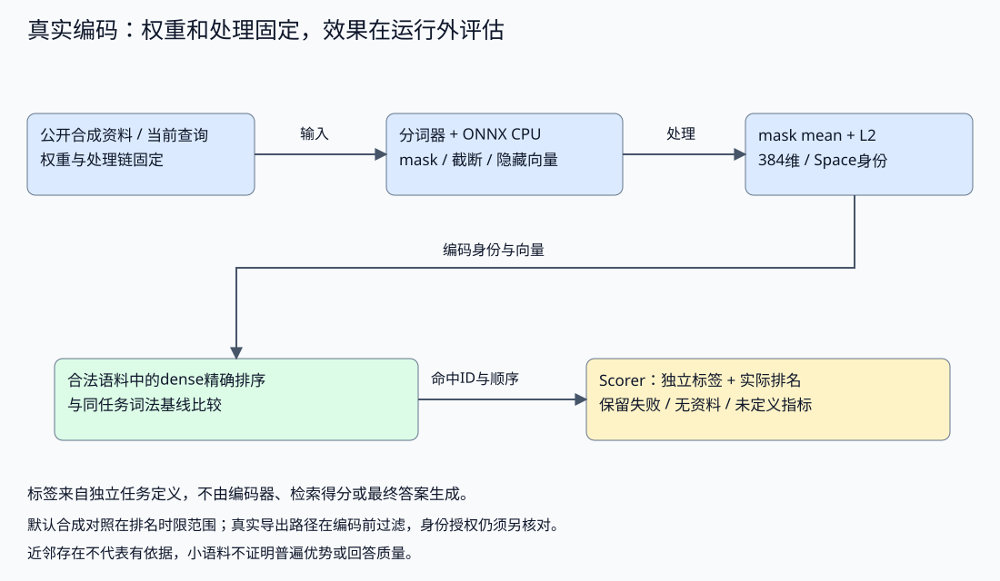

# 本地真实Embedding：同任务检索对照

用固定预训练编码器产生真实384维向量，对照同一英文语料中的简单词重合与精确dense排序。前置：[Retrieval](../../../../content/book/part3-agent/building/chapter27-rag.md#topic-ch28-vector-retrieval)、Go JSON/子进程、Python虚拟环境。原有Go module不新增依赖；Python仅为固定本地编码器伴随程序。

## 来源与复现身份

- sentence-transformers/all-MiniLM-L6-v2，固定revision `1110a243fdf4706b3f48f1d95db1a4f5529b4d41`，模型卡Apache-2.0。
- [assets-lock.json](assets-lock.json)锁定官方ONNX、tokenizer.json、Pooling配置的SHA256、大小、维度与处理；ONNX哈希已对照官方LFS OID。权重只在本机缓存，不进仓库。
- [requirements.lock](requirements.lock)是实际隔离Python3.12环境的完整固定版本；核心onnxruntime1.23.2、tokenizers0.22.1、numpy2.3.4。不是全局安装或其他应用依赖。
- [encoder.py](encoder.py)只读本地资产并逐个校验，不联网、不执行远程模型代码。ONNX CPU输出token隐藏向量，按attention mask平均，再L2归一化，最多256个wordpieces。
- 这个模型用于英文短句/段落；没有中文质量承诺或重新训练；下方假想文档对照另用生成模型，不向用户交付答案。实际资料比上限长时会截断，不能将vector shape正确当作原文完整。

## 默认验证与真实执行

从仓库根目录，Go准备见[运行约定](../../../../content/book/introduction.md#running-examples)：

```bash
go -C labs run ./part3-agent/chapter28/neural-retrieval
go -C labs test ./part3-agent/chapter28/neural-retrieval -race -count=1 -v
```

默认显示documents=8、questions=6、pretrained_embedding=not_run；仅接口与范围测试运行，真实模型测试明确跳过，不把默认成功当作模型已执行。

准备独立Python3.12 venv，按requirements.lock安装（显式联网准备）并从[固定模型提交](https://huggingface.co/sentence-transformers/all-MiniLM-L6-v2/tree/1110a243fdf4706b3f48f1d95db1a4f5529b4d41)取得assets-lock中三个文件。保持相同相对目录，每个文件必须匹配SHA256；程序拒绝缺失、修改或不匹配资产，不自动联网修复。

将绝对路径配置到可信应用环境：EMBEDDING_PYTHON为隔离Python，EMBEDDING_ASSETS为本地模型目录。模型提议不能选择执行程序或资产路径。

```bash
EMBEDDING_E2E=1 go -C labs run ./part3-agent/chapter28/neural-retrieval
EMBEDDING_E2E=1 go -C labs test ./part3-agent/chapter28/neural-retrieval -race -count=1 -v
```

本次真实结果：固定5个有必要资料的问题上，简单词重合Recall@1=.80，真实dense=1.00；六条问题均保留。unsupported问题没有相关资料，Recall分母为零，显示recall_known=false，但dense仍返回cancel近邻——这说明排名存在不等于回答有依据。

这不是BM25对照、中文评测、普遍模型成功率或生产延迟基准。重复运行可核对数值/排名；模型与硬件差异仍需锁定。相关性标签由任务作者提供，不进入编码器；Source/tenant/version先过滤，旧版与其他用户资料不能进排名。

## 数据与运行边界

最多32个文本，每段4096字节；子程序输入128KiB，Go输出2MiB与stderr4KiB，60秒执行期限。验证revision/space/dimension、数值有限和单位范数，记录query截断。文档截断也必须在真实应用中检查，不能只关注查询。

Go编码协议验证与本地推理验证分开；默认只做内存精确排序；显式双E2E已经将同一384维真实批次接入pgvector/HNSW。这个小语料联合实验不是生产性能链路证明。凭据、用户数据和网络生成均不参与。

## 同一编码进入真实向量库

在隔离vector_lab中运行，除了Embedding的本地绝对路径，还需VECTOR_DSN与专用数据库守卫。pgvector版本固定0.8.7，详情见独立向量库实验。

```bash
EMBEDDING_E2E=1 VECTOR_E2E=1 VECTOR_TEST_DATABASE=1   go -C labs test ./part3-agent/chapter28/neural-retrieval   -run '^TestActualEncoderToPgvector$' -race -count=1 -v
```

SeedEncoded由夹具应用写入session临时vector(384)表，存tenant、version、Space、model_revision；SQLDense仅在只读事务查询，参数绑定与返回范围复核同时成立。SQL不接收相关性标签，查询Space/revision先通过真实编码批次验证。

本次实际联合结果：六条查询的Go精确、SQL精确与HNSW首命中一致；EXPLAIN确认Seq Scan/HNSW，两类版本/身份数据不进入结果，五个有相关资料标签问题的ANN Recall@1=1.00。unsupported仍返回cancel近邻且Recall未定义。新建SCRAM集群测试后停止并删除认证/数据。小表诊断强制路径不代表性能、所有ANN无损或生产隔离。

## 假想文档查询与直接查询对照

生成器只接收问题，不接收语料或相关性标签。假想文档仅用于查询编码；排名仍只访问原始八条资料。它是HyDE式机制实验，不复现论文使用的模型与指标。

显式联网准备独立Python3.12环境，按[generation-requirements.lock](generation-requirements.lock)安装；从[固定SmolLM2提交](https://huggingface.co/HuggingFaceTB/SmolLM2-135M-Instruct/tree/12fd25f77366fa6b3b4b768ec3050bf629380bac)取得[generator-lock.json](generator-lock.json)的六个文件，保持相对路径并核对大小/SHA256。GENERATION_PYTHON与GENERATION_ASSETS分别为可信应用配置的隔离Python和资产目录绝对路径。生成器本地CPU运行、禁用远程代码，只读safetensors；不自动下载。

已准备Embedding环境后，从仓库根目录执行：

```bash
HYPOTHETICAL_E2E=1 EMBEDDING_E2E=1 go -C labs test ./part3-agent/chapter28/neural-retrieval -run '^TestActualHypotheticalQueryContrast$' -race -count=1 -v
```

默认不开启生成。显式启用但缺少编码器开关、资产、路径或协议不匹配时失败，不能通过skip冒充成功。每批最多八个问题，每个4096字节；提示模板后最多256输入Token、64新增Token，CPU单线程，Go子进程期限120秒，stdout64KiB、stderr4KiB。输入/输出计数使用生成器分词器，与MiniLM的wordpiece计数不同。

实际结果：五个有标签问题的直接/假想文档Recall@1均为1.00，六条首命中一致，unsupported仍有近邻但指标未定义。五条有标签生成触及64 Token上限；生成文本有医疗场景偏移与无资料支持的LFLOOP术语。不能根据排名一致把生成文本提升为事实；本次没有检索增益。测试记录全部文本、计数和排名，不断言扩展必须更好；输入均为公开合成教学问题。运行耗时包括加载，不作为生产延迟基准。

练习：在副本增加领域歧义、关键实体与无资料问题，先固定相关性标签，再比较两种查询。保留失败与无收益结果，检查生成文本是否截断、漂移，统计新增生成Token。若实现回退，明确空输出/超时/协议错误的条件并验证原始查询仍受Scope限制；不要把生成文本加入证据库。

## 单问题扩展的显式回退

[query_fallback.go](query_fallback.go)的SelectExpandedQuery只选择编码文本，不运行生成器或检索器。它接受原查询、单行带标签的Hypotheses及生成错误；完整候选可选用，坏协议/空文本/输出上限/步骤失败回到原查询，不修复或改写原候选。旧批量对照不变。

```bash
go -C labs run ./part3-agent/chapter28/neural-retrieval -query-fallback
go -C labs test ./part3-agent/chapter28/neural-retrieval -list '^TestQueryFallback'
go -C labs test ./part3-agent/chapter28/neural-retrieval -run '^TestQueryFallback' -race -count=1 -v
```

默认演示使用固定输出触顶的候选，不加载模型，输出：

```text
origin=original reason=output_limit generation_usage_known=true generation_tokens=20/64
```

这些是合成报告计数，不是新一轮实际模型usage。GenerationAttempted与GenerationUsageKnown分开：未尝试、尝试但无回报、已回报用量是三种状态。若有合法单行版本/提示及有界Token报告，即使候选被弃用也保留计数；源错误信息不写入Reason，原始候选和私有诊断由调用方另保留。

总context停止或下游Canceled返回错误、Text为空，不允许继续；只有步骤DeadlineExceeded且总context仍有效才可回退。检索入口必须检查错误、重新编码选定Text，并沿用原Scope/资料版本/Space。选择器不是缓存向量或授权策略，也不判断任意查询漂移。

[query_fallback_test.go](query_fallback_test.go)检查完整选择、触顶回退与用量保留、失败用量未知、错误版本/Trust/UTF8/原查询、总/步骤超时及取消。另用固定词项检索确认相同文本的另一用户/旧版本资料仍被排除；这不是实际Embedding收益测试。

迁移：在自己的副本将单问题生成→选择→编码→原范围查询串联，给步骤与总流程分别设置期限；保留原直接查询基线和全部失败。自行验证弃用文本的向量不会被复用，协议失败与取消不会混为回退，原语料不加入假想文本。新真实对照依旧沿上文显式门禁，不将本演示或原五题1.00召回当作效果提升。

## 候选原文交接给回答阶段

`-export-evidence`在真实编码开关启用时输出受限JSON，仅包含问题和选中的原始资料。编码前过滤demo/v1，拒绝查询或命中文档截断，不输出相关性标签、分数或假想文档。默认不生成候选，未启用EMBEDDING_E2E时显式失败。

候选的ID、来源形状与版本保留到回答阶段；检索排名没有回答成功含义。完整运行命令、Qwen生成与逐层失败结果见[回答链路实验](../evidence-answer/README.md#从真实检索候选到回答验证)。两个Lab分别启动，用公开协议交接，不依赖对方私有源码或上一次工作区状态。

## 练习

| 任务 | 起点与提示 | 验证方式 |
| --- | --- | --- |
| 模型空间改变 | 更换受核对资产与Space身份 | 旧vector不能同维度直接混用；记录模型/处理配置 |
| 输入截断 | 在副本使用超256 wordpieces文本 | truncated可见；不能将尾部事实未命中归因于向量库 |
| 更有力基线 | 相同语料加入BM25/真实分词与任务标签 | 同任务、同访问范围，保留全部失败/无标签情况 |
| 检索不能替代拒答 | 从main.go的fixtures中选unsupported，先检查Lexical/Dense与rank，再追踪-export-evidence交接 | 记录范围内候选、分数与RecallKnown；候选非空不表示能买票或扣款，回答支持与允许能力分别校验 |
| 接入向量库 | 将384维实际向量写入隔离索引 | 锁定维度/Space；分别证明编码、存储、ANN与语义Recall |

## 来源与许可

原创Go/Python封装、语料与问题，MIT。模型及tokenizers按Apache-2.0、ONNX Runtime按MIT、NumPy按BSD-3-Clause，依赖各自许可不由本项目覆盖；没有复制其实现，权重未随源码分发。机制参考[官方模型卡](https://huggingface.co/sentence-transformers/all-MiniLM-L6-v2)、[ONNX Runtime](https://onnxruntime.ai/docs/get-started/with-python.html)。后续权重/二进制分发需保留实际集合的许可声明。

假想文档生成对照使用SmolLM2-135M-Instruct固定revision（Apache-2.0）、Transformers4.57.1与safetensors0.6.2（Apache-2.0）、PyTorch2.9.0（上游许可随安装保留）。模型与Python依赖不分发；原创封装未复制上游实现。机制来源：[HyDE论文](https://arxiv.org/abs/2212.10496)。

## 公开本地编码命令行协议

应用可调用[encoder.py](encoder.py)的固定JSON协议：stdin仅对象texts（1–32个非空文本，每项4096字节、总128KiB），argv仅已校验固定资产目录；stdout为revision/space/dimension/truncated/vectors。调用方须核对锁定身份、数量、维度、数值及截断，再把批次绑定原请求。CLI是本地运行接口，不是认证或任意程序执行接口；上层显式EMBEDDING_E2E门禁和进程期限仍由应用入口落实。

联合实验可通过此公开协议复用编码器，不导入本topic私有实现；必须固定脚本与数据投影，不让模型选择路径、参数或执行环境。改协议时保留兼容契约与原始记录，不能只检查维度一致。

<a id="book-ch28-vector-retrieval-真实编码器的空间还包含处理配置"></a>

## 真实编码器的空间还包含处理配置

### 真实编码器的空间还包含处理配置

相同模型名也不一定得到相同表示：分词器、长度、截断、pooling与归一化都会改变向量。将最后一个Token、CLS表示或平均表示直接当成同一种Embedding，可能让维度正确却排序异常。

配套[真实本地编码实验]()锁定模型revision和资产哈希，用CPU ONNX执行all-MiniLM-L6-v2。编码器取token隐藏表示，再按可见token的mask平均、L2归一化：

```python
    mask = batch["attention_mask"][..., None].astype(hidden.dtype)
    pooled = (hidden * mask).sum(axis=1) / np.maximum(mask.sum(axis=1), 1)
    norms = np.linalg.norm(pooled, axis=1, keepdims=True)
    if not np.all(np.isfinite(pooled)) or np.any(norms <= 0):
        raise ValueError("invalid embedding")
    normalized = pooled / norms
```

padding不应稀释有效文本；截断后的向量也不能代表没有进入模型的尾部事实。输入长度、处理方式和空间身份应随向量保留，查询和资料使用同一条处理链。



Go接口在接收伴随程序结果时核对模型revision、Space、维度、截断字段与数值：

```go
func Validate(batch Batch, count int) error {
	if count < 1 || count > 32 || batch.Revision != revision || batch.Space != space || batch.Dimension != 384 || len(batch.Vectors) != count || len(batch.Truncated) != count {
		return ErrInput
	}
	for _, vec := range batch.Vectors {
		if len(vec) != 384 {
			return ErrInput
		}
		norm := 0.0
		for _, v := range vec {
			if math.IsNaN(v) || math.IsInf(v, 0) {
				return ErrInput
			}
			norm += v * v
		}
		if math.Abs(norm-1) > .001 {
			return ErrInput
		}
	}
	return nil
}
```

这个协议检查能拒绝另一空间或坏向量，不能证明模型适合所有任务。程序只读取本地已校验的资产，不执行远程模型代码；运行时、词表、权重与处理锁定后再评估召回。


<a id="book-ch28-vector-retrieval-同任务对照也要保留无资料情况"></a>

## 同任务对照也要保留无资料情况

### 同任务对照也要保留无资料情况

本实验的英文短语料包含同义提问、来源/版本过滤与无相关资料问题。标签在检索之外定义，编码器看不到答案；词重合和dense使用同一合法语料与top-k，再独立计算相关性Recall。

真实结果只描述这组语料和配置，不从五个有标签问题推导普遍优势。简单词重合不是BM25，多语言与规模也没有在本次验证。无相关资料的查询仍可能得到高排近邻，Recall分母为零时不显示虚假成功；RAG仍须检查证据不足与断言支持。

本地真实Embedding、数据库近似索引与端到端回答是三层证据。现在同一真实批次已通过[联合对照]()写入隔离pgvector的vector(384)临时表，继续用同一查询比较Go、SQL精确与HNSW。

[SQL查询](postgres.go)绑定编码身份及资料范围：

```go
const neuralSQL = `SELECT id,tenant,version,space,model_revision,1-(embedding <=> $5::vector) AS score
 FROM neural_items WHERE tenant=$1 AND version=$2 AND space=$3 AND model_revision=$4
 ORDER BY embedding <=> $5::vector LIMIT $6`
```

索引构建只说明存在结构，查询仍以EXPLAIN确认路径，返回值再检查tenant/version/Space/revision与有限分数。Query不接收评分标签，因此数据库不能从“正确资料列表”直接造出结果。

这次六条问题的首命中一致，只证明该语料、向量与配置的联合路径。真正回答还要经过证据选择、引用与支持校验；即使三条排名相同，也不能保证资料真实、问题可答或答案正确。

