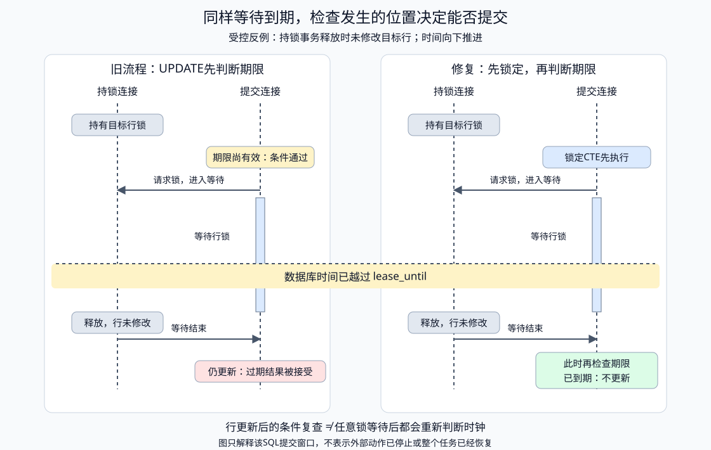
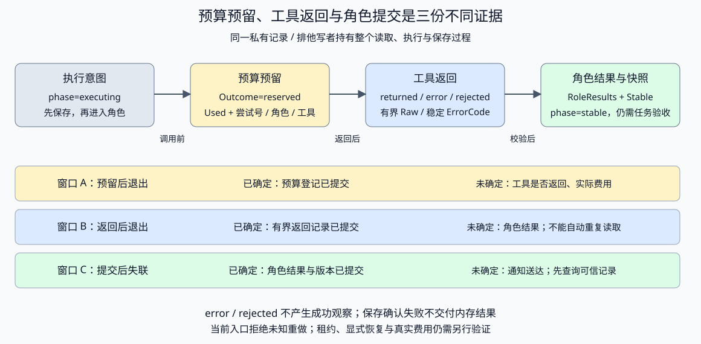

# 实验：角色能力、上下文与结果归属

固定只读事实分别由单执行者和两个角色取得。验证选定上下文、父/子能力交集、共享工具配额、深度、结果身份、来源和汇总冲突。标准库、离线，不调用真实LLM或其他聊天任务。

## 前置与入口

阅读[Delegation正文](../../../../book/part3-agent/runtime/chapter31-collaboration.md#topic-agent-delegation)、Tool、Context与Eval。准备见[运行约定](../../../../book/introduction.md#running-examples)。

- [main.go](main.go)：Task/Result、Toolbox、共享Ledger、Dispatcher与固定角色。
- [main_test.go](main_test.go)：窄能力、上下文复制、伪来源、深度/预算、冲突与迟到结果。
- [routing.go](routing.go)、[routing_test.go](routing_test.go)：应用任务类型到允许角色的选择，角色提议只在本次候选内接受。

## 预测与运行

子角色声明write-file，但父级只允许read-timeout/read-retry；结果是否可以执行？两个子任务分别使用完整预算是否会放大总调用？

```bash
go -C labs run ./part3-agent/chapter31/delegation
go -C labs test ./part3-agent/chapter31/delegation -race -count=1
go -C labs test ./part3-agent/chapter31/delegation -cover
go -C labs build -o /tmp/delegation ./part3-agent/chapter31/delegation
```

输出equivalent=true、delegated_roles=2、shared_tool_calls=2、facts=2。它证明相同固定事实可以保持交接契约，不证明多LLM效果或并行加速。

## 故障观察

- 子工具必须属于父批准范围，未知/未批准调用在执行前拒绝。
- 修改子Context不改父输入，也不能把修改后内容作为可信事实。
- TaskID/Parent/Actor/Scope不匹配或结果无本次观察：ErrResult。
- 深度与共享调用预算分别检查；Depth由运行层赋值，不来自模型。
- 汇总显式绑定本次Parent及父级预先登记的子任务ID→角色集合；少收、多收、未发起任务、错误角色、不同父级、Scope不匹配、重复TaskID或同键不同值：拒绝，不返回部分汇总。
- 取消后迟到结果不提交；子Handler仍要把context传给下游。

每个Toolbox单调用方拥有，角色/工具表运行前构建、期间只读。实验同Scope下有8事实上限；新增同进程Handoff；不实现消息总线、跨进程恢复、异步生命周期或任意自然语言支持判断。

expected由父流程在执行前建立，不能从收到的结果反推。TestAggregateChecksTrustedExpectedChildren通过真实Dispatcher结果验证集合与角色，乱序仍可汇总；TestCollectedResultDoesNotEraseMissingGoal验证收齐一份Missing结果后仍无目标事实。Aggregate只检查已校验内部结果；返回事实map不替代完整目标验收，调用方保留原Results中的Missing。预期集合上限8，不支持并发修改或自动动态任务版本。

## 路由先于Worker执行

SelectRole不解析自然语言：kind由可信应用绑定，routes为运行前配置。单一候选可直接选；多候选无提议返回ErrClarify；未知kind/坏配置返回ErrRoute；未知角色或已登记但不适用提议返回ErrDenied。选择不授予工具，Delegate继续检查能力交集、任务身份和结果。

```bash
go -C labs test ./part3-agent/chapter31/delegation -list '^TestRoleRouting'
go -C labs test ./part3-agent/chapter31/delegation -run '^TestRoleRouting' -race -count=1 -v
```

两个测试应实际运行且通过。TestRoleRoutingBeforeDelegation把选中角色接入真实Dispatcher：拒绝与澄清不启动Worker、不消耗工具配额；允许提议随后读取一次合法事实，角色声明的write仍被父级能力交集拒绝。TestRoleRoutingRejectsBrokenConfiguration覆盖重复候选、错登记、缺执行体、超限与其他类型的坏配置。映射最多8类，每类最多8候选，注册表最多8角色，标识最多128字节；配置运行中只读。它不验证模型分类或澄清对话效果。

## 数据体积与交接失败

Fact的Key非空且最多128字节，Source非空且最多256字节，Value最多4096字节；Missing仍最多8项，每项非空且最多256字节。它们是UTF-8字节限制，不是Token预算。父Context与Handoff初始事实在执行前检查，工具结果在收录观察前检查，子结果的缺失项在交付前检查。拒绝返回整个结果错误，不截断字段。

```bash
go -C labs test ./part3-agent/chapter31/delegation -list 'TestDelegationRejectsOversizedContextBeforeWorker|TestToolRejectsOversizedProvenanceBeforeObservation|TestMissingPayloadAndFactBoundary'
go -C labs test ./part3-agent/chapter31/delegation -run 'TestDelegationRejectsOversizedContextBeforeWorker|TestToolRejectsOversizedProvenanceBeforeObservation|TestMissingPayloadAndFactBoundary' -race -count=1 -v
```

[payload_test.go](payload_test.go)验证超限父输入不会进入Worker、超长工具来源不进入observed但实际尝试仍计入Ledger、空/超长Missing拒绝，以及刚好到上限的合法字段仍可通过。86个“界”是258字节，应被Missing校验拒绝。查到合法来源不能绕过体积限制；合法字段也不证明任务已完成。

## Handoff：同一任务的活动角色切换

```bash
go -C labs run ./part3-agent/chapter31/delegation -handoff
go -C labs test ./part3-agent/chapter31/delegation -run 'TestHandoff|TestTransferPolicy|TestRunningOwner' -race -count=1 -v
```

实际输出：run=report、owner=retry-reader、status=completed、hops=1、turns=2、facts=2、revision=7。第一个角色读取超时，移交后第二个角色读取重试；运行ID/Scope与工具账本不改变，两个角色合计两次工具读取。completed是应用显式终态，不是模型自报任务成功。

[handoff.go](handoff.go)复用Dispatcher/Toolbox校验事实来源，只在ready状态核对ID/Scope/Owner/Revision后移交。Execute先领取running，期间拒绝移交与重复领取，角色完成后验证结果再提交。已初始化角色、工具和边复制为本实例配置，Snapshot复制事实列表；回调为可信应用代码，不是Go代码沙箱。

测试覆盖旧请求、未知/自目标、跨Scope、执行中竞争、晚取消、伪造事实、政策副本、共享工具预算、回边次数和无工具轮次上限。请求身份参数为测试替身，真实HTTP入口须绑定身份，不接受客户端自报Owner/Scope。调用在领取前被取消不会改变运行状态；领取后执行取消进入canceled，迟到事实不提交。

实验上限为8个角色、8个选定事实、最多16次移交和32次角色执行；示例配额更小。没有新建工具预算、持久会话、进程崩溃恢复或跨实例租约。互斥只保证本实例串行执行，不能抢占忽略context的Handler。

练习：让A/B来回请求移交，观察Hops、Turns、工具预算分别何时拒绝；增加需要人工确认的移交，明确审批绑定目标与版本，并确保旧确认不再生效。不要把角色提示词变化当作状态已经提交。

## 保留完整子结果

[collection.go](collection.go)的CollectResults与Aggregate共用集合和体积检查；前者复制所有Facts/Missing，按TaskID排序，不合并或删除冲突。后者仍拒绝同键不同值，同值来源保留后到项。入口都消费Dispatcher来源验证后的内部结果；收取成功不代表目标完成。

```bash
go -C labs test ./part3-agent/chapter31/delegation -list '^TestCollectResults'
go -C labs test ./part3-agent/chapter31/delegation -run '^TestCollectResults' -race -count=1 -v
```

两个测试实际验证真实Dispatcher结果的双来源、冲突值和Missing均保留，换序得到相同收取记录，修改收取切片不改原输入；坏归属、重复/缺失集合和超限结果不返回部分交付。角色与来源独立性、事实支持以及目标完整性仍需另外判断。原正常与Handoff CLI保持原行为。


## 静止Handoff的编码与恢复

[checkpoint.go](checkpoint.go)提供CheckpointHandoff与RestoreHandoff。Schema1最多32KiB，绑定当前Task/策略版本/角色工具/交接边/上限，保留Owner/Revision/Hops/Turns/Facts与Ledger.Used。初始角色由NewHandoff内部保存，不从导出调用方猜测。

```bash
go -C labs test ./part3-agent/chapter31/delegation -list '^TestHandoffCheckpoint'
go -C labs test ./part3-agent/chapter31/delegation -run '^TestHandoffCheckpoint' -race -count=1 -v
```

四个测试实际执行：第一角色读取→移交→导出→新实例恢复→第二角色读取/完成，最终Revision7、Facts2、Used2；恢复不重复初始角色，也不清零预算。另一测试验证当前更高Used保留，以及错版本/归属/Owner/Revision/计数/重复事实、重复键和尾随JSON拒绝，失败不改账本。通道控制running时无法导出，退出回ready以后可编码；另验证初始事实不得丢失、无效UTF-8不能被JSON编码静默替换。

只支持静止ready/completed快照，拒绝failed/canceled/running恢复为可执行状态；零值实例和不可编码UTF-8事实拒绝。状态和配置保存期间只读，账本必须由本任务独占。编码接口是bytes；下方文件入口增加本机保存和单写者声明，bytes接口不支持租约或未知接管，文件入口另有显式只读重做；逐角色Result/Missing/原始观察也不在这个结构中。可信应用存储与权限/资料复核仍需集成，不能把指纹当签名。

迁移任务：为快照设计带同一Run/Scope归属的原子存储与领取协议，实际结束旧执行者后再由新进程恢复；保存逐角色缺项与全部尝试，重复恢复不得重置额度。使用原快照测试作回归，自行补保存/领取/结果提交窗口的硬退出和竞争测试，不只对bytes做roundtrip。

## 文件存储与跨进程CLI

[file_store.go](file_store.go)将快照写入私有0700目录，固定record.json/.record.tmp/writer.lock；记录64KiB上限、0600权限。临时文件Sync后Rename，再同步目录。变更操作在整个读取、执行与提交期间持有排他声明；没有公开清锁命令；结果未知仍默认拒绝，显式只读重做另见下文。

从仓库根目录运行，各命令是不同Go进程：

```bash
handoff_state_dir="$(mktemp -d)"
go -C labs run ./part3-agent/chapter31/delegation -store "$handoff_state_dir" -store-op init
go -C labs run ./part3-agent/chapter31/delegation -store "$handoff_state_dir" -store-op execute -store-owner timeout-reader -store-revision 1
go -C labs run ./part3-agent/chapter31/delegation -store "$handoff_state_dir" -store-op transfer -store-owner timeout-reader -store-revision 3 -store-to retry-reader
go -C labs run ./part3-agent/chapter31/delegation -store "$handoff_state_dir" -store-op execute -store-owner retry-reader -store-revision 4
go -C labs run ./part3-agent/chapter31/delegation -store "$handoff_state_dir" -store-op complete -store-owner retry-reader -store-revision 6
go -C labs run ./part3-agent/chapter31/delegation -store "$handoff_state_dir" -store-op show
```

最终Phase=stable，Stable.State为completed/Owner=retry-reader/Revision7/Facts2，Used2。CLI仅使用固定demo Scope与只读角色工厂；owner/revision是并发条件，真实入口必须绑定身份。旧内存-handoff和默认示例不变；新参数需要非空绝对-store，未知操作与旧版本拒绝。

```bash
go -C labs test ./part3-agent/chapter31/delegation -list '^TestHandoffStore'
go -C labs test ./part3-agent/chapter31/delegation -run '^TestHandoffStore' -race -count=1 -v
```

TestHandoffStoreResumesAcrossProcesses启动多个真实测试二进制进程顺序交接；TestHandoffStoreHardExitKeepsUnknown在工具内exit42，父方等待该进程结束后，验证锁保留及executing意图。测试只移除自己临时目录的锁，之后仍无法execute；不是自动恢复功能。TestHandoffStoreClaimCoversExecution用channel确认首工具进入，第二实例busy且工具零调用。ProcessHelper只作为子进程入口，不是独立场景数量。

硬退出时Stable是先前已提交的快照；Schema2的Used包含调用前持久预留，Attempts给出序号/角色/工具/执行Revision，不证明进入工具或收到结果，也不是真实账单。旧Schema1的Used仍仅为消耗下界。普通执行失败保存failed与已知Used，也不会自动改回stable。初始化不覆盖已有任务，保存确认出错不能用返回的内存状态当提交成功。当前不提供断电/网络盘保证、跨实例lease、完整原始响应/模型usage或费用明细；Schema3的角色Result/Missing见下节。

迁移：在已有尝试登记上补结果未知核查与费用来源，扩展当前显式只读恢复基线；核对旧执行者真实终止，不能仅删锁。自行加入提交窗口硬退出、失败后重试的累计消耗和旧代际迟到结果测试，现有正常跨进程/失败关闭测试只作基线。

### Schema2的调用前尝试登记

Schema2定义了最多128条Attempts；新的init产生后述Schema5并继续保存这些字段。Ledger的私有beforeTake在锁内接收批准工具与下一Used，先同步文件，再允许进入Tool；内存模式未配置回调，保留原行为。工厂每次创建未消费、未安装回调的独占账本，文件恢复提供累计消耗，不接入仍由其他任务修改的账本。

```bash
go -C labs test ./part3-agent/chapter31/delegation -list 'TestDurableReservation|TestLegacyStable|TestHandoffStoreHardExit'
go -C labs test ./part3-agent/chapter31/delegation -run 'TestDurableReservation|TestLegacyStable|TestHandoffStoreHardExit' -race -count=1 -v
```

硬退出子进程在工具入口读取record.json，确认当前Schema5/Used1/序号1/read-timeout已落盘后才exit42。正常跨进程流程最终有两条不同角色/工具登记。TestDurableReservationMustConfirmBeforeTool在意图提交后制造临时文件占用，保存被拒绝，工具零调用且磁盘未伪称预留成功。TestLegacyStableKeepsUnattributedConsumption将旧stable记录迁移到当前Schema5，InitialUsed保留1，下一新尝试号为2；坏序号拒绝。

Schema2校验Used=InitialUsed+尝试条数，以及连续序号、登记角色与批准工具；它不证明过去结果真实。旧Schema1只在下一次合法stable变更时迁移，未知执行不自动升级；更高预留或确认不明不会被失败分支清零。每次新尝试继续占原总预算。

### Schema3保存逐角色缺项

Schema3引入InitialTurns及最多32份RoleResults，当前Schema5继续保留，每份带Turn与完整Result，保留Facts和Missing；整体记录仍限64KiB，不依赖条数限制来保证所有极大字段都能保存。旧Schema1/2只在合法stable变更时迁移，原轮次作为未知历史基线，不补造结果；非stable仍停止。

```bash
go -C labs test ./part3-agent/chapter31/delegation -list '^TestRoleResults|^TestSchema2Migration'
go -C labs test ./part3-agent/chapter31/delegation -run '^TestRoleResults|^TestSchema2Migration' -race -count=1 -v
```

TestRoleResultsKeepMissingAfterReopenAndCompletion使用真实Handoff/文件存储：首角色返回Missing timeout而不查工具，移交后下一角色读取retry，完成并关闭重开，原Missing仍在；Used1对应唯一实际工具预留。completed只表示应用运行终态，任务仍缺timeout，不能删除这份记录当完整报告。

TestRoleResultsRejectBadIdentityOrPayload拒绝错Parent/Actor/Scope/Turn、错误聚合值、超长缺项和丢失结果。TestSchema2MigrationDoesNotInventRoleHistory保留旧轮次1/Used1，新结果从Turn2追加，旧结果不补写。结果归档不重新认证来源，也不替代语义与目标验收。

迁移：为缺项解决建立新证据与版本关联，保留原缺项、解决者与判断依据；自行测试后续角色补齐证据和仍未解决的情况，不把全部Missing清空作为完成实现。真实模型输出、逐次工具结果和账单仍需各自保留，不能从这个结构反推。

### Schema4区分工具返回与角色提交

新init产生Schema5并保留Schema4的工具结果字段。每个工具登记保留Outcome/Raw/ErrorCode：reserved先占配额，returned记录合法有界原Fact，error保存有界部分内容与稳定分类，rejected不存不合法大内容。afterReturn在预算锁内完成保存，确认以后才允许进入观察；不读Handoff锁或调用工具。

```bash
go -C labs test ./part3-agent/chapter31/delegation -list '^TestToolOutcome|^TestToolReturn'
go -C labs test ./part3-agent/chapter31/delegation -run '^TestToolOutcome|^TestToolReturn' -race -count=1 -v
```

TestToolReturnedBeforeRoleCommitSurvivesHardExit启动真实子进程，在box.Read成功返回后、角色提交以前exit42；文件仍executing/Used1，有returned与原timeout Fact，没有新RoleResults。TestToolOutcomeKeepsPartialErrorWithoutObservation保留部分Fact和tool_error，原错误链可识别，角色观察为零、诊断文本不入记录。TestToolOutcomeRejectsUnboundedRawPayload保留预留并记rejected，不截断4097字节内容。TestToolReturnSaveFailureDoesNotReachObservation在工具返回后拒绝保存，角色观察为零、磁盘仍只保留reserved，未提交的Raw不冒充已持久返回。

Schema1–3的Outcome为空表示当时未记录，stable可迁移但不补成returned；非stable仍拒绝重做。Returned不是真实费用或业务完成标签，也不自动授予使用过期资料的权限。记录仍限64KiB，保存确认失败后不交付未经提交的观察；原结果字节、模型usage和完整费用协议另行集成。

迁移：在独立副本把本工具记录与恢复尝试关联，核对当前证据/权限/版本后只补尚未提交的角色结果，验证不会重复读取；旧无结果、未知返回与错误结果另设恢复政策。自行测试保存结果前后退出与取消，不根据Outcome猜测外部副作用已经撤回。

### Schema5：显式只读重做与存储代际

Schema5保留此前结果/预算字段，增加Generation、Recoveries以及每次工具尝试的Generation。内存角色Revision不变，文件恢复代际另递增；后续变更使用ApplyVersioned，旧Apply只携带Generation0，恢复后不能继续修改。

RecoverReadonly只接受executing状态及Schema4/5的原任务快照。可信应用的HandoffRecoveryApproval须声明当前角色/版本为只读，且旧worker真实停止；声明不是退出探测或函数体校验，不从模型JSON读取。已有writer.lock仍返回ErrHandoffBusy，没有自动清锁。原角色轮次与工具配额不足时拒绝，不扩充账本或填造成功。

```bash
go -C labs test ./part3-agent/chapter31/delegation -list '^TestReadonlyRecovery'
go -C labs test ./part3-agent/chapter31/delegation -run '^TestReadonlyRecovery' -race -count=1 -v
```

[readonly_recovery_test.go](readonly_recovery_test.go)的reserved/returned两个子测试实际启动子进程并确认exit42，才移除自己的临时遗留声明。先验证缺确认、旧代际及重复恢复拒绝，再在初始化前固定为3配额的工厂中重做、移交、执行及完成。最终Used3/Attempts3、RoleResults2、Generation1；旧尝试与Raw原样保留，新两次尝试属于Generation1。不是三次成功读取：第一次是未确认角色提交的旧尝试。

另有错误版本/角色/只读声明、原预算已耗尽、伪造旧Schema恢复字段及取消反例。工具前连续中断使用人工构造的executing记录验证恢复次数上限，不冒称真实进程故障；活跃worker测试验证确认声明不能绕过当前文件锁。

CLI新增-store-op recover-readonly、-store-generation和-store-confirm-stopped。先show核对真实Phase/Owner/Revision/Generation，独立确认旧worker退出及私有锁处置，再明确提交只读恢复；这不是自动重试开关。随后所有execute/transfer/complete都携带新Generation，show可查询当前记录。默认固定工厂仍为2配额，重做一次以后可能无法完成另一角色；修改工厂上限会使原指纹不匹配，不是补配额办法。

新Schema的原子记录保存仍可能出现“已保存、响应未确认”，应查询当前代际，不把同一次恢复再次追加。旧Schema1–3执行未知仍拒绝，已failed不被恢复成stable；真实费用、lease与仅提交已有Raw的恢复未实现。

## 迁移练习

证据合并变体：从main.go的Aggregate与collection.go的CollectResults起步，在独立副本构造同Key/Value、不同Source的两份已验证结果，交换到达顺序，比较参数map与完整子结果。随后设计按环境/版本对齐的证据视图，新增测试验证来源不丢失、重复来源不增加独立证据数；明确“独立”的判定依据，不能仅比较URL或Source字符串。CollectResults仅提供收取基线，没有实现条件对齐、来源关系或仲裁，本练习不提供完整答案。


在独立副本选择任务，原测试只作为回归。以下新测试由学习者创建，仓库不预填实现。

| 任务 | 实际起点与需要新增的行为 | 新验收与观察 |
| --- | --- | --- |
| 1. 子任务集合动态变更 | 从Aggregate、CollectResults与TestAggregateChecksTrustedExpectedChildren起步，给应用持有的预期集合增加版本，定义增删与提交窗口 | 创建TestExerciseRevisedChildSet，核对旧结果不能填入新集合、响应不能创建预期任务、Missing和已发生尝试保留；已知费用保留，未知费用不填零 |
| 2. 最小父上下文 | 从Task.Context、Dispatcher.Delegate及TestChildPolicyContextAndResultIdentity起步，构造需要父范围或版本条件的子角色 | 创建TestExerciseMinimalParentContext，分别遗漏关键条件、提供必要事实、增加无关历史；捕获实际子输入，核对缺项与正确结果、8项上限和副本隔离，不用全部历史掩盖缺口 |
| 3. Handoff确认与撤回 | 从HandoffRequest、Transfer、Execute及TestTransferPolicyScopeHopAndTerminal起步，在应用层设计用户响应者、待确认快照与撤回规则 | 创建TestExerciseRevokedHandoffApproval，核对确认绑定ID/Scope/From/To/Revision，旧版本或撤回后不能移交；已经完成的工具不因撤回消失。现有Handoff没有人工审批层，不从模型文本取得确认 |
| 4. 接入真实子Loop | 从Role.Run、Toolbox.Read及Ledger起步，用自己的适配连接有界子Loop，保持父允许工具交集、任务输入和共享预算 | 创建TestExerciseBoundedChildLoop，先以固定提议核对停止、工具错误与累计次数；显式真实模型运行另保存原文、调用、usage与任务评分，并与同信息的单Agent基线比较。不得导入另一Lab私有实现，角色数不证明收益 |
| 5. 角色澄清仍须有依据 | 从routing.go的SelectRole及TestRoleRoutingBeforeDelegation起步，新增两个合法候选的任务类型，设计分类输入与澄清依据 | 创建TestExerciseClarificationStillAmbiguous，核对未知角色、合法但不适用角色、误分类及澄清后仍无依据时不执行、不消耗工具配额；选择后再检查子任务与结果，不动态创建Handler修复未知名字 |
| 6. 同值证据保留来源关系 | 沿上文Aggregate/CollectResults的证据合并变体，设计自己的环境/版本对齐视图 | 创建TestExerciseIndependentEvidenceSources，交换结果到达顺序，核对来源不丢、重复来源不增加独立证据数；独立性不能只靠URL或Source字符串判断 |

先核对新测试被发现，再运行所做任务与原基线：

```bash
go -C labs test ./part3-agent/chapter31/delegation -list '^TestExercise'
go -C labs test ./part3-agent/chapter31/delegation -run 'TestExercise|TestAggregateChecksTrustedExpectedChildren|TestChildPolicyContextAndResultIdentity|TestRoleRoutingBeforeDelegation' -race -count=1 -v
```

未列出新增名称，或只有原测试PASS，都不能算迁移完成。任务集合版本、审批协调、语义分类、子Loop效果与来源独立性是各自的新工作；现有收取、移交、路由与共享账本不自动提供它们。真人试学记录实际解释、失败与迁移结果，不以测试数量代替学习证据。

## 来源与许可

原创代码与固定事实，MIT。标准库[context](https://pkg.go.dev/context)、[sync](https://pkg.go.dev/sync)提供取消与共享账本同步。

## SQL租约与提交端fencing

[sql_lease.go](sql_lease.go)提供独立SQLLease：Scope/Task主键、应用Owner、数据库时间、递增Epoch和受控结果。活租约或已提交任务返回ErrLeaseUnavailable；Commit匹配owner/epoch/期限/未提交才接受，错误票据返回ErrHandoff。TTL为1秒至1分钟，身份字段UTF-8/非空/最多128字节，结果UTF-8/非空/最多4096字节。原文件Handoff没有迁移到SQL。

默认不连数据库。显式准备一个自有隔离delegation_lab与DELEGATION_DSN，只在该数据库创建course_delegation_leases；不连接业务数据库。pgx版本以labs/go.mod为准，不打印本地DSN。

```bash
go -C labs test ./part3-agent/chapter31/delegation -list '^TestActualSQLLeaseRejectsOldProcessResult$'
DELEGATION_LEASE_E2E=1 DELEGATION_TEST_DATABASE=1 go -C labs test ./part3-agent/chapter31/delegation -run '^TestActualSQLLeaseRejectsOldProcessResult$' -race -count=1 -v
```

实际父测试进程A取得epoch1，活租约期间B不能领取；管理连接受控将期限置为过去，A过期提交拒绝。辅助进程B取得epoch2后通过管道等待，父方分别提交“当前owner/旧epoch”和“错误owner/当前epoch”，均拒绝。父方再通知B提交current-B，核对不同PID与最终结果；原A无法覆盖，另一个用户不可读取。再次使已完成行到期后，仍不能重新领取。记录processes=2、epoch=1→2、old_commit_rejected=true；测试没有用sleep决定竞争。

到期注入只是自有表上的故障定位，不是网络分区或自然时间保证。Owner字符串不是认证；提交条件只保护此表的文本，不校验来源或任务目标。Claim/Commit遇到取消或连接失败可能已写入，未知确认要先查状态，不盲目重复外部动作。数据库隔离/权限、续租、epoch与Handoff状态/剩余预算连接、真实工具fencing以及跨实例故障恢复仍需联合验证。

[sql_lease_test.go](sql_lease_test.go)的默认参数反例不连接数据库，真实双进程测试必须门禁且不把skip当通过。辅助入口仅测试内部使用，不设置DELEGATION_LEASE_HELPER作为普通运行配置。

## 行锁等待期间租约到期

原Commit仅在UPDATE WHERE内判断clock_timestamp。实际PostgreSQL18.6反例中，条件在等待前成立；锁持有者不修改行、到期后释放时，旧语句仍接受结果。当前使用MATERIALIZED CTE先SELECT FOR UPDATE锁定目标行，外层更新再判断owner/epoch/期限及未提交。两阶段仍是一个短SQL语句，不持锁运行工具或模型。

```bash
go -C labs test ./part3-agent/chapter31/delegation -list '^TestActualSQLLeaseExpiryDuringRowLockWait$'
DELEGATION_LEASE_E2E=1 DELEGATION_TEST_DATABASE=1 go -C labs test ./part3-agent/chapter31/delegation -run 'TestActualSQLLeaseExpiryDuringRowLockWait|TestActualSQLLeaseRejectsOldProcessResult' -race -count=1 -v
```

沿用隔离delegation_lab与本地DELEGATION_DSN。[sql_lease_lock_test.go](sql_lease_lock_test.go)先持有行锁，专用提交连接最多一条连接；核对该PID在pg_stat_activity的wait_event_type=Lock，再轮询数据库clock_timestamp是否越过实际Until。释放未修改事务后，当前语句返回ErrHandoff且未保存结果；原语句反例返回nil。10ms轮询用于观察，8秒是失败保护，未用固定休眠当作锁等待证据。自有数据库测试管理用户需能查看该自有连接，不提升业务用户权限。

修改行之后的WHERE复查与未修改行锁等待是不同情况；仅增加一个时钟条件不保证检查顺序。真实双进程owner/epoch/结果护栏已同时复验。本修复不补租约续期、Handoff预算联合、外部fencing或数据库高可用。

## 接管后保留原预留次数

[sql_attempt_budget.go](sql_attempt_budget.go)按Scope/Task保存Limit/Reserved，初始化上限1–128。PrepareAttempts重复同一上限不清零，变化拒绝；ReserveAttempt先锁定租约及预算，核对owner/epoch/到期/未提交及剩余额度，再原子增加Reserved。SnapshotAttempts读取总数；准入不满足返回ErrAttemptUnavailable，不能单凭它猜是租约还是余额，应用需按可信范围核查。SQLLease.Init另建course_delegation_attempt_budgets，原租约表与API保持。

```bash
go -C labs test ./part3-agent/chapter31/delegation -list '^TestActualSQLAttempt'
DELEGATION_LEASE_E2E=1 DELEGATION_TEST_DATABASE=1 go -C labs test ./part3-agent/chapter31/delegation -run '^TestActualSQLAttempt' -race -count=1 -v
```

沿用自有delegation_lab与本地DELEGATION_DSN。双进程测试由A准备Limit2、预留1且没有结果，受控到期后B领取epoch2；B看到Reserved1，改上限为3拒绝，再预留到2后下一次拒绝，原A过期不得增加额度，另一user不影响原表。并发测试两个请求竞争Limit1，只有一个接受，最终Reserved1。原双进程提交与实际行锁到期反例一起复验。默认参数测试不连接DB，跳过不算真实通过。

Reserved只表示预留，不证明实际发送次数或费用。ReserveAttempt不是按稳定尝试ID幂等，失联/取消后的确认未知不得盲目重复或退款；总数不能定位原调用。协调者必须在统一工具入口接入此机制，独立Commit不强制预算。Handoff快照、发送意图、结果身份、真实usage/费用及跨实例恢复仍按原作品范围建设。辅助DELEGATION_ATTEMPT_HELPER仅供测试进程，不作为普通配置。

<a id="book-agent-delegation-提交端怎样实际拒绝旧代际"></a>

## 提交端怎样实际拒绝旧代际

### 提交端怎样实际拒绝旧代际

租约可以告诉协调者“现在允许B领取”，但A仍可能保留旧票据。提交端若只按Task ID更新，旧结果就有机会覆盖新状态。fencing必须落在接受结果的位置，不能只在worker本地做一次检查。

[SQLLease](sql_lease.go)以Tenant/User/Task为主键，由数据库时钟判断期限；领取时原子分配递增Epoch。它是独立提交机制，原文件Handoff仍保留自己的角色、预算与提交协议。

Commit在一条SQL中核对身份、当前owner、epoch、期限与未提交状态：

```go
func (s SQLLease) Commit(ctx context.Context, scope Scope, task, owner string, epoch int64, result string) error {
	if err := ctx.Err(); err != nil {
		return err
	}
	if s.DB == nil || !leaseIdentity(scope, task, owner) || epoch <= 0 || strings.TrimSpace(result) == "" || len(result) > 4096 || !utf8.ValidString(result) {
		return ErrDenied
	}
	var accepted int
	err := s.DB.QueryRowContext(ctx, `WITH locked AS MATERIALIZED (
 SELECT tenant,user_id,task_id,owner,epoch,lease_until,result FROM course_delegation_leases
 WHERE tenant=$1 AND user_id=$2 AND task_id=$3 FOR UPDATE)
 UPDATE course_delegation_leases AS target SET result=$6 FROM locked
 WHERE target.tenant=locked.tenant AND target.user_id=locked.user_id AND target.task_id=locked.task_id
 AND locked.owner=$4 AND locked.epoch=$5 AND locked.lease_until>clock_timestamp()
 AND locked.result IS NULL RETURNING 1`, scope.Tenant, scope.User, task, owner, epoch, result).Scan(&accepted)
	if errors.Is(err, sql.ErrNoRows) {
		return ErrHandoff
	}
	if err != nil {
		return err
	}
	return ctx.Err()
}
```

只有匹配行才返回成功。旧epoch即使搭配当前owner也不能写入；当前epoch搭配错误owner也不能写入。已有结果的任务不再领取，避免过期以后重新创建一份“未完成”状态。身份字段必须由应用绑定，Owner字符串本身不是凭据；看到新的epoch也不能替旧尝试换票据。



**期限检查要发生在取得行锁之后。** 普通UPDATE中写了clock_timestamp，并不自动保证等待结束后重新判断时间。配套反例先持有目标行锁，再确认提交连接确实处于Lock等待；租约到期以后释放未修改的行，原语句仍接受了迟到结果。

修复使用MATERIALIZED CTE先按主键取得FOR UPDATE锁，外层更新再核对锁定记录的owner、epoch、期限和结果状态。这样，期限判断不会提前到行锁等待之前。Read Committed在并发更新行后会复查条件，但不能把这种复查理解为任意未修改行的锁等待后都会重算时钟。

测试同时观察数据库时间和连接等待状态，再释放事务，不用固定sleep猜先后。该检查保护的是这次SQL写入的判断点；结果交付后的期限变化、数据库时钟变化与外部副作用仍有自己的边界。

领取与执行不共享长事务。ON CONFLICT处理时，更新分支按当时的数据库时钟重新计算期限，避免使用等待行锁之前已经算好的到期时间。模型或工具调用在事务之外进行，返回后再用原票据提交；提交失败并不撤销已经完成的外部读取。

客户端没收到确认，状态可能已经改变。这里的Claim和Commit都会传递context，并在返回后检查；取消或连接错误仍可能形成结果未知。先查持久状态，再按原身份和恢复政策处理，不能直接无限重新领取或覆盖。这个结果表只保护受控文本提交，断言支持、父目标版本、工具结果身份与业务完成还要独立检查。

双进程实验先由A领取，再受控使其到期，B在另一进程取得新epoch；B提交前分别检查旧epoch和错误owner，确认拒绝不能仅由“已有结果”解释。B提交后保留其结果，旧进程无法覆盖。管理连接的到期注入只定位协议窗口，不证明自然租约时序、网络分区或高可用。

SQLLease尚未与完整Handoff快照、累计工具/费用预算、续租或外部服务fencing联合。条件更新证明当前表拒绝旧写者，不证明旧worker停止，也不替代数据库权限与真实身份认证；这些仍属于协作作品的交接范围。


<a id="book-agent-delegation-次数预留随任务保存不随epoch重建"></a>

## 次数预留随任务保存，不随epoch重建

### 次数预留随任务保存，不随epoch重建

A预留了一次查询机会后失联，协调者没有结果可以判断查询是否发生。B重新领取任务时，若创建一个空账本，就会把原来的占用抹掉。租约回答谁能提交，预算回答还有多少接纳空间；两者需要绑定同一任务，而不能由新owner各自初始化。

[持久预留表](sql_attempt_budget.go)按同一Tenant/User/Task保存原Limit和Reserved。PrepareAttempts重复准备同一上限时保留计数，改大或改小都拒绝。ReserveAttempt先锁定当前租约与预算，再核对资格和剩余量：

```go
func (s SQLLease) ReserveAttempt(ctx context.Context, scope Scope, task, owner string, epoch int64) (AttemptBudget, error) {
	if err := ctx.Err(); err != nil {
		return AttemptBudget{}, err
	}
	if s.DB == nil || !leaseIdentity(scope, task, owner) || epoch <= 0 {
		return AttemptBudget{}, ErrDenied
	}
	var budget AttemptBudget
	err := s.DB.QueryRowContext(ctx, `WITH locked AS MATERIALIZED (
 SELECT l.tenant,l.user_id,l.task_id,l.owner,l.epoch,l.lease_until,l.result,b.max_attempts,b.reserved
 FROM course_delegation_leases AS l JOIN course_delegation_attempt_budgets AS b
 USING(tenant,user_id,task_id) WHERE l.tenant=$1 AND l.user_id=$2 AND l.task_id=$3 FOR UPDATE OF l,b)
 UPDATE course_delegation_attempt_budgets AS target SET reserved=target.reserved+1 FROM locked
 WHERE target.tenant=locked.tenant AND target.user_id=locked.user_id AND target.task_id=locked.task_id
 AND locked.owner=$4 AND locked.epoch=$5 AND locked.lease_until>clock_timestamp()
 AND locked.result IS NULL AND locked.reserved<locked.max_attempts
 RETURNING target.max_attempts,target.reserved`, scope.Tenant, scope.User, task, owner, epoch).Scan(&budget.Limit, &budget.Reserved)
	if errors.Is(err, sql.ErrNoRows) {
		return AttemptBudget{}, ErrAttemptUnavailable
	}
	if err != nil {
		return AttemptBudget{}, err
	}
	if err := ctx.Err(); err != nil {
		return AttemptBudget{}, err
	}
	return budget, nil
}
```

返回Reserved是已接纳的预留序号，不是已证明发送了几次请求。成功预留后，调用方才进入受控执行；取消或失联不能把原预留自动退回。接管后可以重新读取总数，旧占用和原上限仍约束新执行者；缺失、过期、错owner/epoch或额度不足统一拒绝，不从错误文字猜原因。

完整交接按顺序处理：

1. **保存原政策**：任务身份与上限由应用确定，模型不能通过换Task ID或owner创建新的完整额度。
2. **领取当前资格**：取得本次epoch；重新领取不改预算表。
3. **执行前预留**：在有效租约和余额条件下增加Reserved，再调用允许工具；并发请求不能各自看到同一余额后无条件扣除。
4. **接管后核对原占用**：保留未知执行与已知失败，额外尝试继续占原上限。
5. **分别确认结果与消耗**：结果提交仍走fencing，实际usage和费用仍按独立账本核对，不能拿预留数代替实际消耗。

当前ReserveAttempt不提供稳定尝试ID的幂等映射。客户端没有收到确认时，预留可能已写入；总数快照不能说明哪次调用占用了它。不得盲目重复预留或执行，完整恢复还需接入原尝试身份、发送意图、结果查询及费用交接。

原独立Commit接口并不强制所有调用先预留，这项机制需要由协调者接入统一执行入口。实验验证租约接管继承次数上限和原占用，不证明所有外部工具已经受该上限约束，也未将文件Handoff或真实费用迁入SQL。


<a id="book-agent-delegation-静止快照怎样移交角色与剩余预算"></a>

## 静止快照怎样移交角色与剩余预算

### 静止快照怎样移交角色与剩余预算

角色已从timeout-reader移交给retry-reader时，重新创建一个默认Handoff会回到初始角色，也会把工具账本清零。恢复需要原任务、当前Owner、Revision、已确认事实和累计消耗，不能只保存一份模型摘要。

配套[Handoff快照](checkpoint.go)先提供这些状态的有界编码与恢复：只在ready或completed时导出，running时拒绝。快照Schema1记录配置指纹、状态及Used；配置指纹同时绑定原任务、初始角色、登记能力、交接边与预算上限，恢复使用当前可信配置重新核对。

恢复依次完成：

1. **检查记录形状**：有界UTF-8 JSON，拒绝重复键、未知字段与尾随内容。
2. **核对当前配置**：任务与Scope一致，策略版本、角色工具、交接边及各上限匹配；函数实现由应用版本标识，不把函数地址当可移交配置。
3. **核对状态关系**：Owner必须能经已记录次数的批准交接到达，轮次/移交不超限；Revision符合当前状态的推进规则，事实有界且保留初始上下文。
4. **承接累计消耗**：当前账本已经消耗更多时不回退，旧快照也不能恢复一份新配额。
5. **恢复活动角色**：复制确认事实，新实例从保存的Owner继续；completed状态不会重新执行。

最后的提交同时保留更高的当前消耗：

```go
	d.Ledger.mu.Lock()
	defer d.Ledger.mu.Unlock()
	if d.Ledger.Used < 0 || d.Ledger.Used > d.Ledger.Limit {
		return nil, ErrHandoff
	}
	d.Ledger.Used = max(d.Ledger.Used, saved.Used)
	h.state = s
	h.state.Facts = append([]Fact(nil), s.Facts...)
```

这个编码接口本身返回或消费字节。导出得到的字节不等于已经持久保存，同一个快照恢复两份实例也没有唯一执行者；下面的文件入口补上本机保存与单写者交接，并提供显式只读重做政策，租约仍需另行实施。

快照只保存Handoff聚合事实与运行状态，逐角色Result、Missing、原始观察和费用明细需要另外的执行记录。账本要求由该任务独占，并在静止点保存；其他任务仍共用或修改同一账本时，不能把局部快照当完整全局消耗。配置指纹不认证来源，只从可信应用存储加载，禁止让模型提供恢复记录或自行重置计数。


<a id="book-agent-delegation-文件保存与进程执行怎样形成一次交接"></a>

## 文件保存与进程执行怎样形成一次交接

### 文件保存与进程执行怎样形成一次交接

[HandoffStore](file_store.go)把静止快照放在私有目录中，保存与执行各有自己的边界。临时文件写完并同步后替换正式记录，再同步目录；写者从读取到执行和保存一直持有排他声明，另一个实例不能同时使用旧快照。

一次execute按以下步骤推进：

1. **领取单写者声明**：排他创建writer.lock；已存在时返回busy，不按文件年龄抢占。
2. **读取当前记录**：核对配置、身份、快照与累计消耗，再检查调用方的Owner和Revision；旧请求不能自动改用新版本。
3. **保存执行意图与工具预留**：先持久提交executing，再开始角色；每次获准工具调用还须先登记尝试号、角色、工具及执行版本，占用配额，保存确认成功后才进入工具。
4. **提交新静止状态**：执行正常结束后，保存新的角色状态、事实与累计Used，再将phase改回stable；确认失败不先对外宣称提交成功。
5. **正常释放声明**：正常返回移除自己的锁；硬退出会留下锁与执行意图，后续变更停止。

调用前的预算回调把预留保存放在工具执行以前；移交与完成则不触发新的角色执行：

```go
		h.dispatcher.Ledger.beforeTake = func(tool string, next int) error {
			if len(record.Attempts) >= 128 || next != record.Used+1 {
				return ErrBudget
			}
			record.Attempts = append(record.Attempts, HandoffToolAttempt{Sequence: next, Generation: record.Generation, Actor: request.From, Tool: tool, Revision: request.Revision + 1, Outcome: "reserved"})
			record.Used = next
			return s.save(record)
		}
```

执行成功、文件提交与调用方收到响应仍是三个事实。若重启看到stable记录，可以从已提交Owner/Revision继续；看到executing，只能确认结果尚未登记，不能确认工具没发生。Stable保留先前已提交状态。工具登记中的Used还包含已持久预留，Attempts给出逻辑身份；登记以后、进入工具以前也可能退出，所以预留不证明工具执行或真实费用。没有尝试身份的旧记录仍只有先前消耗下界，不能据此补造历史。

配套子进程对照实际完成“初始化→第一角色读取→移交→新进程读取→完成”，最终两份事实、Used2和Revision7保持。另一个子进程在工具内硬退出：写者锁保留；测试父进程确认它退出并移除自己的临时锁后，默认execute仍被executing意图拒绝。**清掉锁不等于解决未知执行。** 显式只读重做还要核对应用批准、版本和剩余配额；当前入口没有自动清锁或租约。

保存预留失败时，执行器不调用工具；若替换文件已经发生、确认却失败，保留可能已占用的配额并停止，而不将它回退为零。新的登记号是本Run内累计序号，结合原任务、角色和执行版本关联；它没有提供外部工具的幂等键或结果查询能力。

迁移旧stable记录时，把原Used记为InitialUsed，新的登记从原消耗后继续。旧executing或failed仍停在原状态，不因为能读旧格式就自动重做。后续显式恢复还需确认原执行者终止、核查结果并记录新尝试；当前记录没有把这些责任交给模型。

私有目录使用固定文件名与os.Root，不允许模型指定存储路径。它支持本机单写者，不提供网络文件系统一致性、存储来源认证或断电实验结论。文件记录同时保存逐角色Result、Missing和有界工具返回；完整原始响应、模型usage和费用明细仍需执行账本，不能由聚合事实补出完整历史。


<a id="book-agent-delegation-缺项也要随角色结果一起保存"></a>

## 缺项也要随角色结果一起保存

### 缺项也要随角色结果一起保存

角色返回“未找到超时资料”时，执行可以正常结束，但父任务仍缺少证据。若只持久保存聚合Facts，下一进程看到的是没有timeout这个键，无法知道原角色明确报告了缺项，还是这一步尚未尝试。结果身份、事实与Missing应一起进入交接记录。

角色提交把成功收取的Result与新静止状态同次保存，按执行轮次归档；读取时核对TaskID、Parent、Scope、登记角色、字段体积及事实值与聚合状态的关系。代码先复制两类列表，再发布结果记录：

```go
	if operation == "execute" {
		roleResult.Facts = append([]Fact(nil), roleResult.Facts...)
		roleResult.Missing = append([]string(nil), roleResult.Missing...)
		record.RoleResults = append(record.RoleResults, HandoffRoleResult{record.Stable.State.Turns, roleResult})
	}
	if !validHandoffResults(record, h) {
		return record, ErrHandoff
	}
```

Missing不会因为后续角色成功、结果收齐或运行标成completed而删除。父级需要决定它是否已经被新证据解决，再作业务验收；保留旧缺项是执行事实，不意味着它永远无法解决。不能只删掉Missing来提高完成率。

缺少角色结果的旧记录迁移时保留原轮次作为InitialTurns，新结果从后续轮次追加，不猜旧Actor或补写缺项。保存确认失败或记录超过整体容量时，调用可能已经发生，入口返回错误并保持原执行意图；不能把未提交的内存Result交给用户冒充持久成功。


<a id="book-agent-delegation-工具返回与角色提交之间还有一个窗口"></a>

## 工具返回与角色提交之间还有一个窗口

### 工具返回与角色提交之间还有一个窗口



只记录调用前的预留，无法判断工具究竟没有返回，还是返回以后程序在整理角色结果时退出。执行器在工具返回以后、进入角色观察以前记录本次序号、原Fact和稳定错误分类。执行器先保存返回，再决定是否回填：

```go
	fact, err := tool(ctx, t.scope)
	if commitErr := t.ledger.returned(sequence, name, fact, err); commitErr != nil {
		return Fact{}, errors.Join(err, commitErr)
	}
	if err != nil {
		return Fact{}, err
	}
```

有界原Fact与error可以同时存在：读取返回部分数据又报错时，部分内容留作诊断，不进入成功观察。错误记录使用tool_error、canceled或deadline_exceeded等稳定分类，原错误链仍交给调用方，不把内部诊断文本写入公开记录。无效或过大的原Fact记为rejected，不截断成看似合法的事实。

尝试记录的几种状态承担不同判断：

| 记录 | 能确认什么 | 不能据此推断什么 |
| --- | --- | --- |
| reserved | 已占用并登记预算 | 工具一定开始、已经完成或未产生费用 |
| returned | 有界工具内容已保存 | 角色结果已提交、任务完成或资料仍有效 |
| error | 工具返回错误，可能附有界部分内容 | 部分内容可以当作成功观察 |
| rejected | 返回不符合接受边界 | 丢弃或截断后可以继续冒充成功 |
| 旧记录未填Outcome | 当时没有保存这个字段 | 从角色终态补出逐次工具成功 |

实际硬退出发生在工具返回已保存、角色尚未返回的位置时，重开可以看到returned和原Fact，却没有新的RoleResults。当前入口仍保留executing并停止重做；后续恢复要核对结果与当前授权/版本，再决定补提交或重新执行，不能由模型自行把returned改成整项任务成功。


<a id="book-agent-delegation-只读重做保留旧消耗也改变控制代际"></a>

## 只读重做保留旧消耗，也改变控制代际

### 只读重做保留旧消耗，也改变控制代际

执行者在工具调用后退出，旧快照仍为ready，文件外层却为executing。旧工具可能已经返回，角色结果仍未提交；恢复不能把ready解释成“没有执行过”。

[RecoverReadonly](file_store.go)提供显式重做政策：应用确认旧worker已停止、当前登记的角色实现为只读，并核对原任务/配置指纹、Owner、Revision与存储Generation。声明来自可信调用层，不能从模型回答构造；声明本身也不是操作系统退出证明或代码副作用检测。

恢复分为两次提交：

1. **重新接纳控制**：仍需取得原文件的排他声明，活跃写者存在时拒绝；不自动删除遗留锁。
2. **核对当前请求**：任务、Scope、角色与原Revision正确，Generation仍匹配，原配额与轮次允许继续。
3. **保存恢复决定**：保留全部旧尝试、原结果和角色缺项，将已预留Used放回稳定检查点，增加存储Generation。
4. **执行新尝试**：后续请求携带新Generation，再调用角色；每次工具读取继续占原预算，结果重新经过原交付检查。

保存恢复决定不会运行角色，也不将旧结果标为成功。关键更新是：

```go
		record.Schema, record.Phase = 5, "stable"
		record.Generation++
		record.Recoveries = append(record.Recoveries, HandoffReadonlyRecovery{record.Generation, request.From, request.Revision, record.Used})
		record.Stable.Used = record.Used
		return record, s.save(record)
```

内存Handoff的Revision继续描述角色执行与移交；Generation描述文件层的恢复决定。原角色Revision不变时，旧Generation请求仍被拒绝。两者一起定位控制条件，不能把“重新打开同一目录”当作新执行者已经取得所有权。

工具尝试另保存自己的Generation及连续Sequence，旧代际的reserved或returned仍保留。恢复次数与已提交角色轮次共用原角色轮次上限，避免连续在工具调用前退出而绕过执行预算；工具配额耗尽时，即使确认只读也不能重做。

固定三配额测试在第一次读取后真实退出，再重做超时读取、移交并读取重试，最终保存三个工具尝试及两份角色结果。三配额在首次初始化前已绑定，不能在恢复时把原两配额任务改成三配额。默认CLI仍只有两配额，因此恢复当前角色后可能已经没有额度完成另一角色；安全重做不保证任务一定完成。

这条路径覆盖本机排他文件与固定只读角色。执行实例的lease/fencing、外部结果核查、真实费用和角色分工收益继续单独验证；已返回结果怎样只补角色提交而避免重读，也是另一份恢复契约，不能由此实现继承。


<a id="book-agent-delegation-最佳实践"></a>

## 最佳实践

## 最佳实践

### 角色有窄职责与结果契约

写清要交付什么、缺失怎么报告、允许哪些能力。不要仅靠“专家”“负责人”等名称承担边界。

### 分享必要信息，不分享隐式权限

主流程选择背景与证据，应用选择工具与身份。数据中的指令、Role描述和共享文件都不能扩大能力。

### 汇总先验证，失败保持可见

结果身份、来源、冲突和任务完整性检查后再交付。缺失目标保留标记，不能通过删除失败角色的结果美化成功率。


<a id="book-agent-delegation-常见问题排查"></a>

## 常见问题排查

## 常见问题排查

### 子角色能调用父级所有工具

核对角色请求与父级批准交集，检查是否直接传入完整注册表。用未批准工具反例验证执行前拒绝，不仅修改角色Prompt。

### 父历史被子任务修改

检查输入是否共享可变列表、map或状态对象。复制选定输入或明确只读所有权，再用修改子副本的测试复验。

### 两个子结果无法关联或互相矛盾

先查任务与Scope，再查Source版本和目标。任务ID不匹配直接拒绝，事实冲突补证据或停止，不按到达顺序任意覆盖。

