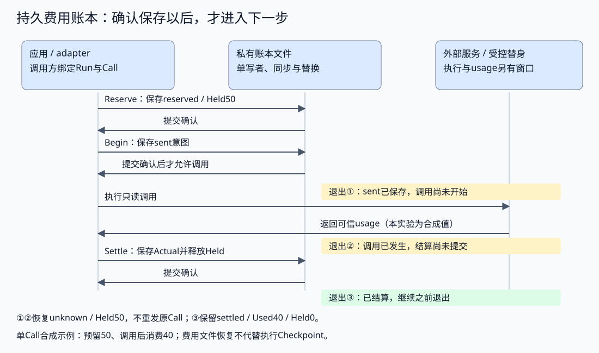

# Cost Ledger：预留、结算与每成功任务成本

用独立标准库账本验证成本契约。前置：[Runtime](../../../../content/book/part3-agent/runtime/chapter29-execution.md#topic-agent-runtime)、[Eval](../../../../content/book/part3-agent/governance/chapter35-evaluation.md#topic-agent-eval)。全部使用固定usage、独立成功标签和虚构microcredit，不调用真实Provider，不给出现实模型价格或收益结论。

## 机制与边界

- 一个Ledger绑定一个Run与一个计量单位；应用传递Ledger和本地Call ID，模型不能指定结算值。子任务应共享同一账本，不复制预算。基础Ledger为内存；DurableLedger提供下述本地单写者提交，不提供跨实例租约。
- Input、CacheRead、CacheWrite、Output是互斥标准化项；adapter须按实际Provider口径转换。Input三项总和最多100万、Output最多100万，费率0–100万单位/Token；64条记录，使整数计算不溢出。
- Reserve按最贵输入类别和输出上限预留，Used+Held一起参与接纳；缓存命中只在实际结算后释放差额。价格快照随Call锁定，不因调用方改Price而追溯变化。
- Begin是发送边界；发送前ctx取消→not_sent并释放预留，Begin以后错误/取消不证明未计费。Unknown保留预留；后续实际usage可以结算。
- Settle只支持已发送/未知记录，相同usage重报幂等，不同usage重报拒绝。无效usage不当作零费用。超出预留/Token边界时仍记实际费用，并冻结新调用，不把账单截断到预算。
- Ledger不是Provider费用强制上限：输入计数、最大输出参数、价格适用条件仍须真实adapter保证；本地撤销不能撤销外部计费。
- Summarize包括失败任务的全部调用与重试消耗；费用缺失显示覆盖率，零成功时每成功成本未定义。Compare核对相同Case集合与单位，再使用示意质量下限/成本条件，不验证真实模型、缓存、路由、并行延迟，也不授权上线。

## 运行

从仓库根目录执行，Go/依赖准备见[运行说明](../../../../content/book/introduction.md#running-examples)：

```bash
go -C labs run ./part3-agent/chapter33/cost-ledger
```

输出：

```text
used=140 held=0 unit=microcredit price=teaching-v1
fixture_cost_per_success cheap=120 strong=90
```

价格是每Token虚构单位：普通输入2、缓存命中1、缓存写入3、输出4。100输入/20输出预留380；实际20输入、60命中、10输出结算140。两组固定记录只演示失败费用进入分子，不证明现实模型更便宜或更好。

```bash
go -C labs test ./part3-agent/chapter33/cost-ledger -race -count=1 -v
```

应全部PASS：并发接纳保留全部在途额度、固定价格与重复结算、发送前取消/发送后未知、对账、超额记账与冻结、无效数据不退款、整数边界、失败成本/未知覆盖、同任务集和质量下限。

## 缓存写入何时摊平

```bash
go -C labs test ./part3-agent/chapter33/cost-ledger -run '^TestCacheWritesNeedEnoughReuseToAmortize$' -race -count=1 -v
```

[cache_test.go](cache_test.go)使用同一Price与100个稳定Token，逐次执行现有Ledger预留、发送和结算，不新建缓存服务。普通输入费用200，缓存首次写入300、后续读取100；1/2/3/5次时无缓存为200/400/600/1000，缓存为300/400/500/700。第二次打平，第三次才省。

五次中第1/4次写入时缓存为900；三次全重写则900高于无缓存600。每项均验证已知结算总数和Held归零。输出与动态输入在两边相同，本表只比较稳定部分，不计算整个任务账单或现实Provider收益。

真实使用时保留每次写入/命中usage、价格和周期边界，确认前缀版本及权限仍适用；期限到达或内容变化后不能沿用一次写入的假设。原默认demo输出不变，原“缓存与路由对照”练习继续要求实际usage和独立成功标签。

## 账本重建：未知预留不能丢

[restore.go](restore.go)的RestoreLedger接收已经由可信存储绑定到Run的Snapshot及原单位/限额；复算Call预留、Actual、Used/Held与冻结，拒绝不一致状态。sent转unknown而不是再次发送；reserved只有在持久协议确认未跨Begin时才能续用。输入Snapshot不是新增JSON外部入口，调用者负责来源、严格解码与身份。

```bash
go -C labs test ./part3-agent/chapter33/cost-ledger -list '^TestRestore'
go -C labs test ./part3-agent/chapter33/cost-ledger -run '^TestRestore' -race -count=1 -v
```

固定JSON往返后：limit100、Used20、Held50仍只允许30，预留31返回ErrBudget；Call2不能再次Begin，结算实际40后Used60/Held0。同usage重报幂等，不同usage冲突，输入快照修改不影响账本。另验证取消的not_sent不占额度、overrun继续冻结，以及重复ID、改上限/单位、假价格/预留/费用/状态或汇总均拒绝。

重建测试使用JSON往返，不证明账单来源。下述DurableLedger补实际文件与进程退出；跨实例、真实usage和执行Checkpoint联合仍分别验收。

## 持久账本：发送意图与结算窗口

[durable.go](durable.go)提供OpenDurableLedger与Reserve/Begin/Unknown/Settle/Snapshot/Close。操作者传入自己的私有os.Root目录（0700）、可信Tenant/User/Run及原单位/限额；它使用固定ledger.lock、ledger.tmp、ledger.json，模型不能选择路径、身份或结算值。状态文件0600、最多64KiB，拒绝重复/别名键、非法UTF-8、未知/尾随JSON与过深结构。

```bash
go -C labs test ./part3-agent/chapter33/cost-ledger -list '^TestDurable'
go -C labs test ./part3-agent/chapter33/cost-ledger -run '^TestDurable' -race -count=1 -v
```

TestDurableCrashWorker默认跳过，仅由TestDurableLedgerHardExitKeepsUncertaintyAndSettlement启动的三个子进程执行；实际父测试不能全跳过。子进程退出93，父进程Wait确认退出后只处理本次私有目录的遗留锁，再重新打开。

| 硬退出窗口 | 受控调用日志次数 | 恢复结果 |
| --- | --- | --- |
| after_begin | 0 | unknown、Held50；拒绝Begin原Call和额外51预留 |
| after_execute | 1 | 同样unknown、Held50；不自动追加调用 |
| after_settle | 1 | settled、Used40/Held0；同usage重报不再收费 |

全部上限100。前两个窗口账本无法区别：受控实验另根据自己的日志确认合成消费分别0/40，再注入结算；真实系统需要可信Provider记录或账单，不能拿一次本地超时作零usage。再次关闭/打开后重复结算仍幂等。

常规测试还验证排他写者、错误Run/限额、发送前取消持久not_sent、显式Unknown/超额冻结、损坏输入与临时残留。写入确认失败后实例停止接纳，Snapshot也不把未确认内存当作持久结果；不能清理失败后继续发送，或自动提升ledger.tmp。Close释放错误保持可见，Root由调用者关闭。

保存使用临时文件Sync/Close→Rename→目录Sync；未模拟断电、磁盘故障或跨实例接管。示例不调用Provider、不写业务数据，仍使用固定价格和usage。保留原“流断开后对账”练习；新增迁移任务是把同一Call身份连接执行Checkpoint，分别制造观察提交与费用提交失败，核对重复查询、预留和结算不能相互覆盖。原存储测试不代替这个联合任务。

## 幂等准备：尝试身份与费用条目一起保存

[attempt.go](attempt.go)增加ReserveAttempt(key, requestHash, price, bound)。key由可信协调者预先持久分配；requestHash为已批准请求及版本的规范小写SHA256。相同key与请求/价格/上界返回原ID，不新增预留；任一冲突拒绝。返回ID不改变发送/结算状态，重试执行用新key，不能反复调用Begin旧条目。

```bash
go -C labs test ./part3-agent/chapter33/cost-ledger -list 'TestAttempt|TestConcurrentPreparation|TestLegacyState'
go -C labs test ./part3-agent/chapter33/cost-ledger -run 'TestAttempt|TestConcurrentPreparation|TestLegacyState' -race -count=1 -v
```

实验覆盖：关闭/重开后same-key仍ID1/Held50；发送后恢复unknown，重复准备不重发；结算40后同key保持原条目，new-key才产生ID2/Held50。十个并发准备同一key均返回1，总预留仍50。独立子进程在准备确认后以93退出，Wait确认后恢复仍只有同一映射和预留。

状态格式Schema2保存Bindings，最多64条，key和EntryID各自唯一，引用必须存在。Schema1仅接受无Bindings的旧账本，严格重建后保存为2，原价格、费用与条目保留为未绑定记录，不猜身份；测试验证旧20预留保持，新尝试20使用ID2。该升级未改变基础Reserve API，也不为旧条目提供新的幂等身份。

key/hash仅用于一致性，不是认证；协议不接受模型自行选择路径或结算值。练习继续实现执行端同key的持久意图/关联确认，验证准备费用后、执行映射提交前退出。已经存在的费用侧测试不代替共同运行入口或真实usage核对。

## 固定JSON命令入口

其他独立实验可以通过此入口复用费用协议，不导入本Lab的私有Go实现。无参数仍运行原内存demo；带参数只执行账本命令，不回退demo。路径、身份、调用ID与指纹由可信应用指定，不接收模型生成的程序、URL或shell。

CLI固定使用fixture/v1/microcredit、总限额100、输入上界50、输入费率1；其他Token类别为0。这是合成账本，不能接真实usage后当作Provider账单。Tenant/User/Run默认demo/reader/run，可用-tenant/-user/-run显式绑定；已有文件的身份/配置必须匹配。

| ledger-action | 参数 | 语义 |
| --- | --- | --- |
| snapshot | ledger-dir及身份 | 打开并恢复当前账本，sent变unknown；它是恢复操作，会保存状态 |
| prepare | attempt-key、request-hash | 持久幂等预留50，返回EntryID |
| lookup | attempt-key、request-hash | 查询已有尝试映射，核对原配置；不存在返回state，不创建预留 |
| begin | call-id | 确认发送意图；明确成功后才能进入受控调用 |
| unknown | call-id | 保留未知预留 |
| settle | call-id、显式usage-input | 按合成已知输入消耗结算，包括明确0；省略usage拒绝 |

目录必须已经存在、权限0700，由操作者拥有。以下自动创建新的私有临时目录，不依赖之前的实验状态；指纹为合成固定值，实际协调者应对已批准请求与版本生成指纹。

```bash
go -C labs build -o /tmp/cost-ledger-cli ./part3-agent/chapter33/cost-ledger
cost_lab_dir=$(mktemp -d /tmp/cost-ledger-cli.XXXXXX)
/tmp/cost-ledger-cli -ledger-dir "$cost_lab_dir" -ledger-action prepare -attempt-key attempt-1 -request-hash aaaaaaaaaaaaaaaaaaaaaaaaaaaaaaaaaaaaaaaaaaaaaaaaaaaaaaaaaaaaaaaa
/tmp/cost-ledger-cli -ledger-dir "$cost_lab_dir" -ledger-action prepare -attempt-key attempt-1 -request-hash aaaaaaaaaaaaaaaaaaaaaaaaaaaaaaaaaaaaaaaaaaaaaaaaaaaaaaaaaaaaaaaa
/tmp/cost-ledger-cli -ledger-dir "$cost_lab_dir" -ledger-action begin -call-id 1
/tmp/cost-ledger-cli -ledger-dir "$cost_lab_dir" -ledger-action snapshot
/tmp/cost-ledger-cli -ledger-dir "$cost_lab_dir" -ledger-action settle -call-id 1 -usage-input 40
/tmp/cost-ledger-cli -ledger-dir "$cost_lab_dir" -ledger-action settle -call-id 1 -usage-input 40
```

两次prepare均EntryID1/Held50；begin报告sent，下一次snapshot恢复unknown/Held50。两次settle均Used40/Held0，没有真实工具或模型调用。试着省略usage-input，或再次begin原Call：分别退出2或1，不能据此继续执行业务。

stdout恰好一个JSON值及换行，最多64KiB：Schema=1、Action、Identity、EntryID、AttemptKey/RequestHash、Snapshot、Error。Schema是命令响应版本，文件格式仍为Schema2。Error为空/退出0表示本命令确认完成；busy/budget/state/overrun退出1；invalid/storage/unconfirmed退出2。未确认Snapshot不作成功数据，错误输出不包含原路径或完整请求。

协调者须固定构建来源与程序入口，限制子进程时间和stdout大小，严格核对响应Schema/Action/Identity、请求回显及账本状态；进程0退出不代替这些检查。输出丢失时同key重试准备，不新建身份；进程硬退出留锁时先确认自有子进程终止，按恢复协议处理，不自动偷锁。实验结束由操作者保留或清理自己的临时目录，不删除其他状态。

协议行为见[cli.go](cli.go)与[真实子进程测试](cli_test.go)。命令入口提供费用侧互操作，Checkpoint的固定RunJoint样例已接入执行/返回证据/费用提交；动态模型提议、真实usage、跨实例与完整作品仍继续验收。

lookup是Schema1响应协议的兼容动作扩展；客户端需显式登记该动作。LookupAttempt不修改账本额度或创建映射，CLI打开时仍按恢复协议处理已有sent状态。普通snapshot、prepare与查询都不能被称为整条命令链的无副作用读取。

## 练习

| 任务 | 起点与提示 | 边界与验证 |
| --- | --- | --- |
| 失败重试也计费 | 从[main.go](main.go)的Ledger/Summarize开始，将失败首调用和重试的已知结算费用相加，再形成一个TaskRecord | 成功标签来自独立Eval；所有费用进入分子，任一调用未知则不把任务费用标为完整 |
| 流断开后对账 | 从[main_test.go](main_test.go)的TestCancellationAndUnknownReconciliation开始，Begin以后Unknown，再模拟账单usage | 未确认不能退款；同usage重复结算一次；不相同重复拒绝 |
| 价格版本变化 | 在[main.go](main.go)的Price/Reserve入口为第二Call选择新Price.Version | 老记录费率不改；单位不同拒绝；真实价格需来源与有效时点 |
| 缓存与路由对照 | 相同Case记录两种策略的实际usage与成功标签 | 先规范化缓存类别，保留失败；不把手写标签当真实策略效果 |
| 报告质量约束 | 增加关键任务/延迟限制，扩展Compare | 常规均值不能掩盖关键任务失败；未知费用不声称确定节省 |

### 迁移：便宜的候选漏掉了关键任务

在独立副本中完成，起点是[Compare与TaskRecord](main.go)和[现有比较测试](main_test.go)。先预测：五个Case中，基线全部成功且每个费用100；候选每个费用30，但关键Case失败、其余四个成功。将成功率下限设为0.8，现有Compare会怎样判断？分别计算成功率和每成功任务成本，再实际构造输入核对结果。

为这类任务增加可信关键Case集合的质量门禁。可以新增包装函数保留原Compare，也可以先设计兼容接口；集合由应用/Eval定义，不能从模型自报的“关键”字段读取。这里只用已知虚构费用，延迟约束是另一项练习，需要另外定义测量数据。

修改后应验证：

1. 候选虽更便宜且达到总体成功率，关键Case失败仍被拒绝，并有可分类原因。
2. 所有指定关键Case成功时，再按原来的任务集合、单位、费用完整性和成本条件比较。
3. 关键ID不存在、为空或重复时明确拒绝，不静默略过；输入顺序改变不改变结果。
4. 未知费用、不同单位/Case集合以及零成功继续遵守原契约，不为展示节省而绕过。

在副本里自行添加`TestExerciseCriticalCaseGuard`，先用`go test -list`确认测试存在，再运行它及原比较测试。`no tests to run`不能作为练习通过；不改正式仓库为当前反例放宽质量标准。

写好新测试后，在副本的仓库根目录执行；第一条必须列出新测试名：

```bash
go -C labs test ./part3-agent/chapter33/cost-ledger -list '^TestExerciseCriticalCaseGuard$'
go -C labs test ./part3-agent/chapter33/cost-ledger \
  -run 'TestExerciseCriticalCaseGuard|TestComparisonsUseSameCasesQualityAndCompleteCosts' -race -count=1 -v
```

闭卷解释：总体成功率已经达标，为什么仍需关键任务门禁？哪些输入来自可信评分，哪些结果只是成本计算？把五Case改成不同顺序和另一组失败分布后，再核对判断。

## 来源与许可

原创Go代码，MIT。计量口径参考[Claude Prompt caching](https://platform.claude.com/docs/en/build-with-claude/prompt-caching)与[官方价格说明](https://platform.claude.com/docs/en/about-claude/pricing)；未复制费率，实验不是账单或模型效果基准。

<a id="book-agent-cost-先确认状态提交再允许发送"></a>

## 先确认状态提交，再允许发送

### 先确认状态提交，再允许发送

账本写入发生在每个动作的继续条件上。预留只存在内存时不能派发；Begin保存了sent意图之后才允许进入adapter；结算保存成功后，才可以将释放出的额度用于下一次接纳。



图中预留50、调用后消费40，是独立单Call的合成示例。账本的发送确认与外部调用之间仍有窗口；返回usage到费用提交之间也可能退出。退出①与②仅靠账本不可区分，均保留预留；退出③已有结算，不重复收费。

配套[DurableLedger](durable.go)在私有目录用单写者锁串行提交。文件绑定Schema、Tenant/User/Run及原账本配置；保存采用临时文件同步、关闭、替换和目录同步。操作与保存通过同一个实例锁连接，关键入口为：

```go
func (d *DurableLedger) update(change func(*Ledger) error) error {
	d.mu.Lock()
	defer d.mu.Unlock()
	if d.failed || d.closed {
		return ErrState
	}
	changeErr := change(d.ledger)
	if err := d.save(); err != nil {
		d.failed = true
		return errors.Join(changeErr, err)
	}
	return changeErr
}
```

**保存失败以后，这个实例停止接纳。** 不能回滚内存数值后假装旧状态仍有效：替换可能已完成，只是目录同步或返回失败。重新打开时先核对正式状态，保留未知窗口；剩余临时文件也不能自动提升为正式结果。

Begin返回取消错误时，not_sent与释放预留也需要保存；Settle报告超额时，实际费用和冻结同样要提交。业务错误不等于状态没有变化，因此不能只在err为nil时保存。调用方只在持久Begin明确返回nil后发请求，不能绕过包装层直接操作内存Ledger。

| 进程退出位置 | 恢复时的账本 | 允许怎样继续 |
| --- | --- | --- |
| sent意图已提交，调用未开始 | unknown，保留预留 | 不自动重发；可信未消费依据可用于结算 |
| 调用已发生，结算未提交 | 同样unknown，保留预留 | 等待可信usage或对账，不从本地缺结果推断免费 |
| 结算已提交，确认未送达 | 保留Actual及释放后的Held | 同Call、同usage重报幂等，不重复收费 |

前两种在账本里不可区分，这是持久发送意图与外部执行之间仍存在的窗口。当前实验通过真实子进程硬退出和受控调用日志验证它，usage仍为合成数据；文件同步不能证明断电可靠性或真实Provider计费。

私有目录和Run身份核对不提供远程用户认证或跨实例租约。旧锁只有在确认原执行者退出后才处理，不按文件年龄自动接管。费用提交与执行Checkpoint分属两份状态时，也还需要统一Call身份、提交顺序和恢复判断，不能由各自保存成功推导整个Agent已可靠恢复。


<a id="book-agent-cost-重新准备时不要重复锁定额度"></a>

## 重新准备时，不要重复锁定额度

### 重新准备时，不要重复锁定额度

协调者已经预留50，确认却没回到执行记录。重启后再调用普通Reserve，会创建第二个条目；两次预留虽然都符合账本规则，却属于同一次尝试。幂等准备需要一个在调用前已经持久分配的尝试身份，不能每次启动都生成新名字。

费用侧的[ReserveAttempt](attempt.go)将该身份、请求指纹与费用条目一起保存。找到已有映射时，它先核对请求、价格与上界，再返回原ID：

```go
		for _, binding := range d.bindings {
			if binding.Key == key {
				entry := l.Snapshot().Entries[binding.EntryID-1]
				if binding.RequestHash != requestHash || entry.Price != p || entry.Bound != bound {
					return ErrState
				}
				id = entry.ID
				return nil
			}
		}
```

首次准备才新建预留，并将映射和账本写入同一文件。返回原ID不代表重新取得发送权：条目可能已发送、未知、结算或取消，Begin仍按原状态拒绝重复派发。真正重新执行应创建新的尝试身份，旧的预留和实际费用不能被新条目覆盖。

请求指纹由可信协调者对已批准请求和版本产生；本实现检查规范SHA256与一致性，不从哈希恢复参数，也不认证批准来源。只保持价格相同而请求已经变化，仍需拒绝同一身份复用。旧账本没有映射的条目保留为未绑定记录，不能凭整数ID相同猜出它属于哪次尝试。

这补齐费用侧的幂等准备。[Checkpoint的RunJoint](../../../../content/book/part3-agent/runtime/chapter29-execution.md#返回证据先落盘恢复才不必重新取数)已将固定动作的尝试身份、费用映射、返回证据与结果提交接起来，并在恢复时查询原映射。模型提议与动态计划仍需扩展原记录；独立账本通过也不代表完整Agent恢复。

前面处理的是“同一次尝试不要重复锁预算”。接下来再把生命周期切得更细：发送前取消、发送后未知、已知usage结算，这三种状态为什么不能混成一个“请求失败”。


<a id="book-agent-cost-最佳实践"></a>

## 最佳实践

## 最佳实践

- **账本以Run为单位共享**：子任务和重试申请独立Call预留，避免复制额度；保留全部尝试。
- **价格和usage可追溯**：来源、单位、模型与版本对应，缓存类别规范化，未知不写零。
- **先预留再发出**：并发接纳计算Held，真实上界由adapter和请求参数支持。
- **结果未知保守处理**：发送后取消不等于免费，对账有独立来源与修订规则。
- **用质量约束解释节省**：相同任务集计算每成功成本，同时检查关键任务、延迟与安全；达标才讨论取舍。


<a id="book-agent-cost-常见问题排查"></a>

## 常见问题排查

## 常见问题排查

| 现象 | 检查顺序 | 原因与处理 |
| --- | --- | --- |
| 本地余额足够，实际仍超预算 | Held → 原子预留 → 请求上界 | 忽略在途或上界失效；保留超额真实值并停止接纳 |
| 取消以后费用变成零 | 是否已发送 → usage来源 → 对账 | 把没有响应当作没有计费；保留unknown与预留 |
| 同一调用被收费两次 | Call身份 → 结算状态 → 重报值 | 无幂等或不同来源重复写入；相同重报一次结算 |
| 缓存开启却更贵 | 写入/命中类别 → 单位与费率 → 复用次数 | 写入费用或口径重复；按真实usage比较净费用 |
| 低价模型总费用更高 | 任务成功率 → 重试/fallback → 全部消耗 | 单次便宜被失败抵消；同任务集比较每成功成本 |
| 报告看似节省，很多任务没usage | 覆盖率 → 缺失分母 → 失败样本 | 缺失当零或删除失败；结论标未知，先补可靠记录 |

先核对本地计数、单位和预留，再查Provider usage映射，最后对账与评估策略。模型效果和计费正确性是两层问题，不让一次好答案掩盖错误账本。

