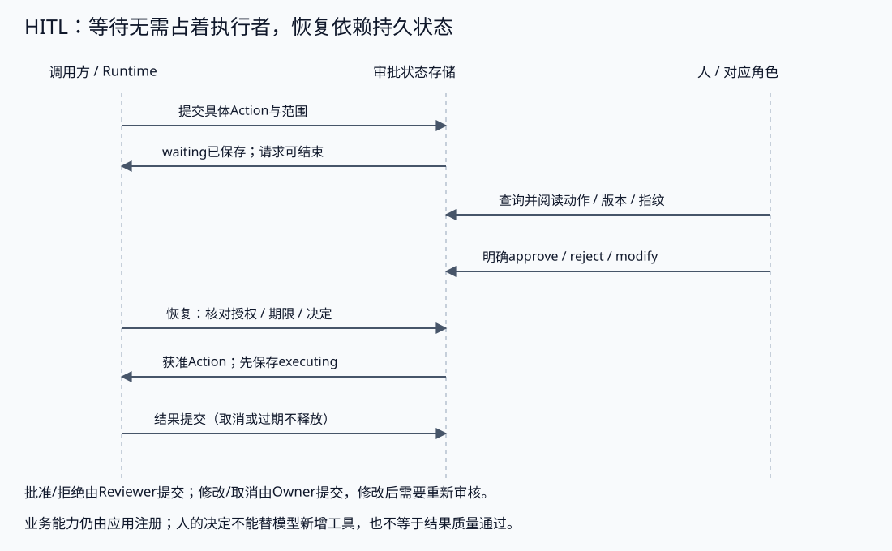

# Human Approval：持久等待与动作绑定

批准一份具体只读动作，程序结束后仍可查询、决定和恢复。先从[工具接入与受控行动](../../../../book/part3-agent/building/chapter23-actions.md#topic-agent-hitl)理解审批契约；实现进阶参考[故障恢复](../../../../book/part3-agent/runtime/chapter29-execution.md#topic-agent-checkpoint)和[权限治理](../../../../book/part3-agent/governance/chapter36-security.md)。标准库、真实私有文件、固定只读Reader，不调用模型、网络或业务写工具。

## 契约

- 一个私有目录对应一个Run/审批，固定approval.json与writer.lock，目录不由模型决定。NewStore拒绝对其他用户开放的目录；文件0600，目录0700，os.Root约束文件操作。
- 应用可信Policy提供Owner/Reviewer/Run/版本和资料ID清单；Scope是演示身份，CLI按显式操作选择角色，不提供生产认证。不能把Decide当作模型工具注册。
- fingerprint绑定Run、Owner、Reviewer、Revision、PolicyVersion、Action、ExpiresAt。SHA256是快照一致性标记，不是MAC/签名，不防护已有状态目录写权限的攻击者。
- approve/reject由Reviewer明确调用；modify/cancel由Owner调用。修改回waiting、递增版本、清除决定并产生新指纹，不延长原期限、不重置执行尝试。批准不能增加未注册工具或文档权限。
- Resume重新检查当前权限、期限与审批版本，先保存executing才调用Reader；结果返回后复核停止/撤销/过期、限制4096字节，再保存终态。异常时不返回正文；未授权不返回审批快照。
- 上游与Reader子context取消/超时按标准错误分类，包装中的诊断不公开；canceled与failed/deadline_exceeded分别保存，不混同审批expired。TestDownstreamContextFailureIsNotGenericReaderFailure验证晚到正文为空、终态/尝试持久且私有诊断不释放。
- 最多2次执行、32次修订、32个有界审计事件；执行前为开始和结果事件保留位置。重复同一决定与已完成恢复不重复读取。
- 原子写采用临时文件Sync、Rename、目录Sync；等待人时不持有writer.lock。Reader执行期间独占本机写者，其他修改返回busy；执行中取消通过调用方context，不能抢占忽略context的函数。
- 文件检查/审批TTL不是跨实例租约。硬退出遗留锁只有确认原进程终止后才能由操作者移除；重启后executing是结果未知。只有显式retry-readonly、当前权限和剩余尝试允许重读。
- Revoke是本实例即时撤销；重启后必须从可信权限源加载新Policy/version，不能用旧策略文件代替当前授权。History保留Actor/版本/指纹/状态/时间，是教学审计，不是防篡改日志。

## 实际CLI流程

从仓库根目录执行；工具与依赖见[运行说明](../../../../book/introduction.md#running-examples)。下面使用任务专用变量，目录位于临时空间，不提交状态文件：

```bash
approval_state_dir=$(mktemp -d /tmp/ai-hitl.XXXXXX)
go -C labs run ./part3-agent/chapter33/human-approval -dir "$approval_state_dir" -action create
go -C labs run ./part3-agent/chapter33/human-approval -dir "$approval_state_dir" -action show
```

应显示waiting、Revision=1、read_document/guide、演示Owner/Reviewer、PolicyVersion与Fingerprint，Output为空。命令已经结束，没有goroutine等你确认。有效期默认10分钟；waiting是持久阶段，是否过期还要判断ExpiresAt。

**先阅读动作与范围，再复制打印的指纹**，用明确输入作决定：

```bash
go -C labs run ./part3-agent/chapter33/human-approval -dir "$approval_state_dir" \
  -action approve -revision 1 -fingerprint '<刚才阅读的指纹>'
go -C labs run ./part3-agent/chapter33/human-approval -dir "$approval_state_dir" \
  -action resume -revision 1 -fingerprint '<同一指纹>'
```

批准以后state=approved；恢复以后state=completed、Attempts=1、Output="Original readonly guide."。相同恢复再次调用不读第二次。把指纹写错或用旧版本应失败，不自动替你读取当前指纹然后批准。

拒绝、修改和取消也必须使用当前指纹：

```bash
# 在新的waiting目录中任选一条，不把已完成请求重新批准。
go -C labs run ./part3-agent/chapter33/human-approval -dir "$approval_state_dir" \
  -action reject -revision 1 -fingerprint '<当前指纹>'
go -C labs run ./part3-agent/chapter33/human-approval -dir "$approval_state_dir" \
  -action modify -document alternate -revision 1 -fingerprint '<当前指纹>'
go -C labs run ./part3-agent/chapter33/human-approval -dir "$approval_state_dir" \
  -action cancel -revision 1 -fingerprint '<当前指纹>'
```

modify得到Revision=2与新指纹，需要重新阅读再批准；旧确认无效。删除、发送等动作不在注册范围，即使人提出也不可执行。生产界面可选择“修改并确认”的组合决策，本实验保守地分成修改与再次批准。

## 验证

```bash
go -C labs test ./part3-agent/chapter33/human-approval -race -count=1 -v
```

应全部PASS：私有文件重开仍waiting、无批准不读取、正确批准/重复恢复一次、修改失效、角色/范围/版本/期限、撤销或取消时丢弃迟到输出、并发写者与重复决定、拒绝不暴露快照、指纹一致性与有界记录。

硬退出测试运行测试二进制子进程，在读完资料但结果尚未保存时exit42；父测试确认该子进程退出以后移除自己的临时锁，验证默认恢复拒绝、显式只读重读且Attempts不清零。测试不证明崩溃窗口exactly-once、远程接管或有副作用工具可重试。

## 练习

| 任务 | 起点与提示 | 边界与验证 |
| --- | --- | --- |
| 修改与旧确认 | 新建waiting，批准后修改document，再用旧指纹 | 原确认拒绝；新请求重审；未允许文档拒绝 |
| 权限版本更新 | 重开Store传policy-v2，保留原审批文件 | 旧批准不执行；Owner修改为当前策略需要新指纹/新确认 |
| 过期与等待 | 创建短TTL并延后决定，查看记录 | 不执行Reader；waiting不等于永远有效；不通过更新自动延长期限 |
| 表单投影 | 将Record转成审批DTO | 展示实际动作、目标、Actor、期限和代价；隐藏内部诊断，不展示未经校验的模型HTML |
| 批量决定 | 在副本设计多个审批ID与部分拒绝 | 决策绑定稳定ID与版本，不仅按数组顺序；每个动作独立检查 |

### 迁移：批量审批不能按数组位置配对

在独立副本中从[Policy、Record和Decide](main.go)及[原有修改/决定测试](main_test.go)开始。为两个审批准备不同的可信Run和各自私有目录，继续复用单审批Store。一个目标为guide，另一个为alternate；Reviewer对其中一项批准、另一项拒绝。

先把决定数组顺序反转，预测“第一个决定给第一个Store”的做法会出什么错。为批量入口设计带稳定审批ID、Revision和Fingerprint的决定记录，按身份关联到对应Store，再调用其原有角色、范围和版本检查。部分成功/拒绝分别返回，不声明两个独立文件形成了原子事务，也不新增模型可调用的Decide工具。

完成后自行添加`TestExerciseBatchApprovalIdentity`，验证：

1. 决定顺序反转仍作用于正确审批；批准项只允许既定只读动作，拒绝项不执行Reader。
2. 重复或未知审批ID不能被悄悄覆盖/忽略；每个返回结果指明实际目标，不能只给总体success。
3. 批量输入形成后修改其中一项，旧版本/指纹对该项失败，另一项的结果不被冒称为回滚或全成功。
4. 角色、文档与策略版本仍由可信应用提供；旧确认、越权决定和模型请求不能扩大权限。

先用`go test -list`确认测试存在，再运行新测试及原修改/并发决定测试。从新临时目录重做一次，说明批量协调负责哪些关联，单Store仍负责哪些检查。指纹不是身份认证，读取后的撤销也不能追回已经处理的数据。

写好新测试后，在副本的仓库根目录执行；第一条必须列出新测试名，不能把未创建的练习当成已验证：

```bash
go -C labs test ./part3-agent/chapter33/human-approval -list '^TestExerciseBatchApprovalIdentity$'
go -C labs test ./part3-agent/chapter33/human-approval \
  -run 'TestExerciseBatchApprovalIdentity|TestModifyInvalidatesApprovalAndCannotExpandPolicy|TestConcurrentDecisionsAndBusyWriter' -race -count=1 -v
```

## 来源与许可

原创实现与图示，MIT。教学结构参考[Deep Agents HITL](https://github.com/datawhalechina/deepagents-in-action/blob/main/content/ch09-human-in-the-loop.md)，框架恢复语义见[LangGraph interrupts](https://docs.langchain.com/oss/python/langgraph/interrupts)。本Lab不是这些API的Go移植，未复制其代码或图片。

<a id="book-agent-hitl-等待存储状态不占着一个goroutine"></a>

## 等待存储状态，不占着一个goroutine

## 等待存储状态，不占着一个goroutine

人可能几分钟以后才决定，程序也可能重启。将等待实现成一个长时间阻塞的函数，会占用请求、连接和执行资源，也容易让任务跟随客户端断开消失。

暂停应先保存待审动作和继续位置，再返回waiting；查询与决定通过后续调用进入，恢复读取同一份状态。本实验使用真实私有文件，等待时没有进程持有writer.lock，也没有goroutine等待输入。



保存使用临时文件、Sync、Rename和目录Sync，文件0600、目录0700，os.Root约束文件名。它是本机可信单写者实验，不是数据库事务、远程租约或对断电/所有文件系统的保证。

等待期限与执行超时不同：ExpiresAt限制决定和恢复仍可接受的窗口；Reader执行还需要调用方context和下游时限。持久waiting不会随着时钟自动改状态，界面判断有效性必须看期限，不能让“waiting”意味着永远可批准。

框架中的interrupt也通常不是保存CPU指令位置。恢复可能重新进入某个节点，因此中断前后的重复动作和提交窗口必须按框架契约处理。持久化记录不自动保证所有工具只执行一次。

前面处理的是“等待要不要占住执行者”。接下来才看真正的决定入口：一条 approve / reject 请求在保存前要核对哪些版本、身份和权限条件。


<a id="book-agent-hitl-执行超时与审批到期分别记录"></a>

## 执行超时与审批到期分别记录

### 执行超时与审批到期分别记录

Reader可能使用自己的子context。即使恢复调用的外层context还有效，子请求仍可能返回包装后的Canceled或DeadlineExceeded；这些信号需要安全分类，不能都变成普通reader_failed。

| 返回边界的条件 | 保存状态与原因 | 调用方得到什么 |
| --- | --- | --- |
| 上游或下游取消 | canceled / canceled | context.Canceled，正文为空 |
| 上游或下游执行超时 | failed / deadline_exceeded | context.DeadlineExceeded，正文为空 |
| 审批期限已过 | expired / expired | ErrExpired，不把它混成执行超时 |
| 权限失效 | failed / authorization_changed | ErrDenied，不释放结果 |
| 普通Reader错误或无效输出 | failed / 稳定失败码 | 公开分类，不返回原始诊断与残余正文 |

Context错误按errors.Is识别，公开返回只保留安全的标准类别，包装中的内部信息不进入记录或结果。终态和已发生尝试保存以后，调用方才能决定重查、重新审批或按明确恢复策略处理；超时不证明Reader或外部动作从未执行。

撤销在本实例用即时标记模拟；跨重启需要从可信权限源加载当前策略版本。把旧审批文件里的许可当作当前权限，会让已经撤销的批准再次生效。Owner可以在新的允许范围内修改并重审，不能自动沿用原确认。

前面讲的是批准后的恢复还能不能继续执行。最后还要面对最难的窗口：动作已经跑完，但结果还没提交，这时“曾经批准过”并不能回答到底要不要重做。


<a id="book-agent-hitl-最佳实践"></a>

## 最佳实践

## 最佳实践

- **只让人判断必要问题**：自动校验和拒绝仍强制执行，避免将所有安全责任变成弹窗。
- **展示并绑定真实动作**：目标、参数、范围、版本与代价对应，模型摘要不能代替可审核内容。
- **等待可退出，恢复有归属**：先保存再返回，确认、查询和执行使用同一状态身份。
- **修改与过期都失效旧确认**：不自动刷新指纹后批准，不用重复重试改变决定含义。
- **保持三层验证**：先检查审批契约，再检查存储/恢复，最后对接框架、真实身份与用户界面。


<a id="book-agent-hitl-常见问题排查"></a>

## 常见问题排查

## 常见问题排查

| 现象 | 定位顺序 | 原因与处理 |
| --- | --- | --- |
| 没有批准却执行Reader | 领取前状态 → 执行入口 → 是否把Decide挂给模型 | 审批路径被绕过；只有经过版本/权限校验的approved可继续 |
| 人看A，实际读取B | 参数快照 → 版本/指纹 → 修改流程 | 复用了旧确认；更新回waiting并重审 |
| 刷新后审批丢失 | 持久保存 → Run/目录身份 → 查询授权 | 状态只在内存或连错任务；先验证重开文件仍可查询 |
| 已同意却被拒绝恢复 | 当前权限、策略版本、期限与状态 | 合理失效或并发变化；重查并在当前范围内重审，不默认绕过 |
| 重新启动重复读取 | executing窗口 → 写者归属 → 只读/幂等策略 | 把未提交当作未执行；结果未知需要明确恢复选择 |
| 文件锁一直存在 | 实际进程状态 → 操作者确认 → 恢复步骤 | 硬退出遗留归属；不按锁年龄自动抢占 |

测试用演示身份与固定Reader检验机制，CLI操作由调用方明确输入；这不证明真实人员已审阅、身份提供方安全或用户体验已经通过。真人试学与产品审查另留实际反馈。

